<p align="center">
  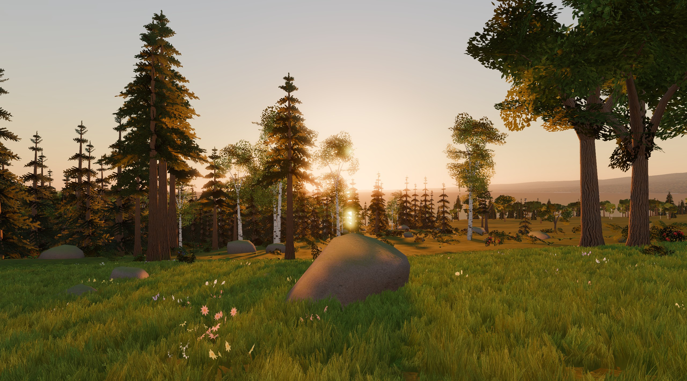
</p>

<h1 align="center">HOLLOW UNIVERSE</h1>

<p align="center">
  <b>Survive on real planets in a full-scale Milky Way.</b><br>
  Gather, build, raid and fight on worlds made from a living galaxy, then build a ship and leave the ground behind.<br>
  About 120 billion star systems are waiting.
</p>

<p align="center">
  <i>Online survival · full-loot PvP · base building and raiding · ships · a 1:1 galaxy</i><br>
  <i>Godot 4.7 · C# / .NET 10 · dedicated server · in development (pre-alpha)</i>
</p>

<p align="center"><sub>You are on <code>main</code> (milestone 1, the galaxy). The game described here, with its server and ground game, is on the <a href="https://github.com/uruskan/Hollow-Universe/tree/ground"><code>ground</code></a> branch.</sub></p>

---

Hollow Universe is an online survival game with the scale of a real galaxy. You arrive on a beach with a rock and a
torch. You chop trees, mine ore, craft tools and build a base that other players can, and will, try to blow open.
You learn your rifle's recoil, defend what you've built, and one day you craft a small ship at the vehicle workbench
and fly it to orbit. Above you is the night sky of a real galaxy, where every star is a place you can go.

It plays like the survival games you already know, on a planet that's a real place and inside a galaxy too big to finish.

## Every star is a place

<p align="center">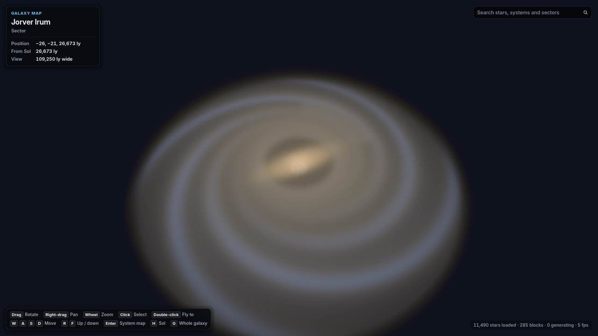</p>

- **A 1:1 Milky Way.** A thin, thick and young disk, four spiral arms and a spur, a barred bulge, a nuclear disk and a
  halo: about **1.2 × 10¹¹ star systems**, generated on demand from one seed. Every system has a permanent address and a
  name.
- **Real stars around Sol.** About 100,000 stars from the HYG catalogue keep their real names and places: Sirius,
  Betelgeuse, Alpha Centauri, Trappist-1.
- **Whole systems.** Companion stars, planets, moons, rings and belts on orbits that move in real time; planets with
  climate, oceans, air you can or can't breathe, and life.
- **The same universe for everyone.** Generation is deterministic to the bit on every machine, so the galaxy needs no
  download and never disagrees with itself.

| | |
|---|---|
| 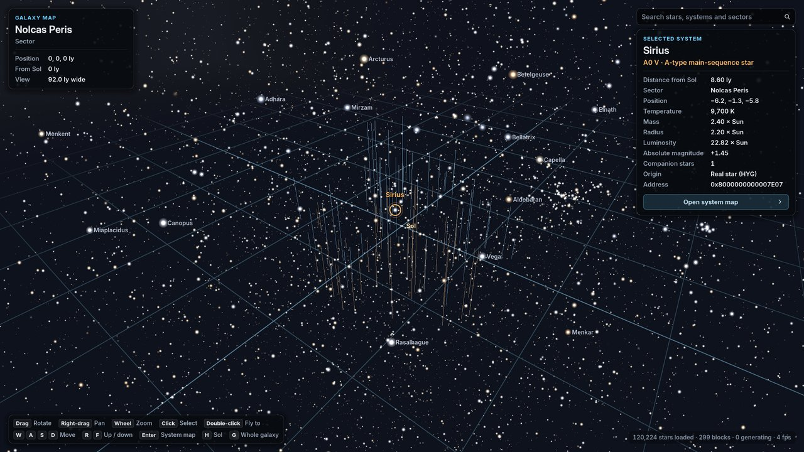 | 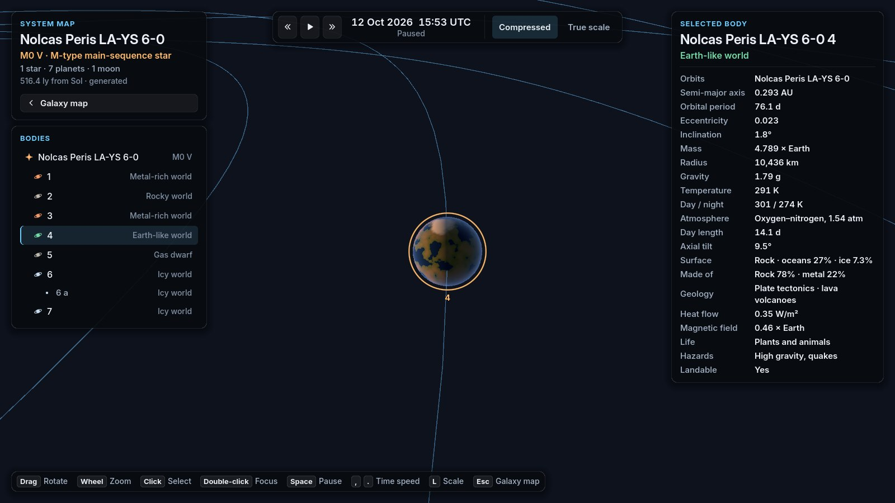 |

## Land somewhere real

<p align="center">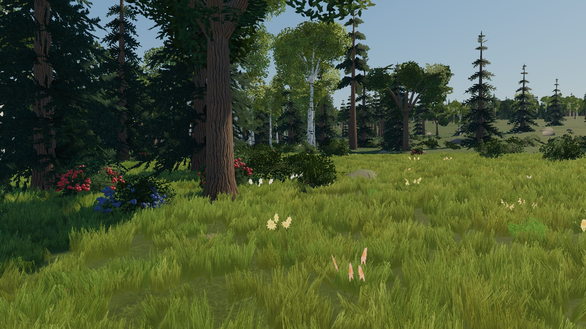</p>

The first world is **Nolcas Peris CQ-SLY 7-0 B 3**, a real planet of the generated galaxy, 331 light years from Sol.
It's an Earth-like world under an F-type sun, with thick, breathable air that turns distances blue, oceans, forested
hills, a moon that looks 1.7 times as wide as ours, and a 35-hour day (compressed for play).

- **Terrain to the horizon,** sea and surf, a sky lit by the real sun and moon at the real time.
- **Forests grown in code:** birches, oaks, spruces, ferns and berry bushes, painted and built procedurally, with
  shader grass around you that moves in the wind.
- **At night, the galaxy overhead** is the same galaxy you'll travel through.

| | |
|---|---|
| 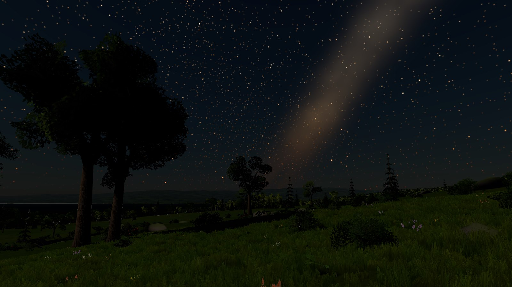 | 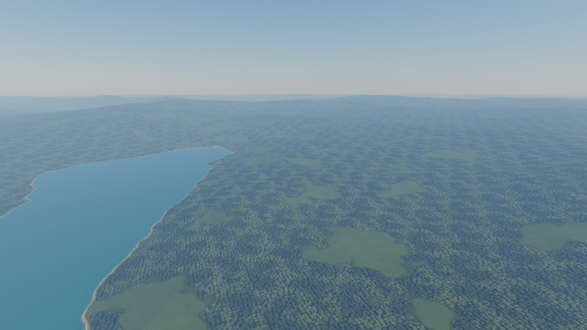 |

## Survive. Build. Raid.

| | |
|---|---|
| 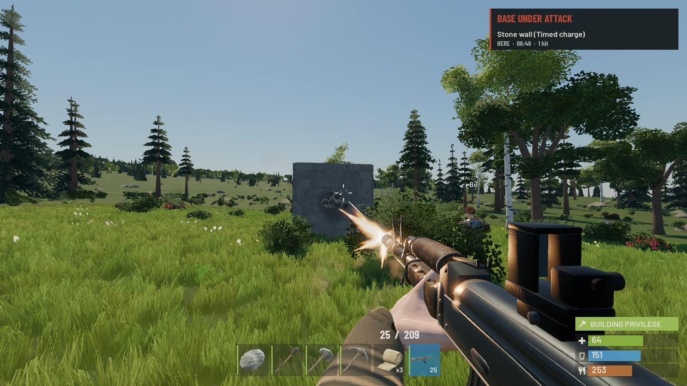 | 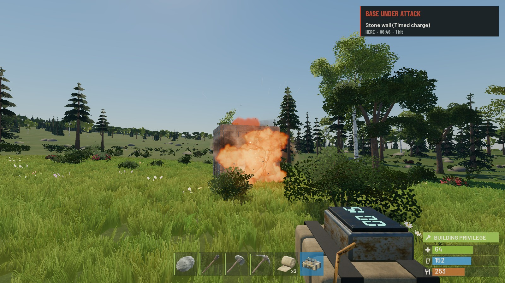 |
| 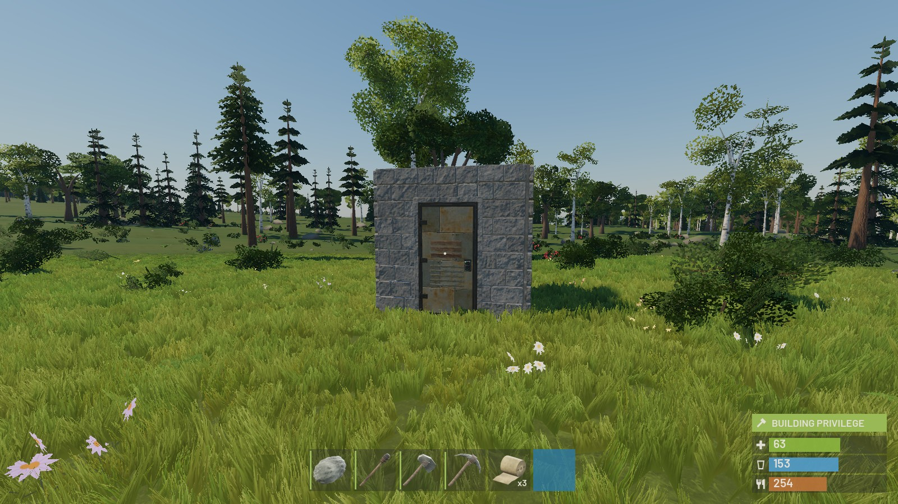 | 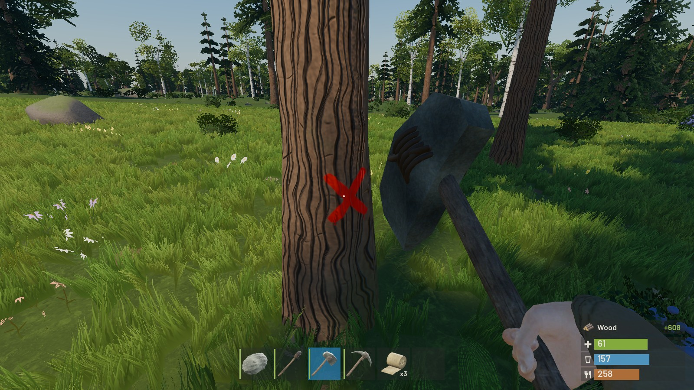 |

- **Gather with skill.** Hit the red X on a tree or the glinting hotspot on an ore outcrop and you gather faster.
  Trees fall, outcrops crack apart stage by stage.
- **Craft and progress.** Tools, clothing, armour, medicine, workbenches, a tech tree, blueprints, a research table
  and a recycler that turns salvage into components.
- **Build bases that hold, until they don't.** Foundations, walls, floors, stairs and roofs in twig, wood, stone,
  metal and armoured grades, with structural stability, doors, key and code locks, and a tool cupboard for building
  rights and upkeep. Place furnaces, boxes and beds with a hologram that tells you why something won't fit.
- **Fight for real.** Bullets fly with drop and drag, aimed by server-side lag compensation. Every gun has a fixed,
  learnable recoil pattern. Armour covers what it covers. Players go down wounded before they die, and teammates can
  pick them up.
- **Raid.** Timed charges, satchel-style bag charges that sometimes fizzle, grenades, rockets and explosive rounds,
  balanced against every wall grade. Broken walls, doors and boxes burst into pieces.
- **Full loot.** What you carry, someone can take. Sleepers stay in the world when you log off.
- **Teams, a map, raid alerts** that reach you even offline, and a Rust-style F1 console.

## Wildlife

<p align="center">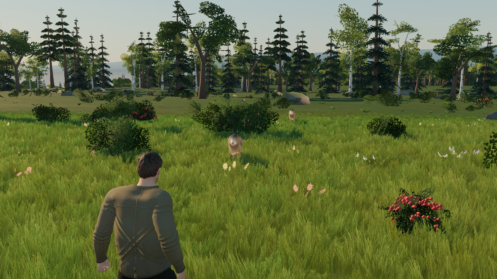</p>

Deer that flee, boar that charge, wolf packs that hunt when they're hungry, and a rare, very large predator. Hunt them
for meat, hide, bone and fat. Cook your meat, or don't, and live with it.

## Build a ship. Leave.

<p align="center">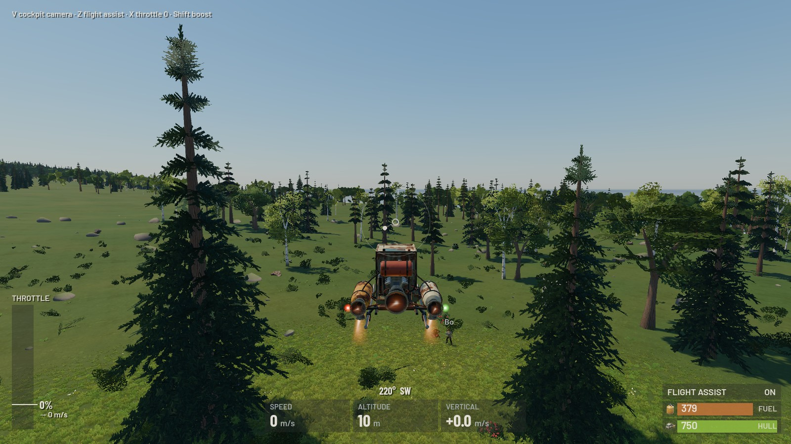</p>

The **Tin Finch** is a one-seat skiff you build at the vehicle workbench. Board it through its hatch and fly it from
the cockpit or a chase camera, with flight assist, boost and a fuel tank to watch. Land on slopes, hover over the
trees, and climb to orbit. Ships are the first step toward the rest of the galaxy.

## Built to scale

Hollow is built as a big online game from its first line.

- **A dedicated server** in plain .NET runs each region of a planet at 30 ticks a second, with its own physics (Jolt),
  and saves the world in SQLite. A hosted game runs the same server on your machine.
- **Prediction that matches the server.** The client runs the same rules library as the server. Its movement
  prediction replays to the server's result bit for bit, so corrections are rare even on a bad connection.
- **Lean networking:** generated serializers, per-client delta snapshots, relevance by distance, and load tests with
  100 bot players gathering, building, raiding, flying and fighting.
- **One system per concern.** Interaction, placement, held items, damage and destruction are each built once and
  driven by data, so new content is a data entry, not new code paths.
- **Original content.** Every model is our own, made by our own scripts; sounds, textures and fonts are our own or
  properly licensed (CC0, OFL, Fab), each listed with its source. Nothing comes from another game.

## Where it stands

Hollow Universe is **in development** and not released. What you can play today:

- the galaxy map and system maps of the whole Milky Way;
- the ground game on the first world, hosted or joined over the network: gathering, crafting, building, raiding, guns,
  bows and melee, animals, the economy and tech tree, teams, the map, and the Tin Finch.

**Next:**
- monuments to loot, with guards and radiation;
- more of each planet, then other planets and the moon through supercruise;
- travel between star systems with a built-in route autopilot;
- the galaxy map's new design.

## Play the current build

**Requirements:** Windows, **Godot 4.7.2 .NET** (the "Godot Engine - .NET" download)
and the **.NET 10 SDK**.

```bat
play-ground.cmd                 :: build, then host a game on this computer (port 27015)
play-ground.cmd join [address]  :: build, then join a game as another player (default 127.0.0.1)
play-ground.cmd menu            :: build, then open the main menu
```

Set `GODOT` to the Godot executable if it isn't where the script looks. The first launch imports the assets, then the
loading screen takes you in.

**On foot:** W A S D move · Shift sprint · Ctrl crouch · Space jump · mouse look · hold **Left Alt** to look around ·
left mouse attack, use or place · right mouse aim (hold with the building plan or hammer for its wheel) · **R**
reload (hold for the ammo menu) · **E** interact (hold for every option) · 1–6 belt · Tab inventory · Q crafting ·
G map · Enter chat · F1 console · Esc menu.

**Flying:** the mouse is the stick · W/S throttle · A/D strafe · Space/C up and down · Q/E roll · Shift boost ·
Z flight assist · V cockpit or chase camera · F step out.

**Galaxy and system maps:** open `game/project.godot` in Godot and press Play. On the galaxy map, left-drag rotates,
right-drag or W A S D moves, R/F go up and down, the wheel zooms, a click selects a star, a double-click flies to it,
Enter opens its system, H and G return to Sol and to the whole galaxy, and the search box finds real names ("Sirius",
"61 Cygni"), generated systems ("Nolcas Peris BF-BA 5-0") and sectors. On the system map, the wheel zooms, a click
selects a body, Space pauses, `,` and `.` change the time's speed, L switches between compressed and true scale.

From a terminal:

```bash
dotnet build HollowUniverse.sln                  # the libraries, the server, the tests and the Godot client's C#
dotnet run --project tests/Hollow.Tests          # all engine-free tests
dotnet run --project src/Hollow.Server -- --port 27015   # a dedicated server
```

## For developers

- [AGENTS.md](https://github.com/uruskan/Hollow-Universe/blob/ground/AGENTS.md): the rules, every command and option, and the repository's layout, for people and AI agents.
- [docs/handoff-ground.md](https://github.com/uruskan/Hollow-Universe/blob/ground/docs/handoff-ground.md): where development stands and what comes next.
- [docs/GAME_DESIGN.md](https://github.com/uruskan/Hollow-Universe/blob/ground/docs/GAME_DESIGN.md), [docs/ARCHITECTURE.md](https://github.com/uruskan/Hollow-Universe/blob/ground/docs/ARCHITECTURE.md),
  [docs/GALAXY.md](https://github.com/uruskan/Hollow-Universe/blob/ground/docs/GALAXY.md), [docs/GROUND.md](https://github.com/uruskan/Hollow-Universe/blob/ground/docs/GROUND.md) and
  [docs/GROUND_SYSTEMS.md](https://github.com/uruskan/Hollow-Universe/blob/ground/docs/GROUND_SYSTEMS.md): the design and how it's built.

Nothing in `src/` depends on Godot: the rules, the simulation, the network and the server are plain .NET, shared by the
server, the client and the test bots.

**Exporting:** the star catalogue is a plain data file. In an export preset, add `data/catalog/*.gz` under
**Resources → Filters to export non-resource files/folders**, or the exported game shows no real stars near Sol.

## Credits and licences

- Star data: the [HYG Database](https://github.com/astronexus/HYG-Database) v4.1 by David Nash (astronexus), under
  [CC BY-SA 4.0](https://creativecommons.org/licenses/by-sa/4.0/); the converted `game/data/catalog/hyg41.bin.gz` is
  shared under the same licence ([its licence file](https://github.com/uruskan/Hollow-Universe/blob/ground/game/data/catalog/LICENSE.md) lists the changes).
- Real orbital elements of the planets: NASA JPL approximate positions of the planets (J2000).
- Fonts: [Inter](https://github.com/rsms/inter) and [Barlow](https://github.com/jpt/barlow), under the SIL Open Font
  License 1.1.
- Characters: the [MakeHuman](http://www.makehumancommunity.org/) base mesh and assets (CC0), animations from
  Quaternius' Universal Animation Library 1 and 2 (CC0), retargeted and dressed by our own scripts.
- Sounds, textures and other third-party material, each with its source, licence and checksum:
  [game/assets/THIRD_PARTY.md](https://github.com/uruskan/Hollow-Universe/blob/ground/game/assets/THIRD_PARTY.md).
- Everything else, including the generated universe and every model made by the scripts in `art/`, is original. The
  code has no licence yet, so all rights are reserved until one is chosen.
