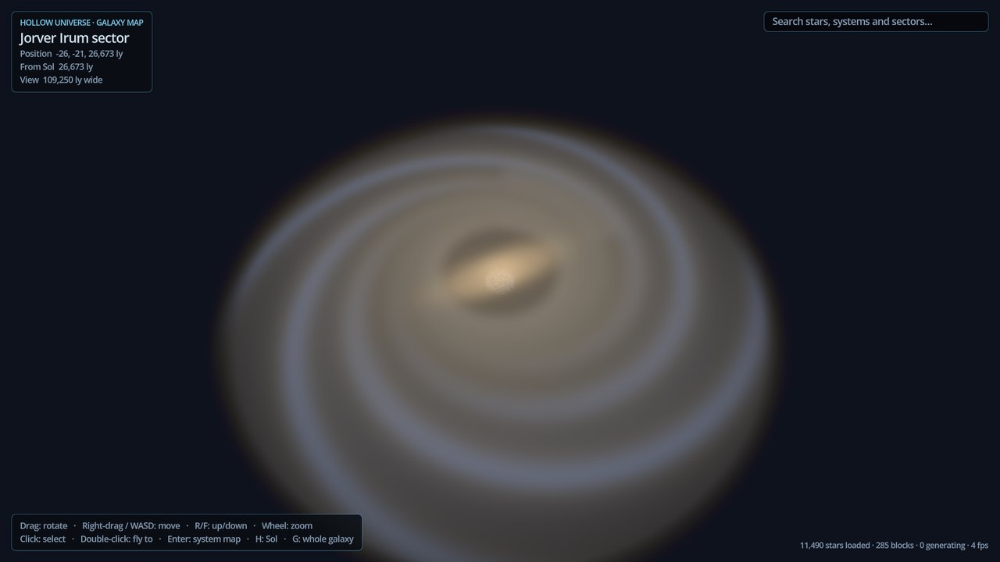
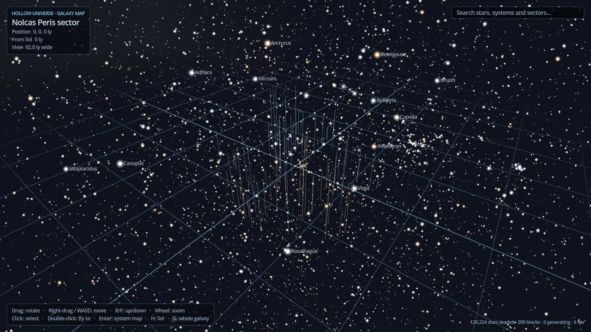
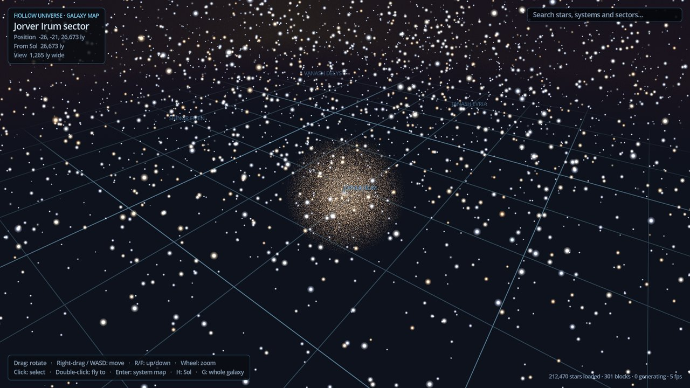
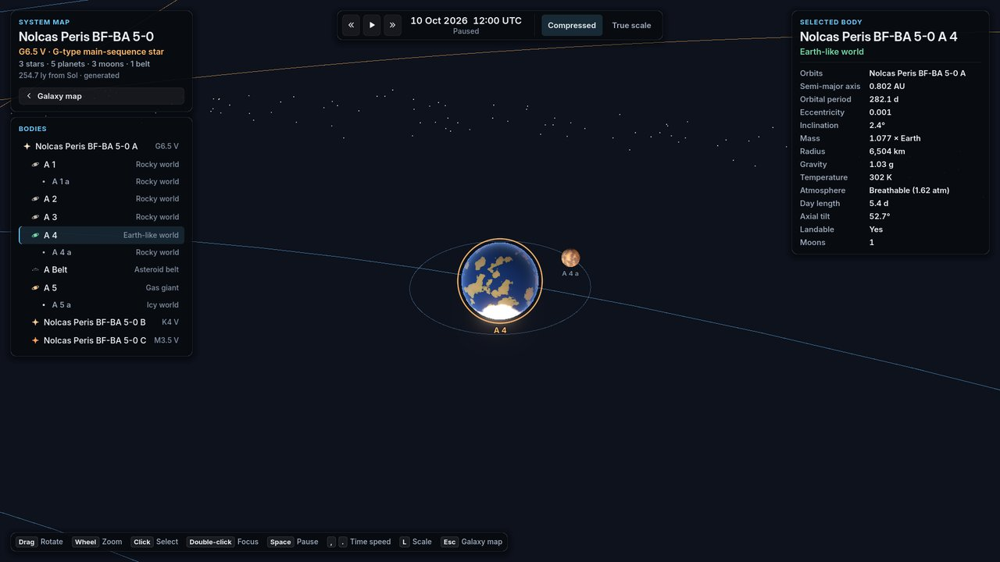
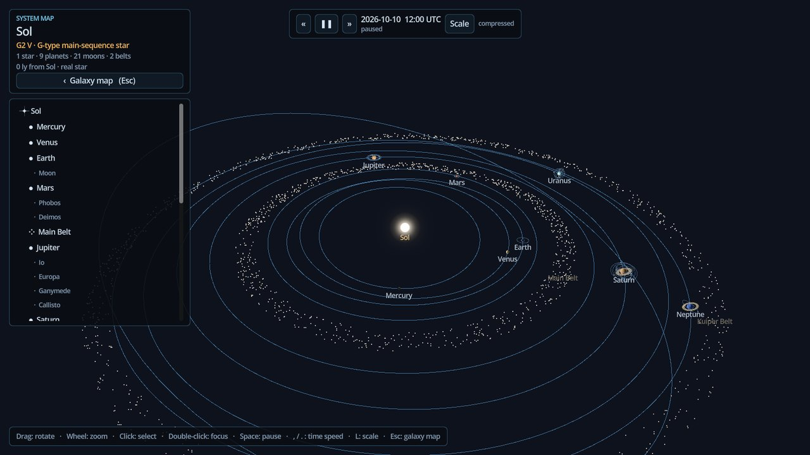

# Hollow Universe

An online survival game in a full-scale Milky Way: Rust-style building, raiding and full-loot PvP on procedural
planets, with Elite-style ships and travel between about 120 billion star systems. Built with Godot 4 and C#.

The `main` branch is at **milestone M1, the galaxy**; development continues on the `ground` branch (the networked
Rust-style ground game on the first world: see that branch's `docs/handoff-ground.md`). This branch contains the deterministic galaxy generator, real stars
near Sol, the galaxy map and the system map. Networking (M2) comes next. See [the milestones](docs/ARCHITECTURE.md#17-milestones).



| | |
|---|---|
|  |  |
|  |  |

## What's here

- **A 1:1 Milky Way.** A density model with a thin, thick and young disk, four spiral arms and a spur, a
  barred bulge, a nuclear disk and a halo. It holds about 1.2 × 10¹¹ systems, generated on demand from a seed.
  Every system has a permanent 64-bit address and a name.
- **Real stars near Sol.** About 100,000 stars from the HYG catalogue, with their real names, replace the
  generated ones where the catalogue is complete.
- **Star systems.** Companion stars, planets, moons, rings and belts, on Keplerian orbits that move in real
  time. Sol uses real orbital data.
- **Deterministic everywhere.** The same seed gives bit-identical stars and systems on every machine. Tests
  pin the output with golden hashes.
- **Galaxy map.** Stars stream in around the focus within a star budget. It shows sector names, a grid,
  search by any name, and works from 1 ly up to the whole galaxy.
- **System map.** An orrery with a compressed or true scale, body data and time controls.
- **A crisp interface at any resolution.** Text, icons and panels are drawn at the screen's real pixel size
  rather than stretched (see [ARCHITECTURE.md §15](docs/ARCHITECTURE.md#15-client-godot)).

## Requirements

- **Godot 4.7.2, .NET edition** (the "Godot Engine - .NET" download, not the standard one).
- **.NET 10 SDK.**

## Run it

1. Open `game/project.godot` in Godot 4.7.2 .NET. The first time, Godot imports the assets and builds the C#
   solution.
2. Press **Play** (F5).

From a terminal:

```bash
dotnet build HollowUniverse.sln                  # the libraries, the tests and the Godot client's C#
dotnet run --project tests/Hollow.Tests          # all engine-free tests
dotnet run --project tests/Hollow.Tests -- Galaxy   # only tests whose name contains "Galaxy"
```

## Controls

**Galaxy map**

| Input | Action |
|---|---|
| Left-drag | Rotate |
| Right-drag, or W A S D | Move |
| R / F | Move up / down |
| Mouse wheel | Zoom |
| Click | Select a star |
| Double-click | Fly to a star |
| Enter | Open the selected star's system map |
| H / G | Back to Sol / the whole galaxy |
| Esc | Clear the selection and search |

The search box finds real star names ("Sirius", "Betelgeuse", "61 Cygni", "HD 10700"), generated system
names ("Nolcas Peris BF-BA 5-0") and sector names ("Nolcas Peris").

**System map**

| Input | Action |
|---|---|
| Left-drag | Rotate |
| Mouse wheel | Zoom |
| Click / double-click | Select / focus a body |
| Space | Pause |
| , / . | Slower / faster time |
| L | Switch between compressed and true scale |
| Esc | Back to the galaxy map |

**Anywhere:** Ctrl + plus / Ctrl + minus make the interface larger or smaller, and Ctrl + 0 resets it. The
interface also follows the window on its own: the same size from 1600 × 900 up to 1080p, larger above that, and
smaller only to fit a smaller window. Your setting is applied on top (as far as the window has room) and saved
between sessions.

## Layout

| Path | What |
|---|---|
| `src/Hollow.Core` | Double-precision vectors, deterministic maths (`DMath`), hashing, random streams, units, time |
| `src/Hollow.Galaxy` | Density model, addresses, sectors, cells, the star catalogue, names, star systems |
| `game/` | The Godot project: galaxy map, system map, user interface, shaders |
| `tests/Hollow.Tests` | Test runner and tests (no NuGet packages needed) |
| `tools/Hollow.CatalogBuilder` | Converts the HYG star catalogue into `game/data/catalog/hyg41.bin.gz` |
| `docs/` | Design and architecture |

Nothing in `src/` depends on Godot. The future server will use the same libraries.

## Documents

- [GAME_DESIGN.md](docs/GAME_DESIGN.md): what the game is.
- [ARCHITECTURE.md](docs/ARCHITECTURE.md): how it's built, including networking, zones and persistence.
- [GALAXY.md](docs/GALAXY.md): the galaxy generator and the maps.
- [AGENTS.md](AGENTS.md): rules and commands for anyone working on the code, people or AI agents.

## Exporting

The star catalogue is a plain data file, not a Godot resource. When you create an export preset, add
`data/catalog/*.gz` under **Resources → Filters to export non-resource files/folders**. Without it, the exported
game logs an error and shows no real stars near Sol.

## Credits and licences

- Star data: the [HYG Database](https://github.com/astronexus/HYG-Database) v4.1 by David Nash (astronexus),
  licensed under [CC BY-SA 4.0](https://creativecommons.org/licenses/by-sa/4.0/). The converted file
  `game/data/catalog/hyg41.bin.gz` is shared under the same licence. See
  [its licence file](game/data/catalog/LICENSE.md) for the changes made.
- Real orbital elements of the planets: NASA JPL approximate positions of the planets (J2000).
- Interface font: [Inter](https://github.com/rsms/inter) by Rasmus Andersson and contributors, under the
  [SIL Open Font License 1.1](game/assets/fonts/Inter/OFL.txt).
- Everything else, including sector names and generated content, is original. The code has no licence yet,
  so all rights are reserved until one is chosen.
