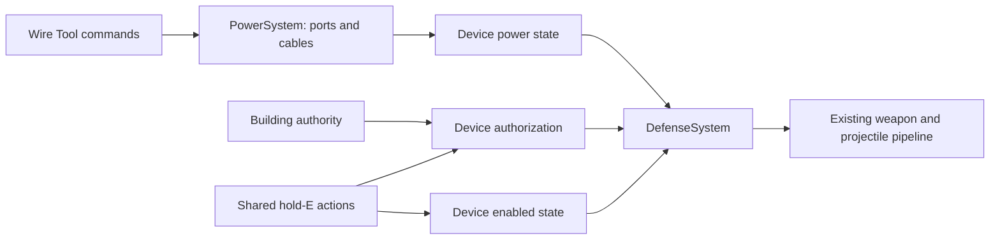

# Electricity and device authorization

Architecture and first implementation, **18 October 2026**. The owner subsequently
authorized implementation. The shared graph, authorization policy, Wire Tool, device
migration, persistence and network integration are implemented. Validation and remaining
limits are recorded in DEVELOPMENT.md; the acceptance matrix below is a target, not a
claim that every listed visual/performance scenario has been exercised.

[DESIGN.md](DESIGN.md) ELEC-01–03 and AUTH-01 contain the confirmed requirements.
Sections 2–3 preserve the pre-migration audit. Later proposals remain proposals unless
the implementation choices below explicitly select them; these are engineering defaults,
not additional user-approved balance requirements.

## Implementation choices and boundaries

- `ElectricalGraph` indexes nodes, ports, edges and support dependencies; topology edits
  rebuild affected components. Static circuits evaluate when dirty; wind/storage circuits
  evaluate on the simulation's one-second utility cadence. Immediate topology/switch
  evaluation uses zero elapsed time and cannot create stored energy.
- `PowerStats` declares generator/consumer/storage transfer profiles and stable physical
  port IDs/poses. Windmill has one output; turret/SAM have input and residual passthrough.
  Disabled or undersupplied consumers draw zero and pass the available supply onward.
  Synthetic storage contracts exist; no playable battery, solar panel or splitter is added.
- The Wire Tool uses the shared held-item registry, a bounded server draft and reliable
  intents. Click output, optional surfaces, input; right-click cancels and R disconnects
  the aimed port. Endpoints must be within 20 m, each click within 4 m; up to 32 decorative
  anchors, draft lifetime 120 seconds. Tool crafting currently costs 10 metal fragments
  and takes 5 seconds without a bench. Those limits/costs are provisional data tuning.
- Anchors use static support-local coordinates. Moving/riding supports are refused.
  Support deletion removes its decorative points; endpoint deletion disconnects the edge.
  Player, held item, reach, visibility, cube bounds and both endpoints' edit permissions
  are checked authoritatively. Failed completion leaves the draft available for retry.
- `DeviceAuthorizationSystem` resolves revocable grants, exclusions and FollowCupboard /
  ManualOnly. Clear-self excludes the caller even if TC-authorized; clear-all empties the
  device lists and persists ManualOnly. Self-authorize does not restore inheritance.
  Friendship grants do not confer configuration rights. Current enrollment/control
  requires building privilege, or ownership when unclaimed; an unclaimed fresh placer
  receives a removable explicit grant. There is no hidden owner/team immunity.
- For overlapping cupboards, the first implementation uses **all covering live cupboards**,
  matching existing building privilege. Coverage is cached per device and invalidated by
  building geometry events; membership is read live. No per-candidate authorization set
  is allocated. A spatial claim-dependency index remains a future optimization.
- SAM identity uses active pilot, otherwise authoritative ship owner; a friendly passenger
  cannot protect a hostile pilot. The same resolver protects players from auto turrets.
  Device enable/disable now controls one shared power/operation state.
- Protocol 36 / thing codec 10 persist topology and policy. Cable routes are sent only
  when changed, with static world-pose fallbacks for out-of-relevance endpoints/anchors;
  viewer access facts update independently. Cable streaming follows the input device's
  relevance. Independent streaming of a distant route segment is not implemented.
- Legacy fan-out conflicts, invalid spans and invalid records disconnect conservatively
  with startup diagnostics. Old defense state maps to power-enabled AND defense-enabled;
  FollowCupboard starts with empty lists and no new owner grant. No original-project save
  is loaded, and conversion does not create a backup/receipt file automatically.

## 1. Confirmed requirements

| Concern | Requirement |
| --- | --- |
| Structure | Shared, efficient, modular, scalable, data-driven systems; no per-item logic branches |
| Generators | Exactly one electrical output per generator, including the wind turbine |
| Batteries | Exactly one input and one output; prepare the architecture before adding the item |
| Auto Turret and SAM site | Exactly one input and one passthrough output each |
| Ports | Small physical cubes on the actual object, clicked with the Wire Tool |
| Cable creation | Click an output, optionally click world surfaces for visual cable-management anchors, then click an input |
| Range | At most **20 m between endpoint ports**; the owner explicitly rejected measuring the routed cable length |
| Anchors | Visual routing only; not electrical nodes, junctions, extra reach or power consumers |
| Expansion | Branches, splitters and combiners later; the initial representation must accommodate them |
| Default friendship | A defense in a base automatically protects people authorized on its governing Tool Cupboard |
| Local control | Hold-E radial actions to authorize yourself, clear yourself, clear everyone, enable and disable |
| Clearing | The owner explicitly requires clearing to remove **inherited cupboard protection too**, on that device |
| Existing interface | Extend the shared held-item and interaction systems; retain the ground UI |

The 20 m measurement uses the physical port positions, not the item origins. A routed
cable can therefore be longer than 20 m. Range is separate from the interaction reach
used to click a port or a surface.

## 2. Pre-migration catalogue audit

The live [deployable catalogue](../game/data/ground/deployables.json) contains three
wired electrical deployables:

| Item | Current implementation | Required topology |
| --- | --- | --- |
| Wind turbine (`windmill`) | Generation rating 100, eight logical outputs, 30 m centre-to-centre links | One physical output |
| Auto Turret (`auto-turret`) | Demand 10, installed firearm/ammunition, zero outputs | One physical input and one passthrough |
| SAM site (`sam-site`) | Demand 25, ballistic rockets against aircraft, zero outputs | One physical input and one passthrough |

These are current data ratings, not new balance approvals. Only the turret's consumption
of 10 is already a confirmed design value; its player-facing unit/time basis remains open.
Solar panels and batteries are design commitments but have no production item definitions.
Generic charge/discharge fields and synthetic storage tests already exist.

Only the turret and SAM currently make automated friend/foe targeting decisions. Related
access systems are the Tool Cupboard, key/code locks (including compound gates), and ship
crew/helm/doors/seats. They share identities and permission concepts but are not all wired
devices. Barricade contact damage currently affects everyone. Campfires, furnaces and the
large furnace burn fuel; workbenches, research machinery and recyclers do not currently
draw wired electricity. Weapon lights and ship fuel also have no wired power connection.
`batteries.json` describes cannon batteries, not electrical storage.

### Existing foundations and gaps

- [PowerSystem.cs](../src/Hollow.Simulation/Systems/PowerSystem.cs) already owns authoritative
  electrical evaluation, edit permission checks and cycle rejection. Its current solver
  pools generation, demand and stored energy across an undirected component, shutting all
  consumers down together when supply is insufficient. That cannot represent residual
  power flowing through a particular device. It also rebuilds/sorts all nodes every second
  and searches all nodes for children during component walks.
- [Interactions.Power.cs](../src/Hollow.Simulation/Capabilities/Interactions.Power.cs)
  offers output selection and connection through E menus. There is no Wire Tool, port
  identity, cable identity or routing-anchor record.
- [DefenseSystem.cs](../src/Hollow.Simulation/Systems/DefenseSystem.cs) reuses installed
  weapons, magazines, ballistics and the common projectile pipeline. However, `CanManage`
  also decides friend status, granting owner/team/TC immunity. SAM additionally exempts
  a ship with any seated friendly occupant or a ship whose crew list includes the device
  owner. These shortcuts do not implement the requested device authorization semantics.
- [WorldObjects.cs](../src/Hollow.Simulation/World/WorldObjects.cs),
  [WorldCodec.cs](../src/Hollow.Persistence/WorldCodec.cs) and
  [Messages.cs](../src/Hollow.Net/Protocol/Messages.cs) retain only one source entity per
  consumer. They preserve charge and switches but cannot describe source ports or routes.
- [compound.json](../game/data/ground/compound.json) has explicit `Power_Output` and
  `Power_Input` sockets on the relevant assets. Passthrough sockets still need authoring.
  [CompoundView.cs](../game/scripts/Ground/CompoundView.cs) draws direct sagging links,
  resolves sockets by suffix and searches remote things repeatedly; it is not the target
  cable renderer.
- Reuse `TargetRef`, support-local transforms, the held behavior registry, capability
  handlers, shared reach/sight checks, typed events, server/client modules and the existing
  interaction radial. This work does not require replacing the entity model or ground UI.

## 3. Ownership and extensibility

Keep rules in `Hollow.Simulation`; Godot draws and collects input. Keep one authoritative
owner per kind of mutable state. The following service/type names describe the proposed
boundaries, not classes that have already been added.

| Owner | Responsibility | Must not own |
| --- | --- | --- |
| Content definitions/readers | Stable ports, producer/consumer/storage/transfer profiles, authorization policy, target categories, sockets and ratings | Runtime links, charge or player lists |
| `PowerSystem` | Electrical members, port occupancy, cable records, adjacency, topology validation, directed supply and storage accounting | Friend/foe, weapon firing, Godot meshes |
| Shared wiring handler/session | Held Wire Tool actions, validated drafts, atomic connect/disconnect requests | A second graph or client-authoritative cables |
| `DeviceAuthorizationSystem` | Per-device inheritance mode, local grants/exclusions, friendship answers and revisions | Power, damage or a copied TC authorization list |
| Building authority service | Indexed claim coverage, governing cupboard identity, membership/coverage changes and building privilege | Turret-specific rules |
| Shared device access policy | Answers for configuration, authorization edits, inventory access and wiring, separately from target friendship | Implicit immunity for anyone who may manage |
| `DefenseSystem` | Active defense scheduling, candidate acquisition, shared friend filter, aiming and existing weapon execution | Its own power graph or authorization implementation |
| Server/client modules | Intent handling, relevant state replication, save/restore integration | Alternate simulation rules |
| Shared port/cable presentation | Cube meshes and picking, route preview, retained cable geometry, readable status | Power or permission decisions |

An item composes profiles. A different turbine or powered machine changes content; a new
behavior such as a splitter adds one registered transfer handler and validation. No
`if (item.Key == "sam-site")` path in wiring, permissions, rendering or persistence.
Registries validate missing/duplicate handlers at content load, outside the hot loop.
Do not add a general scripting language or migrate every unrelated device to implement
this first slice.



## 4. Ports, cables and the wiring transaction

### Definitions and durable records

- `PortDefinition`: stable definition-local ID/key, direction (`Input` or `Output`), role
  (supply, load input, passthrough, storage input/output), explicit socket/local pose,
  cube dimensions and label. Passthrough is an output with a transfer role, not a third
  connection direction. IDs survive content ordering changes.
- `PortRef`: existing stable target/entity identity plus port ID; never a display name,
  world position or transient render-node index. Resolve the target's lifetime before use.
- `CableRecord`: cable ID, output `PortRef`, input `PortRef`, ordered visual anchors and
  revision. One logical directed edge, regardless of the number of anchors.
- `RouteAnchor`: support `TargetRef` and local point, or a static terrain point in the
  planet frame. Use common transform resolution; never save floating-origin coordinates.
- `ElectricalState`: enabled demand, delivered rate, consumed rate, output budget,
  operating/brownout reason and optional stored energy. Derived values are recomputed
  from topology; stored energy and intentional control state are durable.

**Proposed initial topology:** one cable per port, output-to-input only, no self-links or
cycles, no implicit fan-out, no cross-zone links. The schema supports future multiport
devices, but installing a second cable on an occupied port does not create a splitter.
Any future combiner must account for each incoming source once; the graph remains directed.
Battery input/output does not authorize a feedback loop.

### Tool flow

1. Equip the Wire Tool through a data-declared held behavior. Point at a physical output
   cube and click. The server validates the held item, actor state, endpoint, edit rights,
   interaction reach/sight and free port, then creates a bounded draft for that player.
2. Draw a local preview and show the 20 m endpoint span from the selected output. Surface
   clicks add visual anchors. The client may preview immediately; the server resolves
   authoritative surface hits and revalidates the held tool, actor state, interaction
   reach/sight and attachment permissions on every click, plus draft size and sequence.
3. Click a physical input. In one server transaction revalidate both live ports, endpoint
   permissions, current transforms, distance, topology, anchor references and occupancy;
   then allocate/persist one cable and invalidate the affected circuit.
4. Cancel, switch away, die, disconnect or expire the draft: discard only the draft.
   Drafts are not saved, electrically active or globally replicated. An accepted link
   becomes visible to relevant clients through the normal authoritative result.

No port reservation lasting minutes: simultaneous builders may preview the same port;
the first valid commit wins and the other receives an occupied-port result. Commands
carry an idempotent sequence and expected revisions. Retransmission cannot create two
cables. Rewiring validates a proposed replacement graph without publishing intermediate
mutations; failure preserves the old connection.

Interaction reach applies to the port or anchor being clicked now. Completing a wire
does not require the player to remain within interaction reach of the first output;
that endpoint must still exist, be editable and satisfy the 20 m span to the final input.

**Proposed routing details:** click supported static surfaces, including terrain and base
pieces, with a data-configured anchor-count cap (initial candidate 32). This bounds memory,
network and mesh cost; it is not a total cable-length limit. Anchors conduct nothing, need
no rigid-body/rope simulation, and do not add collision or electrical resistance. Cable
sag is cosmetic. A cable crossing an obstacle does not gain a separate electrical rule.
Deleting an intermediate support removes that visual anchor and rebuilds the route;
deleting an endpoint removes the cable and invalidates downstream supply immediately.
Anchor selection must not authorize edits to somebody else's structure: reuse a shared
surface-attachment permission rule where the surface is claimed or owned.

Initial utility placement is already ground-only. Keep that scope for the first delivery.
Same-ship wiring can later use one rigid support frame and the same port model; different
moving frames require an explicit tether policy. Do not introduce ground-to-ship cables
incidentally. Recheck span on endpoint-transform changes, not every tick for static bases.
**Proposed movement rule:** detach a cable immediately if its resolved endpoint span
exceeds 20 m, publish the removal and invalidate downstream supply. Never keep an
over-range cable conducting. Numerical boundary tolerance is shared by preview and server.

## 5. Directed flow and predictable cost

The initial topology consists of chains. Evaluate from an upstream output toward each
input in cached topological order. Decorative anchors never enter the electrical solve.
Do not reject a physically valid connection merely because present supply is insufficient:
the device reports lack of power and can recover when supply changes.

**Proposed first behavior for a consumer with passthrough:**

```text
requested = enabled ? configured demand : 0
consumed  = incoming >= requested ? requested : 0
operating = enabled && incoming >= configured demand
outgoing  = incoming - consumed
```

Thus a device with insufficient input is inactive and passes the available power onward.
A disabled defense consumes zero and preserves passthrough. An enabled defense reserves
its normal demand even while it lacks ammunition; weapon readiness is a separate state.
These are proposed balancing/transfer rules, not additional owner-approved requirements.
They prevent a device's on/off command from silently disconnecting the rest of the base.

Example with the current provisional ratings:

| Chain | Outcome under this proposal |
| --- | --- |
| 40 supply → turret (10) → SAM (25) | Both operate; turret passes 30, SAM passes 5 |
| 30 supply → turret (10) → SAM (25) | Turret operates; SAM receives 20 and stays inactive |
| 30 supply → disabled turret → SAM (25) | Turret passes 30; SAM operates |

Generators have one supply output. Future storage has separate input/output accounting;
it is not an undirected battery contributing power to every device upstream. Define power
as a rate and capacity as energy internally, with an explicit simulation-time conversion;
the names and balance scale shown to players remain open. The storage handler must satisfy
`energyNext = energy + acceptedCharge * efficiency * dt - discharged * dt`, with bounded
capacity/rates and no simultaneous charging/discharging of the stored cell. Input passthrough
and any battery priority policy must be specified before a playable battery is added.
If downstream demand is needed for storage dispatch, use a cached reverse demand pass and
forward delivery pass; evaluating a topology change with zero elapsed time creates no energy.
Only actual supplied demand/accepted storage removes energy from the source; unused output
budget is not energy consumed. Future splitters partition that budget and combiners sum
distinct incoming budgets once.

### Scheduling and indexes

- Register electrical/defense members on add, restore and removal; do not discover them by
  scanning every world object each tick. Keep port occupancy, forward/reverse adjacency,
  connected-component membership and endpoint/support-to-cable indexes.
- On a topology change, rebuild only affected components with an iterative O(V + E) walk
  and cache their order. On a rating, enable or source change, propagate dirty results
  through the affected downstream portion. Validate cycles when editing/loading topology,
  not once a second forever.
- Constant, unchanged circuits need no evaluation. Wind/solar producers and active storage
  need scheduled simulation-time updates even without a wire edit. Stagger producers;
  coalesce dirty circuits; integrate elapsed charge exactly once. No charge from re-evaluation.
- Apply power loss and authorization revocations before weapon execution. If evaluation is
  deferred under a work budget, mark affected defenses pending/inactive; never fire using
  stale power or stale friend state. Separate immediate invalidation from a delayed rebuild.
- Defense candidates come from spatial player/ship queries. Stagger acquisition over tick
  buckets, retain valid targets, reuse buffers and filter range/friendship before raycasts.
  Check power, enable state and current friendship again immediately before firing. No
  per-turret scan of every player/ship or freshly allocated authorization set per candidate.
- Render retained/batched cable geometry and shared cube meshes, updating on topology,
  route, support transform or LOD changes. Do not repeatedly search all things for endpoints
  or rebuild static cable geometry every frame. Cable spatial bounds include the routed path.

These are complexity targets, not measured performance claims. Measure allocations, work
counts, component sizes, power-update latency and p50/p95/p99 tick costs before claiming
the implementation is optimized. Configurable per-circuit/route/command limits provide
bounded work and explicit refusal reasons, not silently dropped cables or combat updates.

## 6. Authorization: inheritance with explicit local overrides

Each protected device owns:

```text
mode: FollowCupboard | ManualOnly
localGrants: set of stable player identities
localExclusions: set of stable player identities
policyRevision
```

Use the existing durable player identity, not a session number or player name. The default
is `FollowCupboard`. Resolve the governing TC from the device's location/support, not the
target player's location. Reference its live membership; never copy its players into every
turret. Changes in TC membership must invalidate affected decisions before the next shot.

```text
IsFriendly(device, player):
    if player is locally excluded: false
    if player has a local grant: true
    if mode is FollowCupboard and governing TC authorizes player: true
    otherwise: false
```

This answers target friendship only. It grants neither building privilege nor management
rights. Owner/team status is not an additional hidden friendship bypass.

| Radial action | Atomic mutation | Result |
| --- | --- | --- |
| Authorize myself | Remove my exclusion; add my local grant | I am friendly on this device, even in ManualOnly |
| Clear my authorization | Remove my grant; add my exclusion | I am not friendly here even if the TC authorizes me |
| Clear all authorization | Set ManualOnly; clear grants and exclusions | Nobody is friendly through this device's TC or local list |
| Enable / Disable | Set the device's intentional enabled state | No authorization, inheritance or topology change |

Clearing affects only the selected device, never the TC's building list or other defenses.
In ManualOnly, new TC members, TC replacement, power restoration, enable/disable and server
restart must not silently restore inheritance. Authorize myself also leaves the mode alone.
Clearing yourself records an exclusion even if you were protected only through the TC.
Later TC deauthorization/re-authorization does not erase that explicit exclusion.

An optional **Restore cupboard inheritance** action is a proposal for later UX: it would
explicitly return to FollowCupboard and retain individual exclusions unless separately
cleared. It is not necessary for Clear all to work and has not been requested by the owner.

### Control access is a different question

The access policy evaluates `CanConfigure`, `CanEditAuthorization`, `CanOpenInventory`
and `CanEditWire` separately from `IsFriendly`. Reuse shared capabilities/interaction
outcomes; do not reuse the single existing `ViewerFlags.Authorised` bit for all meanings.
Clearing all friendship must not accidentally delete the authority needed to turn the
device off or authorize yourself again. Conversely, a friendly person does not acquire
configuration access just by being on its protection list.

**Proposed conservative management baseline:** where a TC claim covers the device, current
building privilege governs management, and a blocking claim wins over creator/team status.
Outside a claim, the placer retains management. Self-authorization is still a validated
operation, not permission for a stranger to immunize themselves against an active enemy
device. How an ally with no building privilege enrolls on an unclaimed device remains a
gameplay decision; do not invent an open-enrollment rule or inherit TC's existing anyone-
may-authorize behavior without deciding it. Self-removal can be offered to a person who
is currently friendly, without granting them clear-all or enable rights.

The server rechecks current permissions, reach, sight, actor state and expected revision
at execution, including after a radial was opened. Clear-all is one mutation, not a loop
of partly visible removals. The resulting mode and list revisions invalidate caches before
targeting. A player who clears themselves/all while the device is enabled can become a
target; management authority alone does not keep them safe. No automatic disable is implied.

### Governing cupboard and aircraft identity

Building authority should expose a reusable `AuthorityAt` answer containing coverage,
governing claim identity and membership/coverage revisions. Extend the current privilege
query; do not run its scan of every structure inside each turret/target comparison.
Index devices by governing claim and spatial region so membership edits affect only its
dependents and claim-geometry edits can find newly covered/uncovered devices.
Maintain one membership lookup per authority source, revisioned when its list changes,
rather than constructing a new set for each device or target. Structure merges/splits,
support changes and relocation invalidate coverage/association as well as list edits.

**Deferred alternative association rule:** use the supporting structure's live TC when present;
otherwise the earliest placed covering TC with a stable ID tie-break. This selection is
actor-independent. Preserve the existing all-covering-claims check for building/edit rights;
do not accidentally change placement rules when choosing one friendship source. Exact
overlapping-claim and replacement behavior remains a design choice. On loss/rebind, invalidate
friendship immediately; preserve local grants, exclusions and ManualOnly. No destroyed-TC
grants may remain cached. On an unclaimed placement, a local grant for the placer is proposed
to avoid a fresh device treating its builder as hostile; it must be removable by clear-all.

Target subject adapters make the same resolver usable by different defenses. A character
maps to its player identity. **Proposed aircraft policy:** use the active pilot/controller;
when unpiloted, use the current authoritative ownership record. A friendly passenger must
not automatically shield an enemy pilot. Capture, controller changes, mixed crews, abandoned
ships and invalid/missing owners require explicit tests and finalized policy before SAM
migration. Unknown subjects are ineligible pending a valid classification; never substitute
management rights or a target-side crew-list invitation for identity. Only authoritative
identity providers can return unknown; diagnose and repair stale identity state rather
than allowing a client to claim unknown ownership for immunity. This pass does not change
projectile friendly-fire damage rules after a shot has already been launched.

## 7. Replication, persistence and migration

Keep topology, visual routes, runtime power and viewer-specific access facts independently
revisioned. Reliable topology/route updates include deletion tombstones and baselines for
join/reconnect. Handle edges arriving before endpoints; a streamed-out object is not a
deleted one. Stream a cable by its route's spatial relevance, with endpoint poses sufficient
to draw the visible portion without replicating an entire remote base or circuit.

Send ordinary viewers only the state required for power presentation and their own menu
facts (`CanManage`, `Friendly`, source/override reason, mode). Full player lists are an
authorized inspection response, not global combat snapshots. Client offers explain current
state but cannot authorize an action. Register handlers/modules through existing registries;
use bounded messages, deduplicated intents and normal result/rejection vocabulary.

Persist cable identity, stable ports, anchors, device enabled state, stored energy and the
complete authorization policy together with the existing world save transaction. Do not
save a derived powered flag as authoritative. Restore all endpoints and claims before
validating graph and policy references, then solve before enabling defenses. A bounded
loader validates IDs, duplicates, port types, occupancy, finite coordinates/energy, span,
cycles and list sizes. Surface dropped/quarantined records in diagnostics.

**Proposed migration from thing codec 9 / protocol 35:**

- Preserve the old save before conversion and write a versioned migration receipt. Never
  load or modify the original project's saves. Bump protocol/schema through their existing
  versioning paths and regenerate serializers when message definitions change.
- A legacy link has no anchor or port identity. Convert only when one unambiguous source
  output and destination input exist, port positions are within 20 m and occupancy/cycle
  checks pass. Generate a direct visual route; do not fabricate authored anchors.
- A turbine's old eight-way fan-out cannot be represented by its new single output.
  Quarantine the conflicting outgoing links for manual rewiring and list them in the
  migration receipt; never choose an arbitrary surviving child or create hidden splitters.
  A formerly valid 20–30 m link also needs repair. Preserve items, inventories and valid
  charge, and expose disconnected/powerless states honestly.
- Old saves have no per-device lists. Initialize FollowCupboard with no exclusions, and
  apply the explicitly chosen unclaimed-placer default. Do not import old team/crew immunity
  as permanent local grants. Existing separate power/defense switches require an explicit
  mapping: proposed enabled = old power-enabled AND old defense-enabled for defenses.
- Retire the old E-menu connect path and source-ID bus solver when the new graph becomes
  authoritative. Keep append-only capability/verb numbers stable; tombstone old verbs and
  reject their execution rather than renumbering or leaving a tool-free wiring bypass.

Electrical simulation must use simulation time, with no duplicate integration after reload
or rewiring. Offline/unloaded production, weather integration and storage catch-up need a
separate explicit policy; do not assume every unloaded base ran at maximum wind output.

## 8. Delivery sequence and proof

1. **This pass: architecture and catalogue audit.** Record confirmed requirements and
   unresolved semantics. No runtime, content or visual changes.
2. **Engine-free foundation.** Implement stable port/cable records, indexed graph and pure
   transfer contracts, claim authority lookup and the shared authorization resolver with
   operation-specific permissions. Test those contracts before migrating devices.
3. **Authoritative integration.** Add lifecycle events, wiring transactions, module state,
   persistence/network versions and migration; migrate turret/SAM to shared power/friendship
   queries. Remove old shortcuts and alternate wiring paths together.
4. **Playable connection workflow.** Add Wire Tool item/presentation, physical cubes and
   passthrough sockets, shared picking, route preview/cables and existing hold-E actions.
   Validate using two clients and a restart; capture the actual workflow and radial states.
5. **Scale and extension.** Measure populated-base scenarios, dirty-circuit work and
   relevance traffic. Add a synthetic alternate device through data alone. Batteries,
   solar and branching devices become subsequent content/handler deliveries.

Acceptance scenarios for implementation:

| Area | Required evidence |
| --- | --- |
| Ports/range | Correct counts; same-direction/occupied/self/cyclic links rejected; port span 19.99/20/20.01 m with declared numerical tolerance; origins differ from port positions |
| Decorative routing | A >20 m routed cable with endpoints <20 m succeeds; anchors cannot extend endpoint reach or change power; zero/max/over-limit route payloads; support deletion |
| Tool/server | Missing tool, spoofed hit, remote edit, stale revision, simultaneous builders, repeated packet, cancellation and failed replacement all preserve valid state |
| Flow | Chain order, residual budgets, zero supply, undersupply, disable/passthrough, source destruction, starvation and restoration; no pooled downstream power feeding upstream |
| Storage contract | Conservation, charge/discharge bounds, zero-time edits, split elapsed intervals, full/empty capacity, restore with no energy creation; no playable battery claim |
| Authorization | Default TC protection; live membership updates; self-clear overrides TC; clear-all persists ManualOnly; self-add after clear-all protects only self; no team/owner bypass |
| Policy lifecycle | TC loss/replacement/coverage change, overlap choice, remove/re-add TC member, destroyed device and player reconnect; no accidental restoration after clear |
| Control/radial | Manager can still configure after clearing friendship; friendly-only player cannot configure; revocation while menu open; correct enabled/disabled reasons |
| SAM | Pilot/owner transitions and mixed crews follow the chosen policy; friendly passenger alone cannot suppress hostile pilot targeting |
| Persistence/network | Two-client deltas, join order, stale baselines, tombstones, restart, corrupt graph, old fan-out/long-link receipt, list caps and no leaked private lists |
| Scaling | Equal local edit with increasing unrelated world population; long chain and many independent circuits; mass TC update; no idle allocations/global scans; bounded worst case |
| Visual | Screenshots of source/input/passthrough cubes, multi-anchor wire, 20 m preview, power states and all authorization/enable radial outcomes at more than one UI scale |

Run the solution build and engine-free suite for implementation, plus relevant network,
persistence, interaction and architecture checks; then Godot screenshots for visual work.
This document's audit is not a build, test pass, performance benchmark or gameplay acceptance.

## 9. Remaining gameplay choices

The architecture accommodates these without per-item branches; they are not blockers to
understanding the confirmed foundation:

- Disabled/undersupplied consumer passthrough and idle demand (proposals in section 5).
- Who may enroll at an unclaimed defense, and whether an explicit restore-inheritance
  action should be exposed (section 6).
- Overlapping/replaced TC association and aircraft pilot/owner/mixed-crew semantics.
- Cable removal controls, Wire Tool recipe/cost, port size/placement, route anchor cap and
  later moving-frame connections. No cable health or wire-resource cost is presumed.
- Generator tuning, energy units, storage priority/capacity/efficiency and offline catch-up.

The **20 m endpoint limit** and **clearing inherited authorization** are already settled by
the owner; they are not open questions.
