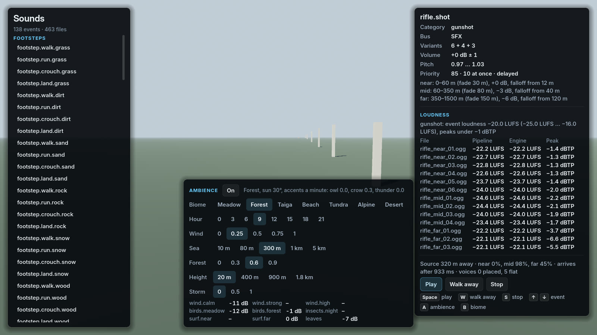
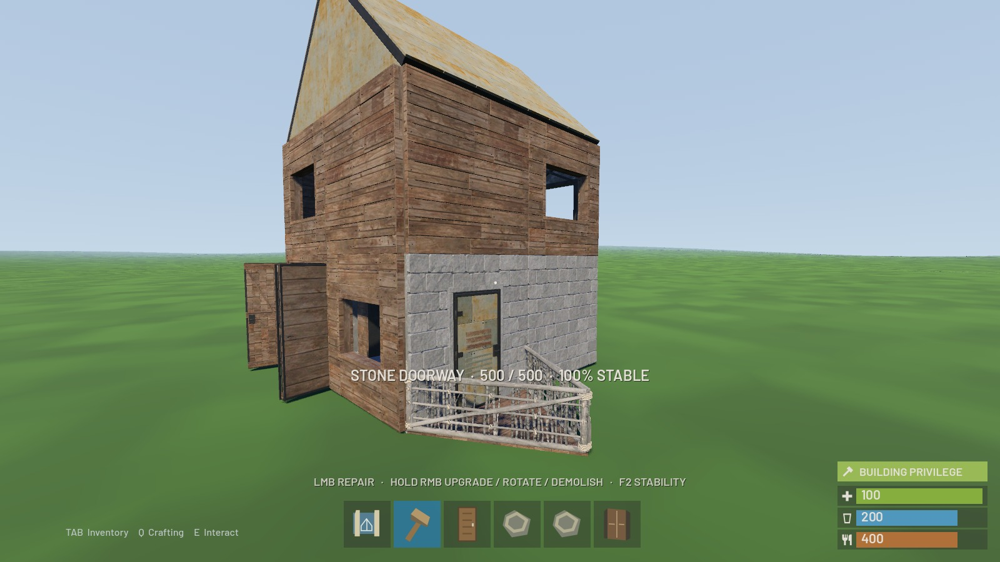
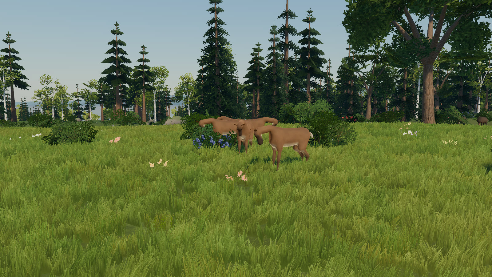
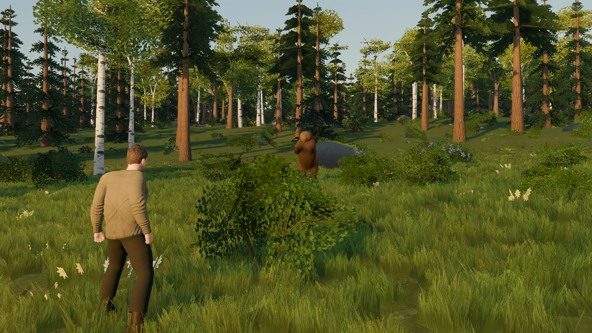
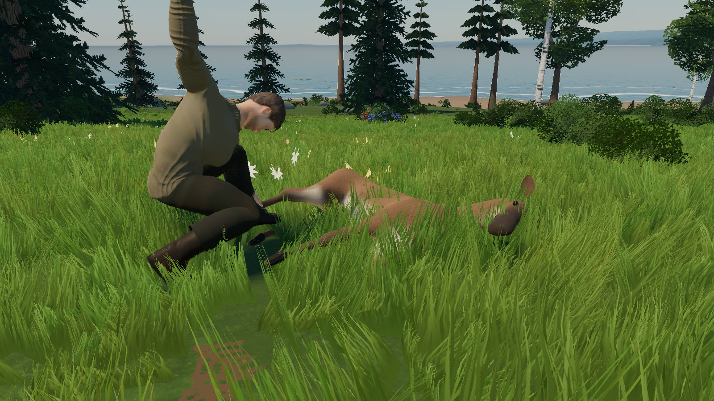
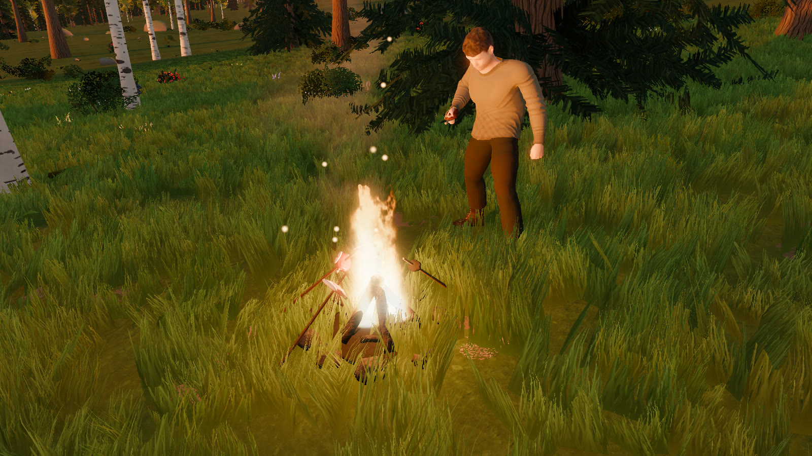
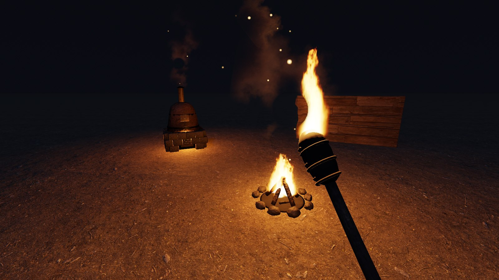

# Hollow Universe — The ground game

Status: draft 1, 12 October 2026. This is the Rust-style game on planet surfaces: what it is, how it's built and in
what order. [GAME_DESIGN.md](GAME_DESIGN.md) §5 says it in short; [ARCHITECTURE.md](ARCHITECTURE.md) holds the
engine-wide rules this follows (principles §2, determinism §8, networking §11, persistence §13).

Every rule is marked **Decided** (the owner said so), **Proposal** (waiting for a yes or no) or **Open**.

---

## 1. Decisions

| Topic | Rule | Status |
|---|---|---|
| Basis | Rust's ground loop, in first person: gather, craft, build, raid, full-loot PvP, sleepers, beds. | Decided |
| What may come from Rust | Its mechanics, its numbers (including the AK recoil pattern) and its UI design. | Decided |
| What may not | Asset files from Rust or any other game: models, textures, animations, sounds, maps, monuments. Not even as placeholders. The list of such files on this PC is in §9. | Decided |
| Names | Our own for items, devices and places. Plain words ("wooden door", "furnace") are fine. | Decided |
| Interface | The RustMVP interface, exactly (§8), built with `Ui` so it stays crisp at any resolution. | Decided |
| Multiplayer | Networked from the first line. Solo play runs the same server inside the game. | Decided |
| First world | A real planet from the generator: Nolcas Peris CQ-SLY 7-0 B 3 (§3). | Decided |
| It must look good | The surface (terrain, plants, water, sky) is part of G1 and is judged by the owner on screenshots. | Decided |
| Tech ladder | Rust's: rock, then stone tools, metal, firearms. Sci-fi only above that. | Proposal |
| Starter ship | The Tin Finch (`D:\GameDev\Assets\TinFinch_TF01`, our own Blender model): a single-seat skiff, crafted at the vehicle workbench. It is the first ship of the space part. | Decided |
| Day length | Planet rotation compressed 24 times for play: an Earth day becomes an hour, and the first world's day 87 minutes. Orbits and seasons stay real. Chosen by Claude while the owner is away; the owner may veto it. | Proposal |
| Who runs the work | Claude, on its own, until the whole thing is finished and polished; the owner is busy elsewhere and isn't asked to playtest in between. Progress is logged in `docs/progress-ground.md`. | Decided |
| Character | Our own character system (§4.8): a MakeHuman body (MPFB 2, CC0), Quaternius' Universal Animation Library 1 and 2 (CC0) retargeted onto it by script, clothing and armour modelled by our own Blender scripts. The owner approved the downloads on 12 October 2026. Never RustMVP's extracted Rust character, even as a fallback. | Decided |

---

## 2. Lessons from earlier attempts

| Attempt | What went wrong | What this design does instead |
|---|---|---|
| hollow-orbit (browser, single player) | Game state, meshes and UI mixed in the same objects; random numbers and a variable time step everywhere; no network. | Rules in engine-free C#; fixed ticks; the server owns the state. |
| RustMVP, Godot phase (GDScript client, C++ server) | Every predicted rule written twice, in two languages. | One C# rules library used by the server, the client and the bots. |
| RustMVP, Unreal phase | One generic command call and whole-struct replication (an audit judged it wrong); the installed engine can't build a dedicated server. | Typed messages; per-client delta snapshots; the server is a plain .NET program. |

Their rules, numbers and edge cases are still the best reference we have (§6).

---

## 3. The first world

The first world is a real body of the generated universe, chosen from the planets the generator makes
(GALAXY.md §10.3). Within 400 ly of Sol there are 1,698 worlds with plants and animals; 71 have breathable air;
this is the one closest to an Earth-like place to live.

| | |
|---|---|
| System | Nolcas Peris CQ-SLY 7-0, 331.5 ly from Sol, 5.2 billion years old. `SystemAddress` `0x7810135EB5240000`. |
| Suns | B, an F9.5 V star (5,983 K, 1.46 × the Sun's light), which the planet orbits. A, a cool white dwarf about 486 AU from B. C, a hot white dwarf about 1,800 AU out. From the planet, A and C are the two brightest stars in the sky. |
| Planet | B 3, body path `0x20600000`. Earth-like world, radius 6,435 km, 0.92 g. |
| Orbit and day | 1.255 AU from B (93% of Earth's sunlight), a 489-day year, a 34.9-hour rotation, 23° tilt (seasons). |
| Climate | Mean 18 °C, 13–20 °C between night and day. |
| Air | 2.23 atm; oxygen 0.31 atm, CO₂ 0.08%: breathable. Thick air means a deep blue sky and hazy distances. |
| Surface | Oceans cover 45%, ice 8%. Moving plates (mountain ranges), gentle volcanism. Complex life: vegetation and animals. Hazards: quakes only. |
| Moon | B 3 a, rocky, 250 km radius, 32,036 km away, orbit 16.3 h. It looks about 1.7 times as wide as our Moon. |
| Neighbours | Two hot rocky planets inside, an asteroid belt and three ice giants with moons outside. |

- **Pinned by a test.** A golden test pins the planet's state. If a generator change alters it, the test fails and we
  decide what to do. The ground branch starts from `generator-v2` for this data.
- **The landing site** (the first zone's origin) is 44.8683° N, 170.0010° W (`FirstWorld.LandingLatitude`,
  `FirstWorld.LandingLongitude`): the east shore of a bay, 21 m above the sea, on a meadow at a forest edge
  (birches, oaks, spruces, berry bushes); the bay within 2 km to the west and south-west; forested hills to 365 m
  nearby and to 1,160 m 18 km to the north-east (`surface site` in the generator report). The golden test of the surface includes points around it.
- **Look-dev views** (`docs/images/ground/`, 1600 × 900; commands in §4.6):
  - `a_landing_morning.jpg`: the landing site at 09:25 local time.
  - `b_golden.jpg`: the meadow 700 m south of it at 18:13, looking into the sun (6° up) through the forest edge.
  - `c_night_moon.jpg`: the same meadow at 22:07, the moon 38° up and 68% lit (behind the camera), the galaxy's
    band.
  - `d_hills.jpg`: forested hills 17 km north-east, from 60 m above a 620 m ridge.
  - `e_beach.jpg`: the beach 4 km south, along the coast.
  - `f_forest.jpg`: inside the forest 600 m north, toward the sun.
  - `g_2km.jpg`: from 2 km above the landing site toward the hills, the bay on the left.
  - Also: `b2_golden_shade.jpg` (the meadow at golden hour facing away from the sun, the grass in shade),
    `f2_forest_clearing.jpg` (a forest clearing near the hills: sparse grass, ferns, litter, full fir crowns),
    `g2_2km_down.jpg` (from 2 km looking steeply down: the canopy, groves and meadow edges).
  - `compare/`: the meadow and forest before and after the plants and grass were redone (same views and times).

---

## 4. Architecture

### 4.1 Projects

```
src/Hollow.Core          (exists) double vectors, DMath, Hash64, Rng, units
src/Hollow.Galaxy        (exists) galaxy, star systems, planet state
src/Hollow.Surface       planet surfaces: height, climate, biomes, materials, scatter; chunk meshes and collision
src/Hollow.Simulation    entities, components, systems: movement, items, crafting, building, combat, survival
src/Hollow.Net           messages, bit packing, snapshots and deltas, transport (LiteNetLib)
src/Hollow.Client        the client without graphics: connection, prediction, interpolation, client world
src/Hollow.Persistence   SQLite storage
src/Hollow.Server        the dedicated server; also a library the game hosts in-process for solo play
game/                    Godot: views, first person, terrain rendering, UI, audio, input
game/data/ground/        items, recipes, building parts, loot, weapons, survival constants (JSON)
tools/Hollow.Bots        headless clients for tests and load tests
third_party/             vendored packages, so the repository builds without network access
```

Dependencies point one way: `Core ← Galaxy ← Surface ← Simulation ← Net ← Client / Server`, and
`Persistence ← Simulation`. The game references `Client` (and `Server`, for hosting). Nothing in `src/` references
Godot.

```
      both sides run the same rules and data: Hollow.Simulation + game/data/ground
┌─ Godot client ─────────────────┐         ┌─ Hollow.Server (.NET, no Godot) ────────┐
│ Hollow.Client (no Godot):      │   UDP   │ zones: physics (Jolt) + systems, 30 Hz  │
│   prediction, interpolation    │<------->│ replication: who sees what, snapshots   │
│ Godot: views, first person,    │         │ persistence: SQLite                     │
│   UI, audio, input             │         │ sessions, chat, raid alerts, admin      │
└────────────────────────────────┘         └─────────────────────────────────────────┘
  bots = Hollow.Client without a window: 2 players + 100 bots, headless, in tests
```

### 4.2 Server

- One process. A **zone** is one surface region of one body: its entities, one Jolt physics world and the systems
  that run on them, at a fixed 30 ticks per second, on one thread at a time (ARCHITECTURE.md §10).
- **Tick order:** inputs → movement → actions (gather, build, craft, use) → projectiles and damage → survival →
  devices (furnaces, timers) → AI → decay and upkeep (slow) → replication. Dirty entities are saved every 30 s.
- **Static entities** (building parts, deployables, boxes) cost nothing per tick until something happens to them.
- **Natural things** (trees, ore, plants) come from the surface generator. Only changes are stored, such as "this tree
  is cut until T" (ARCHITECTURE.md P1).
- **As built in G1** (`src/Hollow.Server`): a .NET console program and a library. One zone on the first world, its
  origin at the landing site (§3; `--lat`, `--lon` move it), on the planet's real surface (`ZoneSpec.CreateSurface`:
  `PlanetSurface`, one instance per process shared by the server, the prediction and the terrain; `--stand-in` gives
  tests the old hilly sphere). Each tick: receive, finish logins, run admin commands, give every character its input
  for this tick, step the zone, send snapshots (20 a second), save every 30 s, send. Tick time is measured (average,
  99th percentile, maximum) and profiled by part (`TickProfile`: time, calls and garbage per part, the slow ticks'
  parts, the collections that paused ticks; the load test prints it, §5.11). The tick runs above normal priority and
  with .NET's sustained low-latency collector, as the game does.
  - **Arrival:** a new character arrives on a random one of the zone's beach points, as in Rust (`Beaches`: up to 24
    points of sandy shore 0.5–3.5 m above the sea with the water within 30 m, at least 45 m apart, nearest to the
    origin first; at the landing site they lie 0.3–0.8 km away). `--spawn origin` puts arrivals at the landing site
    instead (load tests, measurements).
  - **Login** is by player name for development: the name is the account, one character per name, refused if in use.
  - **Admin console:** `status`, `kick <name> [reason]`, `teleport <name> <x> <z>` or `teleport <name> <other>`,
    `say <text>`, `save`, `quit`. Ctrl+C or `quit` saves everyone, says goodbye to every client and stops. Since the F1
    console (§8.2) the server's console runs the same commands as players' F1 consoles, with every right; players run
    them over the network, the server checking their rights (`--admin`, `admins.txt`, `--dev`).
  - **Host mode:** the game runs the same `GameServer` on a background thread for solo play (`--host`); other
    clients can join it on the same port.
  - Ground near the spawn is built at start, so the first arrival doesn't stall the tick. A respawn or a login waits
    for the ground where the player comes in: the point is picked when the player asks (the beach as of that tick),
    its tiles are built on worker threads, and the player comes in, and the respawn intent is answered, on the tick
    they are ready (a second at most; §4.5, §5.11).

### 4.3 Client

- **Hollow.Client** (no Godot) owns the connection and the client's copy of the world:
  - Input commands go out every tick.
  - The player's own character is predicted with Hollow.Simulation's movement code, against a local Jolt world
    built from the surface generator and the replicated static entities.
  - When a snapshot says "input 412 processed, you are here", the client rewinds and replays newer inputs.
  - Other entities are interpolated 100 ms behind the server.
  - Inventory and container contents are mirrored. Intents (build, craft, move an item) show at once in the UI
    and are confirmed or rejected by the server.
- **Godot** draws that world and nothing else: a surface mode with a floating origin, terrain from Hollow.Surface,
  entity views pooled by type, a first-person camera and viewmodel, third-person characters, UI and audio.
  Mouse look is applied every frame, never held back by the tick.
- **Bots** are Hollow.Client with scripted input. Tests run the server and bots headless.
- **As built in G1** (`src/Hollow.Client`, no Godot): `GameClient.Update(delta, input)` every frame receives, runs
  the ticks that are due (each predicts and sends its input) and advances what is drawn.
  - **Prediction:** a `Predictor` keeps 4 s of inputs and predicted states. A snapshot brings the server's state of
    the character after some tick; if it differs from the prediction for that tick, the predictor takes the server's
    state and replays the newer inputs. Identical inputs give identical results (§4.5), so on a clean line nothing is
    ever corrected.
  - **Smoothing:** a correction under 2 m is added to a visual offset that fades in about 0.1 s; a bigger one (a
    teleport, a respawn) shows at once. The drawn position blends the last two predicted ticks, so movement is smooth
    at any frame rate; the eye height eases between stances (RustMVP's rate 18).
  - **Remote entities** are drawn 100 ms behind a clock that follows the newest snapshot tick, blended between the
    snapshots on either side; if snapshots stop they carry on for up to 4 ticks along their last motion, then hold.
  - **Statistics:** round trip (measured by echo), snapshot rate and loss, bandwidth both ways with UDP and IP
    headers, prediction error (last, mean and worst), input margin, clock rate.
- **The ground mode in Godot** (`game/scripts/Ground/`), one game on the real planet:
  - **Starting:** `--view ground` alone opens the main menu over the landing site (PLAY hosts a game on this
    computer, CONNECT joins one by address and port, the name is remembered, QUIT). `--host` or `--connect host:port`
    start at once (`play-ground.cmd`, AGENTS.md). Hosting starts the dedicated server (`Hollow.Server`, the newer of
    its Release and Debug builds) as a process of its own on localhost (`ChildServer`): the game connects once it says
    "Ready.", its log lines show in the game's as "[server]", admin commands go to its console, and it saves and stops
    with the game (`quit`, or by itself through `--parent <pid>` if the game goes away). `--in-process` keeps the
    server on a thread of the game (tests, statistics read from the server directly).
  - **The world** is the planet package's `SurfaceView` driven by the game (`SurfaceView.Driven`, `OpenZone`): its
    terrain, sea, sky, clouds, plants and grass, with the render frame on the zone's own frame (the same origin and
    axes, and no floating-origin moves: the zone keeps within 8.2 km of its origin, where floats are good to half a
    millimetre), so zone-frame metres are Godot's coordinates and the drawn ground is the collision's triangles. The
    sky shows the universe time on the day of play (§1: × 24 from J2000, as the server's climate), so every player
    sees the same time of day. The game places the view's camera at the predicted eye every frame.
  - **Natural objects** as the game changed them (`NatureView`): the surface view asks, per scatter object, which
    kind to draw (`Vegetation.Changes`): felled trees and picked ferns aren't drawn, a picked berry bush is drawn bare
    (the same bush without its berries, `FloraLibrary.BareBerryRed` and `BareBerryBlue`); their scatter tiles are drawn
    again when their state changes. A tree felled within 150 m tips over away from the player on its own model and
    sinks into the ground. Outcrops are drawn by the game from `GroundModels`: the model catalogue's stone, metal and
    sulphur outcrops, one model per depletion stage (§9.1). Weak spots glow on what was hit.
  - **Characters:** other players are the character package's `CharacterView`, fed every frame from the replicated
    state (position, up, yaw, pitch, the velocity seen, stance, ground, the item in hand), with swings and shots,
    flinches when hurt, a ragdoll on death and lying down asleep; corpses are ragdolls (a player's own body if they
    died in view). Each wears what their worn items show (`ItemLooks.Worn`: the woven hood as the knit cap until a hood
    exists, shirt, trousers, the work boots as the laced boots, the chest plate as the riveted breastplate; gloves and
    the metal mask have no garment yet) in the body they chose in the menu (`CharacterView.Body`, male or female: sent
    in `Hello.Body`, kept in the character's saved state, shown to others in `CharacterLook.Body`). The player has
    `ViewmodelView` arms of their own body in their sleeves, holding the belt item's catalogue model (`ItemLooks`,
    through `HeldItems`), and the inventory shows the same body. Godot's own physics gets the ground near the player
    for ragdolls and feet (`GroundCollision`).
  - **Interface:** the RustMVP interface (`GroundUi`, §8) over `ClientGroundUi`, names over other players (placed by
    `Labeller`), F3 for the network graph.
  - **Sound** (`GroundAudio`, §4.9): the audio package's director at the camera, ambience from the place, every
    character's footsteps on the ground under them, and the game's events (gathering, pickups, food and bandages,
    hurt and death, the cold, fires, boxes, placing, swings, the bow and arrows, hit markers, the interface).
  - **Steady frames** (measured with `--measure`, §5.4): everything the game may show is drawn once, tiny, while the
    world opens, so the renderer never builds a pipeline in play (`GroundView.Warmup`); the plants near the camera are
    rebuilt on a worker thread with the game's changes frozen when it starts (`Vegetation.ChangesSnapshot`), and so
    are tree impostor blocks; changes farther than 25 m wait up to five seconds to be drawn together; scatter objects
    are only looked up in tiles already generated (`ScatterNaturalObjects.TryGetCached`); the game runs with .NET's
    sustained low-latency collector. A lost connection returns to the menu.

### 4.4 Network

- LiteNetLib over UDP. Reliable ordered channel: commands, intents, static entities, container contents.
  Unreliable sequenced channel: inputs and snapshots.
- Messages are typed structs, bit-packed by generated code: no reflection or JSON on hot paths.
- Snapshots go out 20 times a second, delta-compressed against the last one the client acknowledged, for the
  entities its relevance grid selects, within a bandwidth budget (≤ 256 kbit/s in a fight).
- Shots: projectiles with drop and travel time are simulated on the server. Hit tests rewind targets to what the
  shooter saw, using one second of hitbox history. Clients never report hits. As built in G4: shots and reloads are
  intents for a tick, the shooter's client predicts its gun, and bullets' launches go unreliable (§6.4).
- For testing, the transport can add latency, jitter and packet loss, and the client shows a network graph.

**As built in G1** (`src/Hollow.Net`):
- **Transport:** LiteNetLib 2.1 in manual mode (no background threads: the server polls once a tick, a client once a
  frame). Reliable ordered: `Welcome`, `Spawn`, `Despawn`, chat. Sequenced (unreliable, newest wins): inputs and
  snapshots.
- **Connecting:** the connection request carries `Hello` (protocol version, the generated schema hash, the name, the body chosen). A
  refusal carries a `Goodbye` with a reason (protocol mismatch, bad name, name in use, server full; also kick and
  shutdown). An accepted player gets `Welcome`: net and entity IDs, the server tick, the rates, the zone (body, radius,
  gravity, surface seed, latitude, longitude) and the saved view.
- **Clocks:** every input is for a tick. The client runs its tick clock ahead of the server's so inputs arrive in
  time: every snapshot says how early this client's inputs arrived (the least over the last half second). The client
  aims for 2 ticks: 4 % faster below, 3 % slower above 4, and it jumps when inputs arrive late or very early. A jump
  forward runs the extra ticks over the next frames (their inputs still go out); one of over a second skips them (the
  server and the prediction both fill skipped ticks by repeating the last input). A jump back pauses. The first lead
  comes from the connect handshake's round trip.
- **Inputs:** one packet per client tick: the tick's input (move axes in 1/127, yaw and pitch in 1/65,536 of a turn,
  buttons: jump held, jump pressed this tick, crouch, sprint) and the three before it, the snapshot acknowledgements and
  a client timestamp for measuring the round trip. Only four losses in a row lose an input. The server applies each
  tick's input on that tick; without one it repeats the last (without the jump press) and counts a miss.
- **Snapshots:** 20 a second per client (every 1.5 ticks on average). The header has the sequence, the server tick,
  the input margin, the player's own character exactly (floats, for reconciliation) with its tick, and the echo. Then
  the relevant entities, each delta-coded against its newest state the client confirmed (acknowledged by sequence and
  32 bits), highest accumulated priority first, within 1,600 bytes and the path's MTU. Remote positions are on a
  1/256 m grid.
- **Relevance:** a 64 m grid; an entity becomes relevant within 300 m (reliable `Spawn`) and stops beyond 320 m
  (`Despawn`). Everyone's own character is always theirs.
- **Bad network:** `ConditionedRelay`, a local UDP relay below LiteNetLib (whose own simulation is compiled out of its
  release package), adds round-trip latency, jitter and loss in both directions; clients and bots take `--lag <ms>`,
  `--jitter <ms>` and `--loss <percent>`.

**Building (G3, §6.5):** pieces, doors and claim devices are static entities, replicated by 64 m area. When an area
comes within 300 m its pieces are queued for that player, nearest areas first, and go out within 1,200 bytes a
snapshot (at most about 190 kbit/s while a base streams in); after that only changes travel, removals first (a
client's copy may give a freed body ID to a new piece). Positions are exact doubles in exact frames and each piece
carries the server's Jolt body ID, so a client's copy links, solves and collides exactly as the server's. A
1,074-piece base reaches a player who joins beside it in about 1.9 s (a test).

### 4.5 Physics and movement

- **Jolt** through JoltPhysicsSharp 2.23 (joltc 1.1), on the server and in the client's prediction. **The G1 spike
  passed (12 October 2026):** a fixed script of 600 ticks of input (walk, sprint while turning, jumps, crouch, strafe)
  walks a virtual character over mesh ground from `ISurface.GroundCollision`, with up from `ZoneFrame.UpAt`, on a
  stand-in planet of the first world's size. A .NET console process and the Godot 4.7.2 client (which also loads
  Godot's own Jolt) print the same final position and the same hash of every state on the way
  (`0x6E7FDE937D5A46FA` on win-x64 with the movement code of 12 October 2026; any change to movement changes it).
  BepuPhysics2 is not needed. The check stays: `dotnet run --project tests/Hollow.Tests -- MovementCheck` and
  `$GODOT --headless --path game -- --physics-check` must print the same line
  (`Hollow.Simulation.Movement.MovementCheck`).
- **One step is a pure function** of the character's state (feet position, velocity, stance, health), one tick of
  input and the static world. Every step first puts Jolt's character exactly at the state and finds its contacts
  afresh, on the server as in prediction, so the client can rewind to any state the server sends and replay its
  inputs to the same bits. Results are repeatable within one build and platform; across platforms they may differ in
  the last bits, which reconciliation absorbs.
- **One lock for Jolt.** joltc's character functions share one temporary allocator inside the native library, so
  `JoltRuntime.Gate` serialises every call into Jolt in a process (a hosted server and the client's prediction share
  the game process). A zone holds it for its movement pass. Zones ticking in parallel (G7) will need joltc's
  per-caller allocators.
- **Characters** use Jolt's virtual character, a capsule (radius 0.32 m, 1.76 m standing, 1.10 m crouched) whose
  position is its feet. "Up" is away from the planet's centre at the character, expressed in the zone's frame
  (`ZoneFrame.UpAt`), so nothing assumes +Y is up; the view's yaw is measured about the zone's +Y and laid onto the
  local horizontal. Characters don't collide with each other in G1 (§11), so prediction depends only on the static
  world and the player's own inputs.
- **Movement** follows RustMVP's numbers (`MovementTuning`, from `weapons_character_ui.md` §2): walk 2.8 m/s,
  sprint 5.5 m/s (straight forward only), crouch 1.3 m/s, acceleration and braking 60 m/s², ground friction 8, air
  control 0.25, jump 7.0 m/s (7.6 crouched), steps up to 0.40 m, slopes up to 46°.
  - **Gravity** is the planet's surface gravity times RustMVP's gravity scale 1.8: 16.2 m/s² on the first world, so a
    standing jump rises 1.51 m.
  - **Fall damage** (RustMVP had none; Rust's rule): landing faster than 15 m/s toward the ground costs
    500 × (speed − 15) / 85 health, rounded up. A fall of about 7 m starts to hurt; about 31 m kills.
  - **Swimming** where `ISurface.SeaRadius` > 0: a character swims once the water reaches 65 % of its height (Rust's
    threshold), steers in the view direction (look down to dive), rises with jump and sinks with crouch, and floats
    at 75 % depth otherwise. 2.0 m/s, 3.0 m/s with sprint. Landing in water never hurts.
- **Collision:** the ground is static mesh tiles of 64 m built from `ISurface.GroundCollision`, identical on both
  sides. A tile's Jolt body ID follows from its grid position (Jolt orders contacts by body ID), so tiles agree where
  they meet whatever else each side holds. Tiles exist within ±8.2 km of the zone's origin. Building parts are boxes
  and convex hulls from data. Deployables and natural objects use simple shapes.
- **Streaming the ground** (`PhysicsWorld`, §5.11), the same code on the server and in every client's prediction, so
  both meet the same ground wherever a query can reach:
  - *Who asks:* a character on foot needs the 3 × 3 tiles round it and builds 5 × 5 ahead; a ship needs only the
    tiles its queries of the tick can reach (its bounding sphere, a tick's travel, the skids' rays and the widest
    natural prop's 3 m: one to four tiles, `EnsureGroundAround`) and builds ahead a corridor that wide along the next
    1.5 s of its way (`PrefetchAlong`); a respawn or a login waits for its 3 × 3 (`GroundReady`, §4.2). A tile with
    its trees and outcrops comes and goes as one.
  - *Built on worker threads*, from the planet's pooled collision with neighbouring tiles sharing their grids'
    heights (§4.6); taken into the world at most 8 a tick. A tile needed now that is still queued is built by the
    tick itself rather than waited for behind the others (a respawn storm queues hundreds); one a worker is building
    is waited for. A tile nobody marked for 10 s goes.
  - *Bodies are kept once made:* Jolt gives a body the ID asked for by walking its list of free IDs, which cost
    50–70 µs a body with this world's scattered IDs, so a body taken out of the world is parked (out of the
    broadphase, on a tiny shared shape) and put back with its new shape and pose, exactly as a new one (a test). The
    first prop makes all 65,536 prop bodies ahead (10 MB, 20–50 ms once), each then at the head of Jolt's list.
  - *The broadphase is kept in shape* by the broadphase part of Jolt's own update (an update with no time step does
    nothing else; the world is never stepped): only what changed is rebuilt, 0.1–0.4 ms a tick, where a whole
    rebuild took 5–10 ms with 30,000 bodies. Queries find the same bodies whatever the tree's shape.
- Godot's own physics is used only for cosmetic things: ragdolls and debris.

### 4.6 Planet surface

`PlanetSurface` in Hollow.Surface is the real surface of a rocky planet; `SphereSurface` stays as the stand-in.

- **A pure function** of (universe seed, system, body, planet state, `GeneratorVersion.Surface`), built with `DMath`,
  `Hash64` and gradient noise made of + − × ÷ and floor only (ARCHITECTURE.md §8), so the server's collision and the
  client's terrain agree to the bit. A golden test pins heights and biomes at 600 points.
- **Cube-sphere:** six faces, each a square of face coordinates (u, v) ∈ [−1, 1]² mapped to the sphere through
  `tan(t·π/4)`, so tiles stay within a factor of 1.5 of the same size. A `TileKey` is face, level (0–28) and x, y;
  every grid coordinate is a dyadic fraction, exact in double, so parents and children share vertices bit for bit.
  On the first world a level-16 tile is about 154 m across and a level-18 tile about 39 m.
- **Tile grids:** 32 × 32 cells, each quad split along the same diagonal at every level. Vertices also carry their
  position on the parent's grid, so the client morphs between levels without popping, plus eight ground-material
  weights and the climate. **Collision is built from the level-18 grids** (1.2 m spacing), exactly the vertices the
  client draws near the player (`GroundCollision`; a test checks it). Of the grids under a 64 m physics tile, the
  physics keeps the triangles over the tile's square and 2 m around it, seen from the planet's centre
  (`PhysicsWorld.ClipMargin`): the grids overlap the square by up to one of theirs, and the same ground twice costs
  every contact query. The physics takes the triangles in pooled arrays (`GroundCollisionPooled`, the same to the
  bit, a test), and the planet keeps the heights of the last 4,096 grids it sampled for them (`GridHeights`, 36 MB
  at most): a 64 m tile's nine grids are mostly its neighbours', so a tile costs a worker 16 ms and 63 KB of garbage
  instead of 42 ms and 600 KB (§5.11).
- **Height**, in layers:
  - *Plates:* 14–20 plates (Voronoi on the sphere, seen through a warped direction so their edges bend), each
    continental or oceanic with its own Euler pole. Every plate near a point weighs in softly, and each boundary's
    relief is a function of the distance across it, so the field is continuous at triple junctions.
  - *Continents:* a warped noise plus the plates' bias, run through a crust curve (abyssal plains, continental slope,
    shelf, coast, lowlands, interiors). The coastline threshold is calibrated on 6,144 fixed directions until the full
    height puts exactly `OceanCover` under the sea (45.1% on the first world).
  - *Boundaries:* mountain belts where plates converge on land, trenches and island arcs at sea, rift valleys and
    spreading ridges where they part; their strength varies along each boundary. Old worn ranges in a few regions.
  - *Mountains:* the belts' uplift shaped by eroded ridged noise ("swiss turbulence": octaves displaced along the
    summed slopes), so crests are sharp, valley floors smooth and side valleys branch.
  - *Hills:* regional amplitude (mostly gentle, hilly in places and around ranges) over noise whose octaves are damped
    on steep slopes. Metre-scale ground on top, rougher on stony ground.
  - *Coasts:* a curve that flattens sandy shores into beaches (a regional "beach" field); rocky shores keep their
    slope.
- **Climate:** annual mean temperature from the planet's mean, latitude (42 K equator to pole), noise and a 6 K/km
  lapse rate; the ice line is calibrated so ice covers `IceCover`. Moisture from latitude bands (wet tropics, dry
  subtropics, wet mid-latitudes), distance inland and noise. Seasons are drawn, not generated (the sky moves).
- **Biomes:** ocean, beach, ice sheet, tundra, boreal forest, temperate forest, grassland, shrubland, desert, savanna,
  tropical forest and alpine ground, as soft weights from a Whittaker-like table. They give the eight ground materials
  (grass, forest floor, soil, rock, gravel, sand, snow, moss; slope turns ground to scree and rock) and plant
  densities, thinned by forest clearings, slope, tree line and shore.
- **Scatter:** per level-16 tile, a jittered grid of candidates per kind (trees 3.5 m, bushes 2.4 m, ferns 1.6 m,
  rocks 3.2 m), each kept with the probability its density gives. Trees grow in stands of one kind (fir, pine, birch,
  broadleaf). An object's ID is the tile plus its index: kind in the top byte, candidate cell below (ARCHITECTURE.md
  §7). Grass is a density per vertex, drawn by the client.
  - **Gameplay kinds** come after the plants and are drawn by the ground game, not the surface view: stone, metal and
    sulphur outcrops (`ScatterKind` 9–11) on a 12-cell grid per tile, about one per 3,000 m² of open, gentle land of
    average roughness: more on stony and mountain ground, 40 % fewer in closed forest, none on sand, ice, cliffs or
    within 1.5 m of the sea; mostly stone, about a third metal, a sixth sulphur (more ore in the mountains). Each kind
    has its own candidates and random streams, so adding them moved nothing else; new kinds only ever go at the end.
- **Speed:** about 3.7 µs per height and 7 µs per drawn vertex (with climate and materials), about 7 ms per tile on
  one core; the client builds tiles on worker threads.
- **Sky:** `SkyEphemeris` turns the planet's body frame in the system frame: the spin axis leans from the system's
  +Y toward −X by the axial tilt and stays fixed (seasons follow the orbit); the body turns 2π·t / period about it,
  prime meridian in the plane of the axis and +X at J2000. Sun, moon, the other suns and planets come from the orbit
  code at the universe time. The client draws physically based scattering for the planet's own air (Rayleigh, Mie,
  ozone, multiple scattering) with the same tables as the aerial perspective on everything under it.
- **Water:** the sea at `SeaRadius` (sea level), drawn on the terrain's own tiles.

**The surface view** (client, `game/scripts/Surface`; presentation only, never deciding what exists):
- **Terrain:** a quadtree of the tiles above around the camera, built on worker threads, morphing toward the parent
  grid with distance (no cracks: skirts), in a floating origin that moves with the camera without turning. Eight
  ground layers (texture arrays) blended by the vertices' material weights and their own heights, triplanar rock on
  cliffs, two scales near and a larger turned copy far so nothing repeats in rows; the grass layer takes the colour
  of the grass blades (below). The forest floor is brown leaf litter with cushions of moss, and under trees the
  canopy keeps much of the sky's light off the ground (sun flecks stay). Beach sand is lighter, with patches of
  fine wind ripples near by; below the wave line and where the swash runs it is dark and glossy, with thin foam
  lines left by the waves.
- **Far forests:** where the trees' impostors end (2.2 km along the ground, so from the air the forest below keeps
  its trees) the ground draws the canopy: a tiling crown map with its own slopes lit by the sun, groves at a larger
  scale, stands of dark conifers and lighter broadleaf, dark gaps between crowns, and crisp irregular forest edges
  with a shadow line on the open side. Seen steeply from the air (where billboards would be slivers) the canopy
  replaces the impostors.
- **Air and light:** the sun (star B) and the moon at their real directions for the universe time; scattering for the
  thick air (transmittance and multiple-scattering tables, the sky ray-marched at quarter resolution) and the same air
  in front of everything through a 3D aerial-perspective table. Clouds: a layer of fair-weather cumulus (1.6–2.9 km,
  cover 0.35) with cloud shadows. Night: the two white dwarfs, the other planets, a star field and a narrow, dim
  band of the galaxy broken into structure; moonlight on the ground is brightened 14 times and turned a little blue
  (dark but readable, as in Rust), the moonlit air only 2.5 times; the moon's disc is capped a few times above white
  so it never blooms over the sky. Exposure meters for the light
  falling on the ground, nights a few stops darker than days.
- **Water** reflects the sky and sun with Fresnel, shows the sea floor through water that absorbs red first, glows
  turquoise in the shallows and moves with Gerstner swell near the camera. Surf: broken lines of foam roll in over
  the shallows along the depth contours, and a swash of foam runs up the sand and back.
- **Plants** are made in code after hollow-orbit's flora (no plant models): firs (spruce-like), pines, birches,
  broadleaf trees (oak and beech), bushes, red- and blue-berry bushes, ferns and boulders; two to four seeded variants
  per species, each with two meshes. Leaves are cards of a painted atlas (4 × 4 cells, mipmaps that keep the share of
  leaf texels so far foliage does not thin), alpha-tested with alpha to coverage, with vertex-colour occlusion,
  normals pointing out of the crown, hollow-orbit's foliage light (a warm sheen with the sun behind the viewer, light
  through leaves that face away from it) and little specular. Bark: fine wandering vertical fissures, cross-cracks,
  lichen and colour variation, with a normal map; moss low on the trunk's north side. Firs and pines end in small
  upturned whorls and a needled leader, not a bare spike. Boulders: icospheres cut into facets, textured with the
  ground's rock layer in their own frame, moss on top.
  - *Levels:* trees draw their full mesh to 50 m, their second mesh to 170 m, then impostors to 2.2 km (eight views
    of every variant, colour and normals, rendered into an atlas when the view opens); the near set's impostors and
    the far blocks' meet at an exact cut (290 m). Each object keeps its level between rebuilds, with a few metres of
    hysteresis; when it changes level the two cross-fade over 0.45 s (complementary dithers), so no crown stands
    half-dithered at a boundary. Bushes, ferns and rocks use their second mesh to 75–200 m and shrink into the ground
    at the end. Past 1.6–2.2 km forests are drawn by the ground (above).
  - *Wind:* every vertex carries a bend weight and a flutter weight; the plant bends along the wind with gusts that
    roll across the forest, leaves flutter along their normals.
  - Each plant is a scatter object, known by tile and index; berry bushes are their own kinds (`BerryRed` 7,
    `BerryBlue` 8) because they will be food.
- **Grass and ground cover** are not in the scatter and have no models: `GrassField` draws one MultiMesh of tufts on
  a 0.4 m grid that follows the camera (to 42 m; they shrink into the ground from 22 m), and a second, flat one of
  leaf litter, needles and twigs (to 26 m). What grows in each cell (place, height, width, turn, lean, colour,
  dryness, kind: grass, meadow grass, dry grass, flowers; ferns, herbs and seedlings under trees; dead leaves of the
  trees around) comes from a hash of the cell in stable coordinates, so nothing shifts as the grid moves. Two field
  textures (256² at 0.5 m, rebuilt on a worker every 14 m) hold the ground's height (the finest tiles' own
  triangles, so tufts sit on the drawn ground), the grass density (from the biomes, materials, slope and tree
  cover), moisture, flowers, forest cover and small plants. Where grass is thin it grows in patches, and a tuft is a
  few narrow cards of ragged blades, not a block. The blades are hollow-orbit's painted blade cards, coloured by one
  function shared with the ground's grass layer (`surface_grass.gdshaderinc`), their foot in the ground's colour,
  normals up on both faces so a field lights as one in sun and shade, light through the tips toward a low sun; wind
  bends them in gusts drifting downwind with a ripple; they bend away from the walker's feet.
- **Time:** the clock runs at the universe time; `RotationTimeScale` (client setting `[surface]
  rotation_time_scale` in `user://settings.cfg`, or `--time-scale`) turns the planet faster than real without
  moving anything else. Keys: `[` `]` jump the clock an hour (Shift: six), T cycles the day speed 1×, 60×, 600×,
  3600×, P pauses, H hides the interface; a card in the corner shows local solar time, UTC and the speed.
  Screenshots pause at `--time`.
- **Speed** (1600 × 900, RTX 2070 Super, vsync on): 11–12 ms a frame (85–89 fps) at the landing site with 3,300
  plant meshes, 414,000 impostors and 45,000 grass tufts; 13–15 ms (65–73 fps) inside dense forest; 7 ms from 2 km.
  Opening the view takes about 4 s (tiles, the painted atlas and the plants, then the impostor bake).
- **Look-dev commands** for the views in §3 (add `--shot <file> --hide-ui` to save them):
  - (a) `--view surface --alt 1.7 --yaw 60 --pitch -2 --time 2026-10-12T03:00:00Z`;
  - (b) `--view surface --lat 44.86225 --lon -170.00150 --alt 1.7 --yaw 280 --pitch 0 --time 2026-10-12T15:50:00Z`;
  - (c) `--view surface --lat 44.86225 --lon -170.00150 --alt 1.7 --yaw 345 --pitch 12 --time 2026-10-18T17:30:00Z`;
  - (d) `--view surface --lat 44.97185 --lon -169.84163 --alt 60 --yaw 45 --pitch -4 --time 2026-10-12T03:00:00Z`;
  - (e) `--view surface --lat 44.83304 --lon -169.99447 --alt 1.7 --yaw 20 --pitch -2 --time 2026-10-12T03:00:00Z`;
  - (f) `--view surface --lat 44.87400 --lon -169.99949 --alt 1.7 --yaw 120 --pitch 6 --time 2026-10-12T03:00:00Z`;
  - (g) `--view surface --alt 2000 --yaw 20 --pitch -14 --time 2026-10-12T03:00:00Z`.
- **The interface between the two G1 work packages** is `ISurface` in Hollow.Surface: height at a point, biome at a
  point (`BiomeAt`), collision for a zone square, scatter for a tile (`ScatterFor`). The last two have default
  implementations, so other `ISurface`s keep compiling.

### 4.7 Persistence

SQLite through Hollow.Persistence, as in ARCHITECTURE.md §13:
- what's stored: characters, persistent entities grouped by region, overrides of natural objects, and zone
  metadata (`last_simulated_at`, versions);
- dirty entities are written every 30 s and on shutdown;
- deaths, trades and transfers commit at once.

In G1 (`Hollow.Persistence`): accounts by player name (the development login, case-insensitive) and one character per
account, stored with its position in the **body frame** (metres from the planet's centre, turning with it), so it
comes back at the same place on the planet whatever zone frame the server uses next. Also its view angles, stance and
health. The schema version is SQLite's `user_version`; opening a database migrates it step by step and refuses one
newer than the build. Every database call runs on one worker thread in the order made, so a tick never waits for the
disk and a login always reads the last save. Characters are saved on disconnect, every 30 s and on shutdown.

Schema 3 (G3, §6.5) adds the body's building: a row per piece, door (with its lock) and claim device (with its list,
store and upkeep debt), each a versioned binary record, written only when it changed and deleted when it's gone. The
zone's record keeps when upkeep and decay were last applied, so loading catches up the time the server was down.

Schema 4 (G5, §6.6) adds a `notifications` table: raid alerts waiting for players who were offline, handed over at
login. Charges in the world are saved with the zone's things.

Schema 5 (G6, §6.7) adds `ships`: a row per ship, in the body frame, with its pilot.

Schema 6 (G7, §6.8) adds `teams` (the server's teams, not a body's) and `prop_overrides` (world props as players changed
them: gone until a time, or as left); characters' records keep the blueprints learnt, the map's markers and the last
death. A database at schema 4 migrates through 5 (ships) to 6.

### 4.8 Characters

What a player looks like to others and to themselves. Code in `game/scripts/Characters/`, assets in
`game/assets/characters/`, built from text by the Blender scripts in `art/characters/` (§9); held items are the item
models of §9.1.

**The contract.** `CharacterView` (a `Node3D`) draws one player from state alone. The network side feeds it; nothing in it
knows about the network.

| Input | Meaning |
|---|---|
| `Apply(CharacterFrame)`, every frame | `Position` (feet) and `Up` (unit, away from the planet's centre), in the view's parent space; `Yaw` (radians about `Up`, 0 = north = the parent's −Z laid on the ground plane, anticlockwise seen from above: the movement code's view yaw); `Pitch` (view pitch, + up); `Velocity` (m/s); `Stance` (stand, crouch, swim; `Crawl`: down and wounded, lying or crawling; `Sleep`: asleep, logged off); `Grounded`; `Held` (unarmed, tool, pistol, rifle) and `HeldItem` (the model, optional); `Aiming` (a gun raised, the bow drawn and held). |
| `Trigger(CharacterEvent, direction)` | `Swing` (tool strike, punch, spear thrust), `Fire` (a shot; with the bow, the arrow loosed), `Reload`, `Hit` (a flinch), `Death` (ragdoll, pushed along `direction`), `HelpUp` (helping a wounded player up), `Use` (the item in hand: food is eaten, a bandage wound on, an injector used), `Eat`, `Bandage`, `Inject`. `Revive()` stands it up again. Changing `Stance` from standing to `Crawl` plays the fall; from `Crawl` to standing, getting up. |
| `Wear(items)` | The worn clothing and armour: one item per wear slot (seven slots, §6: head, face, torso, torso armour, legs, hands, feet). `Wardrobe.ForItem(itemKey)` gives the garments an items.json key is worn as (every clothing and armour key has one); `Wardrobe.ForItems(keys)` a whole outfit. |
| `Look` | How the player looks: `Looks.ForPlayer(id, body)` (skin tone, face, hair style and colour, stubble from the ID; the body is the player's choice). Set any time; `ViewmodelView.Look` gives the arms the same skin. |

`ViewmodelView` is the first-person counterpart, a child of the player's camera: `Hold(kind, item)`, `Wear(items)`,
`Look`, `Apply(ViewmodelFrame)` every frame (velocity in the camera's frame, look rate, grounded, sprinting, crouching,
aiming: down the sights, or the bow drawn) and `Trigger(Swing | Fire | Reload | Use | Eat | Bandage | Inject)`. Its `AimAmount` (0 at the hip, 1 aimed down the sights) lets the owner narrow
the camera's field of view.

"Up" is given per frame and nothing assumes +Y: the view builds its basis from `Up` and `Yaw`, and everything inside
works in the character's own frame. The ragdoll falls along −`Up` at the moment of death.

**Body.** A MakeHuman adult male (1.78 m, eyes at 1.67 m), MPFB's game-engine skeleton: 53 bones with UE-style names
(`pelvis`, `spine_01`…`spine_03`, `neck_01`, `head`, `clavicle_l`, `upperarm_l`, `lowerarm_l`, `hand_l`, three bones per
finger, `thigh_l`, `calf_l`, `foot_l`, `ball_l`). Rest pose: MakeHuman's A-pose. Levels of detail: about 18,000, 7,000
and 2,400 triangles for the body; eyes, brows, lashes and the hair style (MakeHuman CC0 assets) drop out with distance.
A female body (1.61 m, eyes at 1.50 m) is built by the same scripts (`-- --body female`): the same skeleton names, her
own meshes, clothing cut from her body and clips retargeted onto her rig (`human_female.glb`, `clothing_female.glb`,
`animations_female.glb`); a character picks its body with `CharacterView.Body` and `ViewmodelView.Body`. Players
start in plain underwear, which is part of the body (the pelvis region, smoothed and with its own fabric surface, and
for a woman a crop top cut straight round the chest), so nobody is ever without it. The face blinks every two to six seconds at the nearest level of detail (a
"blink" shape on the body and lashes from MakeHuman's eyelid-closure expression units); the eyes have a wet clear coat;
the hair cards blend their thin ends over a depth pre-pass, and a dark hair base painted on the scalp fades into the
forehead, so the hairline is soft.

**Looks.** As in Rust, the body is the player's choice and the rest comes from their ID (`Looks.ForPlayer(id, body)`;
a string ID, such as the account name, through its 64-bit FNV-1a hash), the same on every machine:
- *skin tone*: ten tones from pale to very dark. The shader blends MakeHuman's light skin texture with its dark one
  (both bodies have both; the dark one's painted scalp hair is replaced by its own skin when it is built), spread so
  equal steps look equal, with a tint (rosier, more olive) and less light scattered under darker skin;
- *face*: six per body, the base face and five shape keys (`face_1` … `face_5`) made by `build_body.py` from MakeHuman's
  nose, mouth, cheek and chin targets and its African and East Asian race macros (less the body's own mix, and less
  the head's movement as a whole). They change only the lower and middle face, so the eyes, brows, lashes, every hair
  style and every garment fit all six; they are drawn at the nearest level of detail;
- *hair*: five MakeHuman styles per body (men: short02, short01, short03, short04, afro01; women: ponytail01, bob01,
  bob02, short03, afro01) or a buzz cut (the hair base alone), in one of ten natural colours whose odds follow the
  skin tone. Hair textures are stored as brightness about their mean, so any style takes any colour; one material
  per style, the colour an instance uniform (`hair_colour`). The brows take it a little darker, the hair base painted on
  the scalp and the stubble take it too;
- *stubble* for men: none, light or heavy (a mask painted by `build_body.py`).

Everything per player is an instance uniform or a blend shape, so the materials stay shared.

**Clothing.** Every body face belongs to one of fourteen regions (face, scalp, neck, collar, chest, belly, pelvis, upper
arm, forearm, hand, thigh, calf, ankle, foot). A garment lists the regions it covers completely; the body's triangles there
are collapsed in the vertex shader (`hidden_regions`, a per-instance bit mask), so skin never pokes through and costs no
fragments. Garments carry the same regions, so an inner garment hides its parts under an outer one (trousers tucked
into boots). Garments are single shells built from the body's own surface and skinned to the same skeleton. Each one
is:
- cut with planes for straight hems, and along a curved line round the base of the neck for a crew neckline; a ribbed
  band stands up from it and hugs the neck a finger's width off the skin;
- given room by a cross-section envelope that makes every cross-section convex, so cloth spans the chest instead of
  following it and falls straight from the chest and below the knee;
- skinned with the body's weights blurred over the garment, so loose cloth moves as a whole instead of creasing where
  the body's weights change;
- folded near the joints;
- painted from the body's 3D positions: stitched hems and seams, ribbed collar and cuffs, wrinkles, a belt, laces,
  soles, dirt.

The breastplate is not cut from the body. It is a riveted cuirass of our own design:
- front and back plates with a keel down the front, rolled rims and a flared lower edge, standing 25 mm clear of the
  shirt and rigid on the chest bone (`spine_03`), so they never flex with the chest;
- two fauld lames over the belly, each flaring out from under the one above;
- a cap over each shoulder and a lame round each upper arm, fitted to the sleeve by rays cast from the joints;
- leather straps over the shoulders and round the sides, with brass buckles.

It is built for the silhouette: broad steel shoulders, a keeled chest and a flared skirt read as armour at 20 m.

The hood (`woven-hood`) is not cut from the body either. It is a grid of rays cast out from inside the head and down
the neck (rows from the crown to below the shoulders, columns all the way round), each as long as the furthest of a
smoothed head (with every face shape), the mask and the shirt, plus room (22 mm over the head, less at the neck):
- the face opening is cut out of the grid along a curve that runs level over the forehead, in front of the ears and
  round under the chin, and its edge is rolled, with soft folds running back from it;
- under the chin the cloth hangs from the chin instead of following the throat, gathers at the throat and falls in
  drape folds into a short cape over the base of the neck and the tops of the shoulders: over the shirt, under the
  breastplate's plates and straps;
- a soft point stands behind the crown, and the cape's hem is lowest behind.

It is fitted over the mask, so it goes over it. The cape stands 15 mm clear of the shirt and, where it lies over it,
takes the shirt's own skin weights (blending back to the hood's smoothed ones up the neck), so the two move together
when the arms come forward and the shirt doesn't come through it.

The metal mask (`metal-mask`) is a beaten shell from the brow to under the chin and round the cheeks to in front of the
ears, 13 mm clear of every face shape: one eye slit across both eyes, a keel down the welded centre seam, a heavier ridge
over the brow and a flared lower edge, with a steel band round the back of the head above the ears and a strap over the
crown riveted to it. It is rigid on the head bone. Its welds, heat tint, rivets, drilled breathing holes and rust are
painted. Gloves (`woven-gloves`) are a shell 2.5 mm over the hands (thicker on their backs and the fingertips) whose
cuff runs 5 cm up the forearm under the sleeve; first person draws them.

**The wardrobe** (`Wardrobe`): `ForItem(itemKey)` gives the garments an item is worn as: woven-hood → woven hood,
woven-shirt → woven shirt, woven-trousers → woven trousers, woven-gloves → woven gloves, work-boots → laced boots,
chest-plate → riveted breastplate, metal-mask → metal mask (the knit cap stays for the viewer). Layering, from the skin
out (`Wardrobe.Layer`): trousers and gloves, the shirt, boots, the chest plate, the mask, the hood. An outer garment
hides the parts of inner ones in the regions it covers completely; the hood and the mask hide the hair (the hair base
painted on the scalp stays, and shows at the hairline as hair would).

**Animation.** One `AnimationTree` graph, shared by all characters (`CharacterAnimator`):
- speed blends for standing (idle, walk, jog, sprint at 0, 1.25, 2.8 and 5.5 m/s), crouching and swimming, kept in
  step with Godot's cyclic sync; each loop is stretched so its feet keep up with the ground at its speed. The jog,
  sprint and crouch walk are also re-timed when they are built: a hand-keyed run's planted foot swept back twice as
  fast as the body moved, so its stance phases are stretched until the foot sweeps back at the blend point's speed
  and the swing and flight take the time left (the cycle keeps its length). At the blend speeds the feet don't slide;
- a fall pose blended in while airborne, a take-off and a landing played as one-shots;
- held-item layers: the right arm (tool, pistol, rifle) and the left arm with the chest (pistol, rifle);
- one-shot upper-body actions and flinches: hatchets, picks, hammers and torches chop (UAL2's tree-chopping loop,
  started at its wind-up a little faster than the clip and faded out after the follow-through, so the blow lands at
  about the item's strike time), blades slash, the rock comes down overhand; punch, pistol fire and reload; eating
  (UAL2's Consume: it lifts the left hand, so the food moves to that hand while it eats);
- lying: the wounded state (`Crawl`) blends lying propped on the forearms, breathing hard, into an elbow crawl at the
  movement code's 0.8 m/s (each forearm reaches 0.4 m, plants and pulls while the body slides over it, so it keeps
  still on the ground); asleep (`Sleep`), on the left side with the knees drawn up and the head on the left arm,
  breathing slowly, eyes shut. The lying clips match the server's lying hit shapes (head 0.78 m ahead, feet 0.95 m
  behind);
- whole-body one-shots over everything: the fall (the knees give, the hands go to the body, onto the knees, forward
  onto the hands, flat), getting up (pushing up, hands and knees, up on one knee with a hand reaching ahead, standing:
  the same whether helped or not) and helping up (down on one knee, a hand to theirs, a grip, up pulling).

No library has those last clips: they are authored by script (`art/characters/authored.py`, `authored_clips.py`) from
key poses: the pelvis placed and turned, spine and head turned in rest-aligned axes, hands and feet placed by two-bone
IK (with where the elbows and knees point and how the hands and feet are turned), finger curls; every value eases
between keys and the IK is solved each frame, and lying keys are lowered until the skinned body itself touches the
ground. The female body's are scaled by her hip height.

The procedural layer does what needs the item's own geometry:
- the bow (`BowRig`): its limbs bend back as it is drawn (a "draw" blend shape made from its own mesh), the string
  (taken out of the model) runs from each tip to the nock as two cords, and an arrow lies on it. Aiming, the chest turns
  so the left shoulder leads, the left arm holds the bow out along the aim, canted a little, and the right hand draws the
  string to the jaw over a second; `Fire` looses it (the hand flicks back, the string snaps straight) and, still aiming,
  the next is drawn;
- spears are held in both hands at the hip, point forward; a swing is a thrust: drawn back, driven 0.4 m along the
  shaft with the chest leaning and turning into it, held, recovered;
- the rifle's reload (2.4 s, the server's): the rifle rolls over and dips, the left hand goes to the magazine, away to a
  pouch at the left side and back with a full magazine (drawn in the hand), seats it, works the charging handle and
  returns; the pistol's (UAL's clip) drops its own magazine out of the grip and seats a full one;
- bandaging (the left forearm raised across the chest, the bandage wound round it two and a half times and pressed
  down) and injecting (the injector brought to the left upper arm, pressed, held, taken away).

The clips only run forward; `CharacterPoser`, a `SkeletonModifier3D`, turns the hips towards the direction of travel
and the chest back to the aim (running backwards plays the loop in reverse), spreads the view pitch over spine, neck and
head, reaches both hands onto a rifle's grips with two-bone IK, and plants the feet on uneven ground (the hips drop,
each leg reaches the ground found by a ray under its foot).

**First person.** The arms are the body's own mesh with only the forearms and hands drawn (and the worn sleeves), on
render layer 2, without shadows, with their own field of view (60° by default; `ViewmodelView.Fov` is the player
setting) and depth pulled towards the near plane so they never clip into walls. Their shoulders sit 10 cm lower and
6 cm further forward than the body's, so the forearms rise into view from the lower corners, as in Rust (nobody sees
the shoulders). Both hands reach the item's grips by IK. The fingers of a fist or a pistol grip are wrapped round the
handle: each joint bends just enough for the next to lie on a circle round the handle, so they close on it without
passing through. The skin is the body's, without screen-space scattering (which smears whatever sits that close to the
near plane), with its own relief: a normal map made from the skin texture, fine wrinkles over the finger joints and a
glossy plate for each nail (`art/characters/skin_maps.py`). The item moves procedurally: sway, walk bob, sprint
pose, recoil kick on a spring, aiming down the sights (the sight on the camera's centre line). Swings and reloads are
key poses (`ViewmodelMotion`): a swing turns about the hand, up and back for the wind-up, a beat at the top, then down
and across fast enough to land at the item's strike time (items.json), a damped jolt on the impact, follow-through and
recovery; a reload tilts the gun in, the support hand takes the magazine out and away, seats a new one (the gun jolts),
works the slide or the charging handle (another jolt) and returns; the pistol's magazine (the catalogue's `Magazine`
part) drops and comes back. The bow is raised upright in front of the left eye and drawn (the string to a little over
half its third-person draw, so the hand stops in front of the face), an arrow on the string; a shot looses it. A spear
is thrust along its shaft. Eating brings the food to the mouth for a few bites; bandaging raises the left forearm into
view and winds the bandage round it; injecting pushes the injector into the raised forearm. Gloves are drawn with the
forearms. Unarmed shows no arms, as in Rust.

**Death.** `PhysicalBoneSimulator3D` with fourteen capsules (pelvis, two spine, head, upper and lower arms, thighs,
calves, feet), cones at the spine, shoulders and hips, hinges at the elbows and knees. Built on first use. Ragdolls
collide with the world (layer 1), not with each other; gravity is applied along −`Up`.

**Held items** are every item the model catalogue gives a held pose (§9.1), loaded through `ModelCatalog` with the
materials of their import settings, named from items.json (`HeldItems`). Tools and blades are held by the handle and
swung; guns are held as pistols or rifles; the bow is held in the left hand; whatever else is held (spears, food,
bandages, locks, charges) sits in first person where the catalogue's first-person pose puts its grip. Aiming down the
sights puts a gun's eye socket at the camera.

**Held items in third person.** A tool rides upright in the right hand at the hip (the bow in the left), a pistol is
held by the clip's two-handed pose, a rifle is carried at the right shoulder pointing where the player looks; arm IK
holds the grips and lets go while an action clip plays. Items show one level of detail coarser than the body.

**Cost.** Mesh level by camera distance (to 9 m, 28 m, 450 m; nothing beyond). Animation runs every frame up close,
every second frame in the middle distance and every fourth far away, staggered across characters; the procedural layer
runs only where it can be seen, foot placement only at the nearest level. Animation parameters are cached
`StringName`s, so a frame allocates nothing per character.

Measured on the owner's PC (RTX 2070 Super, 1600 × 900, Forward+, vsync off, two other Godot sessions running),
`--view character --crowd 49 --measure 10`, all 50 characters on screen, each with their own look (skin, face, hair)
and one of the eight outfits (hoods, masks, gloves and plates among them), standing, walking, running, crouching,
lying wounded, crawling and asleep, bare-handed or holding a tool, pistol, rifle (raised), drawn bow or spear:

| Setting | Average frame | 99th percentile | Worst |
|---|---|---|---|
| Levels of detail by distance (as shipped) | 6.5 ms (154 fps) | 11.7 ms | 20.8 ms |
| All 50 forced to full detail, full-rate animation and foot placement | 14.9 ms (67 fps) | 22.6 ms | 41.6 ms |

The other sessions made these noisy (one character alone measured anywhere from 5 to 12 ms). Before the wardrobe and
looks (plain outfits, one hair style, no lying or bows) the same crowd measured 5.7 ms as shipped and 9.8 ms at full
detail. On the first world's own ground (`--on-surface`) the 50 characters added 0.5 ms to what the surface view
alone took on the same busy machine (34.6 against 34.2 ms; that view is 11–12 ms on a quiet one).

**Viewer.** `--view character` (options in AGENTS.md): cycle outfits, looks, held items and motions, fire every
event, help a wounded player up, die and revive, switch to first person, and measure a crowd. `--on-surface` stands
everything on the first world's ground at the landing site (or `--lat`, `--lon`) at `--time`, lit by its sun, sky and
exposure, to judge the looks under the ground's own light. Screenshots in `docs/images/ground/character-*.png` and,
for the wardrobe, looks and new animations, `docs/images/ground/character/`: `crowd.png` (eight players on the
meadow, mixed bodies, looks and outfits), `hood-mask-gloves.png` (the hood over the mask, gloves and plate),
`sleeping.png`, `wounded-crawl.png`, `help-up.png`, `bow-drawn.png`, `rifle-reload.png` (third person, the new
magazine in the hand) and `fp-gloves-rifle.png` (first person, gloves on). The lying ones are on the viewer's own
flat ground: the meadow's grass hides a body lying in it, as it should.

**Not good enough yet** (next passes), judged against Rust: Rust's players are scanned-quality models with
sculpted, layered clothing; ours are MakeHuman bodies with garments that are shells of the body, so at arm's length
they read as a good indie game, not as Rust. In particular: garments aren't simulated cloth, so they don't swing or
drape as the body moves, and their wrinkles are painted; in the crawl, close up, the shirt still shows through the
hood's cape at the armpit (the cape follows the shirt, but the shirt itself creases there); the hood's cape is short;
gloves are plain in first person; the back plate is plainer than the front; faces have no expressions or eye movement
beyond the blink and the shut eyes of a sleeper; hair is cards from MakeHuman, without Rust's strand detail; the
sleeper's lower arm lies stretched out palm up; lying bodies stay flat in the character's plane, so on a slope the
head or feet sink in or float (C12); the rifle's own magazine stays in it during a reload (C11); the bow's string is
two straight cords; the female body's crop top still has a few notched faces at its edges, and her shirt shows the
bust a little more than a real shirt would.

### 4.9 Audio

Rust's sound is the bar: grounded, punchy, readable, nothing cartoonish. Built in the `ground-audio` package from CC0
recordings (§9.2); the ground mode calls it (`GroundAudio` and the views, the hook-up list below).

| Part | Where |
|---|---|
| Sound files: 463, Ogg Vorbis q5 at 48 kHz (interface clicks 16-bit WAV), 12.6 MB | `game/assets/audio/` |
| The catalogue: 138 events with their variants, volume, random pitch and volume, attenuation, bus, priority, voice limit; distance layers; loudness categories; what each item plays | `game/data/ground/sounds.json` |
| Every file's measurements (loudness, true peak, spectrum, lead, tail, SHA-256) | `game/assets/audio/levels.json` |
| The pipeline that builds both (§9.2) | `art/audio/` |
| Engine-free rules: the catalogue model, a BS.1770 meter, distance layers, footstep surfaces and cadence, the ambience mix | `src/Hollow.Client/Audio/` |
| The Godot side: `AudioDirector`, `AudioBuses`, `FootstepDriver`, `AmbienceDirector`, `SoundLibrary`, `SoundMeter`, the viewer | `game/scripts/Audio/` |
| Tests: files there and imported at 48 kHz, measurements current, peaks, loudness, items covered | `tests/Hollow.Tests/SoundCatalogueTests.cs` |

**An event** (sounds.json) has `files` (its variants), `volume` (dB), `pitch` (a random range), `jitter` (± dB),
`unitSize` and `maxDistance` (metres: inverse-distance falloff from the unit size; beyond the maximum it doesn't start),
`bus` (SFX, Footsteps, UI, Ambience), `priority` (0–100), `limit` (voices of this event at once), `loop`, `space`
(`2d` for the interface and ambience beds), `occlude`, `delay` (starts after the time sound takes to arrive, 343 m/s),
`cooldown`. A layered event (gunshots, explosions) has `layers` instead: each with its files, a distance band
(`from`, `to`, `fade`), its own volume and falloff. `items` maps item keys and door kinds to roles and events
(`"stone-hatchet": {"swing": "melee.swing.heavy", "hitWood": "gather.wood.hit", …}`), so the game asks
`SoundCatalogData.ItemEvent(item, role)` instead of knowing keys. The build owns each event's files and category and
the item map; every other field may be tuned by hand and is kept when the build runs again.

**Events.** Footsteps: walk, run, crouch and land on grass, dirt, sand, rock, snow, wood, metal and shallow water, and a
swim stroke. Gathering: wood hit, a tree falling, stone hit, ore hit, an outcrop breaking at each of its three stages,
the weak spot's tick, berries, plants, picking an item up. Survival: eat, drink, bandage, hurt, death, cold breath.
Deployables: campfire and furnace loops, their ignition, putting out, a box opening and closing, placing. Building:
placing by grade, upgrading to each grade, repair, demolish, collapse; doors opening and closing in wood, sheet metal,
armour and the garage door; the code lock's key press, accepted and refused; a key lock. Weapons: melee swings (light,
heavy) and hits (flesh, hard), the bow's draw and release, an arrow's flight and impacts, the pistol and rifle shot in
three layers and silenced, reload parts (magazine out and in, slide or bolt), dry fire, spent cases, bullet impacts on
flesh, wood, stone, metal, dirt and water, the hit marker, a head shot and a kill. Explosives: the fuse, the timer's
beep, the blast in three layers, debris. Interface (Rust's manner: quiet clicks, cloth for the inventory): click,
hover, drag, drop, craft started and finished, error, inventory open and close, a notice. Ambience: calm, strong and
high wind, meadow and forest birds, night insects, near and far surf, leaves; owls, crows and distant thunder.

**Loudness** (ITU-R BS.1770, measured with ffmpeg after encoding; the engine's own decode agrees within 0.7 LU,
`--sound-check`). A one-shot's *event loudness* is its highest momentary loudness corrected for sounds shorter than
the 400 ms window (down to 100 ms), a loop's is its integrated loudness. Every file peaks under −1 dBTP (highest
−1.10).

| Category | Metric | Target | Range | As built |
|---|---|---|---|---|
| footstep | event | −26 | −30 … −22 | −27.9 … −25.9 |
| foley (handling, swings, doors, eating) | event | −23 | −27 … −19 | −26.9 … −22.9 |
| click (reloads, locks, cases) | event | −27 | −33 … −21 | −32.0 … −26.9 |
| gather (chops, picks, building) | event | −19 | −23 … −15 | −22.4 … −18.9 |
| impact (hits, bullet impacts) | event | −21 | −27 … −17 | −25.6 … −20.9 |
| voice | event | −21 | −25 … −17 | −21.4 … −21.0 |
| gunshot (near) | event | −20 | −25 … −16 | −24.3 … −22.2 |
| distant (mid and far layers) | event | −22 | −27 … −17 | −25.8 … −21.9 |
| explosion (near) | event | −13 | −18 … −9 | −14.8 … −13.4 |
| ui, marker | event | −27, −23 | −33 … −21, −28 … −18 | −27.9 … −26.9, −23.5 … −23.0 |
| loop (fires, fuse) | integrated | −29 | −34 … −24 | −32.6 … −29.0 |
| ambience (beds) | integrated | −30 | −34 … −26 | −30.5 … −30.1 |
| accent | event | −27 | −32 … −22 | −27.3 … −26.9 |

A recorded gunshot is a few milliseconds of blast: at −1 dBTP its event loudness is about −22 LUFS, and no more than
6 dB of limiting is allowed, so shots aren't squashed. They are louder in the game than the numbers say: their
falloff starts at 12 m (footsteps at 2 m), the mid and far layers carry them to 1.5 km, and the event volumes set the mix.

**The director** (`AudioDirector`, one node; others call `AudioDirector.Instance`): pools of 56 placed
(`AudioStreamPlayer3D`) and 20 flat (`AudioStreamPlayer`) voices; an event's own limit cuts its oldest voice; a full
pool gives a new sound the voice of the lowest priority, then the oldest, or drops it if every voice matters more.
Variants come in shuffled rounds (`VariantBag`: never the same twice in a row); pitch and volume are random within the
event's ranges. A layered event plays each layer whose band covers the listener's distance, crossfaded with equal
power (`DistanceLayers.Weight`) and started after distance ÷ 343 m/s. Air absorption (a high shelf from 7 kHz) on
ordinary 3D sounds; layered ones carry their distance in their files. Occlusion: a ray from the listener to the source
on `OcclusionMask` (collision layer 1 by default, or `OcclusionTest`); a blocked voice plays on its bus's "Occluded"
child, low-passed at 900 Hz; loops look again every 0.3 s. API: `Play(key, position, volumeDb, pitch)`,
`Play2D(key, …)`, `Loop(key, node)` (follows the node until `Stop` or the node goes), `Loop2D(key)`,
`Stop(handle, fade)`, `SetGain(handle, db, fade)`, `IsPlaying(handle)`.

**Buses** (`AudioBuses.Ensure`, made in code): Master (a hard limiter at −1 dBFS) ← SFX, Footsteps, UI, Ambience; SFX
and Footsteps carry a short room reverb whose wet level follows `AudioBuses.SetSpace(indoor)` (dry outdoors, a damped
room inside a building) and an "Occluded" child each. `AudioBuses.SetVolume(bus, 0–1)` for the player's settings.

**Footsteps** (`FootstepDriver`, one per character; rules in `Footsteps`, `FootstepCadence`): a step every stride, the
stride growing with speed (0.6 m walking slowly to 1.75 m sprinting; shorter crouched), so steps keep pace with the
animation at any frame rate. Run above 3.6 m/s or sprinting, crouch when crouched; a landing after at least 0.12 s in
the air and 2.2 m/s down, louder the harder (−8 to +3 dB); swim strokes every 1.15 s (0.85 s sprinting); shallow water
(8 cm or more, not swimming) splashes whatever the ground. Surfaces from Hollow.Surface: grass and moss → grass; forest
floor, soil and gravel → dirt; rock → rock; sand → sand; snow → snow (`Footsteps.FromGround`, `FromWeights` for a
vertex's eight weights, `FromBiome` when only the biome is known); building floors by grade (twig and wood → wood, stone
→ rock, metal and armoured → metal, `FromGrade`). The player's own feet play flat, 3 dB down; others' at their feet.

**Ambience** (`AmbienceDirector`, rules in `AmbienceMix`): flat loops on the Ambience bus, gliding to their levels over
1.5 s, started when heard and stopped after 4 s unheard. Wind always (stronger with wind, height and exposure; a strong
bed from 400 m up and in wind, a high whistle on exposed heights); meadow birds by day in the open, forest birds among
trees, night insects in warm biomes; all wildlife quieter in wind, storm and above 1.5 km; surf within 220 m of the sea,
a far surf to 1.6 km; leaves among trees, louder in wind. Accents placed 50 m to 4 km around the listener: owls at night
near trees, crows by day, thunder only in a storm (no weather yet, so none).

**Viewer** (`--view sounds`, options in AGENTS.md): every event in a list, a click plays it; its settings, layers, and
each variant's loudness from the pipeline beside the engine's decode; a source walking away from the listener (posts at
10 m to 1.5 km; layer weights and the arrival delay shown); the ambience by biome, hour, wind, sea, forest, height and
storm with every bed's level. `--sound-check` loads and measures all 463 files in the engine and quits with 0 when they
agree with the pipeline.



**How it is hooked up** (`game/scripts/Ground`: `GroundAudio` owns the director, the ambience, the player's feet and
the client's events; the views play what they draw through `Sounds`; `--mute` leaves sound out, `--sound-trace`
prints every sound started). Wired: everything below except building, doors and locks (G3's network phase), guns
(the G4 layer, §6.4) and explosives (G5), which come with their packages' hook-ups. The listener's place (biome,
trees within 30 m, the sea within 1.6 km, how exposed it is) is worked out on a worker every 3 s; the wind is a calm
0.3 until there is weather.
1. At start: add one `AudioDirector` (set `OcclusionMask` to the world and building layers) and one `AmbienceDirector`;
   `SoundLibrary.Preload` the footsteps and the held items' events.
2. Each frame, the player's `FootstepDriver { Local = true }.Update(dt, FootInput, feet)` from the predicted character
   (speed, vertical speed, grounded, crouching, swimming, sprinting, the surface under the feet, water depth); one
   driver per remote character from its interpolated state.
3. Each frame (or a few times a second), `AmbienceDirector.Update(dt, AmbienceInput, camera)`: altitude, exposure,
   `BiomeAt`, tree density around (the scatter's or `Vegetation` trees), distance to the sea, the sun's elevation from
   the sky, wind; `Indoor` and `AudioBuses.SetSpace` when under a roof.

| Game event (client API, §6.2) | Sound |
|---|---|
| A swing or strike (own input, a remote entity's swing count) | `ItemEvent(held, "swing")` at the hand |
| A hit on a tree / an outcrop (the natural object's health drops) | `hitWood` / `hitStone` (`hitOre` on metal) at the impact; `gather.weakspot` with it when the weak spot moved |
| An outcrop's stage changes; a tree falls | `gather.node.break.1/2/3`; `gather.wood.break` |
| `PickUpNatural` / `PickUpItem` answered | `gather.berry` (bushes), `gather.plant` (fibre, tubers), `gather.pickup` (piles, drops) |
| `Use` accepted (food, medicine) | `ItemEvent(item, "use")`, flat |
| `DamageTaken` / a remote flinch; `Died` | `survival.hurt`; `survival.death` |
| Cold (`Vitals.Cold` above 0.5) | `survival.cold` every 4–7 s, flat |
| A deployable spawns (`ThingSpawn`, own `Place` accepted) | `ItemEvent(kind, "place")` at it |
| A fire lights / goes out (`ThingUpdate.Lit`) | `ignite`, then `Loop(loop, node)`; `extinguish` and `Stop` |
| `ContainerOpened` / `ContainerClosed` on a box, campfire or furnace | `box.open` / `box.close` at it |
| Building: placed, upgraded, repaired, demolished; a collapse layer falls | `build.place.<grade>`, `build.upgrade.<grade>`, `build.repair`, `build.demolish`; `build.collapse` per layer |
| A door opens or shuts | `ItemEvent(door, "open" / "close")` at the door |
| A code lock's key, accepted, refused; a key lock | `codelock.beep` / `codelock.accept` / `codelock.deny`; `lock.key` |
| A shot (own fire, a remote shot count, `Projectiles` loosed) | `ItemEvent(gun, "shot")` (`"shotSilenced"` with a silencer) at the muzzle: the layers and delay follow from the distance |
| Reload steps; firing empty | `magOut`, `magIn`, `rack` at the hands; `gun.dryfire`; `gun.shell` where a case lands |
| The bow drawn, loosed; an arrow in flight, stopping | `bow.draw`, `bow.release`; `arrow.flight`; `arrow.impact` / `arrow.impact.flesh` |
| A projectile stops on a material | `impact.flesh/wood/stone/metal/dirt/water` at the hit |
| `HitMarker` | `hit.marker`, `hit.headshot` (head), `hit.kill` (the target died), flat |
| A timed charge: armed, ticking, going off | `Loop("explosive.fuse", charge)`, `explosive.beep` each second, `explosion` (layered) and `explosion.debris` |
| The interface (`GroundUi`): buttons, hover, drag, drop, `Craft`, `CraftFinished`, `IntentRejected`, Tab, notices | `ui.click`, `ui.hover`, `ui.drag`, `ui.drop`, `ui.craft.start`, `ui.craft.done`, `ui.error`, `ui.inventory.open/close`, `ui.notify` |

---

## 5. Steps

Each step is multiplayer and playable. The owner playtests at the end of each one.

| Step | What you can play | Done when |
|---|---|---|
| **G1 Foundation** | Two players and bots on the first world. Walk, sprint, crouch, jump, swim, fall damage. See each other move. Chat. Day and night. After a server restart you're where you left off. | Two Godot clients, the server and 100 bots run on this PC. Prediction feels instant at a simulated 150 ms ping. Tick time and bandwidth are measured. The owner approves the surface from screenshots. |
| **G2 Survive** | Gather wood, ore, fibre and pickups with tools (bonus for the weak spot). Inventory, hotbar, clothing. Crafting queue and workbench tiers. Furnace, campfire, boxes. Health, food, water, temperature, bleeding. Melee and bow. Death leaves a lootable body; respawn on the beach, at a bag or at a bed; logged-off players sleep in the world. | Two players can play the first hours of a Rust wipe together. |
| **G3 Build** | Foundations, walls, doorways, windows, floors, stairs and roofs, in five grades. Upgrade, rotate, demolish. Stability and collapse. Doors with key and code locks. The claim device: build rights, upkeep, decay. | A base survives a server restart. A big base streams in without a hitch. |
| **G4 Fight** | Guns with drop, recoil (the AK pattern), aiming down sights, attachments and ammo types. Damage by body part, armour, wounded state. | A fight between two players at a simulated 150 ms ping feels fair to both. |
| **G5 Raid** | Explosives, damage by grade and weak side, raid alerts, offline raids. | A base can be raided while its owner is offline, and the owner is alerted. |
| **G6 Ship** | The vehicle workbench crafts the Tin Finch. Board it through its hatch; first-person cockpit; take off, fly and land anywhere on the first world, and climb to orbit. Other players see it fly. | Two players can fly one to the other side of the planet and land beside a base. |
| **G7 World** | Animals, monuments with loot, guards and radiation, barrels, a recycler, a currency and a tech tree, teams, the map. | |
| **G8 More worlds** | The same game on any landable body; several zones per planet that merge and split (ARCHITECTURE.md §10.1). The ship reaches the moon and the other planets (supercruise, M5). | |

Later: electricity and turrets, farming, traps, miners (our own feature), ground vehicles. Ships (M5) cover what
Rust's helicopters do.

### 5.1 G1 network measurements

Measured on the owner's PC (12 threads, 16 GB) on 12 October 2026 with the stand-in surface. The server runs alone
in one process; 100 bots run in another, each a full client that predicts its character. Bots wander, circle and jump
within 120 m of the spawn, so every bot sees the 99 others (the bandwidth worst case). 60 s measured after an 8 s
warm-up:

```bash
dotnet run -c Release --project tools/Hollow.Bots -- loadtest --count 100 --duration 60
dotnet run -c Release --project tools/Hollow.Bots -- loadtest --count 100 --duration 60 --lag 150 --loss 5
```

| | Clean loopback | 150 ms ping, 5 % loss each way | Target |
|---|---|---|---|
| Server tick, average | 4.25 ms | 4.27 ms | ≤ 10 ms typical |
| Server tick, 99th percentile / worst | 10.2 / 26.9 ms | 9.5 / 24.7 ms | ≤ 33 ms |
| Bandwidth per client, down (99 characters in view, UDP and IP headers included) | 114 kbit/s | 123 kbit/s | ≤ 256 kbit/s |
| Bandwidth per client, up | 18 kbit/s | 17 kbit/s | |
| Snapshots lost | 0 % | 4.6 % | |
| Inputs that missed their tick | 0 of 180,000 | 2 of 180,000 | |
| Prediction: corrections / reconciliations | 0 / 120,000 | 1 / 114,069 | |
| Prediction error: mean / worst | 0 / 0 mm | < 0.001 / 1.9 mm | |

- **Prediction is exact** whenever the server applied the input the client predicted with: the clock keeps inputs
  2 ticks early, and each packet carries four ticks of input, so loss rarely costs one.
- **Ground tiles** cost about 10 ms each to build (3.7 ms sampling the stand-in surface, 6.2 ms for Jolt's mesh tree),
  so tiles two out from every character are built ahead on worker threads; the worst ticks left are a tile a character
  needed before it was ready, and garbage collections.
- A server sharing its process with the bots measured 5.1 / 16.2 / 36 ms (their allocations and collections land on
  its ticks), which is why the load test runs the bots in a child process.
- **With jitter as well** (150 ms ping, ±20 ms jitter, 5 % loss, 30 s): 99.89 % of inputs on their tick, 11
  corrections in 56,211 reconciliations (mean 0.011 mm, worst 14 cm), 17 clock jumps among 100 bots. Jitter
  sometimes makes an input late before the clock moves; the clock then runs the missing ticks quickly rather than
  skipping them, so their inputs still go out. Server ticks in that run were 6.2 ms average, 16.9 ms 99th percentile
  and 48.5 ms worst (two over budget): the server, 100 bots and the relay share one PC, and the worst ticks vary from
  run to run.

### 5.2 G2 load test: 100 survival bots with full inventories

Measured on the owner's PC on 13 October 2026, with four other agents' work running on it. Every bot joins with the
`load-test-kit` loot table (29 stacks: resources, tools, weapons, arrows, food, clothing, a campfire, a bag, a box),
then plays the survival game (`--script survive`, `SurvivalBrain`): it walks to trees and outcrops and hits their weak
spots, picks pickups and berry bushes, keeps its tools on the belt, dresses, eats and bandages, crafts what it lacks and
keeps its queue busy, lights a campfire, and now and then fights a bot nearby with a spear or the bow. All 100 stay
within 120 m of the origin, so each sees the 99 others.

```bash
dotnet run -c Release --project tools/Hollow.Bots -- loadtest --count 100 --duration 60 --script survive --kit load-test-kit
```

| | G2, 100 survival bots | G1, 100 walking bots (§5.1) | Target |
|---|---|---|---|
| Server tick, average | 5.90 ms | 4.25 ms | ≤ 10 ms typical |
| Server tick, 99th percentile / worst | 12.3 / 65.5 ms (2 of 1,796 over 33 ms) | 10.2 / 26.9 ms | ≤ 33 ms |
| Bandwidth per client, down (99 characters in view) | 105 kbit/s | 114 kbit/s | ≤ 256 kbit/s |
| Bandwidth per client, up | 24 kbit/s | 18 kbit/s | |
| Snapshots lost / inputs on their tick | 0 % / 99.85 % | 0 % / 100 % | |
| Prediction: mean / worst error, corrections | 0.007 / 183 mm, 6 (and 188 respawns) | 0 / 0 mm, 0 | |

In the 68 s the bots made 1,585 gathering hits (848 on the weak spot) for 17,886 items, picked up 770 items, crafted
125, loosed 3 arrows, landed 902 hits on each other (199 kills, 209 deaths, each a corpse) and sent 1,369 intents (21
refused, none over budget). The world ended with 227 things (corpses, campfires, drops) and 710 solid props.
- **Tick time** grew by 1.7 ms for everything G2 adds: swings and their traces, crafting, vitals, devices, the
  replication of things, nature and each player's own state. The worst ticks are the PC's (a garbage collection, other
  work); the 99th percentile stays at a third of the budget.
- **Down** is lower than G1's because bots that gather stand still, and a still character's state is a few bits; G2's
  own messages (containers, vitals, events, things) add little. **Up** grew by the held slot, buttons and view delay in
  every input.
- **Prediction** stays exact while characters walk among solid trees, outcrops and deployables; the few corrections
  are at props, and respawns (more than 2 m) are counted apart.

### 5.3 G4 load test: 100 bots in firefights

Measured on the owner's PC on 13 October 2026, with other agents' work running on it (another package's server and 50
bots among it during the final runs). Every bot joins with the `gunfight-kit` loot table (a rifle and a pistol with 316
rifle and 128 pistol rounds, a holo sight and a muzzle brake, a chest plate, a metal mask and clothes, bandages,
injectors, food) and gets it again with every new life (`KitEveryLife`), then fights (`--script fight`, `FightBrain`):
it keeps the rifle and pistol on the belt and the holo sight on the rifle, picks the nearest player in 60 m and shoots at
the chest in bursts (aimed beyond 12 m), with an aim that wanders by a degree or two and pulls back only half to nine
tenths of the recoil, strafes, reloads, switches to the pistol when the rifle is dry, bandages, crawls when down, now
and then helps a downed bot up, and respawns when dead. All 100 stay within 120 m of the origin, so each sees the 99
others.

```bash
dotnet run -c Release --project tools/Hollow.Bots -- loadtest --count 100 --duration 60 --script fight --kit gunfight-kit
dotnet run -c Release --project tools/Hollow.Bots -- loadtest --count 100 --duration 30 --script fight --kit gunfight-kit --lag 150 --loss 5
```

| | G4, clean loopback | G4, 150 ms ping, 5 % loss each way | G2, 100 survival bots (§5.2) | Target |
|---|---|---|---|---|
| Server tick, average | 8.64 ms (8.05–8.64 over five runs), of which the zone's step 2.03 ms and flying bullets 0.11 ms | 8.14 ms, of which the zone's step 1.81 ms and flying bullets 0.12 ms | 5.90 ms | ≤ 10 ms typical |
| Server tick, 99th percentile / worst | 18.5 / 227 ms (7 of 1,796 over 33 ms) | 24.9 / 47.0 ms (3 of 896 over 33 ms) | 12.3 / 65.5 ms | ≤ 33 ms |
| Bandwidth per client, down (99 characters in view) | 169 kbit/s | 192 kbit/s | 105 kbit/s | ≤ 256 kbit/s |
| Bandwidth per client, up | 23 kbit/s | 21 kbit/s | 24 kbit/s | |
| Snapshots lost / inputs on their tick | 0 % / 99.96 % | 4.1 % / 99.73 % | 0 % / 99.85 % | |
| Prediction: mean / worst error, corrections | 0.24 / 307 mm, 525 (and 618 respawns) | 0.33 / 338 mm, 293 (and 253 respawns) | 0.007 / 183 mm, 6 | |
| Shots / hits / knocked down / killed | 4,396 / 2,541 / 771 / 693 | 2,771 / 1,226 / 354 / 303 (30 s) | | |
| Gun actions answered: accepted / refused | 5,007 / 151, every one "not alive" | 3,113 / 189: 174 not alive, 12 still taking the gun up, 2 too late, 1 no weapon | | |

- **The zone's step** (movement, guns, bullets, survival) is under a quarter of the tick; the rest is the network side:
  snapshots of 99 strafing, aiming characters, every bullet's launch and end to everyone within 300 m (about 65 shots a
  second across the crowd), and the 690 corpses streaming to everyone. Flying bullets cost 10 µs a step (two steps a
  tick, each a trace against characters, trees, deployables and the ground). The worst ticks are the PC's (garbage
  collections, the other package's server and bots); the 99th percentile stays under two thirds of the budget.
- **Down** grew by the bullets' messages (about 50 bytes a shot, to everyone near) and by characters that move and turn
  all the time; it stays at two thirds of the budget. If it tightens, the next step is to batch a tick's bullet messages
  into one per client.
- **The gun's prediction held**: on a clean line every refused gun action was one fired in the moment before the server
  had the shooter down or dead ("not alive", which no client can foresee); no magazine, cadence, reload or recoil was
  mispredicted. (A first version ignored the server's state when it had taken a gun up a tick before the client, and
  152 shots met an empty magazine; the client now always starts again from the server's state for the gun in hand.)
- **At 150 ms and 5 % loss** shots still go through: their intents travel reliable but unordered, so a lost one,
  resent, holds nothing else up, and a late one is applied as of its tick (2 of 3,302 came more than a second late).
  A dozen shots met a gun the server had taken up a tick later than the client (the gun came into its slot between
  the two), and were rolled back. Down grows by what the relay's loss makes the snapshots resend in their deltas.
- **Prediction corrections** come from knock-downs: the server alone decides a player is down and makes them crawl, so
  the ticks the client predicted walking meanwhile are corrected (at most the difference between walking and crawling
  over a round trip).

### 5.4 G3 load test: 100 bots build 100 bases

Measured on the owner's PC on 13 October 2026, with other agents' work and apps using about a third of the CPU. Every
bot joins with the `build-kit` loot table (a building plan, a hammer, 2,000 wood, 1,000 stone, a wooden door, a code
lock and a claim device) and runs `--script build` (`BuildBrain`): it walks to a plot of its own (a 10 × 10 grid of
plots 36 m apart round the origin, since a claim device covers 25 m round itself), picks a spot the rules take from
where it stands (as a player would: no tree in the way, ground a foundation stands on), places a foundation and a
second beside it (level or half a storey up), the walls round them with a doorway, floors on top, a wooden door with a
code lock and a code, upgrades the foundations to stone and the walls to wood, places its claim device, and from then
on opens and shuts its door every few seconds. Every step goes through the client's building API: checked first with
the same rules as the ghost, sent as an intent, waited for. Neighbouring plots are 36 m apart, so each bot sees most
of the bases within its 300 m.

```bash
dotnet run -c Release --project tools/Hollow.Bots -- loadtest --count 100 --duration 120 --script build --kit build-kit
```

| | G3, 100 building bots | G2, 100 survival bots (§5.2) | Target |
|---|---|---|---|
| Server tick, average | 7.38 ms | 5.90 ms | ≤ 10 ms typical |
| Server tick, 99th percentile / worst | 21.3 / 68.2 ms (5 of 3,602 over 33 ms) | 12.3 / 65.5 ms | ≤ 33 ms |
| Bandwidth per client, down (with 90 characters in view) | 83.7 kbit/s (87.3 most) | 105 kbit/s | ≤ 256 kbit/s |
| Bandwidth per client, up | 23.1 kbit/s | 24 kbit/s | |
| Snapshots lost / inputs on their tick | 0 % / 100 % | 0 % / 99.85 % | |
| Prediction: mean / worst error, corrections | 0 / 0 mm, 0 | 0.007 / 183 mm, 6 | |

In the 128 s all 100 bots built their bases: 965 pieces in 100 structures, 97 doors with code locks, 97 claim
devices; 2,013 building intents done and 44 refused (a neighbour's claim reached, someone in the way), none over the
budget; 1,364 door toggles. The bots' shared copy held all 965 pieces.
- **Tick time** grew by about 1.5 ms over G2's for the building, its replication and the doors opening and shutting
  every few seconds. The upkeep pass every minute finds every base unpaid (the bots stock no claim device), so every
  piece's health changes at once and goes out to every player within the budget over the next two seconds: the
  heaviest case. Worst ticks are the PC's (the other work on it, collections); an earlier run (83 bases) with less on
  the PC measured 6.74 / 17.9 / 59.7 ms.
- **Down** is lower than G2's because the bots stand at their bases; building costs little once a base has arrived
  (its changes only). A big base streaming in takes up to 1,200 bytes a snapshot on top (§4.4).
- **Prediction** stays exact with 965 pieces and 97 doors in the shared prediction physics: the copy's bodies carry
  the server's IDs, so contacts are the same on both sides.

### 5.5 G5 load test: 100 bots raiding

Measured on the owner's PC on 13 October 2026, after merging phase 2a (so the huts are replicated and in every client's
prediction), with other agents' work running on it. The server builds 50 claimed stone huts with sheet metal doors on a
ring 70 m around the origin (`--raid-bases`, half the bots by default) and lists two bots on each as they join; every 20 s
it puts back what the raids broke. Every bot gets the `raid-kit` loot table with every life (four timed charges, six bag
charges, eight tin grenades, a rocket launcher with six rockets and two high-velocity ones, a rifle with 96 explosive
rounds, clothes, bandages, food) and raids the next bot's hut (`--script raid`, `RaidBrain`): a timed charge on the door
or the doorway beside it, then out of its blast; bag charges and grenades thrown from 5–6 m; rockets from 15 m; bursts of
explosive rounds from 10 m. It doesn't look at what still stands; it works through its plan. All 100 stay within 120 m of
the origin, so each sees the 99 others.

```bash
dotnet run -c Release --project tools/Hollow.Bots -- loadtest --count 100 --duration 60 --warmup 20 --script raid
```

| | G5, 100 raiding bots | G4, 100 bots in firefights (§5.3) | Target |
|---|---|---|---|
| Server tick, average | 9.66 ms, of which the zone's step 4.60 ms, flying bullets and rockets 1.41 ms and explosives and blasts 0.12 ms | 8.64 ms, of which the zone's step 2.03 ms | ≤ 10 ms typical |
| Server tick, 99th percentile / worst | 30.7 / 100 ms (16 of 1,802 over 33 ms) | 18.5 / 227 ms | ≤ 33 ms |
| Bandwidth per client, down (99 characters and 50 huts in view) | 157 kbit/s | 169 kbit/s | ≤ 256 kbit/s |
| Bandwidth per client, up | 22 kbit/s | 23 kbit/s | |
| Snapshots lost / inputs on their tick | 0 % / 99.97 % | 0 % / 99.96 % | |
| Prediction: mean / worst error, corrections | 0.006 / 157 mm, 10 (and 94 respawns) | 0.24 / 307 mm, 525 | |

In the 80 s the bots placed 117 timed charges (96 found a door or wall within reach; the rest met a hut already blown
open), threw 243 bag charges and grenades, fired 236 rockets and 990 bursts of explosive rounds: 2,425 detonations on the
server (most of them explosive rounds), 35 duds, 44 pieces and 66 doors broken, 75,058 damage to buildings, 1,925 raid
hits on claimed huts summed into 105 alerts, 210 deliveries to bots in the game (two owners a hut), 93 huts put back.
101 bots died, most in each other's blasts.
- **Tick time:** the zone's step is up on G4's by the bodies of 300 building pieces the characters move among, by the
  building's changes (what the raids break and the server puts back, replicated) and by the bullets (explosive rounds
  every few ticks); explosives and blasts cost about 0.1 ms a tick. The PC was busy with other agents' work during the
  run (the bots' process saw 57 clock jumps, and 57 inputs came late), so the worst ticks are the PC's. A run a few
  minutes earlier on the same code, except that broken doors and claim devices weren't put back yet (13 doors broken in
  all), measured 8.46 / 15.8 / 71.0 ms.
- **Down** is lower than G4's: raiding bots stand still while they place, throw and aim, and explosives' and detonations'
  messages are few (a detonation is about 30 bytes to everyone within 600 m; an explosive's state about 50 bytes when it
  changes); the huts' changes come on top.
- **Prediction** is all but exact: every client has the huts in its prediction physics (phase 2a's replication). Before
  the merge, characters bumping into huts their clients didn't have made 651 corrections.

### 5.6 G1 and G2 as one game on the first world

Measured on the owner's PC (RTX 2070 Super, 12 threads) on 13 October 2026, with other agents' builds, servers and
bots running on it at the same time, so the worst frames and ticks vary from run to run.

**Frame time** at the landing site, 1600 × 900, vsync off: the player, a second player (a headless client) and 50
survival bots, all within 120 m, the player looking at them (`--measure 20 --expect 45`: 20 s once at least 45 others
are in view; AGENTS.md has the commands).

| | Alone, looking over the meadow | 2 players and 50 bots, dedicated server | 2 players and 50 bots, hosted (server in the game) | Target |
|---|---|---|---|---|
| Frame, average | 13.7 ms (73 fps) | 12.3 ms (81 fps) | 12.7 ms (79 fps) | 16.7 ms (60 fps) |
| Frame, 99th percentile / worst | 16.7 / 28.6 ms | 16.7 / 53 ms | 19.0 / 139 ms | |
| GPU | 12.7 ms | 10.3 ms | 10.2 ms | |
| Server tick | 0.2 ms | 6.8 ms average, 8.5 ms most in the last 10 s | 8.5 ms average, 72 ms 99th percentile, 234 ms worst (8 of 592 over 33 ms) | ≤ 10 ms typical, ≤ 33 ms |

- **60 fps is met** with others in view, hosted or not; with the dedicated server 99 % of frames make it. The GPU draws the terrain, sea, sky, about 4,000 plant meshes,
  414,000 tree impostors, 45,000 grass tufts and the characters; looking at the crowd it has less of the meadow to
  draw than alone.
- **The worst frame** of each run is the first one after the player turns to the crowd (the first sight of fifty
  bodies); in play the slowest frames are 20–33 ms: a garbage collection, or the body of a new corpse (a ragdoll, about
  40 ms to make).
- **Before the near plants were rebuilt on a worker thread** (§4.3), every change others made to the plants within
  25 m, and every 8 m walked, cost the frame 10–15 ms: 14.6 ms average and 28 ms at the 99th percentile with the
  dedicated server, 17.0 and 30 ms hosted.
- **Hosting costs the server, not the frame**: the server in the game's process shares its garbage collections, so its
  ticks stall when the game collects (decision 63). For a crowd, run the dedicated server.

**Server tick on the planet** (load test, 100 survival bots with full inventories, as §5.2; 40 s measured):

```bash
dotnet run -c Release --project tools/Hollow.Bots -- loadtest --count 100 --duration 40 --script survive --kit load-test-kit
```

| | The first world | Stand-in (§5.2) | Target |
|---|---|---|---|
| Server tick, average | 11.7 ms | 5.9 ms | ≤ 10 ms typical |
| Server tick, 99th percentile / worst | 16.8 / 127 ms (6 of 1,202 over 33 ms) | 12.3 / 65.5 ms | ≤ 33 ms |
| Ground tiles | 189 (73 built on demand) | | |
| Prediction: mean / worst error, corrections | 0.06 / 243 mm, 75 in 80,100 | 0.007 / 183 mm, 6 | |
| Bandwidth per client, down / up (60 s run, before clipping) | 62.5 / 21.0 kbit/s | 105 / 24 kbit/s | ≤ 256 kbit/s |

- **The planet costs twice the stand-in**, nearly all of it in movement: characters' contact queries against the
  planet's ground and its solid props (trees, outcrops, boulders: about 5,000 around the bots). Keeping only each
  collision tile's own square (§4.6) took the average from 13.7 to 11.7 ms; it is above the 10 ms typical target with
  100 players in one place, and well within budget for the 51 of the frame-time run.
- **Down** is lower than on the stand-in: bots seeking trees and outcrops spread out, and each sees about 46 others
  instead of 99.

**Pictures** (`docs/images/ground/play/`, 1600 × 900, from the screenshot run `--tour`, AGENTS.md; retaken in pass 3
with building, raiding and the effects library in the game, except `menu.jpg`; pass 4 added the ship's and G7's, from
its `ship` and `world` steps):

| Picture | What it shows |
|---|---|
| `menu.jpg` | The main menu over the landing site at dusk: PLAY, CONNECT with name, address and port, QUIT. |
| `hud.jpg` | The HUD in the meadow by the landing site, a red berry bush ahead, the stone hatchet in hand, the catalogue's icons on the belt. |
| `berries.jpg` | The bush picked: the same bush, bare, "+4 Red berries". |
| `inventory.jpg` | The inventory: the player's own body in what they wear, the hatchet's panel, quick craft. |
| `crafting.jpg` | Crafting: the stone hatchet's recipe, two wooden spears in the queue. |
| `player.jpg` | The second player with the female body, in the knit cap, woven shirt and trousers, laced boots and the riveted cuirass, hatchet in hand, her name above her. |
| `chop.jpg`, `chop-falling.jpg`, `chopped.jpg` | A birch hit on its glowing weak spot, the tree falling, and gone. |
| `outcrop.jpg`, `outcrop-broken.jpg` | The catalogue's metal outcrop, and its broken stage after the pickaxe. |
| `gun.jpg` | The rifle aimed down its sights in the frame a shot leaves: the effects library's muzzle flame and its light on the gun, 29 of 60 rounds. |
| `build.jpg` | A base begun in the meadow: two twig foundations and three walls, the building plan in hand, the green ghost of a doorway with its cost and stability under the crosshair. |
| `keypad.jpg` | The stone hut's sheet metal door with a code lock fitted: its keypad, two digits entered. |
| `base.jpg` | The stone hut from outside (the `raidbase` command's), the code lock on the door by its free edge. |
| `charge.jpg` | A timed charge stuck on the hut's side wall, its lamp lit; another in hand. |
| `explosion.jpg` | The charge going off: the fireball, debris and the smoke rising over the hut; the raid alert at the top right. |
| `firefight.jpg` | Firing at the hut from the meadow, in the frame a shot leaves: the muzzle brake's flame out of its ports, the tracer, the holo sight and brake on the rifle; the second player firing beside. |
| `ship-craft.jpg` | Pass 4: the Tin Finch's recipe at a vehicle workbench (behind the menu): "VEHICLE WORKBENCH REQUIRED" in green, its five makings. |
| `ship-boarding.jpg` | The Tin Finch rolled out onto the bench's bay (the builder told so in chat), its hatch open: "E BOARD TIN FINCH". |
| `ship-cockpit.jpg` | The cockpit at 106 m/s, 59 m over the forest, with the flight HUD (speed, height, climb, heading, the lever, flight assist, fuel and hull). |
| `ship-chase.jpg` | The chase camera hovering 10 m up near the hut, the lift nozzles burning; the second player on the ground just below, watching. |
| `ship-landed.jpg` | Landed beside the stone hut: "LANDED", and the keys to step out, work the hatch and lock it. |
| `team-invite.jpg` | Pass 4, G7: a team made ("You made a team…"), the second player looked at: "E INVITE TO TEAM BO". |
| `teammate.jpg` | "Bo joined the team.": 73 m off among the trees, her name in the team's green with how far. |
| `loot-props.jpg` | The barrels and the crate nearest the landing site, at a forest edge, seen from the clearest side. |
| `crate.jpg` | A world crate opened beside the barrels nearest the landing site: salvage, a hammer, cloth, gears. |
| `recycler.jpg` | A recycler at work: gears and pipes in, salvage and metal fragments out, the batch's progress, TURN OFF. |
| `recycler-running.jpg` | The recycler running, its green lamp lit on the body's top corner by the hopper: "E OPEN RECYCLER". |
| `workbench.jpg` | A level 1 workbench placed in the meadow: "E OPEN TECH TREE". |
| `techtree.jpg` | Its tech tree: the metal hatchet just unlocked ("Blueprint learnt: Metal hatchet."), the pickaxe after it ready for 125 of the 525 salvage. |
| `research.jpg`, `research-done.jpg` | A research table: a pistol and 200 salvage in, "SERVICE PISTOL: 125 SALVAGE", BEGIN RESEARCH; ten seconds later the pistol's blueprint in its third slot, drawn in blueprint blue, 75 salvage left. |
| `map.jpg` | The map (G) on the zone's parchment picture: the player, the teammate, a sleeping bag, two markers, the grid; the markers' and the team's panels beside it. |
| `death.jpg` | The death screen over the zone's map: the body's skull, the sleeping bag beside it and its countdown. |
| `night.jpg` | Night, by the catalogue's campfire, lit: the effects library's flames, embers and smoke, and its flickering light on the grass; the respawn kit on the belt. |

**Judgement.** It plays as one game: arrive on a real beach, walk, swim and fall on the planet's ground, gather from
its own trees, bushes, ferns and outcrops, craft, wear, cook, fight, die, loot bodies and respawn, with another player
in view, by day and night, at 60 fps. What doesn't look finished yet: outcrops, deployables, dropped items and some held
items are placeholders (§11, decision 68), bodies and sleepers fall as ragdolls with no sleeping pose, and a new body
costs a frame.

### 5.7 Pass 2: the host's server in its own process, and the planet's tick

Measured on the owner's PC on 13 October 2026 with other agents' load tests running on it at the same time (8 % of
inputs missed their tick in some runs for that reason), after G3 phase 1, G4, the assets, the sound and the character
polish were merged.

**The server's tick on the planet** (the load test of §5.6, 100 survival bots, 40 s; `--duration 40`):

| | Before | After | Target |
|---|---|---|---|
| Server tick, average | 10.26 ms, of which the zone's step 6.18 ms | 5.04 ms, of which the zone's step 1.21 ms | ≤ 10 ms typical |
| Server tick, 99th percentile / worst | 20.4 / 96.7 ms (7 of 1,202 over 33 ms) | 13.1 / 93.3 ms (3 of 1,202 over 33 ms) | ≤ 33 ms |
| Prediction: mean / worst error, corrections | 0.033 / 187 mm, 67 in 80,000 | 0.089 / 259 mm, 125 in 80,460 | |
| Bandwidth per client, down / up | 104.9 / 21.9 kbit/s | 105.3 / 22.1 kbit/s | ≤ 256 kbit/s |

- **Where the time went** (a profile of the tick, per tick on average): the characters' movement 6.3–7.0 ms, nearly
  all of it in Jolt's character queries (refreshing contacts 2.0 ms, the extended update 4.9 ms), against 1.4 ms on the
  stand-in; replication 2.5–3.0 ms; receiving 0.7–1.0 ms; sending 0.6 ms; the ground's upkeep 0.2 ms (and 100 KB of
  allocations a tick, from streaming tiles and their natural objects); everything G2 and G4 add, under 0.2 ms.
- **The cause**: the zone never runs Jolt's own update (characters are moved by queries), and that update is what keeps
  the broadphase tree in shape; on the planet 4,000–5,000 props and 170 ground tiles come and go one body at a time, so
  every query walked a tree grown that way. `PhysicsWorld.OptimizeBroadPhase` now rebuilds it after bodies change (at
  most twice a second, sooner after 64 changes), on the server and in every client's prediction: movement went from
  7.0 to 1.1 ms (contacts 0.46 ms, the update 0.55 ms). The worst ticks left are a respawn's ground built on the spot
  (nine tiles at about 10 ms each) and garbage collections.
- Prediction stays exact on a clean line (the physics check's hash is unchanged); the corrections above come with the
  inputs that missed their tick on a loaded PC (the runs before the change had 148 and 176).

**Hosted play** (2 players and 50 bots at the landing site, as §5.6):

| | In the game's process (pass 1) | In its own process (pass 2) |
|---|---|---|
| Server tick | 8.5 ms average, 72 ms 99th percentile, 234 ms worst | 3.05 ms average, 114 ms the most in the last 10 s |
| Frame, average / 99th percentile / worst | 12.7 / 19.0 / 139 ms | 14.6 / 23.2 / 122 ms |

The frame now carries the sound and the catalogue's models, and the PC was busier; the slowest frames left are a new
ragdoll (40–60 ms, the character package's) and plant rebuilds landing (20–30 ms). Players coming back into range
take a spare body (`PeopleView`: four of each body made while the world opens, and those leaving are kept), so only
new arrivals and corpses build one.

### 5.8 Pass 3: building, raiding and the effects in the game

Measured on the owner's PC on 13 October 2026 as in §5.7 (the measuring client hosts, its server in a process of its
own; a headless second player and 50 survival bots at the landing site; `--measure 20 --expect 45`), now with the
building drawn, the raid view, the effects library everywhere and attachments. Another agent's game client and bots
were running on the same PC at the time, so the comparison is rough.

| | Pass 2 (§5.7) | Pass 3 |
|---|---|---|
| Frame, average / 99th percentile / worst | 14.6 / 23.2 / 122 ms | 16.7 / 25.0 / 91 ms |
| GPU, a frame | 10.6 ms | 11.1 ms |
| Server tick (its own process) | 3.05 ms average | 5.82 ms average, 379 ms the most in the last 10 s |

- The new parts of the ground view cost next to nothing: the building view 0.02 ms a frame, the raid view under
  0.01 ms; the effects library's own work runs in the engine's process step (a ten-player firefight's effects cost about
  0.3 ms, §9.3). The ground view's parts as a whole: people 0.96 ms, nature 0.22 ms, overlay 0.20 ms, the client 0.13 ms.
- The slowest frames are as in pass 2: a new ragdoll and a corpse (60–90 ms, the character package's) and plants
  redrawn after hits (25–30 ms).
- The average sits at 60 fps with the GPU at 11.1 ms: the other agent's client was drawing on the same GPU, and the
  server's tick, doubled, shares the CPU with its bots.

### 5.9 G7 load test: 100 bots living off the world's loot

Measured on the owner's PC on 13 October 2026, with other agents' work on it but in a quiet stretch (71 clock jumps in
the bots' process, 99.96 % of inputs on their tick). Every bot gets the `world-kit` loot table (a machete, a metal
hatchet, a research table, 100 salvage, two gears and two metal pipes, bandages and food) and plays `--script world`
(`WorldBrain`): it walks to the barrels and crates it can see (one of the nearest five, so the crowd spreads), breaks
barrels with the machete (holding the swing while someone else stands at the barrel: friendly fire is on), picks up the
salvage, components and blueprints that spill, empties crates, takes three or more components to one of the recyclers
in range and turns it on, places its research table once and researches the hatchet into a blueprint, and learns every
blueprint it finds. One bot in four leads a team and invites the bots within 5 m; the others accept. Each puts a marker
on its map. All arrive at the landing site and roam up to 450 m.

```bash
dotnet run -c Release --project tools/Hollow.Bots -- loadtest --count 100 --duration 60 --warmup 20 --script world
```

| | G7, 100 world bots | 100 survival bots on the first world (§5.7, after) | Target |
|---|---|---|---|
| Server tick, average | 5.75 ms, of which the zone's step 1.51 ms; the world's steps 0.006 ms and its messages 0.024 ms | 5.04 ms, of which the zone's step 1.21 ms | ≤ 10 ms typical |
| Server tick, 99th percentile / worst | 18.6 / 48.5 ms (5 of 1,802 over 33 ms) | 13.1 / 93.3 ms | ≤ 33 ms |
| Bandwidth per client, down (91 characters in view) / up | 100.0 / 20.4 kbit/s | 105.3 / 22.1 kbit/s | ≤ 256 kbit/s |
| Snapshots lost / inputs on their tick | 0 % / 99.96 % | | |
| Prediction: mean / worst error, corrections | 0.012 / 282 mm, 46 in 120,000 | 0.089 / 259 mm, 125 in 80,460 | |

In the 80 s the server counted 10 barrels broken and 3 crates emptied (a hundred bots share the cluster near the landing
site and those 200–450 m out, and a barrel takes four blows), 62 components recycled in 31 batches, 35 research runs and
28 blueprints learnt, and 22 teams with 55 members; 198 props stood at the end (none came back: barrels return after 20
minutes).
- **The world costs next to nothing**: its steps (crates going, props coming back, recyclers and research tables at
  work) take 0.006 ms a tick, and its messages (blueprints, teams, invites, markers, machines, teammates' positions twice a
  second) 0.024 ms. The rest of the tick is movement and replication, as in §5.7.
- **Prediction is exact** but for the crowd shoving at the same barrels and recyclers: solid deployables and props are
  now in every client's prediction physics (W10). Before that, 8 world bots made 120 corrections in 48 s walking into
  barrels and crates; after it, none.
- **Refusals** (186 of 1,025 intents) are the crowd's: a research table placed where another bot stood (106; the bot
  turns and tries again), an invite to a bot already in a team (62), an output another bot took first (9).
- **An earlier run on a busy PC** (945 clock jumps, 2.5 % of inputs late) measured 7.28 ms average and 61.4 / 438 ms at
  the 99th percentile and worst; there the bots still swung into each other at the barrels: 54 hits, 30 deaths.

### 5.10 G7 load test: 200 animals among 100 bots

Measured on the owner's PC on 13 October 2026, after G6 and G7's part A were merged: 100 survival bots
(`--script survive --kit load-test-kit`, as §5.7) at the landing site, and 200 animals in herds within 220 m of it
(`--animals 200`: about 120 deer, 30 boars, 45 wolves and 5 bears), always out, natural spawning off, so every bot has
most of them in range; the same run without animals beside it. The bots don't hunt; the animals do (wolves and bears
landed 100–150 attacks a run on the bots).

```bash
dotnet run -c Release --project tools/Hollow.Bots -- loadtest --count 100 --duration 60 --script survive --kit load-test-kit --animals 200
```

| | 100 bots, 200 animals | 100 bots, no animals | Target |
|---|---|---|---|
| Server tick, average | 9.13 ms, of which the zone's step 1.86 ms and the animals 0.41 ms (2.1 µs an animal) | 6.69 ms, the zone's step 1.52 ms | ≤ 10 ms typical |
| Server tick, 99th percentile / worst | 27.3 / 181 ms (13 of 1,802 over 33 ms) | 22.8 / 115 ms (13 over 33 ms) | ≤ 33 ms |
| Bandwidth per client, down / up | 131.8 (148.9 at most) / 21.6 kbit/s | 94.6 / 22.2 kbit/s | ≤ 256 kbit/s |
| Entities per snapshot | 85.9 of 106.5 relevant | 53.7 of 53.7 | |
| Inputs on their tick, snapshots lost | 97.6 %, 0 % | 97.9 %, 0 % | |

- **The animals' own cost is small**: their AI, movement and population 0.41 ms a tick for 200 (4.5 thinks an animal
  a second). The rest of the 2.4 ms they add is replication: a hundred clients with twice the entities in range each.
  Animals at rest are left out of snapshots once a client holds their state (N8); without that the tick was about 3 ms
  slower.
- **After the calm think rate went from 3.75 to 5 a second**, a last run on a busier PC (53 % CPU taken by other
  agents' work when it started; 1,284 clock jumps and 94.3 % of inputs on time) measured 10.37 ms average, 49.4 / 185 ms
  at the 99th percentile and worst, the animals 0.56 ms (2.8 µs an animal, 5.5 thinks a second), 126.5 kbit/s down.
- **In play the load is far lower**: natural spawning puts about 20 animals round a player at the landing site
  (§6.9), not 200 within reach of everyone.

### 5.11 Server performance on the real planet

Measured on the owner's PC (12 threads, 16 GB) on 13 October 2026 on the first world's own ground, from `ground` after
pass 3 and G6, the server in the load test's process and the bots in a child process (§5.1). Other agents' work
shared the PC all along: a Rust build on three cores, a disk-wide search on one, their builds and load tests (another
package's load test ran beside some of the final runs); the memory in use reached 91 % at times, where .NET's
collector starts working harder, and the disk ran full once. So the final runs alternate the old build and the new
one, scenario by scenario, twice over, and the tables give both runs.

```bash
# 100 walking bots (wander, circle and jump) at the landing site
dotnet run -c Release --project tools/Hollow.Bots -- loadtest --count 100 --duration 40 --warmup 15
# the hardest case: 20 bots flying Tin Finches and 80 walking
dotnet run -c Release --project tools/Hollow.Bots -- loadtest --count 100 --fly 20 --duration 40 --warmup 15
# 20 flying bots alone (§6.7)
dotnet run -c Release --project tools/Hollow.Bots -- loadtest --count 20 --script fly --duration 40 --warmup 15
# 100 bots raiding 50 huts (§5.5)
dotnet run -c Release --project tools/Hollow.Bots -- loadtest --count 100 --script raid --duration 40 --warmup 20
# respawn storms: every bot killed at once every 12 s, each respawning on one of the 24 beach points 0.3-0.8 km away
dotnet run -c Release --project tools/Hollow.Bots -- loadtest --count 100 --duration 40 --warmup 15 --storm 12
```

New in the load test: `--fly n` (the first n bots fly, each given a ship, the rest play `--script`), `--storm s`, the
ground's tiles and props and Jolt bodies made and put back, the scatter tiles made, the server process's collections
and garbage, and **the profile** (`TickProfile`, `src/Hollow.Simulation/Diagnostics`): for each part of the tick its
average and longest time, calls a tick, its time in the slow ticks (33.3 ms or more) and the garbage it makes on the
tick's thread; across the parts, the ground's own work (tiles built or waited for on the tick, tiles and props added
and removed, nature looked up, ground asked for ahead, respawns); and the collections that paused ticks, by kind.
No sampling profiler ships offline with the SDK (`dotnet-trace` isn't installed), so the profile is timing scopes.

**Where the time went** with 20 flying and 80 walking bots (first runs; ms a tick on average, the longest tick in
brackets; in slow ticks: ms in each of them):

| Part of the tick | Before | Before, in its 58 slow ticks | After (no slow ticks) |
|---|---|---|---|
| The whole tick | 10.77 (99.0) | 46.9 | 6.10 (32.8) |
| Receiving | 0.70 (20.6) | 1.3 | 0.67 (22.6) |
| The zone's step | 6.15 (93.4) | 40.7 | 1.66 (18.3) |
| – the ground under characters (tiles taken in, with their trees) | 2.49 (56.6) | 22.5 | 0.23 (16.1) |
| – the broadphase | 1.70 (55.1) | 5.9 | 0.22 (1.6) |
| – movement (80 walkers) | 1.02 (14.8) | 1.3 | 0.98 (6.8) |
| – ships (their ground included) | 0.84 (78.8) | 10.9 | 0.14 (4.6) |
| – the game's rules | 0.05 | 0.0 | 0.05 |
| Replication (20 a second) | 3.18 (20.5) | 3.8 | 3.07 (20.0): snapshots 1.70, nature 0.16 |
| Sending | 0.64 (16.0) | 1.0 | 0.59 (7.5) |
| Across them: tiles added (1.1 a tick) | 2.80 (56.6) | 27.6 | 0.17 (3.8) |
| – their props added (37 a tile) | 2.60 (54.9) | 26.3 | 0.09 (3.3) |
| Across them: tiles built or waited for on the tick | 0.27 (56.3) | 5.5 | 0 |
| Garbage, the whole process | 1,005 KB a tick; 99 gen0, 34 gen1, 14 gen2 in 40 s | | 209 KB (82 on the tick's thread); 29, 10, 2 |

**What was found, and fixed:**
1. **Adding a prop cost 50–70 µs.** Jolt gives a body the ID asked for by walking its list of free IDs, and this
   world's IDs are far apart (tiles by grid position, props by hash over 65,536 slots), so a tile's 37 trees took
   2.6 ms and a few tiles arriving together made most slow ticks. Bodies are now kept once made (P1): taken out of the
   world a body is parked, put back it takes its new shape and pose exactly as a new one (`PhysicsTests.
   KeptBodiesCollideAsNewOnes` walks the movement check's script through a grove of new and of reused bodies to the same
   bits), and the first prop makes all prop bodies ahead from the top of the range down, where each is the list's head.
   Props: 2.6–3.5 → 0.09 ms a tick.
2. **The broadphase rebuild** (`OptimizeBroadPhase`, 5.4 ms every third tick with 30,000 bodies) is replaced by the
   broadphase part of Jolt's own update, which rebuilds only what changed (P2): 1.7–2.0 → 0.2 ms a tick, the longest
   1.6–2.9 ms, queries as fast as after a whole rebuild.
3. **Ships asked for 3 × 3 tiles** round them and a second ahead, and built tiles on the tick when they turned. Now
   only the tiles this tick's queries can reach (one to four) and a corridor that wide along 1.5 s of their way (P3):
   no tile built on the tick in any run, ships 0.8 → 0.14 ms a tick, 620–690 tiles and 23,000–26,000 props held
   instead of 780–820 and 28,000. Their prediction stayed exact (no correction while the PC kept the inputs on time;
   `ShipNetTests`).
4. **A respawn built its ground on the tick:** nine tiles waited for, one respawn after another, so a storm of 100
   took a tick of 1.1–1.25 s, and a raid's respawns 0.3–0.5 s. Respawns and logins now wait for their ground, built
   on worker threads, and happen on the tick it is ready (P4); a tile needed now that is still queued is built by the
   tick rather than waited for behind hundreds (P5).
5. **Garbage, 1 MB a tick:** building a ground tile made 600 KB, most of it large-object arrays (gen2 collections),
   and `Prefetch` allocated a closure for every tile it looked at (a lambda capturing x and z: 94 KB a tick with 100
   characters). Collision now comes in pooled arrays (`ISurface.GroundCollisionPooled`, the same to the bit), the
   closure is only made for a tile that is started, a tile's props are remembered so it leaves without asking the
   scatter, and the tick runs with the sustained low-latency collector (P8).
6. **A tile cost a worker 42 ms**, mostly heights its neighbours had already sampled: the planet keeps the heights of
   recent collision grids (P7), 16 ms and 63 KB a tile.

**Before and after**, the old build and the new one alternating, twice: the server's tick in ms, average / 99th
percentile / worst, then the ticks over 33.3 ms of 1,200; in brackets the clock jumps in the bots' process where there
were any (the PC too busy to keep the bots on time, which lands on the server's worst ticks too). Target: ≤ 10 ms
typical and ≤ 33 ms at the 99th percentile.

| Scenario | Before | After | Garbage a tick, before → after |
|---|---|---|---|
| 100 walking | 5.93 / 27.9 / 133, 10 (71); 5.73 / 18.4 / 70.6, 5 | 5.25 / 11.9 / 31.7, 0; 5.39 / 11.1 / 41.5, 1 | 185 → 74 KB |
| **20 flying, 80 walking** | 10.77 / 53.6 / 99.0, 58; 12.47 / 63.6 / 145, 80 | **6.10 / 13.8 / 32.8, 0; 6.15 / 13.6 / 21.5, 0** | 1,005–1,074 → 208 KB |
| 20 flying alone | 6.95 / 57.8 / 160, 57; 9.03 / 75.6 / 288, 65 (66) | 1.31 / 4.1 / 13.2, 0 (56); 2.32 / 28.5 / 216, 10 (155) | 941–1,014 → 137–150 KB |
| 100 raiding | 11.41 / 88.9 / 359, 34 (1,108); 8.57 / 34.0 / 516, 13 (682) | 9.30 / 39.0 / 74.8, 18 (797); 6.84 / 16.9 / 37.6, 4 (403) | 405–409 → 193–197 KB |
| Respawn storms (3 × 100) | 6.25 / 22.7 / 1,139, 5 (200); 6.07 / 11.6 / 1,244, 3 (251) | 4.94 / 14.4 / 81.8, 5 (449); 4.71 / 12.4 / 80.2, 2 (394) | 297–330 → 117–138 KB |

- **The hardest case meets the target** in both runs, with no tick over budget: from 11.6 to 6.1 ms on average and
  from 54–64 to 14 ms at the 99th percentile. The zone's step went from 6.2–7.4 to 1.6 ms; what is left is mostly
  replication (3.1 ms) and movement (1.0 ms).
- **20 flying bots alone** cost 1.3 ms a tick on a quiet PC (§6.7 measured 5.6 ms and 44 ms at the 99th
  percentile); the second run had the PC's memory at 92 % and lost ticks to it.
- **The raid** ran on a busy PC both times (another package's load test beside it); the respawns' ground, the worst
  ticks before (0.3–0.5 s), no longer stalls a tick, and the rest is the raid's own work (its bullets and blasts,
  1.7 ms a tick) and replication.
- **Respawn storms** no longer stall the server for 1.1–1.25 s: the 300 respawns of a run cost 0.02 ms a tick in all.
  The worst tick left in each run (80 ms) is a respawned character walking onto a tile still queued (below).

**On a busier PC**, after merging G7a (Elite Dangerous and another package's tests running beside, the memory in use
at 88–97 %), the hardest case measured 8.3–8.6 ms and 37–46 ms at the 99th percentile, and the build before the merge
the same (8.5 and 37.5 ms): the PC's, not the code's. Its tick then went above normal priority (P10), measured
alternating with and without:

| 20 flying, 80 walking, busy PC | Run 1 | Run 2 |
|---|---|---|
| Normal priority | 6.63 / 15.4 / 39.9 ms, 1 over (memory 97 %) | 9.58 / 30.6 / 73.6 ms, 8 over (96 %) |
| Above normal | 5.81 / 10.8 / 18.3 ms, 0 over (88 %) | 7.28 / 13.2 / 20.2 ms, 0 over (94 %) |

On the final code, with G7a and G7b merged, one more run of the hardest case on the same busy PC (memory at 88 %):
7.83 ms on average, 16.0 ms at the 99th percentile, 40.2 ms worst, one tick over 33 ms; 158 of 158 tests pass.

**What is left:**
- **Replication** is now the largest part of the tick: 2–3 ms a tick (snapshots 1.0–1.7 ms, then every player's
  relevance, things and nature), all on the tick's thread. Each player's snapshot is independent of the others', so
  writing them on worker threads is the next step if 200 players in one zone (ARCHITECTURE.md §10.1) need it.
- **Movement** costs about 1 ms a tick for 100 characters: Jolt's character queries, already cheap.
- **The worst ticks left are the PC's:** with the other work on it, a tick now and then loses 20–120 ms to the
  operating system or to a collection slowed by memory at 90 %; the profile finds them spread over unrelated parts
  (a send, one player's building, one tile's props). On a quiet PC the same runs had no slow tick; above normal
  priority (P10) keeps most of them away, but a PC short of memory still makes the collector stop everything for
  tens of milliseconds now and then.
- **Respawn storms** still lose a tick about once a storm, in its first seconds, when a respawned character walks
  onto a tile of its 5 × 5 still queued behind the other beaches' tiles: the tick builds it itself with its scatter
  tiles, 70–120 ms in these runs. Building ahead nearest first (a priority queue of tile builds instead of the thread
  pool's first-come order) would remove these.
- **The client's prediction** runs the same code: its first prop makes the 65,536 prop bodies (10 MB, 20–50 ms
  once, while the world opens), and its ships ask for the same ground as the server's.

---

## 6. Gameplay rules and their numbers

The rules follow Rust. The numbers live in `game/data/ground/` (ARCHITECTURE.md P8), with a note on each table
saying where it came from. Sources, in order of preference:

1. RustMVP's legacy specs: `docs/architecture/legacy/building_damage.md`, `inventory_survival.md`,
   `weapons_character_ui.md` (in `D:\GameDev\Projects\RustMVP`).
2. RustMVP's rule headers `unreal/Bare/Source/Bare/Rules/*.hpp`, including the AK recoil pattern in
   `weapon_definition.hpp`.
3. hollow-orbit's tables (`js/game/items.js`), building rules (`briefs/building.md`) and system contracts
   (`GAME_API.md`), in `D:\GameDev\Projects\hollow-orbit-source\hollow-orbit`.

| Area | Rules |
|---|---|
| Survival | Health, calories, hydration, temperature (planet climate, clothing, fires), bleeding, later radiation and comfort. |
| Gathering | Trees, ore nodes, plants, pickups, animal corpses. Yield grows with the tool; the weak spot gives a bonus. Nodes have depletion stages and respawn. |
| Inventory | 24 main slots, 6 belt, 7 wear. Stacks, splitting, quick move, drag and drop, loot panels. |
| Crafting | Queue with times, ingredients taken up front and refunded on cancel. Workbench tiers 1–3. Blueprints, tech trees and research in G7 (§6.8). |
| Building | 3 m module and storey. Square and triangle foundations, walls, doorways, windows, frames, floors, stairs, roofs, half and low walls. Five grades. Sockets and snapping, placement checks, stability, upgrade, rotate and demolish within a time window, repair. |
| Claims | The claim device (our tool cupboard): authorised players, build rights in an area, upkeep storage, decay when unpaid. |
| Doors | Wooden, metal and armoured, single and double, garage door. Key locks and code locks. |
| Combat | Melee, bows, firearms. Ballistic projectiles, recoil patterns, spread, aiming down sights, attachments, ammo types, body-part multipliers, armour. |
| Death | Wounded state, lootable body, respawn on the beach, at a sleeping bag or bed (each with a cooldown), sleepers. |
| Raiding | Explosives and explosive ammo, damage per grade, weak sides, raid alerts. |

### 6.1 As built in G2

The rules live in `Hollow.Simulation` (engine-free); the server applies them, the client runs the same code for its
optimistic updates. Numbers are in `game/data/ground` (§7); the source of each is noted there.

**Inventory** (`Items/`). 24 main slots, 6 belt slots, 7 clothing slots (`PlayerInventory`). A stack is an item ID, a
count and, for tools and weapons, a condition (uses left).
- **Move** (drag): onto an empty slot it moves (a split when part of a stack); onto the same item it tops that stack up
  and leaves the rest where it was (Rust; RustMVP refused the whole move); onto another item it swaps, whole stacks
  only.
- **Quick move** (right-click): onto partial stacks of the same item first, then empty slots that take it; what
  doesn't fit stays. Its targets depend on where the item is: from the loot to main then belt; to the open loot;
  clothing to the clothing slots; main to belt and back.
- **What goes where**: clothing slots take clothing only, one item per layer (head, face, torso, torso armour, legs,
  legs armour, hands, feet), so a shirt and a chest plate go together; a campfire's or furnace's fuel slot takes fuel,
  its input slots what it cooks, its output slots nothing; corpses are take only.
- **Gains** (picking up, gathering, crafting, loot): onto stacks of the same item in main and belt, then empty main
  slots, then the belt. What doesn't fit is dropped at the player's feet.
- Every request carries the item the client saw in the slot; if it changed meanwhile (another looter took it), the
  request is refused as stale rather than moving something else.

**Crafting** (`Items/CraftQueue.cs`, RustMVP §7). Up to 8 jobs of up to 999 units. Starting a job checks the recipe,
the workbench level within 4 m and the materials for every unit, then takes them all. Only the front job advances, a
unit every `seconds × 30` ticks; a finished unit goes into the inventory (dropped at the feet if full, as in Rust, rather
than holding the queue as RustMVP did). Cancelling any job gives back the ingredients of every unit left, the one in
progress included; what doesn't fit is dropped. At death the queue's ingredients go into the corpse. A workbench counts
only when the job starts (Rust). Crafting pauses while the player is offline or asleep.

**Gathering** (`Nature/`). Natural objects come from `INaturalObjects`: objects in a rectangle of the zone's tangent
plane, each with a stable 64-bit ID (tile and index), a kind, a base point, up, size and yaw. `ZoneSpec.CreateNature`
is the one place that picks the provider:
- **On the real surface, the planet's own scatter** (`ScatterNaturalObjects`): exactly the objects the client draws,
  under the same IDs on the server and every client (4 bits tag, cube face, the level-16 tile's X and Y, the scatter
  kind and the candidate cell). gather.json maps scatter kinds onto gameplay kinds (`scatter`): spruces, pines,
  birches and broadleaf trees give wood; red and blue berry bushes are picked; ferns are the fibre plants; rocks of size
  0.9 and more are boulders (`boulder` class: solid, they stop a swing or an arrow, give nothing); outcrops are the
  scatter's gameplay kinds. Plain bushes and small stones are scenery. Scatter tiles are generated on demand (about
  15 ms each; ahead on the physics prefetch workers, `ITileListener.TilePreparing`) and cached, at most 384, least
  recently used first out. An ID from outside is untrusted: one that doesn't decode to a mapped object of a tile in the
  zone isn't found, and a pick-up names a place near the player before anything is generated (`TryGetNear`). Around
  the landing site, 800 × 800 m hold about 4,000 trees, 2,000 berry bushes, 19,000 ferns, 800 boulders and 210
  outcrops (111 stone, 69 metal, 30 sulphur).
- **On the stand-in** (tests), `StandInNaturalObjects` places each kind at its density per 64 m tile from a seeded
  stream (deterministic), keeping 9 m around the zone's origin clear.
- **Trees and outcrops** have health (gather.json × the object's size). A hit takes the tool's tree or ore rate
  (items.json) and gives the share of the object's whole yield that health was, in whole units, so the hits add up to
  exactly the total: a better tool is quicker, not richer. The last hit gives the rest. A 0.94-size pine (206 wood)
  takes 32 hits with a rock, 13 with a stone hatchet, 9 with a metal one.
- **The weak spot** (Rust): it shows with the first hit on a tree or outcrop, on the side facing the hitter (within 50°
  either way), on the trunk at chest height or on the outcrop's upper side. A hit within 0.3 m of it counts double and
  moves it, again to the hitter's side at a new height. Its direction and height are part of the stored change and
  are sent to clients, who draw it. (First placed at random around the object, the spot was on the far side half the
  time: the bots found it on 3 hits in 132; facing the hitter, 91 in 113.)
- **Outcrops** shrink through three stages as they lose health (drawn by the client).
- **Pickups** (piles of wood, stone and ore, fibre plants, wild tubers) and **berry bushes** are taken whole with the
  interact key; a pickup is gone, a bush stays bare, until it grows back.
- **Respawn** on the real clock (Unix milliseconds): trees after 20 minutes, outcrops 10, pickups and bushes 8. Only
  changes are stored (`NaturalState`: health, weak-spot moves, depleted until), and saved.
- **Collision**: trees (capsules), outcrops and boulders (spheres) are static Jolt bodies while their ground tile
  exists, on the server and in every client's prediction (`NaturalBodies`); a felled tree's body goes, and comes back
  when it does. Their body IDs come after every ground tile's, so contacts sort the same way on both sides; a prop's ID
  is the first free one after a hash of its key, not the order props arrived in, so two props touched at once sort the
  same way too (with arrival order they cost 9 cm corrections on the real planet).

**The zone's game** (`Zone.*.cs`). A zone built with `GameContent` runs the survival game after movement each tick, in
§4.2's order: fall damage into the vitals; actions (held item, swings, shots); projectiles and damage; once a second
survival, natural respawns, despawns and loot reach; devices; crafting; then the hit history. Players' actions are
`Zone` methods (`MoveItem`, `QuickMove`, `DropItem`, `UseItem`, `Craft`, `CancelCraft`, `Open`, `Close`,
`PickUpNatural`, `PickUpItem`, `Toggle`, `Place`, `Respawn`), each checking everything and either doing all of it or
nothing, with a reason (`ActionResult`). Every new persistent thing gets an `EntityId` from the server's allocator.

**Survival** (`Zone.Vitals.cs`, once a second, survival.json). Health 0–100, calories 0–500, hydration 0–250; a new life
starts at 60 / 260 / 160 (hollow-orbit's respawn values).
- Needs fall by 0.07 calories and 0.09 water a second, ×1.8 sprinting, ×1.4 cold. At zero, starvation costs 0.2 health
  a second and thirst 0.3.
- Healing: health owed by food and medicine comes back at 1 a second; well fed (≥ 250 calories, ≥ 120 water) and not
  bleeding, 0.04 a second more, twice that by a fire.
- **Bleeding** (ours): a hit with a blade, spear or arrow adds its damage × the weapon's bleed fraction to a pool, lost
  at 1 health a second while the pool clots by 0.2 a second; bandages and injectors empty it.
- **Temperature**: felt = the air (`IClimate`; on the real planet `PlanetClimate`: the planet's annual mean at the
  place from its latitude and height, about 11 °C at the landing site, ±3.5 °C following the zone's sun at play speed,
  warmest at 14:00 local solar time and coldest at 02:00, so it is cold when it looks dark; the stand-in has the first
  world's mean 18 °C over a compressed 87-minute day), warmed by a lit campfire (up to +20 °C within 4 m) or furnace but
  never past 25 °C, and 10 °C colder for two minutes after swimming. Clothing insulation (3–6 °C an item) counts
  against the cold: with it added, below 5 °C a character gets cold (fully at −10 °C); cold costs calories faster and,
  past 0.6, 0.15 health a second. There is no overheating yet. The first world is mild, so cold matters on mountains
  and when wet at night.
- Sleepers are left as they are (no hunger, no bleeding) until they wake. Crafting pauses for them too.

**Deployables** (`Zone.Things.cs`, `Zone.Actions.cs`). Placed from an inventory slot at a point within 3 m of the eye,
snapped to the ground below (at most 0.6 m off), refused under water, outside the zone, on ground steeper than the
item allows (20–30°), or overlapping another deployable, a tree, an outcrop or a character (blocked). Boxes, furnaces and
workbenches are solid Jolt boxes on both sides; sleeping bags and campfires are not. Every deployable has hit points;
melee does its `structure` damage, arrows a quarter of theirs; at 0 it breaks and its contents spill on the ground.
- **Sleeping bag and bed**: respawn points for their owner only, with a cooldown from placing and after each use (bag
  300 s, bed 120 s; real clock, as in RustMVP, so it runs while the server is down). A bed needs workbench 1.
- **Campfire and furnace**: lit by hand when they have fuel; a lit one burns a unit of fuel every `fuel.seconds` (wood:
  2 s) leaving its by-product (charcoal) in an output slot, cooks every input slot at once (metal ore 4 s, sulphur ore
  2 s, high-grade ore 8 s in a furnace; wild tubers 15 s on a campfire), waits when the outputs are full and goes out
  when the fuel does. Both give warmth while lit.
- **Workbenches**: a level counts for crafting within 4 m.
- **Boxes**: 18 and 48 slots.

**Dropped items**: a drop lands on the ground in front of the player, lies there for 300 s of world time (it pauses
while the server is down) and is picked up with the interact key, as much as fits.

**Death and respawn** (`Zone.Players.cs`). At 0 health everything carried and worn, and the crafting queue's
ingredients, go into a corpse where the player fell, laid out as the loot panel shows a body (main 0–23, belt 24–29,
clothing 30–36; the queue's ingredients fill empty main slots, then follow), which anyone may take from but not put into;
it goes when emptied or after 300 s of world time (Rust's corpse lifetime). The dead player chooses: a random beach point
(no wait, as in Rust; survival.json can add one) or one of their own sleeping bags or beds that has cooled down. A new life has
the spawn vitals, and a rock and a torch on the belt (Rust). The beach points are the real coast's (`Beaches`, §4.2); on the stand-in ground
"the beach" is a random point 15–60 m from the zone's origin.

**Sleepers**: a player who logs off stays where they were, asleep (lying hit shapes), lootable and killable; looting a
sleeper shows their main slots, belt and clothing, take only. A sleeper killed leaves a corpse like anyone. Logging in
wakes them where they lie; a player killed while away logs in dead and chooses a respawn.

**Melee** (`Zone.Combat.cs`). The held item comes from the belt slot each input names; taking an item up takes 0.3 s.
While the primary button is held a melee item swings every `swing` seconds and strikes `strike` seconds after the swing
starts: a ray from the eye along that tick's view, thickened to 0.15 m, out to the item's reach (1.6–2.4 m). The first
thing it meets takes the hit: a character (damage), a tree or outcrop (gathering), a deployable (`structure` damage), or
the ground (nothing). Every hit costs the tool a point of condition; at none it breaks.

**The bow**: holding the secondary button draws it (1 s) while there are arrows; the primary button looses one: from the
eye along the view at 50 m/s, under the planet's surface gravity (9.0 m/s² on the first world; not the characters'
1.8×), in two steps a tick, for up to 4 s. Holding on draws the next. An arrow 20 m to a chest flies 0.4 s and drops
0.7 m; loosed flat from eye height it comes down about 30 m out. An arrow that hits the ground, a tree or a deployable
can be picked up again half the time.

**Damage to characters**: the weapon's damage × the body part (head 2, body 1, limbs 0.5; RustMVP) × (1 − protection),
where protection is the sum of what worn items covering that part give against melee or projectiles (at most 0.8).
Bullets (G4, §6.3) add falloff with distance and their gun's own multipliers; since G4 a lethal hit may knock down
instead of killing (the wounded state).

**Lag compensation** (ARCHITECTURE.md §11.5). The server keeps every character's pose (feet, up, yaw, standing,
crouching or lying) for 36 ticks (`HitboxHistory`). Each input says how many quarter ticks behind its own tick the
player was drawing everyone else; a swing or an arrow is tested against characters where they were then, interpolated
between ticks as the client draws them, at most 0.25 s back. Trees, outcrops, deployables and the ground are tested as
they are now. An arrow keeps its shooter's delay for its whole flight. Hit shapes: a head sphere (r 0.13 m), a body
capsule (r 0.21 m), leg and arm capsules; crouching scales them down; sleepers lie. Built for guns to reuse (G4).

### 6.2 Network, persistence and the client API (G2)

**Protocol** (version 2, `Messages.cs`). The connect `Hello` carries the hash of the client's game data; other data is
refused (`ContentMismatch`). Each tick's input also carries the belt slot in hand, the attack and aim buttons (attack
pressed is latched like jump) and the view delay in quarter ticks (lag compensation). A character's snapshot state
adds the item in hand, a 4-bit count of swings and shots with the last kind (others animate each), and asleep.
- **Intents** (client → server, reliable ordered, each with a sequence number): move, quick move, drop, use, craft,
  cancel craft, open, close, pick up (a natural object or a dropped item), place, light or put out, respawn. The
  server applies them as they arrive (at the start of a tick) and answers every one with `IntentResult` (accepted, or
  the `ActionResult` reason) after that tick's changes have gone out.
- **Budget** (RustMVP's command budget): 16 at once, 20 a second; every arrival spends one, a bad one too; over it the
  answer is `RateLimited`, and the server counts accepted, refused and rate-limited intents per player.
- **The player's own state** (reliable, to them alone): their three containers in full at joining, then changed slots
  (`ContainerSlots`); what they loot (`LootState`, then the loot's containers in full, then changes, also to every other
  looter); vitals when a whole unit changes; the crafting queue when it changes (ticks left counted from a server
  tick); life (dead, how, by whom, beach and bag respawn choices with their cooldowns). The container, loot and
  crafting messages carry the last intent the server had applied, so the client drops exactly the pending intents its
  copy now includes.
- **Events** (reliable, to whom they concern): hit markers, items gained or lost and why, damage taken (amount, body
  part, from where, with what), a craft finished; projectiles loosed and stopped (to everyone within 300 m), which
  clients draw on their own arc.
- **Static things** (deployables, dropped items, corpses) are sent once when they come within 300 m (`ThingSpawn`; at
  most 48 new ones per snapshot, so a crowded place streams in), again when they change (`ThingUpdate`: health, count,
  lit, the receiver's own bag) and `Despawn`ed when gone or out of range (320 m).
- **Natural objects** are generated on both sides; only changes travel: when a 64 m area comes within range its
  changed objects are sent (health as a fraction, weak-spot moves, depleted), then each change as it happens.
- **Clothing** others wear (`CharacterLook`) is sent with a character's spawn and when it changes.

**Server** (`GameServer.Survival.cs`). The zone runs with the game data; the server sets its real clock each tick,
applies inputs and actions, steps it, then routes its events, sends each player's own state, the container changes,
and the answers; static things and natural changes go with each snapshot. A player who logs off stays as a sleeper
(saved at once); logging in finds their sleeper and wakes it. A death saves the zone within a second. Admin console: `give <name> <item> [count]`,
`kit <name> <loot table>`, `heal <name>`, `kill <name>` besides G1's.

**Persistence** (schema 2, `GameDatabase`, `WorldCodec`). Characters gain `dead` and `state` (their vitals, inventory,
crafting queue, beach cooldown and last death, in a versioned binary record); new tables hold each body's static things
(`things`: kind and a versioned binary record with the position in the body frame), natural overrides
(`natural_overrides`: health, weak-spot moves, depleted until) and zone metadata (`zones`). The whole zone (every
character, sleeper or not, every thing, and the natural changes since the last save) is written in one transaction
every 30 s, at once on a death, and at shutdown; a character also when they log off. At start the server loads its
body's characters (as sleepers, or dead), things and overrides. World-time timers (corpses, dropped items, a unit of
crafting, a fire's fuel) are saved as what is left and pause while the server is down; real-time ones (bag cooldowns,
respawning nature) keep running. Decoding treats the stored bytes as untrusted: an item the game no longer has is
dropped. A G1 database migrates in place; G1 characters come back with a new life's kit.

**The client** (`Hollow.Client`). `GameClient.Local` (`LocalPlayer`) is the API the UI binds to:

| Member | What |
|---|---|
| `Inventory` (`Main`, `Belt`, `Wear`), `Loot`, `LootBelt`, `LootWear`, `LootKind`, `LootTarget`, `LootTakesDeposits` | Containers as the server has them, with intents not yet answered applied on top. The player's own three are the same objects all session; loot ones are new per open. |
| `Vitals` | Health, calories, hydration (and their maxima), felt temperature, cold, bleeding, healing, comfort, wet. |
| `Crafting` | Jobs front first: recipe, count, progress of the unit in hand, seconds left, still pending. |
| `Life`, `IsDead`, `SecondsUntilReady(option)` | Alive or dead; how, by whom; respawn choices (the beach, each bag) and their countdowns. |
| `HeldSlot`, `HeldItem`, `WorkbenchLevel`, `CanCraft(recipe, count)` | The belt slot in hand (set by the UI; it goes out with every input), the best bench within 4 m, whether a recipe can start. |
| `MoveItem`, `QuickMove`, `Drop`, `Use`, `Craft`, `CancelCraft`, `Open`, `Close`, `PickUpNatural`, `PickUpItem`, `Place`, `Toggle`, `Respawn` | Intents. Each returns its sequence number and, where the outcome is known (moves, drops, uses, crafting, placing, closing), shows at once. |
| `Changed`, `ContainerOpened`, `ContainerClosed`, `HitMarker`, `ItemsChanged`, `DamageTaken`, `CraftFinished`, `IntentAnswered`, `IntentRejected`, `Died`, `Respawned` | Events for the UI. A refused intent has already been rolled back when `IntentRejected` fires. |

Beside it, `GameClient` keeps the static things in range (`Things`, `ThingOf`), the natural objects and their changes
(`Nature`, `Natural`, with trees and outcrops solid in the prediction's physics), projectiles in flight
(`Projectiles`), others' held items, swings, sleep and clothing (`RemoteEntity`), and finds what the interact key would
act on (`Aim(eye, direction)`, `Interact(target)`). `InputFrame` gains the attack and aim buttons. Whether a looted
campfire or furnace burns is `ThingOf(Local.LootTarget).Lit`.

**Godot** (`game/scripts/Ground`, §4.3): deployables, dropped stacks and the dead's backpacks from `GroundModels`
(`CatalogModels`: the model catalogue's, §9.1; a dropped stack is the item's own model at its drop scale, lying on the
ground, or the dropped-item bag; `--placeholder-models` keeps shapes made in code), a lit fire's flame and light at the
model's `socket_fire` (its real strength next to the sun's: the sky meters the camera a few thousand times brighter by
night, `Glow`), arrows in flight, the held deployable's own model as a ghost where it would go, and the interact
prompt; holding E on a fire or furnace lights it or puts it out. A body lies for 150 s in view, then only its backpack
(`loot-sack`) is drawn; a corpse first seen farther than 80 m is drawn as its backpack at once.

### 6.3 Building, claims and doors (G3)

Built in phases. **Phase 1** (this section): the rules, engine-free and tested, their data, the kit's art and a local
sandbox that previews placement with the same code. **Phase 2a** (§6.5): items and recipes, costs taken from the
inventory, the claim device as a deployable, intents, replication, persistence, the client API and bots. **Phase 2b**,
after the integration package: the ground mode's hookup (the held plan and hammer, the ghost, the wheels, drawing
structures from replication).

| Part | Where |
|---|---|
| Rules | `src/Hollow.Simulation/Building/`: `BuildingWorld` (structures, links, stability, collapse; partial files for placement, the hammer, damage), `PieceGeometry` (sockets and snapping), `PieceShapes` (collision), `BuildingPhysics` (Jolt), `Doors`, `ClaimDevice` (rights, upkeep, decay) |
| Numbers | `game/data/ground/building.json`: module sizes, placement, hammer, stability, grades, the 20 pieces with their costs and sockets, the plan wheel's order, doors, locks, the claim device |
| Tests | `tests/Hollow.Tests/BuildingTests.cs` (`dotnet run --project tests/Hollow.Tests -- Building`) |

**Sources.** RustMVP's engine-free rules were ported to C# line by line: `building_rules.hpp` (pieces, sockets,
snapping, support losses, stability, upgrade, repair, the edit window), `building_geometry.hpp` (reach to the nearest
logical surface, aiming at a slab's whole footprint, opening planes, the seams that may overlap) and `damage_rules.hpp`
(damage summed by type, rounded up once). Its spec `docs/architecture/legacy/building_damage.md` gave the costs, the
hit points (the owner's 10 / 200 / 500 / 1,000 / 2,000), the ground check, the placement order, the cupboard and the
door and code-lock rules. The kits' `dimension_contract.json` and `assembly_manifest.json` gave every size and hinge.
hollow-orbit's `construct.js` gave decay times (Rust's 1, 3, 5, 8 and 12 hours), upkeep and the claim radii; Rust gave
its upkeep brackets, the weak side and the key lock. Names are ours.

**Frame.** A structure is the pieces linked to each other through sockets. It has its own frame: its origin is its
first foundation, +Y the planet's up there (`ZoneFrame.UpAt`), turned to the player's view in 15° steps. Pieces snap
in that frame, so a base stays square on a curved world; across a 100 m base the curvature is below a millimetre. All
yaws in a structure are multiples of 30° (squares turn by 90°, triangles by 120°), so they are stored as whole steps
with exact sines and cosines. Positions are doubles in the frame; Jolt and the renderer get floats. Demolishing a
connector splits a structure in two with the same frame; a piece linking two structures of one frame joins them.

**Pieces and sockets** (RustMVP's 20, with their ids): square and triangle foundations; square and triangle floors and
floor frames; wall, half wall, low wall, window, doorway and wall frame; L, U, spiral and triangle spiral stairs, ramp
and steps; square and triangle roofs. The module is 3 m, the storey 3 m, walls 30 cm thick, foundations 1 m deep, floors
20 cm. Sockets: a slab's edges take walls, floors, roofs and (on a foundation) foundations level or half a storey up or
down; its centre takes stairs of the same footprint; a wall's top takes walls, floors and roofs; a staircase's top takes
floors and the next module; a square roof's high edge takes roofs, floors and walls. Each piece's sockets are listed in
the data; the snap formulas are code (`PieceGeometry.Snap`), and a test checks that every pair of neighbouring slabs,
square and triangle, closes its shared edge exactly under a turned parent.

**The plan's aim** (RustMVP's preview): every compatible socket of the pieces near the aim, in every orientation, is
scored by how near the aim passes (a floor by its whole footprint, so a ceiling can be chosen by aiming anywhere on it),
how far it is from what the aim hits, and how close its facing is to the one asked for (a wall's hard side away from
the player, stairs and roofs rising away; R turns it). The best eight are checked and the first allowed wins; if none
is, the best shows with its reason. With no socket near, a foundation goes on the ground: along the aim, at most 3.5 m
across, its top 5 cm above the highest ground under it.

**Placement checks**, in this order, each refusal with a line for the player (`Refusal`, `Outcome.Text`):

| Check | Rule | Refusal |
|---|---|---|
| Size | at most 4,000 pieces in a structure | "This building can't grow any bigger" |
| Reach | 8 m from the eye to the piece's nearest logical surface | "Too far away" |
| Sight | nothing between the eye and that point (35 cm of slack; the ground never hides a foundation) | "Something is in the way" |
| Rights | no claim device the player isn't authorised on covers the spot (2.25 m padding) | "Building blocked: someone else's claim" |
| Spot | no piece of the same kind (slab, wall, stairs, roof) within 1 cm | "Something is already built there" |
| Ground | under every corner and the centre of a foundation: ground within 1 m below its top, at least 5 cm below, with a normal of at least 0.75 up | "…would float", "…would be buried", "The ground is too steep" |
| Collision | a Jolt query of the piece's real hulls: pieces block unless linked through a socket or meeting on a seam (wall on a slab's edge, slabs side by side, walls at a corner); the ground blocks everything but foundations; doors, devices and natural objects block | "It would cut into another piece", "…into the ground", "Something is in the way" |
| Players | no character's capsule reaches into the piece | "A player is in the way" |
| Stability | at least 0.1 % | "Not stable enough (0%)" |
| Claims | it would not link two claimed structures | "That would join two claimed buildings" |
| Price | the twig cost in wood | "Not enough wood" |

**Stability** (RustMVP's): foundations hold 100 %. Along each support link the value drops by the link's loss: nothing
from foundation to foundation or to a wall; 10 % for a staircase on a slab's centre, anything on a wall or staircase,
and a roof; 20 % along any other slab edge. A piece takes its strongest path from the ground, so a loop never holds
itself up. A foundation, four walls and a floor on them: 100, 100, 90 %; floors reaching out past the walls 90 (on the
wall's top), 70, 50, 30 and 10 %, and the next can't be placed. Links come only from exact snaps.

**Collapse.** When a piece goes (demolished, destroyed, decayed), the structure is solved again and the pieces left at
0 % come down in sequence: layer by layer outward from the lost support through their links, one layer every 0.2 s,
announced at once (they stop supporting anything) and removed on the zone's ticks. Over elapsed time (decay) they go at
once.

**Hammer.** Upgrade to any higher grade, paying that grade's cost in its material; the piece keeps its fraction of
health (Rust's rule; RustMVP healed it fully). Rotate (walls flip their soft side, stairs turn 90°, triangle spirals
120°; not slabs, roofs or a frame holding a door) and demolish (no refund) only within 10 minutes of placing, the
boundary included. Repair: +100 health a hit, not within 30 s of damage ("Recently damaged: repair in 20 s"), for
max(1, ⌈cost × 0.2 × restored ÷ max⌉) of the grade's material, worked in whole millionths (a stone wall at 400 of 500:
12 stone). Every hammer action needs reach and building rights.

**Doors.** Deployable items fitted into an opening: single doors into doorways, double doors and the garage door into
wall frames, one per opening, never upgraded. Wooden 200, sheet metal 250, armoured 1,000 health (RustMVP), garage 600
(ours). Their leaves swing on the kit manifest's hinges (single: 56.2 cm left of centre, 17.2 cm out, 100°; doubles
mirrored) and collide open or shut; a turn of 180° on placing swaps the hinge side. A garage door rolls up. Opening a
door needs no rights, only its lock's consent, and its new pose clear of players. Picking a door up needs it open with
no lock on it. **Key lock** (Rust's): its owner opens it without a key; anyone with a key cut for it (its key code)
opens it and it stays locked. **Code lock** (RustMVP's, no guest codes): four digits; setting the code locks it and
leaves only the setter authorised; the right code authorises (up to 64); wrong codes make the player wait 1, 5, 5, 5,
then 30 s; lock, unlock and take off by an authorised player, taking off only when unlocked.

**Claim device** (our tool cupboard): stands on a foundation or floor, one per structure, its owner authorised.
200 health with wood's protection (hollow-orbit's cupboard); its store is a 24-slot container (§6.5).
Anyone may authorise at it; only someone on the list may clear it. It covers the points within 16 m of any of its
structure's pieces or 25 m of itself, so the area grows with the base and ends where the base ends; a player builds,
upgrades, rotates, demolishes, repairs and fits doors and locks there only if every covering device lists them
(RustMVP's strict rule: Rust's twig-floor exception for strangers isn't kept). Without a device anyone builds.

**Upkeep and decay.** A day's upkeep is each piece's cost at its grade times Rust's bracket rate: the first 15 pieces
pay 10 %, the next 50 15 %, the next 125 20 %, the rest 33.3 %. The device's store pays each material until it runs out
("protected for" is the shortest); a piece whose material isn't paid, or with no device, loses its full health over its
grade's decay time (twig 1 h, wood 3, stone 5, metal 8, armoured 12). `AdvanceTime` applies any interval in closed form
(ARCHITECTURE.md §10.4): between events everything is linear, and the events are a material running out and a piece
reaching zero (removed, with what it held), after which the rates are worked out again. Work grows with the events,
not the interval: 82 hours of a ten-piece base take 3 ms. A test runs the same base once over 82 hours and in 29,520
steps of 10 s: the same pieces stand, with the same health within a millionth and the same materials taken.

**Damage hook** (for G5's explosives): `Damage(piece, hit)` sums bullet, melee, explosive and heat through the grade's
transmissions and rounds up once (RustMVP's resolver), capped at the health left. A wall hit from its inside (−Z, the
soft side) uses the grade's soft transmissions, Rust's weak side: 100 melee does 5 to a stone wall's hard side and 100
to its soft side. Bullets don't hurt stone and up; explosives hurt every grade alike. A destroyed piece collapses what
it held. Doors take their material's protection.

**Static entities.** Pieces are plain data: nothing runs per tick but a collapse in progress. A world of 1,024 pieces
ticks in 0.007 µs touching none (a test).

**Collision** comes from the module sizes, never from the art, the same on the server and every client: one hull for a
slab or a wall, jambs and lintel around an opening, a frame's border strips, the kit's spiral (twelve 10 cm treads of
15° rising 12.5 cm about a 12-sided column), solid ramps for the ramp, the steps and the first flights of the L and U
stairs, sloped slabs for their second flights and for roofs. Each piece is one static Jolt body (a hull or a compound of
hulls) with an ID from the building range after the ground tiles' (`PhysicsWorld.FirstBuildingBody`). Queries pass the
matrix in Jolt's column-major layout and collide with back faces, so a slab whose middle is underground still cuts the
ground.

**Art** (§9): `art/import/building_kit.py` and `door_kit.py` run in Blender 5.2.1 in background mode and write
`game/assets/building/`:

| File | What |
|---|---|
| `building_<grade>.glb` (twig, wood, stone, metal, armoured) | Every piece under its key, with `_LOD1` and `_LOD2` (the kit's three levels) and its hulls as `<key>_colNN-convcolonly` (Godot's convex collision; the game's collision comes from the rules, not these). The kit's 13 families come from its FBX files; the 7 pieces it lacks (low wall, L and U stairs, ramp, steps, square and triangle roofs with their gables) are built by the same script with the kit's own generator (its `MeshBuilder`, tier surfaces and atlas tiles, and the twig revision's `TwigMesh`), so they share its look and texel density. |
| `doors_wood.glb`, `doors_metal.glb`, `doors_armored.glb` | Single and double doors: frame insert and leaves (each leaf's origin is its hinge), with levels and hulls. |
| `garage_door.glb` | The frame and the skinned curtain with the kit's Open and Close clips. |
| `window_inserts.glb` | Metal and armoured bars, reinforced glass, horizontal and vertical embrasures (art only in phase 1). |
| `textures/` | Each grade's atlas (base colour, OpenGL normal map, ORM) shrunk from 4K to 2K JPEG, stored once: the GLBs carry no images, and the doors share the grades' sets (the door kit's are the same files). Saved as stored, without Blender's view transform; every channel's mean is within 0.006 of the kit's. |

Metres, the kits' axes turned into Godot's by the glTF exporter (a wall's outside is +Z, as in the rules). Godot imports
the GLBs without generating levels of its own (`.import`: `generate_lods=false`) and the textures VRAM-compressed. The
GLBs total 94 MB, nearly all the kit's bevelled finest level.

**The build sandbox** (`--view build`, `game/scripts/Build/`): a local zone on the first world's stand-in surface,
a walking character (the real movement code), the rules above and their art, and the ground interface's belt and
wheels through a view model (`BuildSandboxUi`). The ghost is `BuildingWorld.Plan`'s answer, green when allowed, red
with the reason. Keys: 1 plan, 2 hammer, 3–5 doors, 6 claim device; the right mouse button holds the plan's or the
hammer's wheel (RustMVP's, from §8); the left places, repairs, fits a door or places the device; R turns the piece or
flips a door; E opens and shuts a door; F2 the stability overlay; F5 an hour of upkeep and decay. Removed pieces fall
and sink away, layer after layer. A scene's view is held for screenshots; otherwise the builder stands under it and
walks. `--build-check` plays a round through the sandbox's own input paths (a free foundation, a wall snapped to its
edge, the hammer's upgrade and turn, a doorway and a door aimed into its opening, E, then demolishing the foundation
and watching the rest come down) and quits with exit code 0 when all nine steps pass.

```bash
$GODOT --path game --resolution 1600x900 -- --view build --scene house --shot house.png
# --scene house | ghost-valid | ghost-invalid | stability | stress | empty;  --overlay;  --tool 1–6;  --piece <key>;
# --wheel plan|hammer;  --from x,y,z --at x,y,z (the camera in the scene's frame);  --finest / --lod n (draw one level)
```

**Rendering.** Pieces are batched into one `MultiMeshInstance3D` per piece, grade and level of detail in each 24 m
chunk of the zone; only a batch whose pieces changed is rebuilt. Levels change at 26 m and 64 m, neighbouring levels
overlapping by a metre (Godot's visibility margins are hysteresis: with them a still camera left whole batches drawn by
neither level). Measured on the owner's PC at 1600 × 900, vsync off, shadows and SSAO on, the 1,060-piece block
(`--scene stress`: 10 × 10 rooms, three storeys, every grade) in full view:

| | Frame | Draw calls | Triangles |
|---|---|---|---|
| Levels of detail (as shipped) | 5.0 ms average, 8.9 ms worst over 300 frames (199 fps; 4.4 ms in a quieter run) | 365 | 12.8 M |
| Finest level only | 14.1 ms average (71 fps) | 364 | 49.4 M |

| View | Screenshot |
|---|---|
| A two-storey house in mixed grades: stone foundations and doorway with a sheet-metal door, metal and wood walls, windows, an open wooden double door, wood floors, U stairs, metal roofs with gables, a twig porch | `images/ground/build/house.jpg` |
| The plan's ghost, allowed (a foundation beside the house) and refused (a sixth floor off a balcony: "Not stable enough (0%)") | `ghost-valid.jpg`, `ghost-invalid.jpg` |
| The stability overlay: the house 100 %, the balcony 90, 70, 50, 30, 10 % | `stability.jpg` |
| The 1,060-piece block with its frame time | `stress.jpg` |
| The plan's wheel with the rules' pieces and costs | `wheel.jpg` |



### 6.4 Combat as built in G4

Firearms, their rounds and attachments, bullets with drop and drag, Rust's recoil, armour by body part and the wounded
state. The rules are `Hollow.Simulation` code shared by the server and the shooter's client (`Combat/Firearms.cs`:
`FirearmRules`, `Recoil`, `Ballistics`; `Zone.Guns.cs`, `Zone.Wounded.cs`); the numbers are in `weapons.json` and
`survival.json`.

**The guns** (`weapons.json`, from RustMVP's `weapon_definition.hpp`, every field it has used exactly):

| | Service pistol (`pistol`) | Frontier rifle (`rifle`) | Source |
|---|---|---|---|
| Magazine, fire | 15, semi-automatic | 30, automatic | RustMVP |
| Interval | 0.15 s (400 a minute: 4.5 ticks) | 60/450 s (450 a minute: 4 ticks) | RustMVP |
| Reload, equip | 2.4 s, 0.5 s | 2.4 s, 0.5 s | RustMVP |
| Muzzle speed, gravity, range, lifetime | 300 m/s, 1.0 × the planet's (RustMVP's 980 cm/s² on a 1 g world), 200 m, 3 s | the same | RustMVP |
| Drag (speed lost a second) | 0.4 | 0.3 | ours |
| Damage; head, body, limb | 35; ×2, ×1, ×0.5 | the same | RustMVP |
| Falloff | full to 70 m, then down to ×0.45 at 200 m | the same | hollow-orbit `falloff` (full to 35% of the range) |
| Spread (cone half-angle) | 1.5° at the hip, 0.25° aimed, +0.25° bloom a shot (at most 2°, fading 3° a second) | the same | RustMVP |
| Spread moving, airborne, crouched | +170% at the hip and +50% aimed at full sprinting speed (in proportion below), ×2.4 in the air, ×0.8 crouched | the same | hollow-orbit `_spread` |
| Recoil | a straight 3° kick a shot, × (1 ± 0.12), ±0.66° sideways; limits 30°/30° | the AK pattern, 30 steps (adding up to 29.37° up, 0.61° right), ±0.06° sideways a step; limits 60°/60°; starts again after 0.4 s | RustMVP (the steps, limits, reset); hollow-orbit `_kick` (the random part) |
| Kick, hold, recovery | applied over 0.1 s; held 0.2 s after the last shot; all of it back over 0.08 s (smoothstep) | the same | RustMVP |
| Recoil aimed, crouched | ×0.78, ×0.85 | the same | hollow-orbit `_kick` |
| Aimed zoom | 1.57× (65° at 90°) | the same | RustMVP |
| Attachments | holo sight, silencer, weapon light, muzzle brake | all five | ours |
| Condition | 200 shots | 300 shots | hollow-orbit `dur` |

**Rounds** (multipliers on the gun; Rust's speeds in proportion; bleeding, burning and damage to deployables ours):

| Round | Damage | Speed | Bleeding (of the damage) | Burning | Deployables (of the damage) |
|---|---|---|---|---|---|
| `pistol-ammo`, `rifle-ammo` | ×1 | ×1 | 25% | — | 15% |
| `pistol-ammo-hv` | ×0.85 | ×1.33 (Rust: 400 against 300 m/s) | 25% | — | 15% |
| `rifle-ammo-hv` | ×0.85 | ×1.2 (Rust: 450 against 375 m/s) | 25% | — | 15% |
| `pistol-ammo-incendiary` | ×0.85 | ×0.75 (Rust: 225 against 300 m/s) | 10% | 6 health, 2 a second | 50% |
| `rifle-ammo-incendiary` | ×0.85 | ×0.6 (Rust: 225 against 375 m/s) | 10% | 6 health, 2 a second | 50% |

**Attachments** (one each in a sight, muzzle and rail slot; ours, in the direction of Rust's):

| Attachment | Slot | Effect |
|---|---|---|
| `holo-sight` | sight | 2× aimed zoom, aimed spread ×0.7 |
| `scope` (rifle only) | sight | 4× aimed zoom, aimed spread ×0.6 |
| `silencer` | muzzle | recoil ×0.8, spread ×0.7, speed ×0.75, damage ×0.85; no muzzle flash, a quiet shot |
| `weapon-light` | rail | a light while the gun is in hand |
| `muzzle-brake` | muzzle | recoil ×0.5, spread ×1.5, damage ×0.8 |

**Drop** (flat from the muzzle, below the line; `GunTests` prints it): plain rounds 0.15 m at 50 m, 0.6 m at 100 m,
1.3 m at 150 m, 2.4–2.5 m at 200 m (0.75 s); high-velocity rifle rounds 1.6 m at 200 m; incendiary rifle rounds 7.4 m.

**A shot.** The client sends a fire intent for the tick it fired on, with its view, whether aimed, how far behind it saw
others and its sequence number; the server queues it and applies it on that tick (a late one, resent after a loss, as of
its tick, from where the shooter was then; more than 1 s late it is refused, and its hit test still looks back at most
0.25 s). The checks, in RustMVP's order: the gun in hand is the one named, then equip time, reloading, cadence, an empty
magazine; not while sprinting or swimming; a view no input can have is refused. Then:
- **Where it goes:** the view (the input's, without recoil) plus the recoil before this shot's kick, plus a point in the
  spread cone; never steeper than 85°. The cone: hip or aimed (attachments scale it), wider moving, in the air, narrower
  crouched, plus the bloom left.
- **Randomness** (the cone's point, the kick's random part) comes from a seed both sides know: the shooter and the shot's
  sequence number. So the server and the shooter's client compute the same direction and recoil, bit for bit
  (`GunNetTests` replays a recorded input stream through both).
- **The gun moves on:** the cadence deadline (RustMVP: a deadline crossed since the previous tick carries over, so 4.5
  ticks average out; a pause restarts it), a round out of the magazine, one point of condition (a gun that breaks gives
  back its rounds and attachments), the kick.
- **The bullet** leaves the eye at the gun's speed (× the round's and the attachments'), falls with the planet's gravity
  and slows with drag, integrated exactly in two steps a tick; it stops at what it meets first (characters where the
  shooter saw them, at most 0.25 s back over the 36-tick hitbox history; trees, outcrops, deployables and the ground as
  they are now), after 200 m, or after 3 s. Its ground test steps as far as its height allows (the ground rises at most
  51°), so a bullet high up costs few samples.

**Recoil, Rust's way** (RustMVP `sample_recoil`, `apply_recoil_shot`). Each shot samples where the view is, then adds one
step (the pattern's next, or the straight kick), scaled aimed (×0.78), crouched (×0.85) and by attachments, towards a new
target the view reaches over 0.1 s. The pattern starts again after 0.4 s without a shot and holds its last step. 0.2 s
after the last shot the whole of it returns over 0.08 s. The recoil is an offset on the camera; the view the player
controls (and sends) stays clean, and the server adds the recoil itself, so a client can't leave it out. The player pulls
against it with the mouse; as it recovers, what they pulled is given back to their view (RustMVP's countersteer credit,
`RecoilCompensation` on the client), so letting go of the trigger doesn't drop the aim by what they compensated.

**Reload** is an intent for a tick, with a timer: equip time, not already reloading, the gun takes those rounds (by
default the kind loaded, else the first kind of its calibre the player has), not full of them, some in the inventory.
After 2.4 s the rounds of another kind come out (back into the inventory) and the magazine fills from the inventory, all
at once (RustMVP: nothing is spent until it completes). Taking another item up cancels it. The magazine (rounds and their
kind) and the attachments are part of the weapon item, so they go wherever it goes: moved, dropped, into a corpse, saved.

**Damage** to a character from a bullet: the gun's damage × the round's × the attachments' × the falloff for the
distance flown × the gun's multiplier for the part hit (head 2, body 1, limbs 0.5) × (1 − protection), where protection
is the sum of what worn items covering that part give against projectiles (at most 0.8). It adds the round's bleeding
and burning. Melee and arrows keep G2's rule (survival.json's multipliers).

**Armour** (items.json `wear`: the regions an item covers and its protection there; a hit on the head counts the face,
scalp and neck; the body the chest, belly and pelvis; a limb the arms, hands, legs and feet):

| Item | Covers | Against projectiles | Against melee | Source |
|---|---|---|---|---|
| Metal mask (`metal-mask`, G4) | face, scalp | 50% | 50% | hollow-orbit `metal_facemask` |
| Chest plate | chest, belly | 25% | 30% | hollow-orbit `metal_chestplate` |
| Woven hood | scalp, neck | 3% | 3% | hollow-orbit |
| Woven shirt | chest, belly, upper arms, forearms | 4% | 4% | hollow-orbit `burlap_shirt` |
| Woven trousers | pelvis, thighs, calves | 4% | 4% | hollow-orbit `burlap_trousers` |
| Woven gloves | hands | 2% | 2% | ours |
| Work boots | ankles, feet | 3% | 3% | hollow-orbit `boots` |

So a rifle round in a chest under a plate and shirt does 24.9 instead of 35, and in a masked head 35 instead of 70.

**The wounded state** (Rust's; survival.json `wounded`). A lethal hit knocks the player down instead of killing them,
unless it is a shot (bullet or arrow) to the head, a hit of 75 or more, cold or fire, or the player is already down or
asleep. Down:
- they have 7–12 health and crawl at 0.8 m/s (no jumping or sprinting; the movement step's `Crawling` stance, predicted
  like any other), can't use items, swing, shoot or open anything, and lie down for hit tests;
- their vitals pause (the timer decides); anyone can loot them, as a sleeper;
- another player within 2.5 m helps them up with the interact key (an intent): they stand with the health they have;
- any more damage that would kill finishes them off;
- after 40–50 s they get up by themselves with a chance of 20%, up to 45% when fed and watered (Rust's), else they die
  of what downed them, killed by whoever did;
- logging off while down is death.

### 6.4.1 Network, persistence and the client API (G4)

**Protocol** (version 4, `Messages.cs`):
- **Shots and reloads** are intents for a tick: `FireIntent` (the gun action's sequence number, the client's tick, the
  gun's belt slot and item, the view as that tick's input carries it, aimed, the view delay) and `ReloadIntent`
  (sequence, tick, gun, rounds). They have their own sequence and budget (RustMVP's weapon budget: 20 at once, 30 a
  second, a refused one still answered in order). The server queues them for their tick and applies them then, in order;
  a late one (resent after a loss) as of its tick, refused more than 1 s late. They travel reliable but unordered, so a
  lost one, resent, holds nothing else up; the server puts them back in order (one that comes after a later one was
  applied is dropped, and the client's prediction starts again from the server's state).
- **`GunUpdate`** (to the owner, reliable, whenever the gun changes: an action applied, a reload done, an equip): the
  last action applied and the last refused (with the `GunResult`), the gun, its magazine, and its equip, cadence and
  reload ticks and recoil exactly (doubles), so the client's prediction starts again from exactly there.
- **Other intents** (the general sequence, answered by `IntentResult`): `AttachIntent`, `DetachIntent`, `HelpUpIntent`.
- **Slots** carry a firearm's magazine and attachments (`GunNet`, one bit when absent).
- **Others see** (`CharacterNetState`): aiming, the held gun's attachments (a bit each, weapons.json order), the crawling
  stance (2 bits) and the reload action (3 bits); shots by `ActionCount` as in G2, and each bullet's `ProjectileLaunch`
  (now with the shot's sequence and whether silenced) and `ProjectileEnd` (`HitTarget.Nothing` for one spent in the air).
  Bullets' launches and ends are unreliable (cosmetic and many, ARCHITECTURE.md §11.3); arrows' stay reliable.
- **The player's own state:** `LifeState` says down and for how long; `VitalsUpdate` carries burning; `HitMarker` says when
  the hit knocked the victim down.

**Persistence** (records version 2, `WorldCodec`): stacks carry a firearm's magazine and attachments, decoded as untrusted
(rounds of another calibre and attachments the gun doesn't take are dropped, the magazine clamped to its size);
characters keep burning and whether they were down; one saved down (a server stopped meanwhile) comes back dead, into a
corpse, killed by whoever downed them.

**The client** (`Hollow.Client`). `Local.Gun` (`LocalGun`) predicts the gun in hand with the server's rules: every tick,
after movement, it takes up what is in hand, ends a reload that is due, starts one asked for, and fires if the trigger
says so (RustMVP's `TriggerState`: a press, even one released before the tick, or a hold; automatic repeats; a tap that
comes too early is lost), sending the intent for that tick. A `GunUpdate` drops the actions it covers and the prediction
replays the rest from the server's state, as movement does; on a clean line nothing is ever corrected (`GunNetTests`).

| Member | What |
|---|---|
| `Local.Gun`: `Weapon`, `Loaded`, `LoadedAmmo`, `Reserve`, `Reloading`, `ReloadProgress`, `Ready`, `Aimed`, `Zoom`, `Mods`, `Spread`, `PendingCount` | The gun in hand as predicted: its numbers (or null), the magazine and its rounds, rounds a reload would load, a reload's progress (0–1), equipped, aimed down the sights, the aimed magnification (the camera: fov′ = 2·atan(tan(fov/2)/zoom)), its attachments (silenced, light), the spread cone now (degrees, for the crosshair). |
| `Local.Gun.ViewKick` | The recoil's offset of the camera now (yaw, pitch in radians; yaw + is to the left): add it to the camera every frame, never to the view the player controls. |
| `Local.Gun.ObserveLook(dYaw, dPitch)`, `TakeCompensation()` | Every frame: the mouse's turn of the view; then what to add to the controlled view as the recoil recovers (RustMVP's countersteer credit, so pulling against a spray doesn't drop the aim when it ends). |
| `Local.Gun.ShotFired` (`ShotEvent`: sequence, weapon, round, origin, direction, speed, silenced, aimed) | A shot, at once: muzzle flash, sound, viewmodel kick, the tracer. The direction is the server's to the bit when the prediction holds. |
| `Local.Gun.ReloadStarted`, `ReloadFinished` (`ReloadEvent`: weapon, round, seconds) | A reload began (at once) and ended. |
| `Local.Gun.Refused` (`GunRefusal`: sequence, `GunResult`) | The server refused a shot or reload (already rolled back), or a reload couldn't start (no rounds, full). |
| `Local.Reload(ammo)`, `Local.Attach(...)`, `Local.Detach(...)`, `Local.HelpUp(target)` | Intents: reload (with a kind of round, or the loaded kind), put an attachment on a gun or take it off (shown at once), help a wounded player up. |
| `Local.HitMarker` (`HitMarkerEvent` + `Downed`), `Local.DamageTaken` (`DamageEvent`: from the shooter's eye, the gun) | Hits landed and taken. |
| `Local.Life.Wounded`, `WoundedUntilSeconds`, `Local.IsWounded`, `Downed`, `GotUp`; `Local.Vitals.Burning` | Down (crawling, a countdown) and up again; burning. |
| `GameClient.Projectiles` (`ClientProjectile`: `IsBullet`, `Own`, `Seq`, `Drag`, `Silenced`; `PositionAt`, `DirectionAt` follow drag) | Bullets in flight: our own from the moment we fire (the server's launch then names it), others' from their launch; where each stopped and on what. |
| `RemoteEntity`: `Aiming`, `HeldMods`, `Wounded` (`Stance == Crawling`), `Action == Reload` | Others' guns aimed, their attachments, down, reloading. |
| `GameClient.Aim` → `InteractionKind.HelpUp`, `Interact` | The interact key on a wounded player helps them up. |

**What the visual layer does with it** (the Godot work after the integration package): add `ViewKick` to the camera and
the compensation to the view; zoom the camera by `Zoom` while `Aimed`; on `ShotFired` the muzzle flash (none when
silenced), the sound, the viewmodel's kick and a tracer from the muzzle to the shot's line; draw `Projectiles` that are
bullets as tracers and their impacts by `EndTarget` (nothing for `Nothing`); others' shots and reloads from `ActionCount`
and `Action`, their aim pose from `Aiming`, the crawl from `Stance`, their attachments (and a light cone) from `HeldMods`;
the HUD's ammo counter (`Loaded` / `Reserve`), reload progress, a crosshair from `Spread` (none aimed), the hit marker
(head, downed), the damage arcs, the wounded screen with its countdown and the "Help up" prompt.

**As built** (`game/scripts/Ground`): `GroundView` adds `ViewKick` to the camera, passes the mouse's turn to
`ObserveLook` and adds `TakeCompensation` to the view, zooms by `Zoom` while `Aimed` (eased), and reloads on R;
`FirstPersonView` kicks the arms on `ShotFired`, plays the shot at the muzzle with its muzzle effect, and plays a
reload's parts (magazine out at once, in at 55 %, the slide or bolt at 85 %); `ThingsView` draws some bullets as
tracers and, where each stops, the hit's effect and sound by what it hit; `PeopleView` plays others' shots (silenced
from `HeldMods`) with their muzzle effect and their reloads; the HUD's ammo counter and the gun's slot show the
magazine; `GroundOverlay` draws the hip crosshair from `Spread`, a reload's progress under the centre, and the
wounded screen with its countdown; a wounded player in reach gets the "Help up" prompt. The muzzle effects, tracers
and hits are the effects library's (§9.3, as hooked up there). Attachments show on guns in hand (`GunEffects.Dress`
through `ModelCatalog.Attach`: a sight on the rail, a silencer or a brake on the muzzle, the light under the barrel):
on one's own gun with the arms' layer and materials, from the weapon stack's mods, and on others' from `HeldMods`;
the muzzle effect then leaves from the far end of a silencer or brake. In the inventory, an attachment dropped on a
gun goes onto it (`Local.Attach`), and a gun's item panel offers REMOVE for each of its attachments (`Local.Detach`).
Not drawn yet, for want of the character contract (§4.8): others' aiming pose and crawling (the wounded crouch
instead).

### 6.5 Building over the network and saved (G3, phase 2a)

The rules of §6.3 run in the live zone; players build through intents; the building replicates as static entities and
is saved with the zone. The ground mode's hookup is phase 2b.

| Part | Where |
|---|---|
| Items, recipes, kits | `game/data/ground/items.json` (100–110), `recipes.json`, `loot.json` (`build-kit`), `categories.json` (Construction) |
| In the zone | `src/Hollow.Simulation/Zone.Building.cs`; `Building/ItemWallet.cs`; `Building/BuildingWorld.Replica.cs` (lookups by ID, batches, restoring, the mirror) |
| Protocol | `src/Hollow.Net/Protocol/Messages.cs` (90–100: intents, `BuildResult`, `BuildFrames`, `BuildPieces`, `BuildRemoved`, `BuildDoors`, `BuildClaims`) |
| Server | `src/Hollow.Server/GameServer.Building.cs` (intents, replication, loading and saving) |
| Storage | `src/Hollow.Persistence/BuildingCodec.cs`, schema 3 in `GameDatabase.cs` |
| Client | `src/Hollow.Client/BuildingReplica.cs`, `GameClient.Building.cs`, `LocalPlayer.Building.cs` |
| Bots | `tools/Hollow.Bots/BuildBrain.cs` (`--script build`) |
| Tests | `tests/Hollow.Tests/BuildingNetTests.cs`, `BuildingPersistenceTests.cs` (`-- BuildingNet`, `-- BuildingPersistence`) |

**Items** (`items.json` 100–110, the Construction tab): the building plan, the hammer, the claim device, the key and
code locks, the key, and the wooden, sheet metal, armoured, sheet metal double and garage doors. An item's
`"building"` says what it does with the rules; a door names its door in building.json; a key's condition holds the
number of the lock it was cut for. Recipes, hollow-orbit's and Rust's: plan 20 wood, hammer 100 wood, claim device
1,000 wood, key lock 75 wood, code lock 100 metal fragments, wooden door 300 wood; sheet metal door 150 fragments
(workbench 1), double door 200 (1), garage door 300 (2), armoured door 20 refined metal and 100 fragments (3). A key
costs 75 wood, cut at its lock by the lock's owner. building.json is now read with the rest of the data and is part of
the content hash (§7).

**In the zone** (`Zone.Building.cs`). The zone owns the `BuildingWorld` on its Jolt world. Each tick it takes down the
pieces whose collapse is due (nothing at all while none is); every 60 s it applies upkeep and decay in closed form. The
building's clock is the real one (Unix seconds): edit windows, repair delays, code waits, upkeep and decay run on while
the server is down. Players act through zone methods that check what they carry and answer with the rules' `Outcome`:
placing needs a building plan in the main or belt slots, the hammer's actions a hammer; costs are taken through
`ItemWallet` (a material is the item with its key, taken in slot order, so the client's optimistic copy takes the same
stacks); a door, lock or claim device comes from the slot the intent names, as the item the client saw there. Fitting
a door and placing a claim device reach as far as the plan (8 m); opening and shutting, locks and the claim device's
list need the player within 4.5 m. A picked-up door or lock comes back as its item; a picked-up claim device comes
back with its store.

**The claim device** is a deployable whose storage is its upkeep store: it replicates and opens like a box (a loot
panel: anyone there may put in or take out, so a raider takes the upkeep), and its upkeep is paid from those slots.
Hits on it go through the building rules (`BuildingWorld.Damage`); at zero its store spills on the ground. Swings and
arrows stop at pieces, doors and claim devices (`HitTarget.Building`): melee does the tool's structure damage as melee
(a wall's soft side counts), arrows as bullets (stone and up take none).

**Intents** (protocol 3; client to server, reliable, with the sequence numbers and the budget of G2's: 16 at once, 20 a
second): `PlacePieceIntent` (the piece and its support, socket and orientation, or a free foundation's ground point and
heading in 15° steps), `HammerIntent` (upgrade to a grade, rotate, demolish, repair), `DoorIntent` (fit from a slot,
turned round or not; open or shut; pick up), `LockIntent` (fit from a slot; set a code; enter a code; lock; unlock; cut
a key; take off) and `ClaimIntent` (place from a slot at a point on a foundation or floor, turned; authorise;
deauthorise; clear the list; pick up). Each is answered with `BuildResult`: done, or the rules' reason (`Refusal`) and
the player's line, after that tick's container changes. The server works out every pose itself and checks everything
again.

**Replication** (§4.4). A piece carries its frame (each frame numbered once for everyone and sent once to a player, 12
doubles), kind, grade, turn and exact position, health, the server's body ID, the seconds left to turn or demolish it,
and whether it is coming down. A door carries its frame piece, kind, turn, open or shut, health, its lock's kind,
whether it's locked and whether this player may pass; a claim device its piece, place and turn, health, whether this
player is on its list, and how long its store keeps the base. Doors and locks are state: sent again when they change.

**The client** (`Hollow.Client`). `BuildingReplica` keeps a mirror `BuildingWorld`: the same rules answer the ghost's
questions, but nothing collapses, decays or pays upkeep by itself, and its bodies take the server's IDs. Bots share one
on their shared ground. The API for the ground mode:

| Member | What |
|---|---|
| `GameClient.Building` | The building in range: `Structures`, `AllPieces`, `Doors`, `Claims`, and `Changed` (piece, door and claim events) for drawing |
| `GameClient.BuildingReplica.StateOf(door)`, `StateOf(claim)` | A door's lock, locked, and whether this player may pass; whether they're on a claim device's list, and its protection in hours |
| `GameClient.PlanPiece(piece, eye, direction, turns)` | The ghost: the server's own `Plan` on the mirror, with this player's materials and building rights |
| `GameClient.AimBuilding(eye, direction)` | The piece, door or claim device aimed at |
| `Local.PlacePiece(plan)`, `Upgrade`, `Rotate`, `Demolish`, `Repair`, `PlaceDoor`, `ToggleDoor`, `PickUpDoor`, `AttachLock`, `SetCode`, `EnterCode`, `Lock`, `Unlock`, `MakeKey`, `RemoveLock`, `PlaceClaim`, `Authorise`, `Deauthorise`, `ClearAuthorised`, `PickUpClaim` | Intents, each returning its sequence number. Optimistic: the materials or the item leave the inventory at once, and a placement is drawn at once (`Local.PendingPieces`) until its piece arrives; a refusal rolls back. |
| `Local.BuildAnswered`, `Local.BuildRejected`, `Local.Carries(role)` | Answers with the reason and line; whether the player carries a building plan or a hammer |
| The claim device's store | `Local.Open(device ID)`, then `Local.Loot` like a box |

**Persistence** (schema 3, `BuildingCodec`). A row per piece, door and claim device in the `building` table, each a
versioned binary record: a piece keeps its structure's frame in the body frame (so it comes back at the same place on
the planet whatever zone frame the server uses next, and the pieces of one lattice come back in one), its exact pose,
kind, grade, health, owner, and when it was placed and last damaged; a door its frame piece, kind, turn, open, health
and lock (a key lock's number; a code lock's code as a hash salted with the lock's ID, and its list); a claim device
its piece, place, turn, owner, health, list, store and what its structure owes. A save writes only what changed since
the last (a claim device when its store's slots change) and deletes what is gone; claim devices are no longer saved as
things. The zone's record keeps when upkeep and decay were last applied: on load the pieces go back in one batch
(stability solved once), then the doors and claim devices, then the time the server was down is caught up in one
closed-form step. Decoding treats the bytes as untrusted: a kind that no longer exists is left out.

**Bots** (`--script build`, §5.4) build a small base each through the same API, and the load test reports the building.

**In the game (phase 2b, `game/scripts/Ground/BuildView.cs`).** The replica's `BuildingWorld` is drawn by the building
package's `BuildingRenderer` (batched per kind, grade and 24 m chunk, doors swinging); a held building plan shows
`GameClient.PlanPiece`'s ghost with `BuildGhost` (green, or red with the reason under the crosshair, `BuildHud`) and
the right mouse button opens the plan's wheel (the piece) or the hammer's (upgrade to each grade, rotate, demolish),
both from `ClientGroundUi`; the left button places (`Local.PlacePiece`), repairs with the hammer, fits a held door in
the doorway aimed through or a held lock on the door aimed at, or places the claim device on a foundation or floor;
R turns the piece (or the door) a step. E opens and shuts doors (the door's own sound, `world.door-slam` when it
shuts), asks a code lock's code on its keypad (`Keypad`, the RustMVP interface's manner: digits, C, OK; the owner
also sets a new code), and opens the claim device's store as a loot panel; held E offers a door's or the claim
device's options (lock, unlock, change the code, cut a key, take the lock, pick up; authorise, deauthorise, clear the
list, pick up: `OptionsMenu`, chosen with the mouse, let go to do it). Placements not yet answered show where they
will stand; pieces placed nearby, upgraded (`world.upgrade.<grade>`), demolished and collapsing (`world.collapse`)
sound and show; the building rights where the player stands show on the HUD.

**Tests:** `BuildingNetTests.PlacingGoesThroughTheServer` (a player without wood is refused, with the reason; a
foundation and a wall placed through intents show at once, then arrive in every client's copy at exactly the ghost's
pose, with the server's stability and body IDs), `CodeLocksKeepStrangersOut` (a door, a code lock, a code; a stranger
is kept out, waits after a wrong code, gets in with the right one; the claim device keeps him from building),
`ABigBaseStreamsIn` (1,074 pieces reach a new player in about 1.9 s, and the copy is one structure with the server's
stability); `BuildingPersistenceTests.ABaseSurvivesARestart` (pieces exactly, doors,
locks, codes, lists, the claim device and its store) and `DecayCatchesUpOnLoad` (an hour away: an unclaimed wood
foundation and wall at two thirds, a twig foundation gone).

### 6.6 Raiding (G5)

Explosives and explosive rounds, rockets, damage to building pieces by grade and side, raid alerts and offline raids. The rules
are `Hollow.Simulation` code (`Zone.Raid.cs`, `Zone.Blast.cs`; `Raid/`: the explosive entity, raid hits, saves, `TestBases`); the numbers are in
`explosives.json` and `weapons.json`; the server's side is `GameServer.Raid.cs` and the notification service
`Hollow.Server/Notifications`; the client's `GameClient.Raid.cs`, `LocalPlayer.Raid.cs` and `RemoteExplosives.cs`.

| Tests | `dotnet run --project tests/Hollow.Tests -- Raid` |
|---|---|
| `RaidTests` | the raid-cost table on every grade, side and door; thrown explosives bouncing, resting and sticking; walls shielding what is behind them; duds lit again; rocket flight and blast; a broken foundation bringing a hut down |
| `RaidAlertTests` | alerts to owners online and offline, rate-limited per base; a whole offline raid |
| `RaidNetTests` | raiding over the network (throw, replication, a dud lit again, detonations, a live alert); charges and alerts surviving a restart |

**Sources.** The owner allows Rust's numbers. Rust's well-known raid tables give how many of each explosive break each grade and
door (the targets below). RustMVP's `docs/architecture/legacy/building_damage.md` gave the timed charge (C4: 250 explosive damage,
a 10 s fuse, stuck to the piece or door it is placed on, no building rights needed, 1/1/2/4/8 to break twig to armoured) and
`unreal/Bare/Source/Bare/Rules/damage_rules.hpp` the resolver (channels summed, rounded up once). hollow-orbit's
`js/game/construct.js` (`explode`) and `js/game/items.js` (`EXPLOSIVE`) gave the blast: a radius, full damage within 40% of it,
the piece hit taking the table's damage and others in sight 30% of it, shielding by what stands between, and its per-tier damage
(275 for a charge, 137.5 for a rocket, a satchel's 100/50/44/44), which reach Rust's counts. Recipes and workbench levels are
Rust's. Names are ours: timed charge (C4-like), bag charge (satchel-like), tin grenade (beancan-like), rocket launcher, rocket,
high-velocity rocket, explosive rifle rounds, explosives.

**The explosives** (`explosives.json`, `weapons.json`):

| Item | Used | Fuse, dud | Blast radius | People (at the centre) | Deployables | Recipe (workbench) |
|---|---|---|---|---|---|---|
| `timed-charge` | placed (3 m) or thrown (9 m/s), sticks | 10 s, never | 4 m | 275 | 550 | 20 explosives, 5 fibre, 2 refined metal (3) |
| `bag-charge` | placed or thrown, sticks | 6–12 s, 1 in 5 | 3 m | 120 | 150 | 4 tin grenades, 20 fibre (1) |
| `tin-grenade` | thrown (15 m/s) or lobbed (6 m/s), bounces | 3.5–4.5 s, 3 in 20 | 3.5 m | 60 | 40 | 60 gunpowder, 20 metal fragments (1) |
| `rocket` (`rocket-launcher`) | fired, 18 m/s, falls a little | explodes where it hits, or after 5 s | 3 m | 210 | 300 | 10 explosives, 150 gunpowder, 2 refined metal (2) |
| `rocket-hv` | fired, 40 m/s | as the rocket | 2 m | 175 | 120 | 100 gunpowder, 1 refined metal (2) |
| `rifle-ammo-explosive` | the rifle's rounds (×0.6 damage, ×0.6 speed) | bursts where it lands | 0.6 m | 4 | 4 | 10 metal fragments, 20 gunpowder, 10 sulphur → 2 (3) |
| `explosives` | the compound charges and rockets are made of | | | | | 50 gunpowder, 3 lamp oil, 10 sulphur, 10 metal fragments (2) |

So a timed charge costs 2,200 sulphur, a rocket 1,400, a bag charge 480 and an explosive round 25, as in Rust. The rocket
launcher (`weapons.json`; 50 refined metal and 100 metal fragments at workbench 2) is a firearm of calibre `rocket`: one in the
magazine, a 5 s reload, 1 s to take up, no damage of its own; it fires through G4's gun pipeline (fire and reload intents, the
client's prediction).

**Raid costs**, how many break each thing, hit on either side (Rust's counts; the test prints the table):

| | twig | wood | stone | metal | armoured | wooden door | sheet metal door | garage door | armoured door |
|---|---|---|---|---|---|---|---|---|---|
| Timed charge | 1 | 1 | 2 | 4 | 8 | 1 | 1 | 2 | 2 |
| Rocket | 1 | 2 | 4 | 8 | 15 | 1 | 2 | 3 | 4 |
| Bag charge | 1 | 3 | 10 | 23 | 46 | 2 | 4 | 9 | 12 |
| Tin grenade | 1 | 13 | 46 | 112 | 223 | 10 | 18 | 43 | 56 |
| Explosive rounds | 1 | 49 | 185 | 400 | 799 | 19 | 63 | 150 | 200 |
| High-velocity rocket (ours) | 1 | 4 | 12 | 23 | 45 | 3 | 4 | 9 | 12 |

The damage of one hit against each grade and door protection is in `explosives.json`, set so these counts come out on our hit
points (twig 10, wood 200, stone 500, metal 1,000, armoured 2,000; doors 200, 250, 600, 1,000): a charge does 275 to a wall of any
grade but twig, a rocket 137.5, a bag charge 75/51/44/44, a grenade 16/11/8.99/8.99, an explosive round 4.12/2.71/2.505/2.505.
The building rules take whole points (RustMVP's resolver rounds every hit up), so the blast keeps the fractions of a point and
carries them to the next hit on the same piece: a grenade's 8.99 against metal takes 112, not 100. The damage goes in through
`BuildingWorld.Damage`'s explosive channel, whose transmissions in `building.json` stay 1: the tables here own the numbers.

**A blast** (`Zone.Blast`): everything within its radius is looked at before anything is damaged (a wall that breaks still
shields what was behind it).
- *Building pieces and doors* in sight take the table's damage for their grade (their protection's, for a door) and side, times
  the falloff (full within 40% of the radius, nothing at it). The one the explosive is stuck to (or the rocket or round hit) takes
  it whole; with nothing stuck, the nearest one in sight counts as hit; every other takes 30% (hollow-orbit's splash). A piece is
  in sight when a ray from the blast to its nearest point or its middle meets no other piece, door or claim device, and no
  ground; behind a wall, a floor or a door, nothing.
- *Deployables* in sight take the blast's deployable damage with the falloff; one broken spills what it held. A
  claim device takes it through the building rules' explosive channel, as part of the raid on its base.
- *Characters* in sight (chest or head; sleepers and the downed lying) take the blast's damage with the falloff, less what they
  wear on the body against projectiles; a lethal blast may knock down (G4's rule: not at 75 or more). Sleepers are killable.
- A piece broken comes down through the building rules: what it held collapses layer by layer (§6.3).
- A claimed structure hit is a *raid hit* for the notification service (below).

**Sides.** Explosives hurt both sides of a wall alike, as in Rust; `explosives.json` takes `[hard, soft]` for a grade to tune that.
The soft side matters for blows (§6.3, §11 36): a stone wall takes 5% of a pickaxe's blow on its hard side, all of it on its soft
side; a stranger soft-siding a claimed wall raises a raid alert too.

**Throwing and placing** (intents, from a belt slot): a throw leaves a hand's length in front of the eye along the view (the
intent's, when it is within 0.6 rad of the view the server has for the player, else the server's: no throwing behind one's back)
with the throw's or the lob's speed plus half the player's velocity, its fuse already lit. It flies under the planet's gravity in
two steps a tick; a charge sticks to the first surface it touches (a piece, a door's leaf, a box, a tree or outcrop, the ground);
a grenade bounces (restitution 0.35, 30% of its sliding speed lost) and rests once slow on ground flat enough. Thrown things
pass through characters. A charge can also be placed on the surface the view meets within 3 m. One throw or placement a second
(0.8 s for grenades); at most 1,024 explosives in a zone. A charge on a door moves with its leaf; one whose support goes (broken,
collapsed, a felled tree) falls and sticks or rests again.

**Fuses and duds.** A fuse's length and whether it goes out are drawn when it is lit, from a seed of the explosive and how often
it was lit. A dud lies there, harmless; anyone within reach lights it again with the interact key (a new fuse, which may go out
again); one left alone goes after 10 minutes.

**Rockets and explosive rounds** are server bullets (§6.3) with a blast: a rocket explodes where it hits (5 cm short of the
surface, so its blast starts outside a wall) or at the end of its flight; an explosive round does its bullet's damage to a person
and bursts where it lands, which is all it does to buildings.

**Raid alerts** (the notification service, ARCHITECTURE.md §14: `INotificationService`, implemented by `NotificationService`).
- A claimed structure hurt by any explosive, or by a blow, arrow or bullet of someone its claim device doesn't list, is a raid
  hit: the base (its claim device's ID and place), everyone the device lists at that moment, what was hit and broken, with what,
  when. Decay is not a raid.
- *Rate-limited per base:* the first hit sends an alert at once; hits within the next minute are summed (hits, pieces broken,
  what, first and last time) into one alert sent when the minute is over.
- *Online* players (playing now) get it in the game (`RaidAlertMessage`). *Offline* ones (logged off: a sleeper, or not in the
  zone) get it queued (the database's `notifications` table; in memory without one), at most 50 each, kept 7 days, and handed
  over at login (`RaidAlertList`), listed with the base, the time and what was hit.
- *Push later:* every alert queued for someone offline also goes to an `IPushChannel` (none yet), where a phone app's push will
  plug in.

**Offline raids** (ARCHITECTURE.md §10.4: they are live). The zone runs whether the owners are there or not: their sleepers lie
where they logged off and die to blasts and bullets like anyone (into a lootable corpse), upkeep is taken from the claim device's
store and unpaid pieces decay on the zone's slow schedule (every minute, in closed form), and the alerts wait for them.
`RaidAlertTests.AWholeOfflineRaid` walks through one: the owner logs off asleep in a stone hut with a sheet metal door; two hours
pass (upkeep paid from the claim device, an unclaimed twig foundation nearby decayed away, the hut whole); a raider breaks the
door with a timed charge (alert queued), kills the sleeper with a second one inside, which breaks the claim device too (summed
into a follow-up after the minute), and loots the body; the owner logs in dead to two alerts.

**Network** (protocol 6, `Messages.cs`):
- *Intents* (the general sequence, answered by `IntentResult`): `ThrowIntent` (belt slot, item, view, lob), `PlaceChargeIntent`
  (belt slot, item, view), `RearmIntent` (the explosive). Rockets go through `FireIntent` and `ReloadIntent` (§6.4).
- *Explosives* (`ExplosiveUpdate`, reliable, to everyone within 300 m when one appears and whenever it changes: thrown, bounced,
  stuck, at rest, a dud, lit again, moved with a door): its ID, item, owner, state (flying, resting, stuck), dud, the arc's start
  and velocity at a server tick, the surface's normal, the tick its fuse ends on and the fuse's length. `ExplosiveGone` when one
  leaves range or goes without a blast.
- *Detonations* (`Detonation`, reliable to everyone within 600 m; an explosive round's unreliable): position, normal, radius, the
  item (explosive or round), what it was on, whose, and the explosive's ID (none for a rocket or round).
- *Alerts:* `RaidAlertMessage` (one, live) and `RaidAlertList` (those that waited, at login).

**The client API for the visual layer and sound:**

| Member | What |
|---|---|
| `GameClient.Explosives` (`ClientExplosive`: `Id`, `Item`, `State`, `Dud`, `Normal`, `Burning`, `FuseTicks`; `PositionAt(serverTick)`, `FuseSecondsLeft(serverTick)`), `ExplosiveOf(id)`, `ServerTickNow` | The explosives in range: draw each at `PositionAt(ServerTickNow)` (on its arc while flying; `RenderTick` keeps it with the other players, 100 ms behind), its model by `Item.Key`, oriented by `Normal` when stuck or resting; a blinking light that quickens as `FuseSecondsLeft` falls; no light on a dud. |
| `GameClient.ExplosiveChanged`, `ExplosiveRemoved` | One appeared or changed (a throw's whoosh, a bounce's clink, the stick of a charge, a fizzle when it turns `Dud`, a hiss when lit again), or went without a blast. |
| `GameClient.Detonated` (`DetonationEvent`: position, normal, radius, item, target, round, owner), `GameClient.Detonations` | An explosion: flash, smoke, debris and dust by the item and radius (a round's small burst, a rocket's, a charge's), a shake and the sound by distance. |
| `GameClient.Projectiles` | Rockets in flight are projectiles whose `Ammo` is a rocket: draw the rocket with its smoke trail. |
| `Local.Throw(slot, yaw, pitch, lob)`, `Local.PlaceCharge(slot, yaw, pitch)`, `Local.Rearm(id)` | Intents; the item leaves the belt at once. `GameClient.Aim` → `InteractionKind.Rearm` on a dud ("E: Light Bag charge"), `Interact` lights it. |
| `Local.RaidAlerts` (`RaidAlertView`: base, where, first and last time, hits, broken, what, item, `WhileAway`), `Local.RaidAlertReceived` | Raid alerts: a notice and a sound when one comes; the list at login for those that waited. |
| `RemoteEntity.Action == ActionKind.Throw` | Others' throws and placements, to animate. |

**What the visual layer does with it** (the Godot work after the integration package): models for the new items (the assets
package: `timed-charge`, `bag-charge`, `tin-grenade`, `rocket-launcher`, `rocket`, `rocket-hv`, `rifle-ammo-explosive`, and
`explosives`); explosives drawn and blinking, with throw, bounce, stick, fizzle and relight sounds; the throw and place animations
(held item, left mouse throws, right mouse lobs or places: the controls are the integration's); detonations with flash, smoke,
debris, a camera shake and a loud, far sound; rockets with a trail; the "Light" prompt on duds; the raid-alert notice and the list
at login (base on the map, time, what was hit); pieces showing damage (their health is replicated by phase 2a). Until the sound
package makes them, `sounds.json` maps the new items to stand-ins (§11 R15).

**In the game** (`game/scripts/Ground/RaidView.cs`). Explosives in range are drawn from the model catalogue at
`PositionAt(RenderTick)`, with the other players (the arc before a bounce is kept until the drawing reaches it), tumbling
while they fly and lying on their bottom along `Normal` once stuck or at rest. A timed charge has a lamp on top that blinks
faster as `FuseSecondsLeft` falls (once a second at first, five times a second at the end) and beeps with it; a bag charge's
or tin grenade's fuse sputters (`fuse.burning` on its `socket_fuse`) and hisses; a dud does neither (§11 81). Throws,
sticking, bounces, a fizzle (`explosion.dud`) and lighting again play the item's sounds (`sounds.json` roles `throw`,
`place`, `bounce`, `fizzle`, `relight`). The controls are Rust's: with an explosive in hand the left button throws it; the
right button puts a charge on the surface aimed at within 3 m, or lobs a grenade gently; E on a dud lights it ("LIGHT BAG
CHARGE"); the item's cooldown holds on the client too (§11 84). `Detonated` plays `explosion.timed-charge`, `.bag-charge`,
`.grenade`, `.rocket` or `.ammo` through the effects library (flash, fireball, smoke, dust along the surface, sparks,
debris, a scorch mark, a light and the camera's shake, which the ground view adds to the camera every frame) and the
item's `explode` and `debris` sounds (the blast's near, middle and far layers chosen by distance and delayed by the speed
of sound). Rockets in flight are the catalogue's rocket, nose first, trailing `trail.rocket`. Raid alerts appear at the
top right in the interface's manner (`RaidAlertsPanel`): "BASE UNDER ATTACK", what was hit and with what, how far and which
way, when, the hits and what broke, for ten seconds with a sound; at login, those that waited while the player was away,
under "RAIDED WHILE YOU WERE AWAY", for twenty.

**Persistence.** Charges stuck or lying in the world (duds too, and any still in the air, which fall on) survive a restart: they
are saved with the zone's things (`things.kind` 16, `ExplosiveCodec`) with their fuse as world time left, which pauses while the
server is down, and restored after the rest of the world with what they were stuck to; one whose support is gone falls. Rockets
and rounds in flight are not saved (as bullets). Queued alerts live in `notifications` (schema 4) until handed over.

**Bots and the load test:** `RaidBrain` and `loadtest --script raid` (§5.5); the admin's `raidbase <name> [grade]` builds a
claimed hut in front of a player for playtests.

**Building** is phase 2a's (§6.3, §6.5). A blast goes into `BuildingWorld.Damage`'s explosive channel, so what it
breaks and brings down replicates and is saved like any other change. Swings, arrows and bullets that stop at a piece,
door or claim device (`HitTarget.Building`) go through `Zone.DamageBuildingBy`, which damages through the same rules
and raises a raid hit when the claim doesn't list the attacker. Test huts come from `TestBases`: built through the
building rules, on the analytic ground (§11 R14).

### 6.7 Ships (G6)

The starter ship, the **Tin Finch** (§1, `D:\GameDev\Assets\TinFinch_TF01`): built at the **vehicle workbench**, boarded
through its hatch, flown the Elite way (GAME_DESIGN.md §6) over the first world, landed anywhere, and climbed to a
ceiling where it reaches orbit. This package is the engine-free core, the network and storage, and the ship's own
viewer; the ground mode's hookup comes after it (the list at the end).

| Part | Where |
|---|---|
| Numbers | `game/data/ground/ships.json` (the Tin Finch's flight model, hull, skids, fuel, cargo, sockets); `items.json` (140 vehicle workbench, 141 Tin Finch), `deployables.json` (the bench and its bay), `recipes.json` (`station`), `categories.json` (Vehicles) |
| Flight | `src/Hollow.Simulation/Ships/`: `ShipDef` (the data), `ShipState` and `ShipInput`, `ShipMotor` (the step), `ShipCollider` (Jolt queries and parked ships' bodies), `Ship` (the zone's entity) |
| In the zone | `src/Hollow.Simulation/Zone.Ships.cs`: building at the bench, the hatch, boarding and stepping out, the lock, fuel, cargo, damage, wrecks, orbit |
| Storage | `src/Hollow.Persistence/ShipCodec.cs`, schema 5 (`ships`) in `GameDatabase.cs`; `GameServer.Ships.cs` loads and saves |
| Network | `src/Hollow.Net`: `Messages.cs` (`ShipControls` in the input, `OwnShipState` in the header, `ShipNetState`, `ShipIntent` 120), `ShipConvert.cs`, `Replication/DeltaChannel.cs`; `src/Hollow.Server/GameServer.Ships.cs`; `src/Hollow.Client`: `ShipPredictor`, `RemoteShip`, `GameClient.Ships.cs`, `LocalPlayer.Ships.cs` |
| Client and viewer | `game/scripts/Ships/`: `ShipView` (the model, plumes, lights, hatch), `ShipCamera` (cockpit and chase), `ShipControls` (keyboard and mouse), `ShipHud` (the flight HUD), `ShipSandbox` (`--view ship`, and `--tour`); `game/shaders/ship_exhaust.gdshader` |
| Tests | `tests/Hollow.Tests/ShipTests.cs` (the flight model), `ShipGameTests.cs` (the game), `ShipNetTests.cs` (prediction, others seeing it fly), `ShipPersistenceTests.cs` (storage) |

**The flight model** (`ShipMotor.Step`, one 30 Hz tick, a pure function of the state, the pilot's input and the static
world, like a character's step, §4.5). Six degrees of freedom in the zone's frame: the centre of mass, a rotation, a
velocity and a turn rate in the ship's own axes (+Z the nose, +Y up, +X the left side, the model's). Forces: the planet's
gravity along −up (`ZoneFrame.UpAt`; the planet's own 9.0 m/s², not the characters' 1.8 ×), thrust, and the air's drag,
½ρv² times a drag area per axis, with the density falling off with height from the planet's surface value (the zone's
spec carries it: 2.7 kg/m³ at the first world's 2.23 atmospheres, a scale height of 9.4 km). The skiff has no wings:
it is thrust-borne.
- **Flight assist** (on by default) holds a velocity in the ship's frame: the throttle's forward speed (reverse below 0),
  strafe and up/down at their speeds, and the turn rates the stick asks for, as fast as each axis's thrusters allow,
  counting gravity and drag in. With no input it hovers where it is. Near the ground (30 m) with the throttle closed it
  eases a descent to 1.5 m/s plus 0.25 m/s per metre of height, so holding "down" lands gently.
- **Flight assist off:** the controls are thrust and torque; nothing holds the ship up or steady but the air's drag.
  Speed is capped at the boost's (Elite does too), turns at half again the most rates.
- **Boost:** 4 s of 1.8 × the main engine's thrust and a 260 m/s target, then 5 s to recharge.
- **Fuel:** lamp oil, 0.1 a second idling plus up to 0.9 at full thrust, twice that boosting; a dry tank means no thrust.
- **Skids:** a sprung, damped pad at each of the four wear pads, found by a ray along the ship's down; their friction
  holds the ship on a slope up to 29° (0.55) and lets it slide off a steeper one. Three pads carrying it with nothing
  asked of the controls idle the engines: a ship sits on its skids, or slides off what is too steep. It counts as
  landed on ground up to 25°.
- **The hull** is six boxes (cabin, engine bay, two tanks, two skids) swept against everything static each substep
  (Jolt's shape cast: ground tiles, trees, outcrops, deployables, building pieces, parked ships), so nothing tunnels at
  260 m/s; what it meets takes an impulse, and the skids sweep 12 cm short of the pads so the springs take a landing
  and the hull a crash. Near the ground a tick is two substeps; above 40 m (plus a second's travel) one, and no queries.
- **Crash damage:** an impact into anything faster than 6 m/s costs (speed − 6)² × 2.5 of the 750 hull; the pilot takes
  a tenth of it.
- **Sleep:** a ship resting a second (landed, slower than 5 cm/s) sleeps and costs nothing until its pilot asks for
  motion, it is hit or its hatch moves; every two seconds it checks it still has ground under its skids.
- **The zone's edge:** the ground's tiles end at ±8.2 km, so ships are held inside a ±7.8 km square (G8's zones that
  follow players lift this).

| The Tin Finch (ships.json) | |
|---|---|
| Mass, inertia | 6,000 kg; 16,200 / 16,500 / 8,700 kg·m² (pitch, yaw, roll) about the centre of mass at (0, 1.23, −0.28) |
| Thrust | main 150 kN (three rear exhausts), retro 90 kN, lateral 45 kN, lift 110 kN (four lift nozzles: 2.0 × its weight), down 40 kN |
| Flight assist's speeds | forward 160 m/s, reverse 40, lateral 40, up 25, down 20; boost 260 |
| Turn rates, acceleration | pitch 55°/s, 160°/s²; yaw 35°/s, 100°/s²; roll 110°/s, 320°/s² |
| Drag areas | forward 2.6 m², side 6.5, top 9.0; turning damped 0.6 /s at sea level |
| Skids | k = 270 kN/m, c = 24 kN·s/m per pad, 12 cm of travel, friction 0.55 |
| Hull, fuel, cargo | 750; 500 lamp oil; 12 slots |
| Measured (`ShipTests`) | hovers on 49 % of its lift; 0 to 150 m/s in 7.5 s; from 160 m/s to a stop with flight assist in 8.4 s and 593 m; with it off, 160 → 127 m/s in 3 s of drag; a 15 m/s sink caught in 1.6 s and 11.5 m; lands and sleeps on 0°, 15° and 24° slopes (up within 1.2° of the ground's normal), slides off 40°; dropped from 1.5 m (3.9 m/s) unhurt, from 6 m (7.8 m/s) 8 hull, from 40 m (26 m/s) wrecked |

**Building one.** The vehicle workbench is a deployable (1,000 health, made at workbench 2 from 800 metal fragments, 40
refined metal and 300 wood). The Tin Finch's recipe names it as its `station`: the job starts only within crafting reach
of one (`NeedsStation`), remembers which, and when it is done the ship rolls out onto the bench's bay (4.6 m in front of
it), never into an inventory. While the bay isn't clear (a box, a tree, a character, another ship, ground over 20°) the
unit waits, asks again every second and tells its builder once. The recipe's lamp oil is its first tank.

**Boarding.** The hatch opens and shuts in a second (the model's clip); it opens only while the ship is still (landed,
or slower than 2.5 m/s within 3.5 m of the ground). Boarding needs the hatch open, the seat free and reach of the
hatch; the hatch shuts behind the pilot. The pilot's character is seated (`Stance.Seated`): it doesn't move by itself,
the seat carries it, and it is out of the hit history (shots hit the hull). Stepping out needs the ship still; the pilot
stands at the first clear exit (the hatch's side, the other side, behind, in front), and the hatch opens. A **lock**
(the owner's toggle) keeps everyone else out of the hatch, the seat and the cargo. **Fuel** goes in at the fuel cap,
the hatch or from the seat: as much of the player's lamp oil as fits. The **cargo** (12 slots) opens like a box at the
hatch or from the seat.

**Without a pilot** a ship's engines are off: it rests on its skids, or falls if it was left in the air. A parked ship
(asleep, nobody in the seat) is a static Jolt body of its hull, from `PhysicsWorld.FirstShipBody` on, so characters walk
into it; a flown one isn't. A pilot who logs off stays in the seat; the engines then hold the ship where it was, with
flight assist and no input, until the fuel runs out.

**Damage** goes through the zone's hooks: a swing, an arrow or a bullet that meets the hull (the six boxes, as the ship
is now: ships aren't rewound like characters) does its damage times the hull's share for the kind (melee 0.25, arrows
0.1, bullets 0.5, explosives 1: `Zone.DamageShip`). G5's blasts reach hulls too (`Zone.BlastShips`): a hull within a
blast's radius that it sees takes the blast's damage to deployables with the falloff, the one a rocket hit or a charge
is stuck to whole (a rocket 1.9 m from the hull takes 178 of the 750; two timed charges on it destroy it); the pilot
is the cabin's to shelter and takes nothing from the blast itself. At 0 the ship is destroyed: the pilot dies
in it (killed by whoever hurt it last), and a wreck (a corpse anyone may loot, for 300 s) holds the cargo, half the fuel
and 300 metal fragments and 20 refined metal. The burning hull stays two seconds for everyone to see, then goes.

**Orbit.** Above the ceiling (15 km over the mean radius; the zone is at most 20 km) the ship reaches orbit: it leaves
the physics and parks at its orbit marker over the spot it left, the pilot still in the seat. **Descend** brings it back
250 m under the ceiling over the same spot, level, falling at 40 m/s with flight assist on. The seam for the space layer
(G8, ARCHITECTURE.md §12): `Zone.OrbitTransfer`, asked first; a handler that takes the ship and its pilot to local space
returns true, and the parking above is what happens without one.

**Network** (protocol 8, `Messages.cs` 120; `Replication/DeltaChannel.cs`, `GameServer.Ships.cs`, `GameClient.Ships.cs`,
`ShipPredictor.cs`, `RemoteShip.cs`, `LocalPlayer.Ships.cs`):
- **Controls** ride in every tick's input while flying (`ShipControls`: stick, throttle lever, strafe and up/down in
  1/127, boost and flight assist; one bit on foot), and the pilot's client predicts its ship with exactly what the
  server will apply, as it does its character.
- **Snapshots** carry ships in a section of their own after the characters (`ShipNetState`: the centre of mass on the
  1/256 m grid, yaw, pitch and roll in 1/65,536 turn, flags, the hatch, the thrust on each axis, the hull and the kind),
  each delta-coded against its newest state the client confirmed, with its own priorities, within 35 % of the
  snapshot's budget. Ships are relevant within 2 km (horizontally): `Spawn` with `EntityKind.Ship`, `Despawn`.
  (The replication became generic over the state type for this: characters and ships are two `DeltaChannel`s
  sharing the snapshots' sequence and acknowledgements.)
- **The pilot's ship exactly** rides in the header (`OwnShipState`) for reconciliation: `ShipPredictor` keeps 4 s of
  states, replays newer inputs from the server's after a mismatch, and parks in orbit as the zone does; the seated
  character's prediction puts it at the predicted seat (`Predictor.Seat`), so it matches too.
- **Everyone else** sees ships interpolated 100 ms behind (`RemoteShip`: the turn by slerp), with the hatch, the flags
  (piloted, landed, engines, boost, flight assist off, locked, in orbit, wrecked, asleep) and the thrust for the glow.
  Parked ships are static bodies in the client's own prediction physics too.
- **Intents** (`ShipIntent`: hatch, board, exit, lock, refuel, descend; the general budget, answered by `IntentResult`).
  The cargo opens with `OpenIntent` on the ship's ID; `LootState` and the container messages carry it like a box.
  `GameClient.AimShip` says what the interact key would do at a ship (open or shut the hatch, board, refuel, open the
  cargo); `Interact` does it.
- The server's admin gives a player a ship (`ship <name>`: beside them, full, theirs, the hatch open);
  `ServerOptions.ShipOnJoin` gives every new character one (the load test).

**Storage** (schema 5, `ShipCodec`): a row per ship in a `ships` table (step 4 → 5), written with the whole zone every
30 s, at shutdown and within a second of a death: its kind, owner and lock, its centre of mass, turn and velocity in the
**body frame** (so it stays where it was on the planet whatever zone frame comes next), hull, fuel, boost timers,
flags, hatch, pilot, orbit marker and cargo (stacks in G4's form: a gun keeps its magazine). At start the ships come back
before anyone joins; a pilot (a sleeper) goes back into the seat, and wakes there on logging in. A wrecked ship's row
goes. Decoding treats the bytes as untrusted (a kind the game lost gives nothing; numbers that aren't are made sane).

**Bots** (`--script fly`, `tools/Hollow.Bots/FlyBrain.cs`): each joins with a Tin Finch beside it (`ShipOnJoin`),
walks round to its hatch, boards through the intent and flies loops a few hundred metres across, between 50 and 200 m
over the ground, boosting now and then and turning home past 900 m. Measured on the owner's PC (13 October 2026), 20
flying bots, 40 s after a 15 s warm-up, on the first world's own ground since the integration (and, for comparison, on
the stand-in ground with `--stand-in`, as before it):

```bash
dotnet run -c Release --project tools/Hollow.Bots -- loadtest --count 20 --duration 40 --warmup 15 --script fly
```

| 20 bots flying | The planet's own ground | The stand-in ground |
|---|---|---|
| Server tick, average / 99th percentile | 5.6 ms / 44 ms (26 ticks over 33 ms in 40 s) | 2.3 ms / 10.6 ms (one) |
| Ships stepped | 0.96 ms a tick, 48 µs a ship step (a ship high up costs about 6 µs; one within the near band about 60: two substeps of four skid rays, a sweep and an overlap) | 1.01 ms a tick, 51 µs a step |
| What the physics holds | 750 ground tiles, 28,700 trees, rocks and bushes | 750 tiles, 9,700 stand-ins |
| Bandwidth per client, down / up | 59 kbit/s (20 ships in view) / 26 kbit/s | 60 / 26 |
| Prediction | inputs 99.9 % on their tick; one correction | none |

The ships themselves stay cheap; what the planet's ground costs is the ground the ships stream as they roam: each keeps
the tiles a second ahead of it, and for ten seconds behind, with the planet's trees in them, and Jolt's broadphase is
rebuilt after every 64 bodies that come or go (the integration's `PhysicsWorld.OptimizeBroadPhase`): with 30,000 bodies
that was every third tick at 5.6 ms (2 ms a tick, the longest 26 ms), and tiles built when one wasn't ready in time
make the rest of the spikes. Runs while other agents' load tests shared the PC measured up to twice these averages.
Making streamed ground cheaper for fast movers (coarser collision and no trees far under a ship, fewer tiles kept
behind it, a rebuild that scales with the world) is the next step for whoever takes the server's performance (done
in §5.11: bodies kept once made, the broadphase updated incrementally, ships asking only for the ground in reach).

What the flying bots found, fixed here: the near-ground band was a second's travel deep (a ship cruising at 150 m
counted as near and swept the ground every tick), now a quarter second's; the prefetch built 25 tiles round the point a
second ahead, now 9 (a sweep needs no more), so 20 ships keep about 780 tiles of the planet's ground instead of 970; and
Jolt's broadphase was never rebuilt (a ray took 5 µs instead of 0.7): found here and by the integration at the same
time, the merge keeps the integration's rebuild, which parked ships' bodies now count toward. The load test now
reports the rebuilds.

**The viewer** (`game/scripts/Ships`, presentation only; the host hands it the ship's pose and flags each frame):
- `ShipView` draws a ship from the catalogue model (`tin-finch`: three levels of detail switching at 60 and 160 m).
  The hatch swings by sampling the model's own `Hatch_Open` clip at the hatch's progress. Every nozzle in ships.json
  has a plume (a quad turned about its axis to face the camera) and a glow at its mouth (`ship_exhaust.gdshader`,
  additive, unlit): the main engine and the two side exhausts grow with forward thrust, the four lift nozzles with up
  thrust, the two small side thrusters with sideways, braking and down thrust; their length goes as the square root of
  the thrust, smoothed over 70 ms; a running engine keeps a pilot light; boosting turns the gas blue-white. Plumes and
  lamps are scaled by the camera's exposure so they read alike by day and night (S15). Nav lights (red on the left pod,
  green on the right, a white beacon on the spine) and a landing light under the nose burn while the engines run; the
  lift nozzles light the ground below; the lamps' material is the ship's own, bright with the engines, dim parked.
- `ShipCamera`: the **cockpit** camera at the model's pilot-camera socket, 4° below the nose line; the **chase** camera
  12.5 m behind and 3.4 m above, following the heading and half the climb but not the roll, swinging after the ship in
  turns (its offset is smoothed, never its position, so it never falls behind at 260 m/s) and staying 1.6 m over the
  ground. V switches them.
- `ShipControls` (S14): the mouse is a virtual stick that springs back to the middle (a turn follows how fast the mouse
  moves; the arrows are a keyboard stick); W/S move a throttle lever that stays where it is put (X: zero); A/D slide,
  Space/C rise and sink, Q/E roll, Shift boosts, Z switches flight assist. In the seat F steps out, H works the hatch, L
  the lock, J descends from orbit; on foot E opens the hatch and boards.
- `ShipHud`, in the ground interface's style and design canvas (§8): speed, height over the ground and climb at the
  bottom with the heading above them; the throttle lever on the left with the speed flight assist will hold; fuel and
  hull where the vitals sit, with flight assist, boost (time left, or cooling), landed (or "too steep") and orbit stacked
  above; the stick and a crosshair in the middle; warnings at the top (pull up when the ground is under 4 s away, hull
  critical, low fuel, the distance to orbit in the last 3 km); the key under the crosshair (step out, descend).
- **The sandbox** (`--view ship`, `ShipSandbox`): a local zone on the first world's own ground and nature (its trees
  and rocks are solid where they are drawn; S16), drawn by the integration's driven `SurfaceView` (`OpenZone`: render
  coordinates are the zone's), with the same rules the server runs, on the play clock (24 × the planet's day; `--hour`
  picks the hour, half past nine by default). You stand beside your Tin Finch, parked on the bay of a vehicle workbench
  in the flattest open spot within 90 m of the landing site that nothing of the planet's stands in.
  `--scene pad|hover|forest|cockpit|slope|ceiling` sets up the pictures below (screenshots hold the scene's camera and
  pause the zone); `--tour` plays the whole loop through the same keys a player presses and prints what happened.

| Picture (`docs/images/ground/ship/`) | |
|---|---|
| `pad.png` | On foot by the ship on the workbench's bay, the hatch open |
| `hover.png` | Hovering 8 m over the pad under flight assist: the lift nozzles carry 49 % |
| `forest.png` | The chase camera over the forest at 95 m/s, 58 m up, with the HUD |
| `cockpit.png` | The cockpit at 55 m/s over the forest edge |
| `slope.png` | Landed on a 15° hillside (the planet's own slope, found by the scene), leaning 15.5° with it |
| `ceiling.png` | 14.4 km up, climbing for the ceiling: "orbit in 570 m" |

`--tour`, measured (13 October 2026): walked to the hatch in 0.8 s and opened it in 1.0 s; boarded; 3 s of "up"
lifted it to 61 m; 0.6 s of W set the lever to three quarters and in 6 s it reached 120 m/s, climbing over a hill
when the ground came within 45 m; a turn with a boost touched 166 m/s; X and flight assist stopped it from 163 m/s
in 9.0 s and 761 m (sliding through the turn: at speed a yaw turn outruns the 45 kN of side thrust, as in Elite); held
"down" sank 46 m in 6.8 s, the landing assist slowing it to touch down at 1.9 m/s with no hull lost on ground
sloping 6°; F stepped the pilot out at the hatch; 21 units of fuel in 31 s. The zone's tick in the client took under
0.2 ms.

| Test | What it shows |
|---|---|
| `ShipPersistenceTests.AShipAndItsPilotSurviveARestart` | A locked, damaged, part-fuelled ship with a loaded rifle and metal in its cargo and Ada in the seat comes back the same (0.3 mm off, the same turn); Ada sleeps in the seat, logs in there and flies it; after it is wrecked its row is gone |
| `ShipNetTests.PredictionMatchesTheServer` | 900 ticks of a recorded flight (lift-off, a turn, boost, flight assist off, pitch, roll, strafe, a landing with the stick moving), the client's predictors on their own ground and trees against the zone: 0 ship ticks and 0 character ticks differ |
| `ShipNetTests.OthersSeeItFly` | Over loopback: Ada boards the ship the server gave her through the intent, climbs and flies; Bo sees it 28 m up at 45 m/s, piloted, engines on; Ada's prediction is never corrected |
| `ShipTests` (four) and `ShipGameTests` (three) | Hovering under flight assist, its braking, landing on slopes, crash damage; boarding and stepping out, the lock, building at the workbench, weapons, G5's blasts (a rocket beside the hull, charges stuck to it, the pilot sheltered) and the wreck (the numbers in the table above) |

**The ground mode's hookup** (after this package; `scripts/Ground` is the integration's):
1. Draw every `GameClient.Ships` with a `ShipView`: the pivot from `RemoteShip.Origin` and `Rotation`, `Hatch`,
   `Thrust` and the flags; the pilot's own from `OwnShipRenderPosition`/`OwnShipRenderRotation` with `OwnShip`'s thrust
   and flags. Set `ShipView.Exposure` from the sky each frame.
2. While `GameClient.Piloting`: `ShipControls.Read` into `InputFrame.Ship` each tick (mouse motion to
   `ShipControls.Mouse`, Z and X to `ShipControls.Key`), the camera from `ShipCamera.Follow` on the predicted state, and
   `ShipHud` in place of the belt and crosshair (fill `ShipHudData` as `ShipSandbox.FillHud` does); hide the viewmodel
   and the local body; F `Local.ExitShip()`, H `Local.ShipHatch`, L `Local.LockShip`, J `Local.Descend()`.
3. On foot: `GameClient.AimShip(eye, direction)` for the prompt under the crosshair, E `Interact` (hatch, board, refuel,
   cargo, which opens with the box screen); `IntentResult` refusals and `Notice` events as toasts.
4. Other pilots: a seated character (`Stance.Seated`) drawn sitting at the seat socket, or hidden.
5. Sounds (engine by thrust at `socket_engine_audio`, boost, hatch, touchdown, crash) and the wreck's fire (Fx) on
   `ShipEventKind.Destroyed`.

**Hooked up** (integration pass 4, `game/scripts/Ground/ShipsView.cs` and `GroundView`):
- Every ship the client knows is drawn by a `ShipView` (`ShipsView`): others at `RemoteShip.Origin` and `Rotation`
  with their hatch, thrust and flags, the one flown at `OwnShipRenderPosition`/`OwnShipRenderRotation` with the
  predicted thrust and flags; `ShipView.Exposure` from the sky; hidden in orbit. In the cockpit the own ship's nearest
  plumes hide (`FromCockpit`).
- While `Piloting`, `ShipControls.Read` fills `InputFrame.Ship` each frame (with the interface open the lever stays and
  the stick lets go); the mouse moves the stick; the camera is `ShipCamera.Follow` on the ship as drawn (cockpit or
  chase, V), with the blasts' shake; `ShipHud` replaces the belt, the vitals and the crosshair (`IGroundUi.Piloting`);
  the arms draw nothing; F steps out, H works the hatch, L the lock, J descends from orbit; E, R and Space belong to the
  ship (roll, nothing, rise).
- On foot, `AimShip` gives the prompt under the crosshair ("E BOARD TIN FINCH", the hatch, "REFUEL", the cargo) after
  the survival targets; E `Interact`s; the cargo opens in the loot panel like a box; refusals (locked, occupied, not
  landed, the hatch shut) are toasts.
- Seated pilots aren't drawn: the character contract (§4.8) has no sitting pose (§11 87).
- The vehicle workbench is a deployable like any other; the crafting menu shows the Tin Finch's "VEHICLE WORKBENCH
  REQUIRED" (green within reach) and the client checks the station as the server does (`LocalPlayer.StationNear`);
  crafted, it rolls out onto the bench's bay, and the builder is told in chat.
- Sounds (`sounds.json`, built from Kenney's CC0 sci-fi pack by `art/audio/events.py`, `ships()`): `ship.engine` (a
  hum) and `ship.thrust` (the burn), loops at `socket_engine_audio` turned up with the thrust; `ship.boost` when a boost
  starts; `ship.hatch.open`/`close`; `ship.touchdown` when it lands moving; `ship.crash` when the hull is hurt as the
  ship stops short; the wreck's `explosion`. The wreck: `explosion.rocket` (1.6 ×) and `fire.burning` on the hull
  until it goes. All from the replicated flags, hull and velocity: the server sends no ship events to clients.

### 6.8 World: economy, progression, teams, the map (G7, part A)

Rust's progression and social layer: salvage (our scrap) from barrels and crates, the recycler, tech trees and research
with blueprints, teams, and the map with its markers. Animals and monuments come later, in other packages. The rules are
engine-free `Hollow.Simulation` code; the numbers are in `world.json` (with the items, recipes and loot tables of §7);
the server, network, storage and client API follow G2's patterns; the interface's screens are new files beside
`GroundUi` (§8).

| Part | Where |
|---|---|
| Numbers | `game/data/ground/world.json` (currency, props, recycler, recycle lists, research, tech trees, loot spots, recyclers, teams, map); items 150–171 in `items.json`; `recipes.json`; the world's tables in `loot.json`; the research table in `deployables.json` |
| Rules | `Content/World.cs` (reader and checks), `Nature/LootSpots.cs` (where props stand), `Economy/Rules.cs` (recycling, research, tech trees), `Items/Blueprints.cs`, `Teams/TeamRegistry.cs`, `Players/MapMarker.cs`, `World/WorldObjects.cs` (`WorldProp`), `Zone.World.cs` |
| Server | `GameServer.World.cs` (intents, each player's own world state, teammates' positions, team chat, saving, admin `learn` and `world`) |
| Storage | schema 6: `teams`, `prop_overrides` (`GameDatabase.cs`); `TeamCodec`; `WorldCodec` player records version 4 (blueprints, markers, last death) and `EncodeProp` |
| Client | `LocalPlayer.World.cs`, `GameClient.World.cs`, `Map/ZoneMap.cs` (the map and its picture) |
| Tests | `tests/Hollow.Tests/WorldTests.cs`, `WorldNetTests.cs` (`dotnet run --project tests/Hollow.Tests -- World`) |

**Sources.** The owner allows Rust's numbers; names stay ours. Rust's economy: scrap from barrels (a rock breaks one in
five blows) and crates; the recycler's half of a recipe and its fixed table for components (gears 10 scrap and 13 metal
fragments, springs 10 and one HQM, pipes 5 and one, tech trash 20 and one, blades 2 and 15 fragments, sheet metal 8, 100
fragments and one, road signs 5 and one, the semi body 15, 75 and two, the rifle body 25 and two), 5 s a cycle; the
workbenches' scrap (50, 500, 1,250); the research table (10 s, 20 / 75 / 125 / 500 scrap by tier); tech trees with scrap
costs; blueprint fragments; teams of 8; five map markers. hollow-orbit's `items.js` (`RECYCLE`, `LOOT`, `RESEARCH_COST`,
`DEFAULT_KNOWN`) and `devices.js` (the research table) agree in kind and filled the gaps (the barrel and crate tables'
make-up, the default blueprints). RustMVP's specs have nothing on these.

**Salvage and components** (items 150–164). Salvage stacks to 1,000 and pays for workbenches, research and the tech
trees. Components, Rust's in kind with our names: gears, springs, metal pipe, rope, cloth, sewing kit, tech scrap, metal
blade, sheet metal, sign plate, gun receiver, rifle frame. Rope (15 fibre), cloth (50 fibre) and the sewing kit (10 fibre,
2 rope) are crafted; the rest come from loot. Higher tiers need components, as in Rust: the pistol a receiver and a pipe,
the rifle a rifle frame and four springs, sights tech scrap, the silencer a pipe, the garage and armoured doors gears, the
rocket launcher four pipes and rockets two, the timed charge two tech scrap, the bag charge rope, the bed a sewing kit. The
torn and sealed schematics (Rust's blueprint fragments) come from crates; the level 2 and 3 workbenches need three each.

**Loot spots** (`LootSpots`): generated, never stored. One candidate per 130 m cell within 1.6 km of the zone's origin
(never within 90 m of it, where players arrive), kept by what is round it: the sea within 35 m (a coast, 70 %), a forest
edge (forest and open biomes side by side, or trees within 22 m but none on the spot; 35 %), or open ground (6 %). A kept
cluster is two to four barrels (a fifth of them fuel barrels) and, 85 % of the time, a crate (a military one 22 % of
those), within 6 m, each on dry ground gentler than 22° and clear of trees and outcrops. A cluster always stands about
130 m from the origin, so arrivals find loot. Three recyclers take the first valid of six fixed points 100–150 m from
the landing site. Deterministic (Hash64, Rng, DMath and the surface): a spot's ID (a tag byte, the cell, the member)
names the same place after every restart. On the stand-in surface (§4.6) there are about 580 spots in 150 clusters.

**World props** (`WorldProp`) are deployables to the rules, so blows, arrows, bullets, blasts, opening and replication
treat them as such; clients see things of kind `Prop` whose look is the prop's number (world.json).

| Prop | Model | What | Loot | Back after |
|---|---|---|---|---|
| Barrel (`loot-barrel-1`) | its own | 25 health: a rock breaks it in five blows, a stone hatchet four; its loot spills on the ground | `barrel`: 1–3 salvage, then one or two of components, metal fragments, rounds, arrows, lamp oil, bandages, food, now and then a blueprint | 20 min |
| Fuel barrel (`loot-barrel-2`) | its own | as the barrel | `fuel-barrel`: lamp oil and salvage, maybe a pipe, gears, fragments or gunpowder | 20 min |
| Crate (`loot-crate`) | its own | opened, take only; can't be broken; goes once empty | `crate`: 4–7 salvage, then two or three of components, tools, clothing, rounds, medicine, food, a torn schematic, a blueprint | 30 min |
| Military crate (`military-crate`) | its own | as the crate | `military-crate`: 8–12 salvage, then three or four of gun parts, springs, pipes, tech scrap, a pistol, rounds, sights, armour, injectors, gunpowder, schematics, a blueprint of level 2 or 3 | 45 min |
| Recycler (`recycler`) | its own | a public machine, opened and switched on by anyone, no fuel; can't be broken | | |

A gone prop comes back on the real clock (as nature does), unless a player, a deployable or a building piece is in the
way, then as soon as it isn't. Only what players changed is stored (`prop_overrides`): a prop gone until a time, or a
standing one as left (health, slots, running).

**The recycler**: six input and six output slots; anything with a recipe or a fixed list goes in, nothing into the
outputs, never salvage, raw materials or blueprints. Switched on (it needs something to take apart), every 5 s it takes a
batch (a tenth of the item's stack size, at least one) of the first input stack: a loot-only component gives its fixed
list (`recycle` in world.json), anything crafted half of each ingredient of its recipe per unit, scaled by its condition,
a fraction of a unit coming out as a chance (seeded by the recycler and the tick). It stops at once when nothing is left,
and when the outputs can't take a batch. Ten gears and a metal hatchet: 100 salvage, 130 fragments and half the hatchet's
(50 wood, 37 or 38 fragments) in 30 s (a test).

**Blueprints and tech trees.** A recipe in no tech tree is known from the start (Rust's default blueprints: stone tools,
spears, the bow, bandages, clothing, the bag, campfire, furnace, small box, the three workbenches, the building plan,
hammer, claim device, key and code locks, the wooden door, rope, cloth, the sewing kit, lamp oil and gunpowder); this
replaces G2's "every recipe is known" (§11 20). The rest are learnt three ways, and last through death:
- *Tech trees*: one per workbench level (13, 14 and 7 nodes), each node a recipe and its salvage (75–500); a root is
  open, any other needs one of the nodes before it known. A player at a workbench of the tree's level or higher (within
  4 m) unlocks it with an intent; the salvage comes from the main slots and belt.
- *Research*: a research table (a deployable: 200 metal fragments and 20 salvage at workbench 1; in the level 1 tree) takes
  an item whose recipe isn't known from the start and its tier's salvage (20, 75, 125, 500: no workbench, levels 1–3),
  and 10 s later a blueprint of it comes out in its third slot. Both are taken when it starts (given back if the table
  breaks first); it can't be stopped.
- *Blueprint items* (`blueprint`, its condition the recipe it teaches, as a key's holds its lock): from research and from
  loot (barrels and crates of level 1–2, military crates 2–3); using one learns it and uses it up, unless it is known.

**Teams** (`TeamRegistry`, Rust's): a player creates a team and leads it; the leader invites a player in no team within
6 m (looking at them: the interact key's "Invite to team"); an invite lasts 5 minutes; accepting joins while there are
fewer than eight; the leader kicks and promotes; a member leaves; a leader who leaves hands the lead to the member who
joined first, and the last one out ends the team. Team chat goes to members alone. Twice a second every member online
hears where the others are (unreliable), for the map and for name tags beyond the 300 m range. "Authorise team": at a
claim device it puts the player and their team on its list (anyone may authorise there, as in Rust); on a code lock only
someone the lock knows can, and it adds the team. Friendly fire stays on, as in Rust. Teams belong to the server, not to
a body, and are saved in `teams`.

**The map's markers**: up to five per player, a point in the zone (on the ground), one of six colours and a label of up
to 24 characters; one taken off, or all. The map also shows where the player died last and their sleeping bags and beds;
all of it is the player's own, saved with the character.

**Network** (protocol 9, `Messages.cs` 130–145):
- *Intents* (the general sequence and budget, answered by `IntentResult`): `UnlockIntent` (a node's recipe),
  `TeamIntent` (create; invite a player; accept or decline a team's invite; leave; kick or promote a member),
  `MarkerIntent` (place, or take off by index, −1 all). Using a blueprint is G2's `UseIntent`, a recycler's switch and a
  research's start G2's `ToggleIntent`, "authorise team" an action of `ClaimIntent` and `LockIntent`. New refusals:
  `AlreadyKnown`, `Locked`, `InTeam`, `NotLeader`, `TeamFull`, `NoTeam`, `CantStart`.
- *Public state*: world props are static things of kind `Prop` (`ThingSpawn`, `ThingUpdate`): a barrel's health, a
  recycler's running (the `Lit` flag), a research table's researching; crates and barrels despawn when gone and spawn
  again when back.
- *The player's own* (reliable): `BlueprintList` (every blueprint learnt, when that changes), `TeamState` (the team, its
  leader and members, who is online), `TeamInvites`, `MapState` (markers, last death, bags and beds), `MachineState`
  (the recycler or research table being looted: running, progress, seconds left, what it researches);
  `TeamPositions` (unreliable, twice a second, the newest wins). Team chat: `TeamChatSend` up, `ChatLine` of kind `Team`
  down.

**Storage** (schema 6, step 5 → 6 after the ships' 4 → 5): `teams` (a row per team: its leader and members, `TeamCodec`)
and `prop_overrides` (per body and spot: gone until a time, or health, slots and running, `WorldCodec.EncodeProp`),
written when changed, deleted when back to as generated. Characters' records (version 4) add the blueprints learnt, the
markers and the last death's point; decoding keeps only recipes the game has and doesn't teach everyone, and a blueprint
item of nothing is dropped.

**The client API** (`Hollow.Client`):

| Member | What |
|---|---|
| `Local.Blueprints`, `Local.Knows(recipe)`, `Local.CanCraft` | What the player knows (the server's, with unlocks not yet answered); crafting checks it |
| `Local.CanUnlock(node)`, `Local.Unlock(recipe)` | A tech tree node: whether it can be unlocked now (known, locked, bench, salvage) and the intent (the salvage leaves and the blueprint is known at once) |
| `Content.World.TechTrees`, `.NodeOf(recipe)`, `.Research`, `.Props`, `Economy.Research.Cost(content, recipe)` | The trees (node, cost, nodes before it, depth for the layout), research prices, the props |
| `Local.Learn(from, slot)` | Reads a blueprint item (`Use`) |
| `Local.Toggle(id)`, `Local.Machine` (`MachineView`) | A recycler on or off, a research started; the looted machine's running, progress, seconds left and what it researches |
| `Local.Team` (`TeamView`: members with name, online, leader, me), `Local.LeadsTeam`, `Local.TeamInvites`, `Local.Teammates` (`TeammateView`: position, yaw, awake, asleep, down or dead) | The team, its invites, where teammates are |
| `Local.CreateTeam()`, `InviteToTeam(player)`, `AcceptInvite(team)`, `DeclineInvite(team)`, `LeaveTeam()`, `KickFromTeam(member)`, `PromoteInTeam(member)`, `GameClient.SendTeamChat(text)` | Team intents and chat (`ChatReceived` gives lines of kind `Team`) |
| `GameClient.IsTeammate(id)` | For name tags (draw teammates' names, through walls) and the map |
| `Local.Markers`, `Local.PlaceMarker(at, colour, label)`, `Local.RemoveMarker(index)`, `Local.DeathPoint`, `Local.RespawnPoints` | The map's own markers |
| `GameClient.Props`, `RemoteThing.Prop(content)` | World props in range: barrels, crates, recyclers |
| `GameClient.Aim` → `InteractionKind.Open` on crates and recyclers, `InviteToTeam` on a player close by (when leading a team) | The interact key |
| `GameClient.Map` (`ZoneMap`: `Metres`, `Cells`, `ToMap`, `ToZone`, `GridName`, `CacheKey`, `Render(pixels)`) | The map and its picture |
| Events: `Local.BlueprintLearned`, `TeamChanged`, `TeamInviteReceived`, `MapChanged` | For notices and sounds |

**The map's picture** (`ZoneMapImage`, client side): a square of 3.9 km centred on the zone's origin, north up,
rendered from the surface at any size (1,024 px by default) in Rust's parchment manner: land coloured by its biome
weights and darker where forest stands (the planet's own vegetation), hill shading from the north-west, faint contours
every 25 m and stronger every 100 m, the sea in muted teal deepening offshore with a light band at the surf and an inked
shoreline, and paper grain, stains and a darker edge. Deterministic (Hash64 noise, no platform maths; rows in parallel),
so the game caches it on disk under `ZoneMap.CacheKey`. The grid (26 × 26 cells of 150 m, lettered A–Z from the west and
numbered from the north, as Rust's) and every label are drawn by the interface, crisp at any scale.

**What the visual layer does with it** (the Godot work after this package; the screens are built, §8):
- `ClientGroundUi` implements `IGroundUi`'s G7 members from `GameClient.Local` and `GameClient.Map`: `Map` (the
  `ZoneMap`'s cache key, `Render`, metres and cells), `MapMarkers` in the map's 0–1 frame (`ToMap`): the player with their
  yaw, `Teammates`, `DeathPoint`, `RespawnPoints` (bed or bag), `Markers`; `PlaceMarker` and `RemoveMarker` through
  `ToZone`; `TechTree` from `Content.World.Tree(WorkbenchLevel)` with `Knows` and `CanUnlock` for the states; `Team` and
  `TeamInvites`; the loot kinds `Recycler`, `ResearchTable` and `Crate` with `Machine` (`IsOn`, `Progress`,
  `Researching`, `Cost`, `Reason`); a blueprint stack's `Teaches` (the key of `Content.Recipe(condition).Output`); team
  chat lines. Once `Map` is given, the death screen draws that map, so the death's and the bags' places must be in its
  frame too (`ToMap`), not the old survey picture's.
- Open the tech tree at a workbench (`GroundUi.OpenTechTree`; the crafting screen has a TECH TREE tab too). G opens the
  map (`GroundUi` handles it).
- Draw the props from the model catalogue by their key (`loot-barrel-1`, `loot-barrel-2`, `loot-crate`,
  `military-crate`, `recycler`: stand-ins now), the recycler's light and hum while it runs (`Lit`), sounds for a barrel
  breaking, a crate opening and a blueprint learnt (`sounds.json` has stand-in roles).
- Teammates' name tags (`IsTeammate`: through walls, as Rust's), and an "Invite to team" prompt on a player within 6 m
  while leading a team; notices for invites, team changes and blueprints learnt.
- Icons and models for the new items: `salvage`, the components (`gears`, `springs`, `metal-pipe`, `rope`, `cloth`,
  `sewing-kit`, `tech-scrap`, `metal-blade`, `sheet-metal`, `sign-plate`, `receiver`, `rifle-frame`), `torn-schematic`,
  `sealed-schematic`, `blueprint` and `research-table` (flat placeholders in `ItemIcons` until then).

**Hooked up** (integration pass 4, `game/scripts/Ground/ClientGroundUi.World.cs`, `ThingsView`, `PeopleView`,
`GroundOverlay` and `GroundView`):
- The map (G): its picture (1,024 px) starts rendering on a worker thread as soon as the zone is known, and comes from the
  disk cache after; the markers through `ToMap`: bags and beds, the last death, the player's markers, teammates (where
  they are drawn, else where the server last said; dim and marked while asleep, down or dead) and the player with their
  facing (the ship's nose while flying). A click puts a marker down (`ToZone`), a right-click takes it off. The death
  screen draws this map, its body and bags placed through `ToMap`; G2's survey picture is gone (§11 94).
- The tech tree: E on a workbench ("OPEN TECH TREE", Rust's) or the crafting screen's TECH TREE tab opens the tree of
  the bench level in reach (`WorkbenchLevel`), its nodes known, open or locked (`Knows`, `TechTrees.CanUnlock`);
  UNLOCK checks `CanUnlock` first and says why not (the salvage, the bench, a node before it). The crafting list holds
  the recipes known, from the start or learnt, again whenever one is learnt.
- Crates open in the loot panel (take only), recyclers with their six inputs, six outputs and switch, the research
  table with its item, salvage and blueprint, its price (`Research.Cost`) and why it can't start (no item, one that
  can't be researched, the last blueprint not taken out, the salvage short); running and progress come from `Machine`.
  A blueprint is drawn as the item it teaches, on blueprint blue, and is learnt by using it.
- Props from the model catalogue by their key; a running recycler's lamp (a small green light on its top) and hum; a
  barrel rings under blows, and one gone within 40 m broke: its sound and a burst of metal (§11 91); bullets strike
  metal on barrels, military crates and recyclers. Crates and recyclers open and shut with the box's sounds.
- Teams: E on a player close by while leading says "INVITE TO TEAM"; the map's panel creates, leaves, promotes, kicks
  and answers invites; chat lines starting `/t ` go to the team and show as [TEAM]. Teammates' names are drawn in the
  team's green at any distance and through walls, with how far beyond 40 m (§11 90).
- Notices (with their sounds): a blueprint learnt, an invite ("answer on the map"), the team made, joined or left,
  members coming and going, a new leader, and the refusals G7 adds. They wait 3 s after joining (§11 92).

**Bots and the load test**: `WorldBrain` and `loadtest --script world` (§5.9).

### 6.9 Animals (G7, part B)

Rust's wildlife on the first world: deer that graze in herds and run, boars that charge when hurt, wolves that hunt in
packs, and a rare bear. Each has server-side AI, can be killed and butchered, and gives meat to cook. The bar is Rust's:
believable movement, a threat you can read before it lands, and fights you can win. The rules are engine-free
`Hollow.Simulation` code; the numbers are in `animals.json`; the network, storage and client API follow G2's patterns;
the Godot side is `game/scripts/Animals`.

| Part | Where |
|---|---|
| Numbers | `game/data/ground/animals.json` (species, senses, spawning, harvest rates); items 200–216 in `items.json`; recipes (`lamp-oil-from-fat`, id 220; the bone knife and club) in `recipes.json` |
| Rules | `Content/Animals.cs` (reader and checks), `Animals/` (`AnimalWorld` and its brain, steering and spawning, `NavGrid`, `AnimalHitboxes`), `Zone.Animals.cs` (players as the animals see and hear them, attacks on players, damage, butchering) |
| Server | `GameServer.Animals.cs` (replication, saved corpses, admin `animals` and `spawn`); `--no-animals`, `--animals <n>` |
| Network | `AnimalNet.cs` (what an animal's snapshot state means), `EntityKind.Animal`, protocol 10 |
| Storage | `AnimalCodec` (corpses, things of kind 17) |
| Client | `GameClient.Animals.cs` (`Animals`, `ClientAnimal`, `AnimalEvent`) |
| Godot | `game/scripts/Animals`: `AnimalView`, `AnimalsView` (the seam), `AnimalSandbox` (`--view animals`); models from `art/animals/build_animals.py`, voices from `art/audio/animal_voices.py` |
| Tests | `AnimalTests.cs`, `AnimalNetTests.cs` (`dotnet run --project tests/Hollow.Tests -- Animal`) |

**Sources.** Rust's numbers where the Facepunch wiki has them: health (wolf 100; deer and boar 150, as its stag and pig;
bear 400), what a corpse gives, the food values of its meats, cooking times, the bone knife, the low-grade fuel recipe,
and its server's populations. Speeds, senses, bites, charges, temperaments and herd sizes are ours (the wiki has none),
set against the player's 5.5 m/s sprint and 100 health. Names are plain words.

**The species** (`animals.json`):

| | Deer | Boar | Wolf | Bear |
|---|---|---|---|---|
| Health | 150 | 150 | 100 | 400 |
| Walk / trot / run (m/s) | 1.4 / 3.8 / 10.5 | 1.2 / 3.2 / 6.6 | 1.5 / 3.8 / 9.2 | 1.3 / 3.2 / 8.2 |
| Sight, cone, hearing | 55 m, 310°, ×1.4 | 25 m, 260°, ×0.9 | 60 m, 270°, ×1.2 | 35 m, 240°, ×1.0 |
| Temperament | flees (people within 30 m, shots, wolves and bears) | defends: warns within 4.5 m, charges whoever hurts it (9 s, 45 m); gunfire sends it off | hunts when hungry (people, deer, boars); fed, warns within 7 m | hunts only when very hungry; warns within 15 m, then charges (15 s, 70 m) |
| Runs when below | always | 20 % health | 30 % | 12 % |
| Group | 2–5 | 1–3 | 2–4 | 1 |
| Attack | none | charge: 16 to a limb, every 1.6 s, wind-up 0.35 s | bite: 12 to a limb, every 1.4 s, wind-up 0.45 s | swipe: 30 to the body, every 1.9 s, wind-up 0.6 s |
| Density (a km² of land that suits it) | 12 | 8 | 4 | 1.2 |
| Respawn | 300 s | 360 s | 600 s | 900 s |
| Corpse gives | 4 raw venison, 50 hide, 50 bone fragments, 10 animal fat | 8 raw pork, 20, 50, 40 | 5 raw wolf meat, 75, 40, 10 | 20 raw bear meat, 100, 150, 100 |

**The AI** (`AnimalWorld`), on the zone's tick after the wounded (§4.2):
- States: idle, graze, wander, alert (watching, or warning someone off), flee, chase, attack, eat, dead. Each animal
  thinks on a staggered tick (7.5 times a second when engaged, 5 when calm, spread by its seed); movement runs every tick.
  Animals farther than 340 m from every player sleep (no thinking, no moving).
- Perception: players by sight (the species' range and cone; a crouching player is seen at 55 % of it, one standing
  still at 80 %, anyone within 5 m whichever way it faces), by their footsteps (sprint 28 m, walk 10, crouch 3, swim 12,
  times the species' hearing) and by noises (gunshots 180 m, silenced 45, a bow 14, blows 18, gathering 30, explosions
  400). One animal alarmed alarms its herd.
- Herds and packs stay together (a cohesion radius, the leader wandering and the rest following, stepping aside from
  each other); a whole herd runs when one runs. A hungry pack shares its prey: it stalks at a trot from afar, runs in,
  and at most two bite at once while the rest circle. A fighter that someone walks up to warns first (1.4 s: a wolf's
  growl, a boar's snort, the bear rearing up and roaring), then charges; one that is hurt turns on its attacker; one that
  is badly hurt runs. A chase gives up after the species' time or distance.
- Steering: terrain-following and kinematic (turn rate, acceleration, speed limits; the feet on the ground's height),
  context steering over 16 headings (where it wants to go against what is in the way), a short A* path around trees
  and rocks when the straight line is blocked, a break-away when stuck. In the way: water deeper than 0.35 m, slopes
  steeper than the species takes (36–42°), trunks and boulders (the zone's natural objects: on the planet, its own
  scatter), building pieces and deployables (traced). The navigation grid is 64 m areas of 2 m cells, built on workers
  around animals that are awake.
- Hits: a capsule for the body, a sphere for the head (×2, as on people), capsules for the legs, from the model's
  measured size; lag-compensated like characters' (one second of poses). Every weapon works: blows, arrows, bullets with
  their falloff, blasts. An animal's attack on a player lands at its wind-up's end if the player is still in reach and
  in front, through the armour on the region it hits (a wolf's bite on the legs, the bear's swipe on the chest), and
  makes them bleed.

**Butchering.** A corpse lies 300 s, then goes. Any melee tool takes harvest health off it: the bone knife 30 a hit,
the machete 26, the metal hatchet 24, the stone hatchet 18, a rock 8, the torch 4, others 40 % of their damage; what it
gives comes out in proportion (a better tool is quicker, not richer, §6.1): a deer is 7 cuts with the bone knife, 25
blows with a rock.

**Food and items** (items 200–216): raw, cooked and burnt meat of each kind. Raw meat makes you sick (poison: health
lost at once, as "Food poisoning"); cooked meat feeds and heals; burnt meat feeds a little and makes you a little sick.
Meat cooks in 15 s on a campfire and burns 45 s later; meat left in the campfire's output slots burns there too (Rust).

| Meat | Raw | Cooked | Burnt |
|---|---|---|---|
| Venison | 20 calories, 10 poison | 40 calories, 3 water, 10 healing | 10 calories, 2 healing, 4 poison |
| Pork | 30, 5 poison | 70, 2 water, 8 healing | 15, 2, 4 poison |
| Wolf meat | 20, 10 poison | 60, 1 water, 5 healing | 10, 2, 4 poison |
| Bear meat | 10, 3 water, 5 poison | 100, 1 water, 10 healing | 20, 2, 4 poison |

Hide (stack 1,000) waits for leather goods; bone fragments make the bone knife (30, 10 s: 16 damage, reach 1.5 m, the
butcher's tool) and the bone club (20: 24 damage, a slower swing); animal fat makes lamp oil, Rust's way, beside the
charcoal recipe: 3 fat and 1 cloth make 4 in 5 s. A second way to make an item is a recipe with an `id` and `key` of its
own (`Recipe.Id`, `Recipe.Key`, `GameContent.RecipeByKey`); a tech tree's node names an item's own recipe, and the
crafting list keys recipes by `Recipe.Key`.

**Spawning** (deterministic, from the planet): the zone is cut into 256 m spawn areas. An area within 380 m of a player
is surveyed once (its land and biomes from `PlanetSurface`, its tree cover from the vegetation) and gets herds: for
each species, its density × the area's land × how well the biomes and the cover suit it, as herds of its size, the
fraction a seeded draw. An area comes out when its navigation grid is ready, its herds at least 70 m from every player;
it goes 30 s after the last player is beyond 560 m. A herd killed off comes back after the species' respawn time, never
above its size. At most 600 animals in a zone. Living animals are not saved (they come back from their areas); corpses
are, while their timer runs. Round the landing site that makes about 20 animals in the areas near a player.

**Network** (protocol 10): animals are entities of kind `Animal` in the same delta-coded, prioritised snapshots as
characters (`CharacterNetState` reused; `AnimalNet` says what its fields mean: species, state, alert, warning, health or
the harvest left, attack and hit counters), relevant within 300 m. Their `Spawn` carries the species' key. An animal at
rest (its state unchanged for two snapshots and confirmed by the client) is left out until it moves.

**The client API**: `GameClient.Animals` (`ClientAnimal`: species, position and heading interpolated 100 ms behind,
state, alert, warning, health, speed over the ground, attack and hurt counters, the last attack's kind, seconds since
the last attack, hurt and death) and `GameClient.AnimalEvent` (appeared, attack, hurt, died, fled, threatens, gone).
Animals are not in `Entities` (characters only).

**Drawn** (`game/scripts/Animals`):
- `AnimalsView` is the seam: set `Client` and call `Refresh(delta)` every frame (the ground view does); it makes an
  `AnimalView` per animal and keeps spares per species. Without a client it draws a `Source` of `AnimalFrame`s (the
  sandbox's local zone).
- `AnimalView`: the species' model (three levels of detail, changing at 22 and 60 m, gone at 450 m), a state machine
  over its clips (idle, graze, alert, threaten, eat; walk, trot and run played at the speed over the ground ÷ the clip's
  own; attack, hurt and death as one-shots, the death pose held for the corpse; a corpse seen later lies as it fell),
  tilted along the slope it climbs; far away its skeleton is posed less often. Footsteps at each footfall, calls now and
  then, the alarm, threat, attack, hurt and death through `AudioDirector` (`animal.<species>.<role>`); blood through
  `FxDirector` (a hit, a kill, a trail of drops when badly hurt, a cut when butchered). A quarter of the deer carry
  antlers.
- The models (`art/animals/build_animals.py`, Blender 5.2): our own metaball anatomy per species polygonised into one
  skin, rigid parts (antlers, hooves, tusks, claws, eyes), a quadruped skeleton weighted by distance, vertex-coloured
  coats over a shared fur texture, and eleven procedural clips each, the gaits made for the species' speeds.
- The voices are made in code (`art/audio/animal_voices.py`): a glottal source through formant resonators, a growl's
  rattle, clicks for teeth and a jaw; footsteps are the grass recordings made lighter or heavier (§9.2, N11).
- The sandbox, `--view animals` (AGENTS.md): a local zone on the real surface with five scenes at clearings near the
  landing site: a deer herd with boars nearby, a hungry pack stalking a test dummy, the bear warning it off, butchering
  with a bone knife, meat roasting on a campfire.







**Admin and bots**: `animals` (how many of each, awake, what they cost), `spawn <species> <name> [n] [m]`;
`loadtest --animals <n>` places n animals round the landing site, always out (§5.10).

---

## 7. Data

`game/data/ground/*.json`, read by the server and the client:
- items, recipes and categories;
- building parts, grades, costs and upkeep;
- deployables, loot tables, gather yields;
- weapons, ammo and recoil patterns;
- damage and protection tables, survival constants.

A test checks that every reference resolves and that every recipe can be made from gatherable resources (since G7, also
from what the world's barrels and crates give and the recycler's fixed lists turn it into).

**As built in G2** (`Hollow.Simulation.Content`, engine-free): `GameContent.Load(folder)` reads the files below (thirteen:
G3 phase 2a added building.json, G5 explosives.json, G6 ships.json, G7 world.json and animals.json),
resolves every reference by key and checks them all; it lists every problem at once (a missing field, an unknown name,
a typo'd field) and refuses to start with any. `GameContent.FindFolder()` takes `HOLLOW_GROUND_DATA`, else
`game/data/ground` above the program. A hash of the files' text goes into the connect handshake, so a client with other
data is refused. Each file starts with a `source` note saying where its numbers came from.

| File | What | Sources |
|---|---|---|
| `items.json` | 77 items (43 in G2; G4 adds the pistol and rifle, six kinds of round, five attachments, gunpowder and the metal mask; G3 phase 2a the building plan, hammer, claim device, locks, key and doors; G5 the explosives, timed and bag charges, the tin grenade, the rocket launcher, two rockets and explosive rifle rounds, ids 120–127): resources, tools, melee weapons, the bow and arrows, medical, food, clothing, deployables. Each has a stable numeric `id` (saves and the wire use it; never reused) and a `key` (data uses it). Blocks: `melee` (damage, reach, swing and strike times, gather rates on trees and ore, damage to deployables, bleeding), `bow`, `ammo`, `consume`, `wear` (layers, body regions covered, protection, insulation), `fuel`, `cook`, `deploys`, `building` (what it does with the building rules) and `door`. | hollow-orbit `items.js`; RustMVP stack sizes; Rust's bow, arrows, spears and berries |
| `recipes.json` | 62 recipes (G3: the building plan, hammer, claim device, locks and doors; G4: gunpowder, the guns at workbench 2 and 3, rounds, attachments, the metal mask; G5: Rust's raiding recipes): output, amount, seconds, workbench level, ingredients, known. A recipe's ID is its output's. | hollow-orbit; Rust for spears, bow, arrows, the key lock, the double and garage doors and raiding; times ours |
| `gather.json` | Natural kinds: trees, three outcrops (three depletion stages), pickups (piles, fibre plants, wild tubers), red and blue berry bushes; health, yields, respawn, shape; the weak spot (radius 0.3 m, ×2). | hollow-orbit `planet.js`; Rust's pickups and weak spot |
| `deployables.json` | Sleeping bag, bed, campfire, furnace, small and large box, workbenches 1–3: hit points, half extents, steepest slope, solid or not, slots, device slots (fuel, input, output), warmth, bag cooldown, workbench level. | hollow-orbit `DEPLOY`; Rust's box sizes; RustMVP's 300 s bag; the bed's 120 s from hollow-orbit and Rust |
| `loot.json` | Loot tables (guaranteed entries, then weighted rolls): the respawn kit (rock and torch), a supply crate for tests, the load tests' kits (`load-test-kit`, `gunfight-kit`, `build-kit`, `raid-kit`, `world-kit`); G7 the world's barrels and crates (`barrel`, `fuel-barrel`, `crate`, `military-crate`), whose `blueprint` entries take a fifth number, the workbench level of the recipe taught. | Rust; hollow-orbit `LOOT` |
| `survival.json` | Vitals, metabolism, bleeding, burning (G4), the wounded state (G4), temperature, the climate stand-in, body-part multipliers, rewind limit, corpse and dropped-item lifetimes, reach, action rate limits. | RustMVP, hollow-orbit `player.js` |
| `categories.json` | The crafting tabs (Construction added in G3). | Rust's grouping |
| `weapons.json` (G4) | The two firearms (magazine, fire mode and interval, reload and equip times, muzzle speed, drag, gravity, range, lifetime, damage with falloff and head/body/limb multipliers, spread at the hip, aimed, moving, airborne and crouched with bloom, recoil: a straight kick or the AK pattern, its limits, kick, hold and recovery, scaled aimed and crouched, the aimed zoom, the attachments each takes); the rounds of each calibre (normal, high velocity, incendiary: damage and speed multipliers, bleeding, burning, damage to deployables); the attachments (holo sight, 4x scope, silencer, weapon light, muzzle brake: slot, zoom, spread, recoil, speed and damage multipliers, silenced, light). §6.3 has every table. | RustMVP `weapon_definition.hpp` (every field it has, exactly, including the AK pattern); hollow-orbit `combat.js` (falloff, moving spread, aimed and crouched recoil, the random part of a kick); Rust's round speeds; ours for drag, the round and attachment modifiers |
| `building.json` (G3) | The building rules' numbers (§6.3): module, placement, hammer, stability, materials, grades, the 20 pieces, the wheel, doors, locks (and the key's price), the claim device (health, store, decay schedule). | RustMVP, the PSG kits, hollow-orbit, Rust |
| `world.json` (G7) | The world's economy and progression (§6.8): the currency (salvage) and the blueprint item; the world props (barrels, crates, the recycler: number, model key, health, size, slots, loot table, respawn); the recycler's slots, pace, share of a recipe and batch; the fixed recycle lists of loot-only components; the research table's slots, time and prices by tier; the three tech trees (node, salvage, the nodes before it); where loot spots are kept (radius, cell, clear ring, chances by kind of place, a cluster's make-up, the landing cluster); the recyclers' points; teams (size, invite time); the map (markers, size, grid). Its checks: props, slots, yields, research slots and prices, trees (a recipe in at most one, at its bench or below, no loops), blueprint loot entries, and that every recipe stays makeable now that loot and the recycler supply parts. | Rust's numbers (scrap, recycler, research, tech tree costs, teams, markers); hollow-orbit `items.js` (`RECYCLE`, `LOOT`, `RESEARCH_COST`, `DEFAULT_KNOWN`) and `devices.js` |
| `explosives.json` (G5) | The blasts (radius, falloff, splash, damage to people and deployables, one hit's damage to a piece of each grade by side and to a door of each protection), the explosives thrown or placed by hand (fuse, dud chance, sticky or not, throw and lob speeds, bounce, size), and how raid alerts go out (cooldown, how long and how many are kept). §6.6 has the tables. | Rust's raid costs; RustMVP `building_damage.md`; hollow-orbit `construct.js` and `items.js`; ours for fuses' spread, throws and alerts |
| `animals.json` (G7) | The animals (§6.9): how far noises carry to them (`senses`), the spawn areas (`spawning`), what each tool takes off a corpse (`harvest`), and each species: number, key, name, health, size (with where its head is), walk, trot and run speeds, turn rate and acceleration, sight, cone and hearing, temperament, flee, calm and warning distances, when it runs, chase time and range, hunger, prey, group size and cohesion, its attack (kind, damage, reach, rate, wind-up, bleeding, the region it hits, damage to animals), the biomes and cover it likes, density, steepest slope, respawn, corpse time and what its corpse gives. | The Facepunch wiki for health, yields and populations; ours for the rest |

The client alone also reads `sounds.json`, the sound catalogue (§4.9); it is not part of the game data's hash.

The checks (`ContentTests`): unique IDs and keys; every reference resolves; sensible ranges; and a fixpoint from what
natural objects yield, through recipes, workbench levels, cooking and fuel by-products, proves every recipe can be made.
Charcoal, for example, comes from wood burnt in a campfire, which is made of wood; the furnace needs lamp oil, made from
charcoal and fibre.

---

## 8. Interface

The RustMVP interface is the reference, matched exactly: layout, colours, fonts, spacing, behaviour. It is built
(G2) in `game/scripts/UI` and runs on sample data in the viewer:

```bash
$GODOT --path game --resolution 1600x900 -- --view ui --screen inventory --shot inventory.png
# --screen hud | inventory | loot | corpse | furnace | campfire | crafting | death | wheel | hammer | menu
#          map | techtree | recycler | research   (G7)
```

| Screen | Reference (in `D:\GameDev\Projects\RustMVP`) | As built (`docs/images/ground/ui/`) |
|---|---|---|
| HUD, hotbar, vitals | `docs/evidence/ui-restoration-2026-10-01/hud-final.png`, `logs/ui-polish/hud.png` | `hud.jpg` |
| Inventory and loot | `docs/evidence/ui-restoration-2026-10-01/inventory-final.png`, `logs/ui-reference-final/inventory.png`, `loot-circle-preview.png` | `inventory.jpg`, `loot.jpg`, `furnace.jpg` |
| Crafting | `logs/ui-reference-final/crafting.png` | `crafting.jpg` |
| Building and hammer wheels | `docs/evidence/building-2026-10-04/plan-wheel-build4-image-1.png`, `hammer-wheel-build4-image-1.png` | `wheel.jpg`, `hammer.jpg` |
| Death and respawn | Rust's own, `D:\GameDev\References\RustMVP-2026-09-20\20260920-inventory-controls\10-death-respawn-future.png` | `death.jpg` |
| Main menu | `logs/ui-polish/menu.png` | `menu.jpg` |
| Map (G7) | Rust's map: parchment, a lettered and numbered grid, markers; RustMVP's panels beside it | `map.jpg` |
| Tech tree (G7) | Rust's workbench tech tree, drawn with RustMVP's slots and buttons | `techtree.jpg` |
| Recycler and research table (G7) | Rust's loot panels for them, in the furnace's manner | `recycler.jpg`, `research.jpg` |
| Other scales | | `crafting-720p.jpg` (scale 0.8), `inventory-1440p.jpg` (scale 1.3125) |
| Specification | `docs/architecture/legacy/weapons_character_ui.md` | |

- **Numbers** come from RustMVP's final interface, `unreal/Bare/Source/Bare/UI/SBareRoot.cpp`: every position, size,
  colour and font size on its 1600 × 900 design canvas. Where its Godot predecessor (`e569e19`) differs and the
  reference shots agree with it, the Godot one wins: the centred recipe title and table headers, the darker amount
  field.
- **Drawn as RustMVP drew it:** one control, `GroundUi`, paints each screen in immediate mode on the design canvas, in
  partial files per screen. Every design length goes through `Ui.Px`, so at 1600 × 900 each element sits where
  RustMVP put it and at other sizes it is still whole pixels; fonts and icons are rasterised at their final size.
- **Anchoring:** the canvas sits centred on the window's bottom edge, so the belt doesn't move when the inventory
  opens. Vitals, statuses and pickups follow the bottom-right corner; chat and notices the bottom-left; the centre dot,
  prompts and wheels the centre; the inventory and crafting tabs hang from the top edge. The scale is the usual
  `Ui.Scale` (1.0 up to 1080p, ARCHITECTURE.md §15).
- **Style:** `Ui.Ground` in `Ui.cs`, beside the map styles: RustMVP's palette (ink `#E3DFD6`, panel `(.71,.69,.65)`
  at 17 %, selected blue, health, water, food), its type rule (regular Barlow Medium; bold Barlow SemiBold below 26 px
  and Barlow Condensed Bold from 26 px) and its text fields.
- **Fonts:** Barlow and Barlow Condensed (SIL OFL 1.1), from RustMVP, in `game/assets/fonts/Barlow`.
- **Icons:** every screen asks `ItemIcons` (an `IItemIconProvider`). They are rendered from our models (§9.1) and
  served by `CatalogItemIcons`; keys without a model get the flat vector placeholders (RustMVP's own placeholder
  shapes and new ones in their style).
- **The character on the inventory screen is ours.** The reference image shows RustMVP's extracted body, which is
  never used (§9). Until the character package supplies the body, a plain wooden mannequin stands in, rendered into a
  texture the size of its panel.

### 8.1 View model

The screens never talk to the network. They read and act through `IGroundUi` (`game/scripts/UI/Model`), plain C# with
no Godot types, which an adapter over the client API implements. `MockGroundUi` implements it with sample data and
local rules (stacking, swapping, splitting, quick moves, a crafting queue with refunds, bag cooldowns) for the viewer.

| Part | Contract |
|---|---|
| Items | `Item(key)`: name, description, category, stack size, wearable, usable, INFORMATION stats. Unknown keys get a stand-in. Stacks: key, amount, condition (0–1 or none), loaded rounds (or none). |
| Containers | `Slots(container)`: main 24, belt 6, clothing 7, and the open container's. A slot is `(container, index)`. |
| Vitals | Health /100, calories /500, hydration /250 (as RustMVP), body temperature (°C), comfort, bleeding (health per second), wetness, building rights. Cold below 5 °C, hot above 40 °C. |
| Belt | `ActiveBelt` (−1 for none); `Ammo`: loaded, reserve, reloading. |
| Loot | `Loot`: kind, title, slots; for furnaces and campfires also burning, progress and fuel seconds. Slot order per kind: a box any number; a body 0–23 main, 24–29 belt, 30–36 clothing; a furnace 0 fuel, 1–2 input, 3–5 output; a campfire 0 fuel, 1–4 cooking. |
| Crafting | `Categories` (name, count), `Recipes` (result, category, seconds, ingredients, yield, workbench level), `Workbench` in reach, `Have(key)`, `Queue` (ticket, item, count, seconds left, total seconds). |
| Death | `Death`: alive for, killed by (a player or a cause), weapon, distance, place on the map; `Bags`: id, name, cooldown, place on the map. |
| HUD | `Prompt` (key, action, more options). Events: hit confirmed (head shot), damaged (bearing), gathered (item, amount), crafted (item, amount), notice, chat line. |
| Wheels | `Wheel(kind)`: the plan's pieces or the hammer's actions in clockwise order (glyph, title, description, cost line, reason it can't be chosen); `WheelCurrent(kind)`. |
| Actions | `Move(from, to, amount)`, `Split(slot, amount)`, `Drop(slot, amount)`, `QuickMove(slot)`, `Use(slot)`, `Craft(key, amount)`, `CancelCraft(ticket)`, `Respawn(bag or beach)`, `SelectBelt(i)`, `SetBurning(on)`, `ChooseWheel(kind, i)`, `CloseLoot()`, `Say(text)`. Each is a request; the answer is a changed read, or a notice. |
| World (G7, §6.8) | Default members, so models without them still compile. `Map` (`MapView`: cache key, pixels, `Render()` giving RGBA, metres across, grid cells) and `MapMarkers` (me with facing, teammates (dim when offline), the last death, bags, beds, the player's markers with colour 0–5 and index; X and Y 0–1 across and down the map), `MaxMarkers`, `PlaceMarker(x, y, colour, label)`, `RemoveMarker(index, −1 all)`. `TechTree` of the workbench in reach (level, nodes: item, salvage, depth, the nodes before it, known/open/locked; the player's salvage) and `Unlock(key)`. `Team` (members: id, name, online, leader, me; whether the player leads) and `TeamInvites` (team, from, seconds left); `CreateTeam`, `LeaveTeam`, `AcceptInvite`, `DeclineInvite`, `KickFromTeam`, `PromoteInTeam`, `SayTeam(text)`. Loot kinds `Recycler` (0–5 input, 6–11 output; `SetBurning` switches it), `ResearchTable` (0 item, 1 salvage, 2 blueprint; `Researching`, `Cost`, `Reason`; `SetBurning(true)` begins) and `Crate`; a stack's `Teaches` (a blueprint's item); a chat line's `Team`. |

`GroundUi` itself raises the menu's requests (host solo, connect with name, address and port, quit) and tells the game
when it wants the mouse pointer (`WantsCursor`).

**In the game:** the ground mode puts `GroundUi` on a `CanvasLayer` with `ClientGroundUi` (game/scripts/Ground) as its
`Model`, frees the mouse while `WantsCursor` is set, and leaves Tab, Q, Esc, 1–6, Enter, H and the right mouse button
(with a plan or hammer held, `HeldWheel`) to it. The adapter reads `GameClient.Local`: containers as the server has
them with unanswered intents on top (a sleeper's main, belt and clothing laid out as a body), vitals, the crafting
queue, the life and the respawn choices; it acts through the intents, and turns the client's events into the HUD's
moments (hit markers, damage from a bearing, "+20 Wood", crafts, refusals as notices, chat). Item names,
descriptions and stats come from items.json, the crafting tabs from categories.json. Item icons are the model
catalogue's renders (`CatalogItemIcons`, §9.1); with `--placeholder-icons`, `ItemIconAliases` maps items.json keys
onto the placeholder drawings. The inventory shows the player's own body in what they wear (`InventoryBody`, through
`CharacterPreview.Body`), and the death screen the zone's map (G7: `GameClient.Map`, the map screen's picture, 3.9 km
across), the body and the bags placed on it through `ZoneMap.ToMap`. Pictures of it in play are in §5.4.

### 8.2 Console (F1)

Rust's F1 menu, in our interface's style and our own drawing: F1 opens one dark translucent panel hanging from the top
edge (the belt stays in sight below it, so what `give` hands over shows), with Rust's five tabs. F1 or Esc closes it;
it frees the mouse while open, and the game takes no keys. Anyone may open it; the admin commands are the server's to
allow (§8.2.2). Pictures from the real game (`--tour-steps f1`, 1600 × 900): `docs/images/ground/play/f1-console.jpg`,
`f1-info.jpg`, `f1-net.jpg`, `f1-items.jpg`, `f1-tools.jpg`.

| Tab | What it shows |
|---|---|
| CONSOLE | The log (newest at the bottom; the wheel or Page Up and Page Down scroll it) and the input line. Lines typed show after a red ">", the game's own answers in grey, the server's in pale blue, things done in green, refusals and errors in amber. Up and Down go through the last 100 lines typed (kept in `user://console-history.txt`); Tab completes the word being typed (§8.2.3). |
| INFO | The game (version, the commit and branch built from and when, protocol and schema, game data hash, engine), this computer (system, processor, graphics and driver, memory, window and interface scale, frame rate), the world (planet, system and its address, body path, radius and gravity, the landing site, the zone's origin, the local solar time here, the day's speed and whether an admin set it, universe time) and the server (name, address, players, tick and snapshot rates, the player's rights). |
| NET | Ping, snapshot loss, bandwidth in and out, snapshots a second, prediction error, input margin, clock rate, corrections and teleports, clock jumps, ship corrections, what is in view; and a graph of the last 30 s of round trip, bandwidth down and prediction error, each on its own scale (labelled with its top). |
| ITEMS | Every item (items.json) as a grid of its catalogue icons and names, in categories with their counts, with a search. The item under the pointer, or the one chosen last, shows on the right: icon, name, key, category, stack size, description, stats. An admin picks an amount (1, 10, 100, 1000) and a click gives it at once (Rust's item list); anyone else browses. |
| TOOLS | An admin's buttons, each running a console command (it shows in the log as if typed, and its answer under the buttons): god and noclip (lit when on), heal, kill; the zone's time of day as a slider (dragged, set on release) with 06:00, 12:00, 18:00, 00:00 and reset; the time scale (stop, ×1, ×10, ×60); spawning (the animals, the Tin Finch, barrels, crates and the recycler, every deployable, a raid base of each grade); teleporting to each player on, or to the player's map marker; entity counts, save, status, players. Without admin rights it says so and offers kill. |

#### 8.2.1 Commands

Words are split at spaces; "double quotes" keep a name with spaces whole; a leading slash is ignored (so chat's
`/give rifle` works too). Names and aliases are any case. Where a command takes a player, a part of the name is enough
when only one player's name has it; without one, it means the player who typed it ("me"). The server's own console
(its standard input, and the hosting game's calls) has every right and no "me", so there a command names its player;
the older forms (`give <name> <item> [count]`, `kit <name> <table>`, `learn <name> <item>`, `raidbase <name> [grade]`,
`spawn <species> <name> [count] [metres]`) still work.

| Command | Arguments | Who | Where | What it does |
|---|---|---|---|---|
| `help` | `[command]` | everyone | game | The commands (admins' listed only for admins), or one command's forms, aliases, rights and side. |
| `find` | `<text>` | everyone | game | Commands, items, loot tables and kinds to spawn whose names (or help) hold the text. |
| `clear` | | everyone | game | Empties the log. Alias `cls`. |
| `quit` | | everyone | game | Leaves the game (a hosted game saves and stops). |
| `fps` | | everyone | game | Shows or hides the frame rate at the top left. |
| `netgraph` | | everyone | game | Shows or hides the network graph (as F3). |
| `fov` | `[degrees]` | everyone | game | The field of view, 60–100 (75); kept in `user://ground-settings.cfg`. |
| `sensitivity` | `[x]` | everyone | game | Mouse look, 0.1–5 (1 = RustMVP's 0.002 rad a count); kept there too. |
| `kill` | `[player]` | everyone (another player: admins) | server | You die where you stand ("Suicide"): your body keeps what you carried and the respawn screen opens, as Rust's F1 kill: to come back at a bag in a base under attack (GAME_DESIGN.md §5). God mode doesn't stop it. |
| `players` | | everyone | server | Who is on, admins marked, alive, wounded or dead (admins also see pings), and how many sleep in the world. |
| `whereami` | | everyone | server | Latitude and longitude, the zone position (with the `teleport` that comes back here), height above the sea, map cell, biome, local solar time, the air's temperature. |
| `give` | `<item> [amount] [player]` | admins | server | Items into an inventory (1–100,000); what doesn't fit drops at the feet (24 stacks at most); "+N" in the pickup feed. |
| `kit` | `<loot table> [player]` | admins | server | A loot table's items (loot.json). |
| `learn` | `<item\|all> [player]` | admins | server | A blueprint, or every one. |
| `teleport` | `<player>` · `<x> <z>` · `<lat> <lon>` · `<player> <target>` · `<player> <x> <z>` | admins | server | To a player (1.5 m east of them), or to a point of the zone on the ground: metres east and south of its origin, or a latitude and longitude (marked N, S, E or W, or with three decimals or more on both and inside the zone). Not out of a ship's seat. |
| `tp2me` | `<player>` | admins | server | A player to two metres in front of you. |
| `tpmarker` | `[marker]` | admins | server | To your newest map marker, or the numbered one. |
| `spawn` | `<kind> [count] [player]`, `spawn raidbase [grade]` | admins | server | In front of you (§8.2.4): an animal herd (`deer`, `boar`, `wolf`, `bear`; up to 12), `tin-finch`, `barrel`, `fuel-barrel`, `crate`, `military-crate`, `recycler`, any deployable by key (up to 10 in a row), or `raidbase`. |
| `heal` | `[player]` | admins | server | Full health, food and water; no bleeding or burning. |
| `god` | `[on\|off] [player]` | admins | server | No damage of any kind, falls included (a toggle without on or off). |
| `noclip` | `[on\|off] [player]` | admins | server | Flies through everything: W A S D along the view, Space up, Ctrl down, Shift fast (10 and 40 m/s). |
| `time` | (none) · `<hour>` · `reset` | admins | server | The zone's local solar time at its origin, set (0–24, `21` or `21:30`), or back to the planet's own clock (§8.2.5). |
| `timescale` | `[x]` | admins | server | How fast the zone's day runs: 1 the day of play (×24), 0 stops the sun, up to 1,000. |
| `status` | | admins | server | Tick time, ground tiles, every player's ping, place, traffic and inputs on time. |
| `kick` | `<player> [reason]` | admins | server | Disconnects a player. |
| `say` | `<text>` | admins | server | A server line in everyone's chat. |
| `save` | | admins | server | Saves the world now. |
| `ents` | | admins | server | Counts: players and characters (asleep, dead, wounded), animals by species, deployables, world props, dropped items, bodies, building pieces, doors, claims, ships, explosives, changed natural objects, ground tiles, net entities. |
| `clearinv` | `[player]` | admins | server | Empties an inventory: main, belt and clothing. |
| `ship` | `[player]` | admins | server | A Tin Finch beside a player, theirs, fuelled, its hatch open (as `spawn tin-finch`). |
| `raidbase` | `[grade] [player]` | admins | server | A claimed hut 8 m in front, listing the player (`twig`, `wood`, `stone`, `metal`, `armoured` or 0–4; stone by default). |
| `admin`, `unadmin` | `<name>` | admins | server | Gives or takes admin rights until the server stops (admins.txt keeps them). |
| `world`, `animals` | | admins | server | The world's props, teams and economy; the animals, by kind, and what they cost. |

Rust's names work too, so the hands remember them: `inventory.give`, `inventory.giveto`, `global.teleport`, `tp`,
`teleportpos`, `teleport2me`, `teleport2marker`, `env.time`, `env.timescale`, `global.god`, `global.noclip`, `fly`,
`global.kill`, `suicide`, `global.status`, `global.kick`, `global.say`, `server.save`, `entity.spawn`, `ent.spawn`,
`entity.count`, `ownerid`, `removeowner`, `global.players`, `perf`, `graphics.fov`, `input.sensitivity` (the catalogue
in `src/Hollow.Net/Commands/ConsoleCatalog.cs` has them all; `help <command>` lists a command's).

#### 8.2.2 Rights and the network

- **Admins** are named, as logins are (decision 9): `--admin <name>` (as often as wanted) and the names in `admins.txt`
  (the working directory's, or `--admins <file>`; one a line, `#` comments) at the dedicated server's start; `--dev`
  makes everyone an admin. A hosted game (`play-ground.cmd`, PLAY in the menu) passes its host's name, so the host is
  the game's admin. `admin` and `unadmin` change the list until the server stops.
- **The server decides.** Every server command goes to it as typed (`ConsoleRun`, message 150, reliable ordered, with a
  sequence number); it parses the line, checks the rights there and then, runs it with the player as "me", and answers
  line by line (`ConsoleReply`, 151: output, error or success, with the sequence number). A player who isn't an admin
  gets "'give' needs admin rights on this server, which you don't have." and nothing happens. The client runs its own
  commands (help, find, clear, quit, fps, netgraph, fov, sensitivity) at once and sends nothing.
- **Budget:** ten lines at once, five a second per player (as chat's and the intents' budgets); over it the answer is
  "Slow down" and the line isn't run.
- **What the console knows of the server** (`ServerState`, 152, at joining and whenever someone joins, leaves or their
  rights change): whether this player is an admin (the ADMIN badge, the TOOLS tab), and who is on (completion, TOOLS'
  teleport buttons, INFO).
- Every line run is in the server's log (`[console] Ada: give rifle`); teleports, cheats and kills are logged too.

#### 8.2.3 Completion

Tab completes the word at the end of the line from what that place of the command takes: command names (Rust's dotted
aliases once a dot is typed), item keys, players on, loot tables, kinds to spawn, building grades, blueprints, on and
off, commands (after `help`). Optional counts are passed over: `give rifle A` completes the player. One match completes
the word and adds a space; several extend it to what they share and are listed over the bottom of the log (48 at most).
Engine-free in `ConsoleCompletion`, with the catalogue, so the tests check it.

#### 8.2.4 Spawning

Things come in front of the player who typed the command (or the one named), on the ground, facing them, without the
placing rules: animals 18 m ahead (wolves and bears 22 m) as a herd of their own (`AnimalWorld.SpawnHerd`, never
refilled; the world's areas still come and go by themselves); a prop or deployable 2–3 m ahead, several in a row across
the view, a sleeping bag or bed theirs and ready at once; the Tin Finch beside them where its hull fits; a raid base 8 m
ahead with its doorway towards them. A barrel or crate spawned this way is the world's to everything else (it breaks,
spills, empties), but it doesn't come back once gone and isn't kept across a restart (`Zone.SpawnProp`).

#### 8.2.5 God mode, noclip and the zone's clock

- **God mode and noclip** are flags of the character's movement state (`MoveCheats` in `CharacterState`), which only the
  server sets; the player's own state in every snapshot carries them (`OwnState.Cheats`), so the prediction steps with
  them exactly as the server does: one correction when one is switched (as a teleport), none while flying (a test flies
  through the real ground at the landing site tick for tick, and over the network with no correction). Noclip is a mode
  of `CharacterMotor`: along the view, no gravity, no collision, within the zone's ground and 20 km of height; leaving it
  stops the character where it is (put back onto the ground if it was under it). God mode makes `Zone.Hurt` take nothing
  and a landing cost no health. Both last through a death and a respawn, not a restart.
- **The zone's clock** is the planet's spin as this zone's server keeps it (`SkyEphemeris.Spin`): `time <hour>` turns the
  planet, from now on, so that it is that hour of local solar time at the zone's origin; `timescale <x>` makes it turn x
  times faster than the day of play (0 stops the sun). Only the spin changes: orbits, seasons, the universe's time, and
  any other zone's sky stay as they are. The climate follows it (it is cold after `time 3`); every client gets it
  (`ZoneClock`, 153, at joining and when it changes) and turns its sky with it. It isn't saved: a restart, or `time
  reset`, brings back the planet's own clock.

### 8.3 Behaviour

RustMVP's rules, with Rust's where RustMVP had none:

- **Keys:** Tab opens and closes the inventory (even from a text field); Q opens crafting, and again returns to the
  inventory, closing any open container; Esc closes the wheel, the inventory or crafting, then opens the menu; 1–6
  select the belt; Enter opens chat; F1 opens and closes the console (§8.2, even from a text field; it may stay open
  over the death screen, but a death closes it). A container opened in the world opens the inventory with it.
- **Inventory:** a click selects a slot and shows the item panel (name, description, INFORMATION, ACTIONS, and
  SPLITTING for stacks). Dragging moves the whole stack; middle-dragging half, with left Shift a third (rounded up);
  dragging the split icon moves the slider's amount. Right-click moves a stack across (into the open container and
  back, or between main and belt). Holding H, each filled slot the pointer rests on for 350 ms moves across once,
  with a green ring filling meanwhile. Released on another slot a drag merges, swaps or splits; released on a panel
  it does nothing; released outside every panel it drops the items.
- **Item actions:** USE (medicine, food), WEAR or UNEQUIP (to the first free clothing or main slot), DROP.
- **Quick craft:** what the player can craft now (up to three rows); a click crafts one.
- **Crafting:** categories with their counts, search, the recipe grid (the mouse wheel scrolls it), the details with
  the workbench badge (green when in reach, red when not), time and yield, ingredients with TOTAL for the amount and
  HAVE (short ones in amber), − / amount / + / the most the player can make / CRAFT, and favourites (kept on this
  computer). The queue at the bottom left shows each job's seconds and count, the first one's progress; a click
  cancels and refunds.
- **HUD:** the centre dot; the hit marker (red for a head shot); red arcs pointing to where damage came from; the
  interaction prompt; the belt with the active slot in blue, condition bars and loaded rounds; the ammo counter above
  it; status rows above the vitals (building privilege or blocked, bleeding, cold or hot, wet, comfort); pickups and
  crafts ("+20 Wood") above those, fading after four seconds; chat at the bottom left, fading after twelve; RustMVP's
  one-line notices.
- **Death:** Rust's layout. DEAD, how long the player lived, who killed them, with what and from how far across the
  top; the map with the body and the bags (a ready bag on the map can be clicked); the bags with their cooldowns along
  the bottom, RESPAWN (a random beach) on the right. The map opens centred on the body and pans by dragging; bag
  names are placed by the `Labeller`, so they never cover each other or a marker.
- **Wheels:** held right mouse button with the plan or the hammer; release (or click) chooses, Esc cancels. The plan's
  sectors start at −81° so the top ray falls between the foundation and the triangle roof; the hammer's first sector
  is centred at twelve o'clock.
- **Menu:** PLAY hosts a solo game; CONNECT opens the panel with name, body (MALE or FEMALE, a toggle), address and
  port (HOST SOLO or CONNECT); QUIT.
  The name and address are remembered.
- **Map (G7):** G opens and closes it (Esc closes it). The zone's map (§6.8: heights, sea and beach, hill shading,
  contours, the grid in 150 m cells lettered across and numbered down) fills a square on the left, following the
  player until dragged; the wheel zooms. Markers: the player (an arrow with their facing), teammates (dim offline),
  the last death, bags and beds, and the player's own (up to five, numbered, in six colours); names placed by the
  `Labeller`. A click puts a marker down in the chosen colour, a right-click on one takes it off. Beside the map: the
  cell the player is in, FOLLOWING YOU, the markers with their cells (× removes, CLEAR ALL), the team (LEAD and KICK
  for its leader, LEAVE TEAM, or CREATE TEAM) and the invites (ACCEPT, DECLINE, seconds left). The keys sit at the
  panel's foot. The death screen draws the same map, with the zone's cells, when the model has one.
- **Tech tree (G7):** the crafting screen's TECH TREE tab, when a workbench is in reach (the game also opens it at a
  workbench). Each subtree takes as many columns as it has leaves, its root above them; a node is the item's slot with
  its salvage on a strip below it, green and ticked once known, blueprint blue and dim while locked; lines from the
  nodes before it turn green once those are known. The chosen node on the right: the item, its description, why it
  can't be unlocked yet (or READY TO UNLOCK) and UNLOCK · N SALVAGE.
- **Machines (G7):** a recycler shows INPUT and OUTPUT rows, the progress of the batch and TURN ON or OFF (no fuel); a
  research table the item, the salvage and the blueprint with arrows between, the price or the reason it can't start,
  and BEGIN RESEARCH. A blueprint is drawn as the item it teaches on blueprint blue. A world crate is a box's grid.
- **Team chat (G7):** "/t " or "/team " before a line sends it to the team; team lines are green, marked [TEAM].
- **Commands in chat:** any other line starting with "/" runs as in the F1 console (`/give rifle`), with the player's
  own rights on any server; the answer's first line shows as a notice, and the whole of it in the console's log.
- **Check:** `--view ui --ui-check` plays these gestures through Godot's input (click, drag, middle-drag, right-click,
  drop outside and on a panel, split, Q, CRAFT, Tab) against `MockGroundUi` and quits with 0 when all pass.

---

## 9. Assets

**Allowed sources:**
- Our own Blender scripts. Blender 5.2.1 is at `D:\GameDev\Tools\blender-5.2.1-windows-x64`.
- The PSG kits in `D:\GameDev\Assets`. They were built by Blender Python with Poly Haven CC0 textures:
  - `PSG_BuildingKit_R01`: 13 parts × 5 grades.
  - `PSG_DoorWindowKit_R01`: the source files; R02 is Unreal-only.
  - `PSG_ResourceNodes_R01`: 4 ore nodes × 3 depletion stages, and miner deposits.
  - `PSG_StarterKit_R02`: workbenches, boxes, tools, two guns, the cupboard, a bag and a code lock.
  - `PSG_C4VFX_R01`: explosion flipbooks.
  - Also `RustMVP/assets/PSG_FrontierAK_R05`, `Assets/ResourceNodes` and `TinFinch_TF01`.

  Rename their Rust item names, and redo any shape that copies a Rust model too closely: the ore-node notes call
  them "reconstructions".
- The texture and plant sets in `D:\GameDev\Assets`:
  - Poly Haven: CC0.
  - Megascans and other Fab content: check the licence of each item; some Fab content is Unreal-only. Use only sets
    whose Fab listing is on record (`Inventory`, or a download manifest with the listing URL).
  - LOLIPOP trees: CC BY 4.0, credit required.
- Downloads the owner approved on 12 October 2026 (§1), kept outside the repository in
  `D:\GameDev\Assets\Downloads\<name>\` and listed with their checksums in `game/assets/THIRD_PARTY.md`:
  - Quaternius Universal Animation Library 1 and 2, Standard (CC0);
  - MPFB 2.0.17, MakeHuman for Blender (GPL code; the base mesh, targets, rigs and weights it uses are CC0);
  - the MakeHuman system asset pack (CC0): the skin, eyes, eyebrows, eyelashes and hair of the player body.
- Other CC0 or CC-BY sources (CMU motion capture, Poly Haven, Kenney) if a need arises.
- Sounds (§9.2): free CC0 downloads, approved by the owner on 13 October 2026 (BigSoundBank, the Free Firearm Sound
  Library, Kenney's audio packs, OpenGameArt's CC0 packs), in the same `Downloads` folders, listed in
  `game/assets/THIRD_PARTY.md`.
- **In the game now:** the ground textures only (six Megascans surfaces and two Poly Haven sets, listed in
  `game/assets/THIRD_PARTY.md`, built by `tools/blender/surface_ground.py`). Plants, grass, rocks and their textures
  are made in code (§4.6); the Megascans and LOLIPOP plant models tried earlier were dropped.

**Never used** (extracted from Rust's game files):
- RustMVP's player body and first-person arms (`Content/Rust/Character`).
- Every animation derived from Rust (`Saved/RustReference`).
- The BareRustWorld maps and their cliffs, rocks, water and ice.
- The gas station monument: `Assets/Oxum-Test`, `RustMVP/assets/SourceMonuments/oxum`, and `client/world/monuments/oxum`
  in RustMVP's git history.
- `Assets/RustMapsResearch`.

**Pipeline:**
- **Models:** Blender Python scripts in the repository export GLB into `game/assets/`.
- **Characters** (§4.8): scripts in `art/`, run in background Blender (AGENTS.md has the commands), in this order:
  1. `art/characters/build_body.py`: the MakeHuman body through MPFB (installed in a separate Blender user folder,
     `BLENDER_USER_RESOURCES`), regions, underwear, levels of detail → `human_male.glb`, `human_male.json`, textures;
     also `art/.cache/human_male.blend` (not committed) for the next scripts.
  2. `art/characters/build_clothing.py`: the garments, shaped from the body and skinned to it → `clothing.glb`,
     `clothing.json` (materials), textures.
  3. `art/characters/build_animations.py`: retargets the UAL clips → `animations.glb`, `animations.json`.
  4. `python -I art/lib/import_settings.py` after Godot first sees new files: compressed textures with mipmaps, no
     automatic LODs (the scripts make their own), constant animation tracks kept.

  The held items are the item models of §9.1.
- **Kit FBX files:** centimetres (scale 0.01); `UCX_` collision renamed to Godot's `-col` / `-convcolonly`; use the
  OpenGL normal maps, or flip the green channel of the DirectX ones.
- **Textures:** 2K by default. The PC has 8 GB of video memory and 16 GB of RAM, and RustMVP ran out of memory on
  bulk loads.
- **Credits:** every third-party file is listed in `game/assets/THIRD_PARTY.md` with its source and licence.
- **As built (G3):** `PSG_BuildingKit_R01` (13 families × 5 grades, three levels each, plus 7 pieces built in its style)
  and `PSG_DoorWindowKit_R01` (doors, the garage door, window bars, glass, embrasures) by `art/import/building_kit.py`
  and `door_kit.py` (§6.3).

### 9.1 Item and world models, as built

Every item key and world object has a model, an icon if it's an item, and a line in the model catalogue. All of it is
rebuilt by scripts:

```bash
blender -b --factory-startup --python art/build.py                 # every model (30 s; 2 min converting the textures)
blender -b --factory-startup --python art/build.py -- tools        # one script (names below)
$GODOT --path game -- --view icons --out game/assets/items/icons   # every icon (a real window; --only a,b for some)
$GODOT --path game --resolution 1600x900 -- --view icons --shot icons.png       # the contact sheet
$GODOT --path game --resolution 1600x900 -- --view models --shot models.png     # everything on the ground
$GODOT --path game --resolution 1600x900 -- --view models --model tin-finch --yaw -38 --shot ship.png
```

**Scripts** (`art/`, Blender 5.2 in background mode):

| Script | What it makes |
|---|---|
| `hollow/` | The shared code: texture conversion, Godot `.import` and `.tres` writers, kit conversion, the model builder (primitives on the shared atlas, per-vertex tint, baked vertex occlusion, decimated LODs, convex hulls, sockets) |
| `import/starter_kit.py` | The PSG Starter Kit's 17 items (all but the AK and the solar panel) |
| `import/frontier_rifle.py` | The rifle, from the PSG Frontier AK |
| `import/tin_finch.py` | The Tin Finch: hull and hatch with their LODs, 26 hulls, 10 sockets, the hatch's open and close clips |
| `models/resources.py` | The twelve resources as small piles (their dropped look; gunpowder a heap on an opened paper), and the four world pickups as bigger piles |
| `models/tools.py` | Torch, metal hatchet and pickaxe, wooden and stone spears, machete, bow, arrow |
| `models/supplies.py` | Bandage, medical injector, red and blue berries, wild and roasted tuber, pistol and rifle ammunition of every kind, key lock |
| `models/clothing.py` | Stand-ins for the woven hood, shirt, trousers and gloves, the work boots and the chest plate; the metal mask (the item; the character package models it worn) |
| `models/deployables.py` | Campfire, furnace, small box, bed, ladder, wooden, armoured, double and garage doors, the dead body's backpack (`loot-sack`) and the dropped-item bag |
| `models/nodes.py` | Stone, metal, sulphur and high-grade outcrops, three depletion stages each |
| `models/attachments.py` | G4 attachments: holographic sight, scope, silencer, weapon light, muzzle brake |
| `models/props.py` | G7 world props: two roadside loot barrels, a loot crate, a military crate, a recycler |
| `models/raid.py` | G5 raid items: bag charge, tin grenade, rocket launcher, rocket and high-velocity rocket |

**Conversion of the kits:** metres (the `.blend` sources, never the centimetre FBX); the kit's LOD0–LOD2 kept (the
rifle's LOD1–LOD3, as the character package chose); `UCX_` hulls renamed `<Part>_hull<i>-convcolonly`; sockets kept as
empties; duplicate faces in some kit LODs dropped; only the OpenGL normal maps used; textures box-filtered to 2K at
most (the Tin Finch's surface normals and markings to 1K) and written once to `game/assets/textures/<set>/`. Three
plates of the kit's markings atlas carried Rust's item names (P-250, K-47) or a joke ("fictional game prop");
`import/relabel_markings.ps1` redraws them as SERVICE PISTOL, FRONTIER RIFLE and TIMED CHARGE with the kit's own
recipe (Windows: System.Drawing and Consolas).

**Layout of a model** (GLB in `game/assets/items` for things carried, `game/assets/world` for things placed):
- One node per level of detail and part, `<Part>_lod0` to `_lod2`; parts that move (box lids, doors, hatches,
  magazines, slides) sit under an empty named after the part, at its pivot.
- Convex hulls `<Part>_hull<i>-convcolonly` (Godot makes them static bodies); attach points are empties
  `socket_<name>`, +X along the item's forward and +Y up.
- **Held items** point +X (barrel, blade or head; the character package's frame, §4.8) with the pivot at
  `socket_grip_r`, the right palm; `socket_grip_l` is the other hand (the bow is held by `grip_l`). Guns also have
  `sight`, `eye`, `muzzle` and `eject`, tools `impact`. Things held while being placed (locks, the timed charge) get a
  palm socket at their middle.
- **World objects** (deployables, doors, outcrops, piles, the ship) face +Z, glTF's and Godot's model front, with the
  pivot on the ground at the middle of their footprint; doors hang from their lower hinge corner and close across +X
  (the garage door: the middle of its bottom edge).
- No images inside: each GLB's `.import` maps its materials to shared Godot materials in `game/assets/materials`
  (`psg_surface` and `psg_markings`, the PSG atlas; `frontier_metal` and `frontier_furniture`; `tin_finch_*`;
  `hollow_rock`, a tiling CC0 rock; `hollow_glossy`, plain). Our own models use the PSG atlas's sixteen material tiles
  (timber, rusted steel, gunmetal, enamel, canvas, leather, basalt...) tinted per vertex; the vertex colour also
  carries baked occlusion. Godot stores glTF vertex colours as sRGB, so these materials set `vertex_color_is_srgb`.

**Catalogue:** `game/data/ground/models.json`, read by `game/scripts/Items/ModelCatalog.cs`. One entry per item key
(kind `item`) or world object (kind `world`):

| Field | Meaning |
|---|---|
| `key`, `kind`, `class` | The item key or world kind; `class` is tool, gun, spear, blade, bow, arrow, resource, medical, food, clothing, ammo, lock, explosive, deployable, container, door, building, node, pickup or vehicle |
| `file` / `stages` | The GLB, or for outcrops one GLB per depletion stage (stage 1 whole, 2 broken, 3 a remnant) |
| `lods`, `lodDistances` | Levels of detail in the file; switch distances (metres: LOD1, LOD2, gone; 0 = never), by default from the model's size |
| `collision` | `convex`: hulls in the file |
| `icon` | Present when the item has an icon; `view` is the icon camera's yaw, pitch and roll (degrees) when the class default isn't right; `key` borrows another item's icon |
| `held` | `firstPerson`: where the grip sits in camera space (position in metres, rotation in degrees, Euler YXZ) when no arms are drawn; `thirdPerson`: the item relative to the hand's grip frame (the character package's `HandFrame`; identity, since the pivot is the grip socket); `offHand`: the other hand's socket; `hand`: `left` for the bow |
| `drop` | `scale`: how big it lies on the ground when dropped (big deployables shrink to a kit) |
| `standIn` | A note when the model is a stand-in to replace |
| `slot` | Attachments: the gun slot they mount on, `sight`, `muzzle` or `under` |
| `sockets` | Guns: each slot's socket node (`sight` → `socket_rail`, `muzzle` → `socket_muzzle`, `under` → `socket_under`) |
| `source` | Where it came from |

**Attachments** (G4): each one's pivot is its mount point and it points +X like the guns, so it sits on the gun's
socket for its slot with no offset: a sight's rail clamp on `socket_rail` (on top of the pistol's slide, which carries
it, and of the rifle's receiver cover), a silencer's or brake's rear face on `socket_muzzle`, a light's clamp on
`socket_under` (under the pistol's frame and the rifle's handguard). The rail and under sockets are placed by casting
rays onto the converted guns' surfaces. `ModelCatalog.Attach(gun, gunKey, attachmentKey)` mounts one; the sights carry
`socket_eye` for aiming through them. Ammunition types are the boxes with colour bands and painted tips: blue for high
velocity (`pistol-ammo-hv`, `rifle-ammo-hv`), orange for incendiary (`pistol-ammo-incendiary`, `rifle-ammo-incendiary`),
yellow striped black with yellow tips for explosive (`rifle-ammo-explosive`, G5).

**Raid items** (G5, `models/raid.py`, our own designs): the bag charge is a stuffed canvas satchel, two belts, a carry
loop and an igniter with its fuse cord; the tin grenade a ribbed food tin with nails bound round it under wire and tape
and a fuse through the lid. Both are held by a palm socket at their middle (`grip_r`, +X out of the front), as the
timed charge is, and carry `socket_fuse` for the fuse's sparks. The rocket launcher is a 1.1 m painted tube with a
flared venturi, a canvas heat sleeve where it rests on the shoulder, a pistol grip (`grip_r`, the pivot) and a vertical
fore grip (`grip_l`), a folding frame sight on the left (`sight`, `eye`), `muzzle` at the front and `exhaust` at the back
(+X pointing backwards, for the back blast); class `gun`, so the character package holds it two-handed like the rifle.
The rockets lie on the ground along their length: an olive warhead with a yellow band, or for `rocket-hv` a slimmer
pointed one with a blue band, on a motor with four fins.

`ModelCatalog.Instantiate(key, stage, use)` gives a ready node: LOD visibility ranges set, hulls dropped (`Display`) or
merged into one static body (`Static`). `CatalogItemIcons` serves the interface's `ItemIcons` from the rendered PNGs,
resampled to the exact pixel size asked, and falls back to the placeholder drawings for keys without an icon; `Main`
installs it (`--placeholder-icons` keeps the drawings). Its `Blueprint` gives the blueprint look by tinting, so no
extra files are needed.

**Icons** (`--view icons --out game/assets/items/icons`): every catalogue entry with an icon, on a transparent
background, at 128 and 256 px: an orthographic three-quarter shot (front-right from above for things placed, the right
side for guns, a diagonal for tools and long things), framed so the model's extent fills 86 % of the square, under a
warm key light from the upper left, a cool fill and a white rim from behind, with a light studio for metal to
reflect. Rendered at 1024 px and area-filtered by coverage, so edges have no dark fringe.

Long things get two icon options: `crop` frames only the front part of the item along its forward axis (the
spears show their head large, the shaft running out of the square), and `bundle` shows a small fan of several (three
arrows). First-person poses are set from where the item's forward and up should point in camera space (tools lean in
from the lower right with the head toward the middle, guns point in toward the crosshair), then written as Euler
angles.

**Viewer** (`--view models`): every model on the ground in groups by size with a 1.8 m figure for scale, or one on a
turntable (`--model <key>`, Tab); LOD keys 0, 1, 2 and A; F (or `--first-person`) shows a held item at its first-person
pose; H (or `--anim <clip>`) plays a model's clips, such as the Tin Finch's `Hatch_Open`; the ship stands on a plain
stand. `tests/Hollow.Tests/ModelCatalogueTests.cs` checks that every file is there,
has its LODs, hulls, palm sockets and mapped materials, that icons are square RGBA PNGs at both sizes, and that every
item key (and every item of `items.json` when present) has a model.

Screenshots (`docs/images/ground/assets/`): `icons.jpg` (the contact sheet), `icons-g4.jpg` (the bed, the G4 items and
the reworked icons), `icons-g5.jpg` (the G5 raid items and the models that replaced the last stand-ins: gunpowder, the
metal mask, incendiary pistol rounds), `attachments.jpg` (attachments mounted on the rifle and pistol, and a scope in first person),
`models.jpg` (everything on the ground),
`items.jpg` (the carried items closer), `tin-finch.jpg` (the ship on its stand).

### 9.2 Sounds, as built

Every sound (§4.9) is rebuilt from text: recipes in `art/audio/events.py`, run by `art/audio/build.py` with ffmpeg
(`HOLLOW_FFMPEG`, else ShareX's copy on this PC, else `ffmpeg` on the path) and Python's standard library only.

```bash
python -I art/audio/sources.py --fetch     # the downloads that are missing, each checked by SHA-256
python -I art/audio/build.py               # every sound whose recipe or sources changed (6 at once), the catalogue, the levels
python -I art/audio/build.py --only weapon/rifle   # some; --force rebuilds all (about a minute)
$GODOT --headless --path game --import     # then build.py again: it marks loops and keeps the WAVs uncompressed
python -I art/audio/build.py --credits     # the THIRD_PARTY.md tables of the recordings used
python -I art/audio/inspect.py <file> <out.png> --steps    # a waveform and spectrogram with the cuts marked
```

**Sources** (CC0, downloaded 13 October 2026 with the owner's approval, listed in `game/assets/THIRD_PARTY.md`):
BigSoundBank (Joseph Sardin's field and foley recordings: footsteps, axes, fire, doors, metal, water, eating, birds,
insects, surf, wind, thunder, explosions at 10, 150 and 250 m, a pistol's slide and magazine), the Free Firearm Sound
Library (22 firearms recorded near and at mid distance: the rifle is an AK-47 and an SKS, the pistol a Walther PPQ and
a 1911), HaelDB's male grunts and yells, Kenney's Impact, Interface, UI, RPG and Sci-fi packs, and OpenGameArt's
footstep packs (Fantozzi, Corsica_S, TinyWorlds) and rubberduck's metal, wood and breaking packs. Made in code
(`art/audio/synth.py`): the calm and high wind beds, the outdoor impulse response of the far gunshot tails, and two
piezo tones (the code lock's verdicts and the charge's timer). No sound comes from Rust or any other game.

**How a recipe becomes a file:**
1. *Parts* of recordings: found by onset analysis (`audiolib.find_events` for hits and shots, `find_steps` for
   sequences of steps or chops, from a smoothed envelope), picked at a steady level and spread through the take.
2. Each part's gain, varispeed pitch (heavier or lighter), filters and offset; parts layered; a convolution with the
   outdoor impulse response where a tail is wanted.
3. Cut from where the sound starts (45 dB under its peak) to where its tail has died away (48–55 dB under), with short
   fades; or, for a loop, the steadiest stretch of the recording with its end crossfaded into its start (equal power).
4. Brought to its category's loudness (§4.9) under −1 dBTP: a look-ahead limiter takes at most the category's
   allowance (0–10 dB), the rest stays as recorded.
5. Encoded bit-exactly (no random Ogg serials or tags), measured again, and recorded with its SHA-256 in
   `levels.json`; a recipe that didn't change isn't built again.

Archives are unpacked into `art/.cache/audio/src` by Python's `zipfile` and our own 7z reader (`art/audio/sevenzip.py`:
LZMA, LZMA2, BCJ, Delta; names kept inside the folder); nothing in a download is ever run. The waveform and
spectrogram pictures (`inspect.py`) were how cuts and layers were checked, since nobody listened while they were made.

### 9.3 Effects

Every visual effect of the ground game: shots, hits, blood, gathering, blasts, fires and the world's dust. The aim is
Rust's: punchy and readable, never cartoonish, at a steady frame rate. Presentation only (ARCHITECTURE.md §2): the
library plays what the game tells it; nothing it does reaches the rules.

| Part | Where |
|---|---|
| Library | `game/scripts/Fx/`: `FxDirector` (the API, caps, distance, budget, delays, loops), `FxBatch` (the particle batches), `FxFlashes` (muzzle flashes), `FxTracers`, `FxDecals`, `FxLights`, `FxLoops` (fires, trails, fuses), `FxShake`, `FxCatalog` |
| Catalogue | `game/data/ground/fx.json`: every effect's layers and numbers (sizes, speeds, lives, cones, colours), caps, cull distances, loops and tracers |
| Assets | `game/assets/fx/`: `c4/` (the PSG C4 VFX kit converted), `textures/` and `decals/` (ours), `chunks.glb` (debris meshes), `shaders/` |
| Builder | `art/fx/build.py` (Blender 5.2, background): converts the kit, paints our textures and decals, builds the debris meshes |
| Viewer | `game/scripts/Fx/FxViewer*.cs`, `FxStage.cs` (`--view fx`) |

**How it draws.**
- **Particle batches.** Fourteen `GPUParticles3D` cover the whole world, one per kind of particle: `spark`, `ember`,
  `flash`, `fire`, `dust`, `smoke`, `smoke_hero`, `haze`, `haze_rise`, `ring`, `droplet`, `chunk_stone`, `chunk_wood`,
  `chunk_metal`. None emits by itself: effects put particles into them with `EmitParticle`, each with its own position,
  size, velocity, colour, life and random number, and one particle shader (`fx_process.gdshader`) moves them: gravity
  or buoyancy, drag, slow turbulence, streaks along the velocity, tumbling debris that bounces on the floor and settles.
  So ten players firing cost one simulation step and one draw call per kind of particle, however many hits there are;
  a batch's capacity caps what lives at once, and a batch with nothing alive goes idle and costs nothing.
- **Draw shaders.** Camera-facing billboards (`fx_billboard.gdshaderinc`): lit dust and smoke, rounded, fading into
  what is behind them (soft particles) and away near the camera; smoke from the C4 kit's flipbook with its normals; the
  C4 fire flipbook blended premultiplied, so its light adds and its soot darkens; additive flashes and embers; heat
  haze that bends the screen. Streaks (`fx_streak.gdshaderinc`): sparks that cool from white-yellow to red, droplets of
  blood, water and sand, never thinner than about a pixel and a half (thinner ones are drawn dimmer instead), so far
  sparks don't shimmer. Rings lying in a surface. Debris meshes, several shapes in one mesh, one picked per particle.
- **Muzzle flashes** are cards on the gun's muzzle socket (+X along the barrel) for two or three frames: flames along
  the barrel, a burst across it, a brake's flames out of its side ports; a card seen edge-on fades out. Each shot picks
  one of four variants, turns and stretches them. First person draws them with the view model's field of view on its
  render layer, without shadows, exactly where the gun is drawn; the shot's smoke is moved to where the view model
  shows the muzzle (`ViewmodelToWorld`).
- **Tracers** fly the projectile's own path (gravity and drag as `ClientProjectile.PositionAt`), so they meet the
  impact; the head stops where the projectile stopped and the tail catches up. One MultiMesh draws all of them, never
  thinner than a pixel and a half.
- **Fires** (loops) are flame cards stood up along world up and turned to the camera, drawn by a shader from scrolling
  noise (a tongue of fire hottest at its foot, breaking into licks as it rises), with emitters for embers, smoke and
  heat haze at their rates, and a flickering light.
- **Decals** (holes, blood, scuffs, scorch) come from a small pool per texture that keeps its texture (changing a
  decal's texture makes Godot rebuild its decal atlas, which stalls frames) and fade out; **lights** from a pool of
  shadowless omni lights that rise and fall; **camera shake** is summed per camera position from each blast's
  strength, radius and age.
- **Render layer 20** (`FxDirector.RenderLayer`) holds every effect drawn in the world; decals skip it, so a scorch or
  a bullet hole never stains the dust over it. Cameras draw all twenty layers by default.
- **Limits.** Each effect has a cap on how many may play at once (`cap`) and a distance past which it is skipped
  (`cull`); fewer particles play with distance (all within 20 m, half by 55 m, a quarter past 110 m), debris only within
  45 m, decals within 70 m; a frame may emit 1,500 particles.

**The API** (`HollowUniverse.Fx`, static, from anywhere; the director puts itself under the scene tree's root on
first use, or `FxDirector.Install(parent)`):

| Call | What |
|---|---|
| `FxDirector.Play(key, position, normal, FxParams p = default)` | A one-shot effect at a point on a surface facing `normal` (up in the open). Returns false when skipped (unknown key, too far, at its cap). |
| `FxParams` | `Direction` (a bullet's flight, a tree's fall, along a door), `Scale`, `Area` (half extents to spread over, in the frame of the normal and the direction), `Tint`, `Follow` (a node flashes, lights and loops follow), `FirstPerson`, `Floor` (where debris lands), `Duration` (loops), `Seed` |
| `FxDirector.Impact(surface, position, normal, incoming)` | A bullet's hit on `FxSurface` Dirt, Grass, Sand, Rock, Wood, Metal, Water or Flesh (`impact.bullet.<surface>`) |
| `FxDirector.Muzzle(key, muzzleSocket, firstPerson)`, `FxDirector.MuzzleKey(weapon, silenced, brake)` | A shot's flash, light, smoke and spark on the gun's muzzle socket |
| `FxDirector.WantsTracer(shooter, seq)` | Whether a shot draws a tracer: some do, as in Rust (`tracerEvery` in fx.json: every third, per shooter) |
| `FxDirector.Tracer(key, origin, velocity, gravity, drag)` → id; `FxDirector.EndTracer(id, at)` | A tracer or trail along the projectile's path; where it stopped |
| `FxDirector.Start(key, position, normal, p)` → `FxHandle`; `Stop(handle)`, `Move(handle, position)` | Loops: fires, torches, burning, rocket trails, fuses; at a point or on `p.Follow`; they fade in and out |
| `FxDirector.CameraShake(cameraPosition)` | The camera's offset this frame (pitch, yaw, roll in radians): add it to the camera like the gun's `ViewKick`, never to the view the player controls. `FxDirector.Shaken` fires when a shake starts. |
| `FxDirector.ViewmodelToWorld(point)` | Where a point of the view model appears in the world's projection |
| `FxSurfaces.Of(GroundMaterial)`, `FxSurfaces.OfGrade(grade)` | The surface of a ground material or a building grade |
| `FxDirector.Brightness`, `FxDirector.HeatHaze` | What every effect's light is multiplied by (fx.json is seen at exposure 1 under a sun of 1.3: the ground game sets 1.3 ÷ its camera's exposure, §11 82); heat haze on or off (off in the ground game, §11 83) |

**Hook-up list** (the integration package wires these; the library does nothing by itself):

| Game event | Effect |
|---|---|
| `Local.Gun.ShotFired` | `Muzzle(MuzzleKey(weapon, silenced, brake), the view model's muzzle socket, true)`; when `WantsTracer(own id, seq)`, `Tracer("tracer.bullet"` or `"tracer.incendiary", origin, direction × speed, gravity, drag)` from `ViewmodelToWorld(muzzle)`, so it leaves the gun where the view model draws it |
| Others' shots (`RemoteEntity.ActionCount`, `ProjectileLaunch`) | `Muzzle(…, their held gun's muzzle socket, false)`; a tracer as above when `WantsTracer(shooter, seq)` |
| `GameClient.Projectiles` that are bullets, ending (`EndedAt`, `EndTarget`) | `EndTracer`; `Impact(surface, EndedAt, normal, DirectionAt)`: `Ground` by the ground material there (`FxSurfaces.Of`), `Natural` by the object (tree Wood, outcrop Rock, bush Grass), `Deployable` by its material (Wood or Metal), building pieces by grade (`OfGrade`), water Water, `Character` Flesh (`blood.hit`; `blood.hit.heavy` for a head shot); nothing for `Nothing` |
| Incendiary rounds' hits | `impact.incendiary`, and `Start("fire.burning", …, Duration = 3)` where they set fire |
| Explosive rounds' hits | `explosion.ammo` |
| Arrows in flight, landing | `Tracer("trail.arrow", …)`, `EndTracer`; the impact as for bullets |
| `Local.HitMarker`, `DamageTaken`, bleeding | `blood.hit` on the victim; while bleeding, `blood.drip` on the ground under them every second or two |
| A gathering hit (the swing's impact, `ItemsChanged` with `Gather`) | `gather.wood` on trees, `gather.rock` on stone, `gather.sparks` on metal and sulphur ore; `gather.weakspot` too when `WeakSpot` |
| A tree felled, an outcrop depleted (natural object state) | `gather.tree-fall` where the trunk lands (`Direction` its fall, `Area` half its length); `gather.node-break` |
| Timed charge, bag charge, tin grenade, rocket, explosive round going off | `explosion.timed-charge`, `.bag-charge`, `.grenade`, `.rocket`, `.ammo`; a dud `explosion.dud`; while a fuse burns, `Start("fuse.burning", Follow = socket_fuse)` |
| A rocket fired, in flight | `Muzzle("muzzle.rocket", socket_muzzle, first person)`, `Play("backblast.rocket")` on `socket_exhaust` (+X backwards), `Start("trail.rocket", Follow = the rocket)` |
| Campfire, furnace lit and out | `Start("fire.campfire"` / `"fire.furnace", Follow = its model)`, `Stop` |
| A lit torch in hand | `Start("fire.torch", Follow = socket_flame, FirstPerson)` (third person for others) |
| A player burning (`Vitals.Burning`) | `Start("fire.burning", Follow = the body)` while it burns |
| A building piece collapsing | `world.collapse` (`Area` the piece's half size, `Tint` the grade's colour) |
| An upgrade with the hammer | `world.upgrade.wood`, `.stone`, `.metal`, `.armoured` over the piece (`Area`) |
| A door shut | `world.door-slam` at its foot (`Direction` along it, `Area` half its width) |
| A step on sand (footsteps) | `world.footstep.sand` |
| Every frame | the camera: rotation += `FxDirector.CameraShake(camera position)` |

**Hooked up in the game** (pass 3):
- *Shots:* `FirstPersonView.OnShot` plays `Muzzle(GunEffects.MuzzleKey(gun, its attachments), the muzzle of the gun the
  arms hold (past a silencer or brake), first person)`; `PeopleView.Shot` the same on the gun in the other player's hands,
  and the launcher's `backblast.rocket` out of `socket_exhaust`. `ThingsView` launches a tracer when `WantsTracer`
  (`tracer.incendiary` for incendiary rounds) from where the gun is drawn, along the bullet's velocity, gravity and drag,
  ends it where the bullet stopped and plays the hit: `GunEffects.SurfaceOf` takes the ground's material there
  (`GroundAudio.MaterialAt`), a natural object's class (tree wood, bush grass, outcrop and boulder rock), the deployable
  hit (wood, a furnace's stone, the metal workbenches), a building piece's grade or a door (wood or metal), water, or a
  body (`impact.bullet.flesh`, the blood hit); `impact.incendiary` for incendiary rounds. Arrows fly with `trail.arrow` and
  hit alike.
- *Blood:* a hit on another player bleeds (`blood.hit` on the chest along their facing) unless a bullet's blood showed
  there just now; while the player bleeds, `blood.drip` falls under them every 1.5 s.
- *Gathering* (`NatureView`): `gather.wood`, `gather.rock` or `gather.sparks` (metal and sulphur ore) where the tool bit,
  on the side towards the player; `gather.weakspot` when the weak spot moves; `gather.node-break` when an outcrop breaks a
  stage (smaller) or is used up; `gather.tree-fall` along the trunk where a felled tree lands.
- *Fires:* `ThingsView` starts `fire.campfire` or `fire.furnace` at the model's `socket_fire` while it is lit (the loop
  outlives the model's rebuilds); a torch in hand burns with `fire.torch` on its `socket_flame` (first person with the
  arms; for others on their torch).
- *Raiding and building:* blasts, fuses, duds and rocket trails in `RaidView` (§6.6); upgrades, collapses and doors in
  `BuildView` (§6.5); the camera's shake in `GroundView`, which also warms the effects' materials once the camera is in
  place and installs the director with the view.
- *Not yet:* `fire.burning` (nothing in the protocol says a player burns), `world.footstep.sand`.

**The effects** (`fx.json`; each has an `about` line there):

| Family | Keys |
|---|---|
| muzzle | `muzzle.rifle`, `muzzle.rifle.brake`, `muzzle.pistol`, `muzzle.pistol.brake`, `muzzle.silenced` (no flash, no light, a little smoke), `muzzle.rocket`, `backblast.rocket`; each first or third person |
| tracer | `tracer.bullet`, `tracer.incendiary`, `trail.arrow`, `trail.rocket` (a loop) |
| impact | `impact.bullet.dirt`, `.grass`, `.sand`, `.rock`, `.wood`, `.metal`, `.water`, `.flesh`, `impact.incendiary`: debris, dust and a decal where right (holes in wood, rock and metal, a scuff in earth) |
| blood | `blood.hit`, `blood.hit.heavy` (a short mist and a few drops, restrained), `blood.drip` (a drop and a stain) |
| gather | `gather.wood`, `gather.rock`, `gather.sparks`, `gather.weakspot`, `gather.tree-fall`, `gather.node-break` |
| explosion | `explosion.timed-charge`, `.bag-charge`, `.grenade`, `.rocket`, `.ammo`, `.dud`, `fuse.burning` (a loop): flash, fireball, smoke column and puffs, dust thrown along the ground, pressure ring, heat haze, sparks, debris, embers, scorch, a short light and a camera shake |
| fire | `fire.campfire`, `fire.furnace`, `fire.torch`, `fire.burning` (loops) |
| world | `world.collapse`, `world.upgrade.wood`, `.stone`, `.metal`, `.armoured`, `world.door-slam`, `world.footstep.sand` |

**Assets** (`art/fx/build.py`, about 15 s):
- *The PSG C4 VFX kit* (`D:\GameDev\Assets\PSG_C4VFX_R01`, made for this project: a Mantaflow simulation rendered by
  Blender, and procedural textures), converted to `fx/c4/`: the smoke flipbook (8 × 8, 4K → 2K) and its normals turned
  to OpenGL's convention, the fire flipbook (4 × 4 HDR EXR → 2K, stored sRGB at 1/1.25 of its value, which the shader
  multiplies back), flash, pressure ring, heat distortion, dust puff and spark (512 px or less), the scorch mask baked
  into soot and an ember glow, the concrete texture of its debris; its four concrete shards and two metal fragments
  (from the kit's `.blend`, in metres) go into the debris meshes.
- *Ours, procedural:* the muzzle flash atlas (four flames from the side and four bursts down the barrel, painted from
  noise and a fire colour ramp), tileable noise, a soft dot, a droplet; decals with normal maps: bullet holes in wood
  (fibres torn along the grain, splinters), rock (a crushed crater with cracks) and metal (a punched hole with a torn
  bright rim and chipped paint), blood stains, a dirt scuff; debris: rock chips and clods, wood splinters and bark, torn
  tin.

**The viewer** (`--view fx`): every effect in turn on its station while the camera turns about it. The stations: ground
of each kind with the planet's own textures, rock, wood, metal and stone walls from the building kit, water, a target
dummy, the guns, the campfire, furnace and torch. Options: `--fx <key>` (start there; with `--shot`, caught `--at <s>`
after it starts, its `hero` moment by default), `--sheet <family>` (a contact sheet: every effect of a family in its
own cell at its hero moment, muzzle flashes in first and third person), `--strip <key> --times a,b,c` (one effect at
several moments), `--action <family>` (a scene of the family in use), `--stress firefight --measure <s>` (below),
`--night`, `--only-batch <name>` (tuning), `--spikes` (with `--stress`: print every frame over 12 ms). Keys: ← → effect, ↑ ↓ family, Space replay, P pause, N night, R reload
fx.json.

```bash
$GODOT --path game --resolution 1600x900 -- --view fx --sheet explosion --shot sheet.png
$GODOT --path game --resolution 1600x900 -- --view fx --action fire --shot fire.png
$GODOT --path game --resolution 1600x900 -- --view fx --stress firefight --measure 8
blender -b --factory-startup --python art/fx/build.py        # the effects' assets (-- c4 | textures | decals | chunks)
```

**Cost.** `--stress firefight` has ten players (five a side, rifles and a pistol each side) fire bursts across an arena
of walls, rock and open ground for 8 s at a time with the effects off, on, off and on, about 34 shots a second: every
shot's muzzle effect (the camera's own in first person), a tracer for every third, its impact after its flight (one in
eight on a body), and a grenade every six seconds. On the owner's PC (RTX 2070 Super, 1600 × 900, vsync off):

| | Frame, average | Frame, 95th percentile | GPU | The library's CPU time |
|---|---|---|---|---|
| Effects off | 2.32 ms | 2.38 ms | 1.72 ms | |
| Effects on | 2.61 ms | 2.78 ms | 1.97 ms | 0.03 ms (emission and updates) |
| **What the effects cost** | **+0.29 ms** | +0.40 ms | +0.25 ms | |

So a ten-player firefight's effects cost about 0.3 ms a frame, well inside the 2 ms allowed (an earlier run during
tuning measured +0.41 ms). The figures are the means of the two halves of a run (`[fx-measure] RESULT` in the log);
other programs busy on the PC move them by a few tenths and can add stalls to either half.

Screenshots (`docs/images/ground/fx/`): `sheet-<family>.jpg` (each family's contact sheet) and `action-<family>.jpg`
(each family in use), for muzzle, tracer, impact, blood, gather, explosion, fire and world.



### 9.4 Gibs: things breaking apart

Barrels, boxes, furnaces, workbenches, beds, the claim device, doors, building pieces of every grade and an outcrop's
last remnant don't vanish when they are destroyed: they break into their own pieces, which fly from the blow, tumble,
bounce, settle and sink away after a few seconds, with dust in the material's colour, as Rust's gibs do. The owner's
words: "super optimized and efficient and scalable". The network carries only the fact that something broke.

| Part | Where |
|---|---|
| Pieces | `art/gibs/build.py` (Blender 5.2, background): every model with `gibs` in `models.json` fractured into `game/assets/gibs/<key>.glb` |
| Which model breaks into what | `game/data/ground/models.json`: an entry's `gibs` (its file, its material, options); kits (`kind: kit`) for the building's grades and the doors, whose parts are building.json's pieces and doors |
| How pieces fly and go | `game/data/ground/gibs.json`: limits, the integrator's numbers, the pieces' life, materials (bounce, friction, spin, dust, sound), causes (push, spread, lift, spin) |
| Dust | `fx.json`'s family `gibs` (`gibs.dust.wood`, `.stone`, `.metal`, `.rock`, `.cloth`, `.ash`), tinted by the material |
| The fact | `ZoneEventKind.Destroyed`, raised only by `Zone.ReportDestroyed` (`Zone.Destroyed.cs`); the `Destruction` message (175); `GameClient.Destroyed` |
| Tests | `tests/Hollow.Tests/GibTests.cs` (`dotnet run --project tests/Hollow.Tests -- Gib`) |

**The pieces** (`art/gibs/build.py`; `-- <keys>` for some, `-- --list` for the plan):

```bash
blender -b --factory-startup --python art/gibs/build.py        # every set (about 40 s)
```

1. The source: every part of the model in place (lids shut, a door's leaves on their hinges), at the finest level of
   detail within the set's triangle budget (`budget`, 1,200 by default), decimated toward it (to half at most) when even
   the coarsest is above, coincident vertices welded so each primitive is one closed island.
2. A hollow model (`hollow`: metres; the barrels, the recycler) gets an inner wall, so its pieces are sheets.
3. Seeds spread through the solid (halfway through it under random surface points, picked farthest-first with a little
   chance): 1.5 + 1.6 × its two longest sides in metres, 6 to 12, or `pieces`.
4. Each island is cut by the seeds' Voronoi cells, every cut capped with faces of the material's inside (the island's own
   atlas tile, planar mapped at the material's texel density, its colour darkened). An island smaller than half a cell
   goes whole to the cell its middle is in, so bolts, bricks, boards and stones stay whole. Slivers join their neighbour.
5. Each piece lies in its principal axes (so the game's contact box fits it); its node keeps where it sat, so the pieces
   put together are the model again.

A whole model's file holds its pieces as top nodes (`c00`…); a kit's holds a node per part (a piece's or a door's key)
with its pieces under it. Pieces use the shared materials the models use (`psg_surface`, `hollow_rock`, …; the build
writes `building_<grade>.tres` and `door_garage.tres` for the kits' parts).

**The fact** (`Zone.Destroyed.cs`). Every destruction is reported once, through one method, `Zone.ReportDestroyed`, as
`ZoneEventKind.Destroyed`: what kind of thing broke (`HitTarget`: deployable, building, natural) and which, its model as it
stood (`ModelPlacement`: the catalogue key, the kit's part, its place, turn and size), the blow's direction and its cause
(`DestroyCause`: melee, bullet, arrow, explosion, collapse, decay, demolish, fire), and by whom. Deployables and props
report where they break (`DamageDeployable`); the building world says why a piece, door or claim device left it
(`BuildingEvent.Removal`: taken, destroyed, collapsed, decayed, demolished), so a door or claim device picked up breaks
nothing, while a door in a doorway brought down breaks with it; an outcrop used up reports its kind's model. The server
sends `Destruction` (175, reliable) to everyone near; `GameClient.Destroyed` and `Destructions` give it to the visual layer.

---

## 10. How the work is run

- **Branches:**
  - The `ground` branch lives in `D:\GameDev\Projects\Hollow-wt\ground` and starts from `generator-v2` for the
    planet state.
  - Work packages run on their own branches and worktrees and merge into `ground`.
  - Nothing merges into `main` without the owner.
- **G1 runs as two packages in parallel:** network core (`ground-net`) and planet surface (`ground-planet`). They
  meet at `ISurface` (§4.6).
- **Every package:**
  - docs first;
  - build and tests green;
  - one scripted run and one screenshot per view;
  - a commit after each green step.

---

## 11. Open questions

1. **Day length:** compressed ×24 is the working default (§1). The owner may switch it back to real rotation. The
   client's `RotationTimeScale` setting and the surface view's time keys (§4.6) control it.
2. **Downloads for the character:** approved by the owner on 12 October 2026 (Quaternius animation libraries, MPFB),
   with free use of other CC0 and CC-BY sources.
2a. **Character decisions taken by Claude while the owner is away** (§4.8; the owner may change any of them):
   - The UAL clips are retargeted onto MakeHuman's game-engine skeleton, not the other way round: the body keeps its
     A-pose bind (better shoulders) and the two skeletons already share bone names.
   - The first headwear was a knit cap rather than a hood; the hood now has its own construction (C5), and the knit
     cap stays for the viewer.
   - The seven wear slots are head, face, torso, torso armour, legs, hands and feet.
   - Underwear is part of the body and cannot be taken off, as in Rust.
   - In third person a rifle is carried at the right shoulder, pointing where the player looks; with nothing in hand
     the first-person view shows no arms, as in Rust.
   - Garment names: knit cap, woven shirt, woven trousers, laced boots, riveted breastplate. Held items take their
     names from items.json.
   - Armour is rigid and built over the clothes, not cut from the body: plates ride one bone (the chest's), caps and
     lames ride the collarbones and upper arms. It stands clear of the shirt, so the shirt never shows through.
   - The riveted breastplate has faulds and shoulder caps although the brief asked only for a breastplate: without
     them it did not read as armour at 20 m.
   - The female body comes from the same scripts with her own MakeHuman build, skin, brows and hair (a ponytail),
     a crop top as underwear and garments cut from her own body; the two bodies share no meshes, only the skeleton's
     names, the materials of eyes, lashes and underwear, and the animation graph.
3. **Tech ladder:** Rust's is assumed.

Decisions taken during G1 without the owner, to confirm or overturn:

4. **Character gravity** is the planet's surface gravity times RustMVP's gravity scale 1.8 (§4.5). Without the scale
   RustMVP's 7 m/s jump would rise 2.7 m on the first world; with it, 1.51 m.
5. **Fall damage** uses Rust's rule (safe below 15 m/s, 500 × (speed − 15) / 85), since RustMVP has none.
6. **Swimming numbers** are ours until tuned: swim at 65 % depth, float at 75 %, 2.0 m/s (3.0 with sprint).
7. **Characters pass through each other** in G1. Colliding characters need the other players' positions in
   prediction, which are 100 ms old; it comes back with combat (G4) if it's wanted.
8. **The zone's origin** is 28.4°, −61.7° until the landing site is chosen (the stand-in surface is the same
   everywhere); the server takes `--lat` and `--lon`, and characters are stored in the body frame, so moving the zone
   later keeps them where they were on the planet.
9. **Development login** is the player name alone: no password, one character per name. Real accounts come with the
   account service and connect tokens (ARCHITECTURE.md §11.1).
10. **Placeholders in the client** until their owners land: the ground drawn from collision tiles and a fixed sun
    (planet package), capsule mannequins (character work), a minimal HUD (the RustMVP interface, G2). Day and night
    come with the planet package's sky.

Decisions taken for the interface (§8) without the owner, to confirm or overturn:

11. **Where RustMVP's references disagree, its final code wins.** The 20 September Godot shots set small bold labels
    in Barlow Condensed with a shadow; twelve minutes later RustMVP switched to "cleaner text" (Barlow SemiBold below
    26 px, no shadow), which both its final Godot and Unreal code keep, so we do too. Likewise the plan wheel's order
    and its −81° start: RustMVP re-matched them to Rust's screenshot on 4 October, after the build-4 capture we have.
12. **No compass:** RustMVP had none (Rust has one at the top); it can come with the map.
13. **Rust's manner where RustMVP had nothing:** the death screen (RustMVP's was a plain card with the same choices),
    damage arcs, status rows, the pickup feed, chat, the furnace, campfire and body loot layouts, dropping outside
    the panels, and the USE / WEAR / DROP actions (RustMVP showed only WEAR, at the bottom of the column).
14. **The ground screens keep `Ui.Scale`** (1.0 up to 1080p) instead of RustMVP's stretch-to-fit; on a 1080p screen
    the inventory stays 1600 × 900 pixels, centred on the bottom edge, and the tabs stay on the top edge.
15. **Our names for items**, plain words or our own (Service Pistol, Frontier Rifle, Refined Metal, Claim Device);
    the RustMVP catalogue's Rust names aren't carried over.
16. **The menu has no picture:** RustMVP's coast image isn't ours to reuse. The world behind is blurred and darkened
    under RustMVP's vignette instead. The menu is English, like the rest of the interface (RustMVP's was Turkish).
17. **Placeholders until their packages land:** item icons (vector drawings), the mannequin, and the death screen's
    map (a fixed-seed coast).

Decisions taken during G2 (step "Survive") without the owner, to confirm or overturn:

18. **No scrap yet.** Rust's workbenches cost scrap, which comes from barrels and crates (G7). Until then workbench 1
    is 500 wood and 100 metal fragments, and workbenches 2 and 3 cost refined metal (smelted from the high-grade ore
    metal outcrops give, as Rust's high-quality metal). *Replaced in G7 (§6.8, W1, W3): the workbenches cost salvage.*
19. **Lamp oil** (our low-grade fuel) is made from charcoal and fibre, since there are no animals for fat yet; a
    furnace needs ten. So the first furnace comes after a campfire has burnt wood into charcoal. *Joined in G7 (§6.9,
    N5) by Rust's recipe: 3 animal fat and 1 cloth make 4.*
20. **Every recipe is known** from the start; the tech tree (G7) will hide some (`known` in recipes.json). *Replaced in
    G7 (§6.8, W4): Rust's default blueprints, the rest learnt.*
21. **Yield is fixed per object**: a better tool or the weak spot gathers it faster, not more of it (hollow-orbit's
    rule; Rust's numbers differ per tool). The weak spot shows after the first hit, facing the hitter (Rust).
22. **Dragging onto a stack of the same item tops it up and leaves the rest** (Rust); RustMVP refused the whole move.
    A crafted unit that doesn't fit drops at the player's feet (Rust) instead of holding the queue (RustMVP). A
    workbench is checked when a job starts (Rust). Crafting pauses while the player is offline or asleep (RustMVP).
23. **Sleepers are frozen**: no hunger, thirst or bleeding while logged off; looting them is take only; logging in wakes
    them at once (no key press).
24. **The beach** is one of the zone's real beach points (§4.2: up to 24, nearest the origin first); a beach respawn
    has no wait (Rust), and new characters arrive there too.
25. **Timers**: corpses and dropped items last 300 s of world time, which pauses while the server is down, as does
    crafting and a fire's fuel; sleeping-bag cooldowns and respawning nature run on the real clock.
26. **Bleeding and the cold** use our own numbers (survival.json) where neither source had any; a fire warms the air
    felt up to 25 °C; nothing overheats yet.
27. **Arrows fall with the planet's surface gravity** (9.0 m/s²), not the characters' 1.8×; lag compensation looks back
    at most 0.25 s (ARCHITECTURE.md §11.5) over a 36-tick history.
28. **Deployables**: sleeping bags and campfires don't block movement; a broken deployable spills everything it held;
    arrows do a quarter of their damage to deployables, melee the tool's `structure` value.
29. **Natural objects' bodies** take IDs after the ground tiles', each the first free one after a hash of its key, so
    the client and the server give a prop the same ID (§6.1).
30. **Decisions taken in the surface work** (to confirm):
   - Plants are generated in code in hollow-orbit's style rather than scanned models; trees switch to their second
     mesh at 50 m and to impostors at 170 m, which keeps the frame time near 11 ms. Forests farther than 2.2 km are
     drawn by the ground's canopy, not by trees: a scatter that far would take minutes to generate.
   - Three Megascans surfaces on disk (Mossy Ground `tj4ocdjr`, Tundra Lichened Rock `vjbode1mw`, Tundra Mossy Ground
     `vjulbjjr`) have no listing on record, so they were replaced by listed sets and Poly Haven CC0 sets. The six
     listings used were checked on 2026-10-13: all six say "License terms: Standard License", and none says "licensed
     for use only with Unreal Engine" (`game/assets/THIRD_PARTY.md`).
   - Cloud cover is fixed at 0.35 (fair weather) until weather exists; moonlight on the ground is brightened six
     times.
   - The landing site (§3) can still move: only the surface golden test's landing-area points depend on it.

Decisions taken for the item and world models (§9.1) without the owner, to confirm or overturn (numbered M1 on, so
they merge beside the other packages' items):

- M1. **Outcrops are our own design.** The PSG Resource Nodes R01 call themselves "reference-based reconstructions"
  of Rust's nodes, and their stone, metal and sulphur stages follow Rust's stacked slabs and colours closely; the
  older `Assets/ResourceNodes` do the same. Neither is used. Ours are clusters of chipped, angular boulders with the
  mineral showing its own way (metal specks and rust streaks, yellow crystal clusters and crusts, bright flakes),
  broken along inclined planes for stages 2 and 3, 2 m across and 1.4 m high as gather.json says. A high-grade
  outcrop is made too, though gather.json gets high-grade ore from metal outcrops.
- M2. **Doors:** the door kit is the building package's. Until it converts it, our own wooden, armoured, double and
  garage doors stand in (marked `standIn`); the metal door is the Starter Kit's sheet-metal door.
- M3. **Clothing icons come from stand-in garments** (`models/clothing.py`, marked `standIn`); render them again from
  the character package's meshes when they can be posed for the inventory.
- M4. **The rock is fist-sized** (the kit's 39 cm two-handed rock at 0.4, 16 cm), as items.json describes it.
- M5. **Held items use the character package's frame** (+X forward, palm sockets `grip_r` and `grip_l`, LODs `_lod0`),
  so its hands can hold any of them. `HeldItems` loads them through `ModelCatalog`; the character package's test
  copies of the kit items and their textures are gone.
- M6. **Dropped deployables shrink** (`drop.scale`: a workbench lies at 0.3, a door at 0.3, a large box at 0.45), like a
  packed kit, rather than appearing full size or as a bag.
- M7. **Textures are 2K at most and shared:** one PSG atlas for the Starter Kit items and every model of ours, the
  Frontier rifle's two sets, the Tin Finch's surface (normals at 1K) and markings (1K), and one 1K tiling rock
  (Poly Haven's rock_08) for outcrops, stones and bark. About 37 MB of PNG in all.
- M8. **Icons fall back to the placeholder drawings** for keys the catalogue doesn't know, so the interface viewer's
  sample data (RustMVP's old keys) still shows something; the integration replaces those keys with items.json's.
- M9. **One set of attachments fits both guns** through the three slots; the holographic sight is sized for the rifle
  and sits large on the pistol, as in Rust. Ammunition types are told apart by a colour band on the box and painted
  bullet tips (blue high velocity, orange incendiary).
- M10. **First-person poses are placements without arms:** the character package's viewmodel holds items by their palm
  sockets, so `firstPerson` only matters where no arms are drawn (the viewer, a fallback).
- M11. **The metal mask is our own design** (round eye ports in riveted bezels, a brow band, a slotted grille over the
  mouth), not Rust's slit-eyed plate. Only the item is modelled here; the worn mask is the character package's.
- M12. **The G5 raid items are our own designs** (a stuffed satchel with an igniter, a nail-bound food tin with a fuse,
  a painted tube launcher with a venturi and a heat sleeve). The launcher's class is `gun`, so until the character package
  gives it a shoulder pose it is held two-handed like the rifle; the thrown charges are held by a palm socket at their
  middle, like the timed charge.
- M13. **Explosive rounds are marked yellow striped black** with yellow tips, so the four kinds of round read apart at a
  glance (plain, blue, orange, hazard stripes).

Decisions taken for the wardrobe, looks and animations (§4.8) without the owner, to confirm or overturn (numbered C1
on):

- C1. **Looks come from the player's ID**, as in Rust; the body is the player's choice. A string ID (the account name
  with development logins) is hashed with 64-bit FNV-1a, so a look is the same on every machine and in every session.
- C2. **Skin tones blend two MakeHuman skins** (the light and dark young adult textures) rather than tinting one, so
  dark skin keeps its own detail (lighter palms, darker lips); ten tones with small tints and a little jitter.
- C3. **Hair styles end at the shoulders**: MakeHuman's long01 and braid01 hang down the back, where the shirt and the
  back plate stand, so they are left out. Five MakeHuman styles a body plus a buzz cut; afro hair is more likely on
  darker skin, as are the faces that lean African; the face leaning East Asian is more likely on lighter skin.
- C4. **Faces change only the lower and middle face** (nose, cheeks, mouth, jaw, chin): the hair, brows, eyes and every
  garment then fit all of them without a fit per face.
- C5. **The hood is one mesh that fits over the mask**, rather than one cut for each: without a mask it stands a little
  further off the cheeks than it needs to, which reads as a roomy hood. It has a short cape over the shoulders (under
  the breastplate) so that it reads as a hood from behind, at 20 m.
- C6. **The metal mask covers the crown with a band and a strap**, as items.json says ("the face and the crown of the
  head"), and hides the hair as a helmet would; our own design (one slit, a keeled plate, drilled breathing holes), not
  Rust's.
- C7. **Glove cuffs go under the sleeves** (gloves are an inner layer), so a gloved hand never shows a step at the
  wrist and the sleeve's hem lies over the glove.
- C8. **The wounded lie face down and crawl on their elbows** (nothing of Rust's own animation was used, and a supine
  drag would move head first while the player looks the other way); helped up or not, they get up the same way, a
  hand reaching ahead.
- C9. **Sleepers lie on their side**, not as a ragdoll: integration should set `Stance = Sleep` instead of triggering a
  death for a sleeper.
- C10. **The bow's draw is shown, not simulated**: the limbs bend by a blend shape and the string is two cords. The
  server sets `Aiming` only for guns today, so another player's bow shows drawn once the server sends aiming for the
  bow too (a line in GameServer's state, for integration).
- C11. **The rifle's own magazine stays in place** in a reload (the catalogue's rifle is one mesh); the new magazine is
  drawn in the hand until it is seated.
- C12. **Lying poses don't follow the ground's slope**: a wounded or sleeping body lies flat in the plane square to the
  character's `Up`. Integration could tilt `Up` towards the ground's normal under the body while it lies (the
  server's lying hit shapes would want the same).
- C13. **The look under the ground's light is judged with `--on-surface`** (the viewer on the first world's meadow,
  its sun and sky, auto exposure): skin, hair and cloth were tuned there, not only under the viewer's own sky; the
  palest skin was made a little warmer, as it read grey in full sun.

Decisions taken for building (§6.3) without the owner, to confirm or overturn:

31. **Hit points are RustMVP's, the owner's:** twig 10, wood 200 (Rust has 250), stone 500, metal 1,000, armoured 2,000.
32. **Reach is RustMVP's 8 m** to the nearest logical surface (the owner's correction in RustMVP); Rust's feels shorter.
33. **Claim radii are hollow-orbit's** (16 m around every piece, 25 m around the device): RustMVP's 30 m around every
    piece would block a 70 m square around a one-room base.
34. **Upgrades keep the health fraction** (Rust's rule) where RustMVP healed fully; neither has a time window.
35. **Up to 4,000 pieces a structure**: RustMVP's 100 is far below the 1,000-piece bases G3 must carry.
36. **Soft-side and melee transmissions are ours** until G5 tunes raiding: stone's hard side lets 5 % of melee through,
    its soft side all of it; metal 2 % and 50 %; armoured 1 % and 25 %.
37. **Collapse runs at 0.2 s a layer** (ours); RustMVP removed everything in one commit.
38. **The garage door has 600 health** and rolls up; the L and U stairs, ramp, steps, low wall and roofs aren't in the
    kit, so their art and collision are ours (§9).
39. **A key lock starts unlocked**, and a key carries its lock's number; key crafting and keys as items come with phase 2.
40. **Upkeep counts pieces only** for now; Rust also charges for doors and window inserts.
41. **The building art is 94 MB of GLB** in the repository (the kit's bevelled finest level is most of it), as plain
    binary files like the character's. Git LFS would suit it; that is the owner's call.
42. **Textures are 2K JPEG** (normal maps at quality 95), kept beside the GLBs rather than in them, so the doors and the
    grades share one copy.
43. **Levels of detail change at 26 m and 64 m** (ours), and the ghost is the stone piece's second level in green or red.
44. **The sandbox has no network:** it runs the rules in the game process on the stand-in surface; the same rules run on
    the server in phase 2.

Decisions taken during G4 (step "Fight") without the owner, to confirm or overturn:

45. **RustMVP's weapon definitions are used exactly**, as asked: both guns do 35 (×2 head, ×0.5 limbs) and fly 300 m/s
    for 200 m, reload in 2.4 s and take 0.5 s to take up. Rust's own balance (its assault rifle's 50 damage, faster rifle
    rounds, a 4.4 s reload, a 10-round semi-automatic pistol) is not applied: RustMVP calls its values development
    defaults, and the owner may switch to Rust's at any time (weapons.json). The guns differ by magazine, fire mode,
    cadence, recoil, attachments, and their rounds' speed.
46. **Drag is ours** (the speed lost a second: 0.4 for the pistol, 0.3 for the rifle; RustMVP had none). Gravity is the
    planet's (RustMVP's "absolute 980 cm/s²" meant not the characters' 1.8×, so 9.0 m/s² on the first world, as arrows).
47. **Recoil is RustMVP's**: an offset on the camera that recovers fully 0.2 s after the last shot, with its countersteer
    credit, rather than Rust's, where the view itself moves and stays; the task asked for recovery, and the server adds
    the recoil itself, so leaving it out client-side gains nothing. Each kick has a random part from a seed both sides
    know (hollow-orbit's sizes: ±12% and ±0.66° for the pistol, ±0.06° for the rifle's pattern).
48. **Aiming and crouching** scale the kick (×0.78, ×0.85) and the spread (moving +170% at the hip, +50% aimed; ×2.4 in
    the air, ×0.8 crouched) as hollow-orbit does. RustMVP blocked shots in the air; Rust and hollow-orbit allow them, so
    we do, with the airborne spread. Shots are blocked sprinting (RustMVP) and swimming.
49. **Shots are intents for a tick**, applied on that tick; the server takes the shot's aim flag from the intent (RustMVP
    likewise trusts the aim state of a validated intent) and checks the view's range, the gun in hand, equip, reload,
    cadence and magazine. A late intent (resent after a loss) is applied as of its tick from where the shooter was, and
    refused once more than 1 s late (its hit test looks back at most 0.25 s, the rewind limit). Shot and reload intents
    travel reliable but unordered (RustMVP sent them unreliably with retries), so a lost one holds nothing up.
50. **Rounds**: normal, high velocity and incendiary per calibre (the coordinator's keys, plus `pistol-ammo-incendiary`
    for the pistol's incendiary). Their speeds follow Rust's ratios; their damage (×0.85), bleeding and damage to
    deployables are ours. Incendiary rounds set the victim burning (6 health at 2 a second, water puts it out, bandages
    don't); cold and fire kill outright rather than knocking down.
51. **Attachments** and their numbers are ours, in the direction of Rust's: holo sight 2× and aimed spread ×0.7, 4×
    scope (rifle only) ×0.6, silencer (recoil ×0.8, spread ×0.7, speed ×0.75, damage ×0.85, no flash), weapon light (on
    while held, no toggle yet), muzzle brake (recoil ×0.5, spread ×1.5, damage ×0.8). A gun that breaks gives back its
    rounds and attachments (G2's tools vanish when broken; Rust keeps broken items for repair, which comes later).
52. **The wounded state** follows Rust's rules as we know them, without a source file to check them against: a lethal hit
    that isn't a projectile to the head knocks down with 7–12 health for 40–50 s, after which the player gets up by
    themselves 20% of the time (up to 45% fed and watered) or dies; helping up is immediate (Rust's assist) within
    2.5 m; the wounded can be looted like sleepers; logging off while down is death. Ours: a lethal hit of 75 or more
    kills outright (the threshold the task asked for), crawling at 0.8 m/s with the eye at 0.45 m, vitals paused while
    down, and nobody is knocked down twice (a downed player hit again dies).
53. **Armour** keeps G2's model (an item's protection over the regions it covers) and adds the metal mask (hollow-orbit's
    metal facemask: half of a head shot). Per-region values within one item can come if an item needs them.
54. **Recipes** for the guns and attachments cost refined metal where Rust's need parts that come from loot (pipes,
    springs, tech trash: G7); the pistol needs workbench 2 and the rifle workbench 3.
55. **Bullets' launches and ends travel unreliably** (cosmetic, and many in a firefight); arrows' stay reliable. The
    shooter's client draws its own bullets at once and matches the server's by the shot's sequence number.
56. **Names**: Service pistol and Frontier rifle (the assets package's markings), Pistol rounds, Rifle rounds and their
    high-velocity and incendiary kinds, Holo sight, 4x scope, Silencer, Weapon light, Muzzle brake, Metal mask, Gunpowder.

Decisions taken for the sound (§4.9, §9.2) without the owner, to confirm or overturn (numbered A1 on):

- A1. **One-shots are levelled by their event loudness** (the highest momentary loudness, corrected for sounds shorter
  than 400 ms), loops by integrated loudness, each category to its own target (§4.9); the event volumes in
  sounds.json do the mix on top.
- A2. **Gunshots stay as recorded** (at most 6 dB of limiting): their event loudness is −24 to −22 LUFS, under the
  −20 target, because a real shot is a few milliseconds of blast. Rust's shots sound denser; heavier compression or a
  saturated body layer is the owner's call after listening.
- A3. **Distance layers:** guns near to 60 m, mid 60–350 m, far 350–1500 m; explosions 80, 500 and 2,500 m; sound
  arrives at 343 m/s. The far gun layer is the mid recording with its report ducked under its echo, darkened, through
  a made-in-code outdoor tail.
- A4. **Silenced shots are processed** from the near recordings (a 1.5 kHz low-pass, compression, the slide's clack);
  no recording of a suppressed gun was found under CC0.
- A5. **Footstep surfaces:** forest floor, soil and gravel sound like a dirt path, moss like grass; metal floors are our
  layering of a hard shoe step and a thin plate's ring (no CC0 recording of steps on sheet metal was found).
- A6. **The player's voice** is one vocalist of HaelDB's pack (short grunts for hurt, a cry and a body fall at death);
  a female voice comes with the female body.
- A7. **Made in code only where it is natural:** the calm and high wind beds (two bands of noise in slow gusts), the far
  tail's impulse response, and two piezo tones (the code lock and the charge's timer). Fire, surf, birds, insects,
  strong wind and leaves are recordings.
- A8. **The interface is quiet and physical** (Kenney's soft clicks; cloth and leather for the inventory and dragging),
  in Rust's manner; hover has a 50 ms cooldown, errors 200 ms.
- A9. **The medical injector** uses the bandage's sound until it has its own; eating is one event for every food.
- A10. **No weather yet:** `AmbienceInput.Storm` is 0, so there is no thunder; wind comes from the caller.
- A11. **Occlusion is one ray** (collision layer 1) and a 900 Hz low-pass bus; no portals or diffraction. Indoors is a
  short room reverb on the SFX and Footsteps buses (`AudioBuses.SetSpace`).
- A12. **The buses are made in code** (`AudioBuses.Ensure`), not a `default_bus_layout.tres`, so the layout lives in
  one reviewed place.
- A13. **BigSoundBank's single files** were downloaded into one folder (`Downloads/bigsoundbank`) rather than one folder
  each; every file is checked by its SHA-256 before use.

Decisions taken in G3's phase 2a (§6.5, building over the network), to confirm or overturn:

- B1. **The key is an item of its own** (`door-key`) whose condition holds its lock's number; it has no model yet, so the
  catalogue lists it with the key lock's model and icon.
- B2. **No ladder yet:** climbing needs the movement code (and the prediction) to know ladders; it comes with the
  ground-mode hookup or later.
- B3. **`double-door` is the sheet metal double door** (Rust's common one); the wooden and armoured doubles stay in
  building.json for later items. The armoured door's gears and sheet metal (not in the game yet) are metal fragments.
- B4. **Building needs the tool carried, not held:** placing needs a building plan in the main or belt slots and the
  hammer's actions a hammer, because an intent can arrive before the input that changes the held slot. Rust needs
  it in hand.
- B5. **The claim device has 200 health, 24 slots and wood's protection** (hollow-orbit's tool cupboard); anyone at it
  may open its store, as in Rust.
- B6. **The building runs on the real clock**, so its timers and decay run on while the server is down and are caught up
  on load (Rust decays only while the server runs).
- B7. **Arrows hit buildings as bullets** and melee as melee, so arrows do nothing to stone and up; a claim device hit
  through its deployable box takes melee.
- B8. **Replication budget:** 1,200 bytes of building per player per snapshot (about 190 kbit/s at most while a base
  streams in), by 64 m areas; positions are exact doubles rather than quantised, so a client's copy links and collides
  exactly as the server's.
- B9. **Building results** are their own message (`BuildResult`, the rules' 48 reasons and the line) rather than G2's
  `IntentResult` (at most 32 reasons).
- B10. **Saved per part:** a row per piece, door and claim device rather than per structure, because structures merge and
  split; only what changed is written.
- B11. **The load test's bots build 36 m apart:** a claim device covers 25 m round itself (with 2.25 m of padding for
  the hammer), so nearer bases would block each other.

Decisions taken during G5 (step "Raid", §6.6) without the owner, to confirm or overturn (numbered R1 on):

- R1. **Raid costs are Rust's counts on our hit points.** One hit's damage per grade and door is set so Rust's counts come
  out on RustMVP's hit points (wood 200 against Rust's 250, the armoured door 1,000 against 800); the blast keeps
  fractions of a point from hit to hit, since the building resolver rounds every hit up. The tin grenade's doors and the
  high-velocity rocket are ours, in proportion.
- R2. **Explosives ignore the side** of a wall (Rust); the data can give a grade [hard, soft]. G5 leaves the melee
  soft-side numbers of decision 36 as they are.
- R3. **The blast is hollow-orbit's:** the piece stuck to or hit takes the table whole, the nearest in sight counts as
  hit when nothing is stuck, other pieces in sight take 30% with the falloff (full within 40% of the radius). Rust's
  stuck charges hurt only their piece; here a charge's neighbours in sight take a share too.
- R4. **Line of sight:** building pieces, doors, claim devices and the ground block a blast; deployables, trees and
  characters don't. Everything is looked at before anything is damaged, so a wall that breaks still shields what was
  behind it.
- R5. **Fuses and duds:** timed charge 10 s, never a dud (RustMVP, Rust); bag charge 6–12 s with one in five a dud, tin
  grenade 3.5–4.5 s with three in twenty (Rust's in kind; exact Rust numbers not on record). Anyone within reach lights a
  dud again, any number of times; a dud left alone goes after 10 minutes of world time (ours).
- R6. **Throwing:** from any belt slot (not only the one in hand), at 9 m/s for charges and 15 m/s for grenades, or a
  lob; the view is the intent's when within 0.6 rad of the server's (anti-cheat); one a second (grenades 0.8 s); thrown
  things pass through people; charges stick to anything static; grenades bounce (restitution 0.35) and rest. Placing
  reaches 3 m (the deployables' reach; RustMVP had 6 m) and needs no building rights (RustMVP). At most 1,024 explosives
  in a zone (RustMVP: 1,000 charges).
- R7. **The rocket launcher is a firearm** of its own calibre, so rockets use G4's fire and reload intents and the
  client's gun prediction (the task's "fire rocket" intent is `FireIntent`); a rocket flies 18 m/s with 0.15× the
  planet's gravity for 5 s and explodes on contact or at the end; the high-velocity one 2.22× faster with a small blast.
  Its 5 s reload and 1 s equip are ours.
- R8. **Explosive rifle rounds** do ×0.6 damage at ×0.6 speed (Rust's speed ratio) and burst (0.6 m); the burst is all
  they do to buildings and deployables.
- R9. **Blasts on people** use what is worn on the body against projectiles (armour has no explosion protection yet); a
  lethal blast may knock down unless it does 75 or more.
- R10. **Recipes are Rust's** with stand-ins for what doesn't exist yet: fibre for cloth, rope and the stash, refined
  metal for tech trash and pipes, lamp oil for low-grade fuel. Rust's intermediate "explosives" is a new item key
  (`explosives`, id 120).
- R11. **Raid alerts:** to everyone the claim device lists at the hit; for any explosive damage to a claimed piece, door
  or claim device, and blows or shots by someone it doesn't list; not for decay. One a minute per base, the hits in
  between summed into the next; queued alerts kept 7 days, 50 a player; a push channel is a seam with nothing behind it.
  The base is its claim device's ID; its place is in the zone's frame (a moved zone would show it elsewhere).
- R12. **Charges survive a restart** with their fuse left as world time (it pauses while the server is down, like a
  fire's fuel, while the building's own timers run on the real clock, B6), rather than being defused on load; one whose
  support is gone falls. Saved as things (`things.kind` 16), not a table of their own. Queued alerts are a
  `notifications` table: schema 4, after phase 2a's `building` table at 3.
- R13. **Hits on buildings go through `Zone.DamageBuildingBy`:** phase 2a's swings, arrows and bullets that stop at a
  piece, door or claim device (`HitTarget.Building`) are kept and take the same building rules; the one call adds the
  raid alert for a stranger's hit. A claim device in a blast takes the blast's damage to deployables (with the falloff,
  no splash share) through the explosive channel, as part of the raid; blows and shots on its box stay phase 2a's (B7).
- R14. **Test bases and explosives use the analytic ground:** `TestBases` takes a foundation's frame from the surface
  itself, and explosives' flight and lines of sight take the ground from it too, because Jolt's rays straight down onto
  the ground tiles' meshes missed about a third of the time here (phase 2a found the seam between two tiles and tries
  again a millimetre aside in `FoundationAt`). Rays against building hulls never missed in 13,000 tries.
- R15. **Stand-in models and sounds** for the new items until the assets and sound packages make them: the timed charge
  for the bag charge and grenade, the rifle for the launcher, rifle rounds for rockets, incendiary rounds for explosive
  ones, sulphur for explosives; in `sounds.json` (and `art/audio/events.py`) the charge's fuse and explosion for every
  explosive, a swing for a throw, a fire going out for a dud and a fire lit for lighting it again, a metal impact for a
  grenade's bounce and an explosive round's burst, the rifle's sounds for the launcher and an arrow's flight for a rocket.
- R16. **The raid arena runs only without a database** (`--raid-bases`, the load test's huts): the building is saved now,
  so its huts would come back at the next start and be built again over themselves. The admin's `raidbase` builds one
  hut that is saved like any other.

Decisions taken for the effects (§9.3) without the owner, to confirm or overturn (numbered F1 on):

- F1. **One particle system per kind of particle for the whole world**, fed by `EmitParticle`, instead of a particle
  system per effect: a firefight then costs a dozen dispatches and draws however many hits there are, and nothing has
  to be pooled or restarted per effect. Particles carry their own size, life and colour, so one batch serves every
  surface's dust.
- F2. **Some shots draw a tracer, as in Rust:** every third shot per shooter (`tracerEvery` in fx.json), the same on
  every client because it follows the shot's sequence number.
- F3. **The C4 kit's fire flipbook is drawn premultiplied**, its light added and its dark smoky parts covering what is
  behind, and blasts throw a burst of smaller flipbook fireballs rather than one big billboard: the single billboard
  read as a flat orange cut-out.
- F4. **Campfire, furnace, torch and burning flames are drawn by a shader** (scrolling noise shaped into tongues) on a
  few cards rather than from a flipbook: the C4 kit's fire is a fireball, and a looping fire flipbook of our own would
  need its own fluid simulation.
- F5. **Smoke and dust are lit by the scene** (the sun, the sky, fires and flashes), so they darken at night and glow by
  a fire; they get no backlight term.
- F6. **Effects draw on render layer 20**, which decals skip: Godot's decals otherwise stain the transparent dust over
  a scorch. Every camera must keep layer 20 in its cull mask (all cameras do by default).
- F7. **No collision with the world for particles:** debris bounces on a floor each effect gives (the hit's height on
  the ground, 1.2 m below a hit on a wall, or `FxParams.Floor`). Godot's particle colliders would need the scene
  rendered into a height field every frame.
- F8. **Each decal texture keeps its own pool** (24 decals, 10 for scorch marks): changing a decal's texture made
  Godot rebuild its decal atlas and stalled frames by up to 30 ms in the firefight.
- F9. **The camera shake is an offset the camera's owner adds**, like the gun's `ViewKick`; the library owns no
  camera. A blast shakes within its radius (35 m for the timed charge), most close by.
- F10. **Blood stays restrained:** a short dark mist and a few drops on a hit, small stains from drips that fade
  within a minute; no pools or splatter on walls.

Decisions taken while joining the pieces into one game on the real planet (G1 and G2 integrated), to confirm or overturn:

57. **Ferns are the fibre plants** (10 fibre each, as Rust's hemp gives cloth). On the real planet they are many
    (about 19,000 in 800 × 800 m around the landing site), so fibre is easy to come by; a rarer plant of our own can
    replace them later.
58. **Scenery and obstacles**: plain bushes and stones smaller than 0.9 of the rock model are scenery (walked through,
    as Rust's bushes); bigger rocks are boulders that block movement, swings and arrows and give nothing (Rust's
    boulders can't be mined either). Stone, metal and sulphur come from the outcrops (§4.6), about one per 3,000 m².
59. **Arrival and respawn on the beach**: as in Rust, new characters arrive on a random beach point, not at the landing
    site; the nearest beach is 0.3 km from it. The landing site is the zone's origin and the place of the screenshots.
60. **The day of play** is the planet's rotation × 24 counted from J2000 (`ZoneSpec.RotationTimeScale`, sent to clients
    with the zone, `--day-scale` on the server), so every player sees the same time of day and the air is cold when it
    is dark. The server's climate is the real planet's mean at the place (11 °C at the landing site, not the stand-in's
    18 °C) with the same ±3.5 °C day swing.
61. **The stand-in stays for tests**: the old hilly sphere and its natural objects (`ZoneSpec.StandIn`,
    `ServerOptions.StandIn`) keep the network and survival tests plain and quick; the game, the dedicated server and
    the load test run on the planet.
62. **Rust's hands**: the attack button places a held deployable and uses held food or medicine (Rust), so F, G and H
    are gone; a tap of E acts, holding E on a fire or furnace lights it or puts it out (Rust's "more options"); the death
    screen's buttons respawn (B is gone); Esc closes what is open, then opens the menu.
63. **The host's server runs in a process of its own** (since pass 2; G1 ran it on a thread of the game): in one
    process the game's garbage collections stalled the server's ticks (72 ms at the 99th percentile, §5.4).
    `--in-process` keeps the old way for tests.
64. **Fires are lit with their real strength** next to the sun (about 5 lux at 2 m): invisible by day, as in life, and
    the light of the camp by night, when the eye-like exposure is thousands of times higher. Glowing things (flames,
    weak spots) are divided by the exposure, so they look as bright by day as by night.
65. **What others change in the plants is drawn in batches**: within 25 m of the player at once, farther away every
    5 s, tree impostors every 10 s; each is a rebuild of 10–15 ms on a worker thread while the old meshes show. A felled
    tree tips over on its own model only within 150 m.
66. **A body keeps its layout** (main, belt, clothing) as the loot panel shows one, and the furnace has the interface's
    six slots (one fuel, two inputs, three outputs) instead of seven.
67. **Sleepers lie down as ragdolls**, as the dead do: there is no sleeping pose yet. A corpse that comes into range
    after its player died gets a fresh body (dressed as its player was last seen) that falls where it lies.
68. **The assets come in through seams**: `GroundModels.Provider` (`CatalogModels` over `ModelCatalog`, with
    `PlaceholderModels` for what it lacks), `ItemIcons.Provider` (the catalogue's `CatalogItemIcons`; `ItemIconAliases`
    only with `--placeholder-icons`) and `ItemLooks` (held items by their catalogue key through the character
    package's `HeldItems`).
69. **Collision tiles keep only their square and 2 m around it** (§4.6): the load test's tick on the planet went from
    13.7 to 11.7 ms; the stand-in's tiles are unchanged.
70. **`--demo` is replaced by the screenshot run** (`--tour`), which plays the same moments on the real planet.
71. **The respawn kit goes on the belt** (Rust): a new life starts with the rock and the torch in the hotbar; what is
    gathered, crafted or given still fills the main inventory first.
72. **A body becomes its backpack after 150 s in view** (Rust's corpse turning into a bag), drawn by the client: the
    server's corpse is one thing for its 300 s either way. A corpse first seen farther than 80 m is its backpack at once,
    so a crowd of the dead costs no ragdolls far away.
73. **A picked berry bush is the same bush without berries**: two draw-only flora kinds (253 and 254, never
    scattered) built from the berry bushes' own seeds.
74. **The body is chosen in the menu at every connect**, like the name: the server keeps the latest choice with the
    character (player state version 3), so others see it while the player sleeps. A third of the bots are female.
75. **Sleepers stay ragdolls**: the character package's clips include a death fall and a sitting idle, but its
    contract (§4.8) has no lying pose to ask for; a `Sleep` event or a lying stance there would replace the ragdoll.
76. **Hits on trees and outcrops sound when their state changes** (the natural object's health, stage or weak spot in a
    snapshot), for everyone's hits alike, so one's own hit sounds a round trip after the swing; a burst of more than 20
    changes at once is an area coming into range and is silent. A deployable that appears within 25 m once the world
    is in was just placed.
77. **One's own tracer leaves where the arms show the muzzle** (`FxDirector.ViewmodelToWorld`), parallel to the
    bullet's path a hand's breadth off it, and stops where the bullet stopped; the muzzle effect is drawn with the arms
    (their render layer and field of view). Aimed down the sights, one's own tracer is seen almost end-on, as in life.
78. **What the character contract can't show yet is left out** rather than drawn around it: others' aiming pose,
    crawling (the wounded crouch), sleepers' pose (75). The character package's views would need an aiming flag and a
    crawling stance.
79. **Jolt's broadphase is rebuilt after bodies change** (`PhysicsWorld.OptimizeBroadPhase`: at most twice a second,
    sooner after 64 changes), since the zone never runs Jolt's update that would do it (§5.5). Now kept in shape by
    the broadphase part of Jolt's update instead (P2).
80. **Spare bodies**: four of each body are built while the world opens, and players leaving range give theirs back
    (kept up to eight of each), so coming back into view costs no frame.
81. **A timed charge blinks; fuses sputter** (Rust's way): the timed charge carries a red lamp that blinks and beeps
    faster as its fuse runs down; a bag charge and a tin grenade show their burning fuse and hiss instead, with no lamp.
82. **The effects follow the camera's exposure** (`FxDirector.Brightness` = 1.3 ÷ exposure): fx.json's numbers are seen
    in its viewer at exposure 1 under a sun of 1.3, and the planet's camera meters about three times that by day and
    thousands of times by night; so a blast or a fire looks as bright by day as by night, like everything that glows.
83. **No heat haze in the ground game** (`FxDirector.HeatHaze = false`): the haze draws the screen behind it bent, and
    in the ground game that copy of the screen reads black around trees and the edges of buildings (not in the effects
    viewer). Off until the effects package finds why.
84. **An explosive's cooldown also holds on the client** (1 s for charges, 0.8 s for grenades): a click sooner does
    nothing, rather than send a throw the server refuses and take the item back.
85. **Attachments and sockets are found on the held model in the views' trees** (the arms' item node is named by its
    model, `ViewmodelView.Model.Id`; `CharacterView.HeldModel`): the muzzle, the torch's flame and the attachments
    mount there, outside the contract of §4.8, until the character package offers a held model and its sockets.
    Aiming down the sights still looks along the gun's own sights: a holo sight or a scope is drawn but its eye
    point isn't used yet (Rust raises the sight line to it).
86. **Attaching is a drop and detaching a button** (cheaper than Rust's attachment slots in the item panel): an
    attachment dropped on a gun goes onto it; the gun's panel lists REMOVE <PART> for each one.
87. **A seated pilot isn't drawn** in the cockpit, others' or one's own: the character contract has no sitting pose
    (§4.8), and a standing body would stick out of the canopy. A `Seated` stance there would put them in the seat.
88. **The ships' sounds are made from Kenney's sci-fi pack** (CC0, already a source of the explosions): the Tin Finch
    hums and burns with its thrust; a ship's crash is told from its hull dropping while its speed changes by more
    than 3 m/s in a frame (gunfire hurts the hull without the jolt), since the server sends no ship events.
89. **E on a workbench opens its tech tree** ("OPEN TECH TREE", as Rust's workbench does), and the tree shown is that of
    the highest bench level in reach (`WorkbenchLevel`): beside a level 2 bench, the level 1 tree needs a level 1 bench.
90. **Teammates are named at any distance, in the team's green, through walls**; beyond 40 m, where other players'
    names stop, with how far. Out of range, at the place the server sends twice a second; teammates asleep or dead out
    there aren't named.
91. **A running recycler shows a green lamp of ours** at its model's `socket_lamp` (the stand-in model has none, so on
    its body's top front corner), with a little light seen at night; its hum and a
    barrel's break are W14's stand-ins, the break with a burst of metal sparks. A barrel that goes within 40 m of the
    player is taken to have broken (the server sends no prop events; one leaving the range goes at 300 m).
92. **Notices wait 3 s after joining**: the blueprints and team the server sends at once would otherwise read as news.
93. **The crafting list shows the recipes known**, from the start or learnt, not the locked ones (Rust can show those
    under a filter); the tech tree and the research table are where the rest are seen.
94. **The death screen draws the zone's map**, the map screen's 3.9 km picture, instead of G2's 9.6 by 4 km survey
    picture. While the picture renders (about a second, on the first run on a machine) the placeholder coast shows under
    the right places.


Decisions taken for ships (§6.7, G6) without the owner, to confirm or overturn (numbered S1 on):

- S1. **Our own six-degree integrator, not a Jolt rigid body.** A ship's step is a pure function of its state, its
  pilot's input and the static world, so the pilot's client rewinds and replays it exactly, as it does its character;
  Jolt's solver keeps contact caches between steps and steps every body together, which a replay can't reproduce. Jolt
  answers the queries (the skids' rays, the hull's sweeps and overlaps).
- S2. **A thrust-borne skiff in thick air:** no wings or lift; the first world's 2.23 atmospheres drag it (the density
  falls off with height), so with flight assist off it coasts down from 160 to 127 m/s in 3 s. Flight assist holds up to
  160 m/s, boost 260 (a little over Elite's small ships' 220 and 320 would be too fast this low).
- S3. **Lamp oil is ship fuel** (our low-grade fuel), as Rust's helicopters burn low-grade fuel: a 500-unit tank, 0.1 a
  second idling to 0.9 at full thrust, twice that boosting (about 9 to 80 minutes of flying a tank).
- S4. **Ships are built, not carried:** the vehicle workbench builds the Tin Finch onto its bay, never into an inventory
  (Rust's helicopters stand on a vendor's pad); a finished one waits while the bay is blocked.
- S5. **The hull:** Rust's minicopter's 750; melee does a quarter of its damage, arrows a tenth, bullets half, explosives
  all. Ships aren't rewound for hits as characters are (shooters lead them by their ping), and the pilot sits out of
  the hit history: the cabin takes the shots.
- S6. **Only a still ship opens its hatch or lets its pilot out** (landed, or under 2.5 m/s within 3.5 m of the ground).
  There is no ejecting yet. A pilot who logs off stays in the seat and the engines hold the ship where it is.
- S7. **Orbit is a parked marker until G8:** above 15 km over the mean radius the ship leaves the physics and waits over
  where it left; Descend brings it back 250 m under the ceiling over the same spot. `Zone.OrbitTransfer` is the seam for
  the space layer.
- S8. **The zone's edge holds ships** inside a ±7.8 km square, where the ground's tiles end, until zones follow players
  (G8): "the other side of the planet" in G6's "done when" needs that, or a hop through orbit.
- S9. **Flying ships don't collide with characters** (as characters don't with each other, §11 7); a parked ship is a
  static body everyone walks into.
- S10. **Crashes:** impacts over 6 m/s cost (speed − 6)² × 2.5 of the hull (a 7.8 m/s drop costs 8, 26 m/s wrecks it); the
  pilot takes a tenth and is never knocked down in the seat; a pilot in a destroyed ship dies.
- S11. **Landing:** three pads carrying the ship with nothing asked of the controls idle the engines; it counts as landed
  on ground up to 25°, and the pads' friction (0.55) holds it up to 29°.
- S12. **Numbers taken in shared spaces:** protocol 8, `ShipIntent` 120, schema step 4 → 5 (`ships`), `ActionResult`
  19–23 (needs a station, locked, occupied, not landed, hatch shut), `HitTarget.Ship` 6, physics bodies from
  `PhysicsWorld.FirstShipBody` (1,024 of them). Whichever branch merges second takes the next free protocol number and
  schema step (the step's SQL stands alone).
- S13. **Ships are relevant within 2 km and get up to 35 % of a snapshot's budget** (characters the rest; a 6 m ship
  2 km away is about ten pixels across at 1600 × 900).
- S14. **The pilot's keys** are Elite's habits on our ground keys: the mouse turns (pitch and yaw, the owner's own
  binding; a stick that springs back rather than a pointer to fly toward), Q/E roll, W/S a throttle lever that stays put,
  A/D and Space/C the thrusters, Shift boost, Z flight assist; E stays the interact key on foot, so in the seat F steps
  out.
- S15. **Plumes, lamps and ship lights are scaled by the camera's exposure** (brightness over exposure), not lit
  physically: a thruster reads as a thruster at noon, and doesn't blind at night.
- S16. **The ship sandbox is a local zone with the server's rules** on the planet's own ground and nature, drawn by the
  integration's driven surface view, not a hosted game: it starts in seconds and its scenes set any state. Its scenes
  look for their spots (a flat clearing, a hillside near 19°, the thickest forest) on the planet and check them clear
  of the planet's trees and rocks.
- S17. **The cameras:** the cockpit is the model's pilot-camera socket, looking 4° down; the chase camera follows the
  heading and half the climb, not the roll (rolling into a turn tilts the ship, not the world).
- S18. **A pilot's ground is the ship's business:** the zone's ground pass skips seated characters (a pilot at 150 m
  needs no tiles under it; the ship asks for them when it nears the ground), and a blast leaves a pilot to the cabin.

Decisions taken during G7's part A (step "World": economy, progression, teams, the map; §6.8) without the owner, to
confirm or overturn (numbered W1 on):

- W1. **Salvage is our scrap** and Rust's currency: barrels give 1–3 (Rust's 2, hollow-orbit's 2–4), crates 4–7, military
  crates 8–12; workbenches cost Rust's 50, 500 and 1,250 (hollow-orbit's 50, 300, 750), research Rust's 20, 75, 125 and
  500 by tier (hollow-orbit's 20, 60, 125, 250). Replaces decision 18.
- W2. **Components** are Rust's in kind with our names (gears, springs, metal pipe, rope, cloth, sewing kit, tech scrap,
  metal blade, sheet metal, sign plate, gun receiver, rifle frame). Fibre stands for Rust's cloth, so rope (15), cloth (50,
  Rust's tarp in kind) and the sewing kit (10 and two rope) are made of it; the rest come only from loot. Recipes that
  used refined metal for parts (decision 54, R10) now take the components, as in Rust.
- W3. **Schematics** (torn and sealed) are Rust's blueprint fragments: the level 2 and 3 workbenches need three each
  (Rust's five, from monuments; three until monuments exist), found in crates (torn) and military crates (both).
- W4. **Default blueprints are the recipes in no tech tree** (Rust's default set in kind, hollow-orbit's `DEFAULT_KNOWN`
  close to it); the three workbenches are among them, gated by their cost. Replaces decision 20.
- W5. **Tech trees**: a node needs one of the nodes before it (Rust's graph), a workbench of the tree's level *or
  higher* within 4 m (Rust shows each bench its own tree), and its salvage (ours, in Rust's range: 75–500).
- W6. **Research** takes the item and its salvage when it starts (given back if the table breaks first; hollow-orbit took
  them at the end), puts the blueprint in a third slot (hollow-orbit used the item's), and can't be stopped. A tier is the
  tree's level, else the level the recipe needs.
- W7. **The recycler**: Rust's fixed lists for loot-only components; half a crafted item's recipe, scaled by its
  condition, a fraction of a unit coming out as a seeded chance (hollow-orbit rounds down); a tenth of the item's stack
  per 5 s batch; it stops at once when empty or when its outputs can't take a batch. Public and unbreakable; three stand
  at fixed points 100–150 m from the landing site until monuments bring their own.
- W8. **Barrels** have 25 health (a rock's five blows), spill their loot on the ground (Rust's) and come back after 20
  minutes; **crates** can't be broken, take nothing, go once empty and come back after 30 (45 military); a prop never comes
  back on top of a player, a deployable or a building piece. Respawns run on the real clock, as nature's.
- W9. **Loot spots** are generated clusters (coasts, forest edges, the open), within 1.6 km of the zone's origin and never
  within 90 m of it, where players arrive (and the tests play); one cluster always about 130 m out. Barrels and crates
  stand anywhere a cluster is kept, not along roads (there are none).
- W10. **World props are deployables to the rules** (hits, blasts, opening, replication). Clients see them as things of
  kind `Prop`. They are solid on the server and in every client's prediction, as boxes and furnaces now are: a solid
  deployable or prop reaching a client gets the server's box (same place, up and yaw) in its prediction physics, and
  loses it when it goes (`GameClient.ThingBodyAdded`; clients sharing a physics world, the bots, count who holds each).
  Before, walking into one was corrected: 8 world bots made 120 corrections in 48 s, and none after.
- W11. **Teams**: Rust's size of 8; an invite lasts 5 minutes and goes to a player within 6 m (looking at them); a leader
  who leaves passes the lead to the oldest member. "Authorise team" on a claim device adds the player and the team (anyone
  may authorise there); on a code lock only someone it knows can. Friendly fire stays on. Teammates' positions go to
  members twice a second, unreliably. Teams are the server's, not a body's.
- W12. **Map markers**: five, each a point, one of six colours and a label (Rust's markers in kind); saved with the
  character in the zone frame (a moved zone would move them), as the last death's point.
- W13. **The map** is 3.9 km across, centred on the zone's origin, with 26 × 26 cells of 150 m (Rust's 146 m) lettered
  from the west and numbered from the north; its picture is rendered by each client from the surface (deterministic,
  cached on disk), not sent by the server.
- W14. **Stand-in models and sounds** for the new items until the assets and sound packages make them (`models.json`
  `standIn`, `sounds.json` and `art/audio/events.py`): metal fragments for salvage and tech scrap, refined metal for the
  metal components, fibre for rope, cloth and the sewing kit, the building plan for schematics and blueprints, the
  engineering workbench for the research table; box sounds for crates and the recycler's lid, the furnace's for its
  motor, metal impacts for barrels, the crafting clicks for research.
- W15. **Numbers taken in shared spaces** (G7 merged after G6, so it took the next ones, as S12 asks): protocol 9,
  messages 130–133 (intents) and 140–145 (state), schema step 5 → 6 (`teams`, `prop_overrides`), player records version
  4, `ActionResult` 24–29 (already known, in a team, not the leader, team full, no team, can't start) with `Locked` (20)
  shared with the ship's, `ChatKind.Team`, `StaticKind.Prop`, item IDs 150–171, categories `components` (before the
  ships' `vehicles`), and `world.json` read after `ships.json`.

Decisions taken during G7's part B (step "World": the animals, §6.9) without the owner, to confirm or overturn
(numbered N1 on):

- N1. **Rust's numbers where the wiki has them** (health, what a corpse gives, the meats' food values, 15 s to cook,
  the bone knife, the low-grade fuel recipe, the populations' starting point); speeds, senses, attacks, warnings, herd
  sizes and temperaments are ours (§6.9). Names are plain words: deer, boar, wolf, bear; venison, pork, wolf meat, bear
  meat; hide (Rust's leather), bone fragments, animal fat.
- N2. **Animals give fair warning.** A fed wolf growls at anyone within 7 m, a boar snorts within 4.5 m and the bear
  rears up and roars within 15 m, each for 1.4 s, before it charges; a hurt one turns at once. Rust's bears and wolves
  come straight in. At most two wolves of a pack bite at once while the rest circle, and a chase gives up after its time
  or distance, so a fight can be won or run from.
- N3. **Denser than Rust's populations** (deer 12, boars 8, wolves 4, the bear 1.2 a km² of land that suits them,
  against Rust's 3, 5, 2, 2): over our 256 m spawn areas Rust's numbers left the landing site with no animal within reach
  (one bear 330 m off a player on the beach). Now a player usually has a herd or two within 380 m: 20 animals came out
  round the landing site in the test. Herds rather than single animals: deer 2–5, boars 1–3, wolves 2–4, the bear alone.
- N4. **The planet's tree cover counts 50 trees a hectare as closed forest** (its trees are big and spaced); at 200,
  the landing site's forest read as 4–20 % cover and the wooded species were rarer than the eye says they should be.
- N5. **Lamp oil keeps the charcoal recipe and adds Rust's** (3 animal fat and 1 cloth make 4 in 5 s), as a second
  recipe with its own key (`lamp-oil-from-fat`) and number (220): `recipes.json` takes optional `id` and `key`; a tech
  tree's node names an item's own recipe; the crafting list keys recipes by `Recipe.Key` and draws a recipe's icon by its
  item (`ClientGroundUi`, `GroundUi.Paint`).
- N6. **Raw meat makes you sick at once** (`consume.poison`: health lost as "Food poisoning"), as Rust's; burnt meat a
  little. Meat left in a campfire's output slots goes on cooking and burns there (Rust's).
- N7. **Animals don't collide with characters**: their bodies keep apart from each other only, and a player can walk
  through one, as players through each other (G1, decision 7). Rust's animals block. They do go round trunks, rocks,
  building pieces and deployables.
- N8. **An animal's snapshot state is a character's** (`CharacterNetState` with `AnimalNet`'s meanings; the warning is
  `MoveFlags.Sprinting`), so replication, priorities and the delta coding are reused unchanged; animals at rest are left
  out of snapshots once the client holds their state (it took about 3 ms off the load test's tick with 200 animals,
  §5.10).
- N9. **Living animals are not saved**; their areas bring them back. Corpses are, as things of kind 17, while their
  timer runs (300 s of world time).
- N10. **Our own models, made from text** (`art/animals/build_animals.py`: metaball anatomy, a quadruped skeleton,
  procedural clips) rather than a download: four consistent species without a licence question. They read as their
  animals at play distances but are below Rust's: smooth, untextured fur, simple clips (no inverse kinematics on the
  feet, no blending between gaits, no ragdoll; the death is a clip and the pose is held).
- N11. **The voices are made in code** (`art/audio/animal_voices.py`), as stand-ins: no recording of these animals is in
  the project's CC0 libraries, and no new download was made for this package. They have not been listened to by a
  person; recordings should replace them once chosen (OpenGameArt and BigSoundBank have CC0 dogs, horses and goats to
  build from). Footsteps reuse the grass recordings, deaths BigSoundBank's body falls.
- N12. **The numbers taken in shared spaces** (G7's part B merged after G6 and G7's part A): protocol 10,
  `EntityKind.Animal` after `Ship`, `HitTarget.Animal` 7 (the ship took 6), items 200–216 and recipe 220 (part A took
  150–171), the thing kind 17 for corpses (explosives have 16), `animals.json` read after `world.json`. No message and no
  schema step: animals ride in snapshots and corpses in the things table.
- N13. **A quarter of the deer carry antlers**, chosen on the client from the animal's ID: the rules have no sexes.
- N14. **The ground view draws the animals**: three lines in `GroundView` create `AnimalsView` with the client and
  refresh it every frame (the integration package's file; the seam is `AnimalsView`).
- N15. **A spectator keeps animals awake without being seen** (`AnimalWorld.Watchers`: the sandbox's camera); players
  do it as observers. Animals farther than 340 m from all of them sleep.

Decisions taken for the server's performance (§5.11) without the owner, to confirm or overturn (numbered P1 on):

- P1. **Jolt bodies are kept once made.** Taking a body out of the world parks it (out of the broadphase, on a tiny
  shared shape) instead of destroying it, and the first prop makes all 65,536 prop bodies ahead: Jolt's walk of its
  free IDs made every new body cost 50–70 µs with this world's scattered IDs. It costs 10 MB and 20–50 ms once,
  on the server and in every client's prediction world; a put-back body is exactly a new one (a test).
- P2. **The broadphase is kept in shape by Jolt's own update with no time step**, which rebuilds only what changed,
  every tick something did (replaces decision 79's whole rebuilds). The world is still never stepped.
- P3. **A ship asks for the ground its queries can reach this tick** (one to four tiles) and builds ahead a corridor
  that wide along the next 1.5 s of its way. Trees and outcrops still come with their tile rather than being streamed
  on their own by height: with kept bodies they cost about 3 µs each to add, and a ship low enough to need the
  ground can be among the trees within a second.
- P4. **A respawn or a login waits for its ground, up to a second.** The point is picked when the player asks (the
  beach as of that tick, the bag's spot), its tiles are built on worker threads, and the respawn happens, and its
  intent is answered, on the tick they are ready: one to a few ticks later than before, unseen behind the death
  screen. Past a second it builds what is missing itself, as before.
- P5. **At most 8 tiles built ahead are taken into the world a tick**; a tile needed now is always taken in, and if
  it is still queued, built by the tick itself rather than waited for behind the queue.
- P6. **Ground tiles still stay 10 s after nobody marks them**, ships' corridors included: with bodies kept a tile's
  coming and going is cheap, and ships flying loops come back over the same ground.
- P7. **The planet keeps the heights of the last 4,096 collision grids** (36 MB at most) for neighbouring tiles.
- P8. **The server ticks with .NET's sustained low-latency collector**, as the game does: no blocking full
  collections while it runs, unless the PC runs short of memory.
- P9. **The load test's walking bots now respawn when dead** (the storms of §5.11); before, a mixed bot that died
  stayed dead.
- P10. **The server's tick runs above normal priority**, before the ground tiles it has built on worker threads and
  before the rest of the PC's ordinary work. Its tick takes 5–10 ms of every 33, so nothing else starves; on the busy
  PC of §5.11 its 99th percentile went from 15–31 ms to 11–13 ms.

Decisions taken for the F1 console (§8.2) without the owner, to confirm or overturn (numbered K1 on):

- K1. **The F1 panel is a screen of the ground interface** (`GroundUi.Console.cs`, painted like the rest), hanging from the
  top edge with the belt in sight below, rather than a full-screen overlay as Rust's: what `give` hands over lands where
  it shows. Its look is ours in RustMVP's colours (a dark translucent panel, the blue of a selected tab, a red rule),
  with Rust's five tabs: console, info, net, items, tools.
- K2. **Admin rights are by name**, as logins are (decision 9): the hosting player (the game passes `--admin` with its
  name), `--admin`, `admins.txt` and `--dev`. A name alone is no protection on a public server; real accounts will
  carry the rights (ARCHITECTURE.md §11.1).
- K3. **One command runner for the server's console and every player's**, with the player as "me": the older forms that
  name the player first still work, so the tests, the bots and the screenshot run kept theirs.
- K4. **kill is everyone's**, for themselves (GAME_DESIGN.md §5's designed respawn), straight to death rather than
  knocked down, even in god mode; the body keeps the loot as any death's does. Killing another player is an admin's.
- K5. **God mode and noclip live in the movement state** (`MoveCheats`), not in a server table: the prediction then runs
  them as the server does, so flying has no corrections. Noclip is 10 m/s (40 with Shift), along the view, within the
  zone's ground; god mode blocks every damage through `Zone.Hurt` and the landing's. Both last through a respawn, not a
  restart.
- K6. **The zone's clock is the planet's spin, per zone** (`time`, `timescale`): orbits, seasons and universe time stay
  global, and the sky of every client turns with the zone's (`ZoneClock`). Not saved: a restart brings back the planet's
  own clock. `time` is local solar time at the zone's origin, as the map and the climate count it.
- K7. **Two numbers after teleport are metres** east and south of the zone's origin (as the old admin command), unless
  they read as a latitude and longitude: marked N, S, E or W, or both with three decimals or more and inside the zone
  that way. `whereami` prints both forms ready to paste.
- K8. **Spawned herds are one-off** (`SpawnHerd`, not a refilled slot as the old `spawn` made), so a pack spawned to test
  a fight doesn't come back; spawned barrels and crates don't come back either and aren't saved. Things are placed
  without the placing rules, an admin's privilege.
- K9. **The console's budget is ten lines at once and five a second** per player, with a refusal line rather than
  silence; the TOOLS and ITEMS tabs' clicks spend it too.
- K10. **The game's own commands run in the game** (help, find, clear, quit, fps, netgraph, fov, sensitivity); fov,
  sensitivity and fps are kept in `user://ground-settings.cfg`, the history (100 lines) in `user://console-history.txt`.
  Sensitivity scales mouse look on foot; a ship's stick keeps its own feel.
- K11. **Chat's slash commands go through the console** with the player's rights, on any server: `/give rifle` works for
  an admin who joined, and a player who isn't one gets the refusal (before, they worked only when hosting).
- K12. **An admin's click on the ITEMS tab gives at once** (Rust's item list), in the amount chosen; pointing at an item
  shows it on the right, so nothing is given by looking.
- K13. **The TOOLS tab's buttons are console lines**, shown in the log as typed (to learn the commands from) but not added
  to the history; the newest answer shows under the buttons.
- K14. **The INFO tab's build line reads the repository's git HEAD** beside `game/` (commit and branch, and when the C#
  was built), for bug reports; an exported game would show only the build time.
- K15. **Numbers taken in shared spaces:** protocol 11, messages 150–153, two bits for the cheats in `OwnState`. Whichever
  branch merges second takes the next free protocol number.
