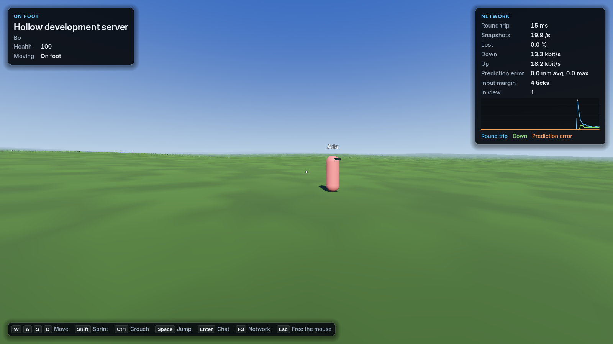
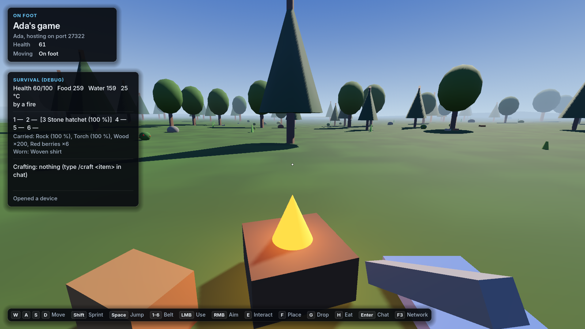

# Hollow Universe — The ground game

Status: draft 1, 12 October 2026. This is the Rust-style game on planet surfaces: what it is, how it's built and in
what order. [GAME_DESIGN.md](GAME_DESIGN.md) §5 says it in short; [ARCHITECTURE.md](ARCHITECTURE.md) holds the
engine-wide rules this follows (principles §2, determinism §8, networking §11, persistence §13).

Every rule is marked **Decided** (the owner said so), **Proposal** (waiting for a yes or no) or **Open**.

---

## 1. Decisions

| Topic | Rule | Status |
|---|---|---|
| Basis | Rust's ground loop, in first person: gather, craft, build, raid, full-loot PvP, sleepers, beds. | Decided |
| What may come from Rust | Its mechanics, its numbers (including the AK recoil pattern) and its UI design. | Decided |
| What may not | Asset files from Rust or any other game: models, textures, animations, sounds, maps, monuments. Not even as placeholders. The list of such files on this PC is in §9. | Decided |
| Names | Our own for items, devices and places. Plain words ("wooden door", "furnace") are fine. | Decided |
| Interface | The RustMVP interface, exactly (§8), built with `Ui` so it stays crisp at any resolution. | Decided |
| Multiplayer | Networked from the first line. Solo play runs the same server inside the game. | Decided |
| First world | A real planet from the generator: Nolcas Peris CQ-SLY 7-0 B 3 (§3). | Decided |
| It must look good | The surface (terrain, plants, water, sky) is part of G1 and is judged by the owner on screenshots. | Decided |
| Tech ladder | Rust's: rock, then stone tools, metal, firearms. Sci-fi only above that. | Proposal |
| Starter ship | The Tin Finch (`D:\GameDev\Assets\TinFinch_TF01`, our own Blender model): a single-seat skiff, crafted at the vehicle workbench. It is the first ship of the space part. | Decided |
| Day length | Planet rotation compressed 24 times for play: an Earth day becomes an hour, and the first world's day 87 minutes. Orbits and seasons stay real. Chosen by Claude while the owner is away; the owner may veto it. | Proposal |
| Who runs the work | Claude, on its own, until the whole thing is finished and polished; the owner is busy elsewhere and isn't asked to playtest in between. Progress is logged in `docs/progress-ground.md`. | Decided |
| Character | Our own character system (§4.8): a MakeHuman body (MPFB 2, CC0), Quaternius' Universal Animation Library 1 and 2 (CC0) retargeted onto it by script, clothing and armour modelled by our own Blender scripts. The owner approved the downloads on 12 October 2026. Never RustMVP's extracted Rust character, even as a fallback. | Decided |

---

## 2. Lessons from earlier attempts

| Attempt | What went wrong | What this design does instead |
|---|---|---|
| hollow-orbit (browser, single player) | Game state, meshes and UI mixed in the same objects; random numbers and a variable time step everywhere; no network. | Rules in engine-free C#; fixed ticks; the server owns the state. |
| RustMVP, Godot phase (GDScript client, C++ server) | Every predicted rule written twice, in two languages. | One C# rules library used by the server, the client and the bots. |
| RustMVP, Unreal phase | One generic command call and whole-struct replication (an audit judged it wrong); the installed engine can't build a dedicated server. | Typed messages; per-client delta snapshots; the server is a plain .NET program. |

Their rules, numbers and edge cases are still the best reference we have (§6).

---

## 3. The first world

The first world is a real body of the generated universe, chosen from the planets the generator makes
(GALAXY.md §10.3). Within 400 ly of Sol there are 1,698 worlds with plants and animals; 71 have breathable air;
this is the one closest to an Earth-like place to live.

| | |
|---|---|
| System | Nolcas Peris CQ-SLY 7-0, 331.5 ly from Sol, 5.2 billion years old. `SystemAddress` `0x7810135EB5240000`. |
| Suns | B, an F9.5 V star (5,983 K, 1.46 × the Sun's light), which the planet orbits. A, a cool white dwarf about 486 AU from B. C, a hot white dwarf about 1,800 AU out. From the planet, A and C are the two brightest stars in the sky. |
| Planet | B 3, body path `0x20600000`. Earth-like world, radius 6,435 km, 0.92 g. |
| Orbit and day | 1.255 AU from B (93% of Earth's sunlight), a 489-day year, a 34.9-hour rotation, 23° tilt (seasons). |
| Climate | Mean 18 °C, 13–20 °C between night and day. |
| Air | 2.23 atm; oxygen 0.31 atm, CO₂ 0.08%: breathable. Thick air means a deep blue sky and hazy distances. |
| Surface | Oceans cover 45%, ice 8%. Moving plates (mountain ranges), gentle volcanism. Complex life: vegetation and animals. Hazards: quakes only. |
| Moon | B 3 a, rocky, 250 km radius, 32,036 km away, orbit 16.3 h. It looks about 1.7 times as wide as our Moon. |
| Neighbours | Two hot rocky planets inside, an asteroid belt and three ice giants with moons outside. |

- **Pinned by a test.** A golden test pins the planet's state. If a generator change alters it, the test fails and we
  decide what to do. The ground branch starts from `generator-v2` for this data.
- **The landing site** (the first zone's origin) is 44.8683° N, 170.0010° W (`FirstWorld.LandingLatitude`,
  `FirstWorld.LandingLongitude`): the east shore of a bay, 21 m above the sea, on a meadow at a forest edge
  (birches, oaks, spruces, berry bushes); the bay within 2 km to the west and south-west; forested hills to 365 m
  nearby and to 1,160 m 18 km to the north-east (`surface site` in the generator report). The golden test of the surface includes points around it.
- **Look-dev views** (`docs/images/ground/`, 1600 × 900; commands in §4.6):
  - `a_landing_morning.jpg`: the landing site at 09:25 local time.
  - `b_golden.jpg`: the meadow 700 m south of it at 18:13, looking into the sun (6° up) through the forest edge.
  - `c_night_moon.jpg`: the same meadow at 22:07, the moon 38° up and 68% lit (behind the camera), the galaxy's
    band.
  - `d_hills.jpg`: forested hills 17 km north-east, from 60 m above a 620 m ridge.
  - `e_beach.jpg`: the beach 4 km south, along the coast.
  - `f_forest.jpg`: inside the forest 600 m north, toward the sun.
  - `g_2km.jpg`: from 2 km above the landing site toward the hills, the bay on the left.
  - Also: `b2_golden_shade.jpg` (the meadow at golden hour facing away from the sun, the grass in shade),
    `f2_forest_clearing.jpg` (a forest clearing near the hills: sparse grass, ferns, litter, full fir crowns),
    `g2_2km_down.jpg` (from 2 km looking steeply down: the canopy, groves and meadow edges).
  - `compare/`: the meadow and forest before and after the plants and grass were redone (same views and times).

---

## 4. Architecture

### 4.1 Projects

```
src/Hollow.Core          (exists) double vectors, DMath, Hash64, Rng, units
src/Hollow.Galaxy        (exists) galaxy, star systems, planet state
src/Hollow.Surface       planet surfaces: height, climate, biomes, materials, scatter; chunk meshes and collision
src/Hollow.Simulation    entities, components, systems: movement, items, crafting, building, combat, survival
src/Hollow.Net           messages, bit packing, snapshots and deltas, transport (LiteNetLib)
src/Hollow.Client        the client without graphics: connection, prediction, interpolation, client world
src/Hollow.Persistence   SQLite storage
src/Hollow.Server        the dedicated server; also a library the game hosts in-process for solo play
game/                    Godot: views, first person, terrain rendering, UI, audio, input
game/data/ground/        items, recipes, building parts, loot, weapons, survival constants (JSON)
tools/Hollow.Bots        headless clients for tests and load tests
third_party/             vendored packages, so the repository builds without network access
```

Dependencies point one way: `Core ← Galaxy ← Surface ← Simulation ← Net ← Client / Server`, and
`Persistence ← Simulation`. The game references `Client` (and `Server`, for hosting). Nothing in `src/` references
Godot.

```
      both sides run the same rules and data: Hollow.Simulation + game/data/ground
┌─ Godot client ─────────────────┐         ┌─ Hollow.Server (.NET, no Godot) ────────┐
│ Hollow.Client (no Godot):      │   UDP   │ zones: physics (Jolt) + systems, 30 Hz  │
│   prediction, interpolation    │<------->│ replication: who sees what, snapshots   │
│ Godot: views, first person,    │         │ persistence: SQLite                     │
│   UI, audio, input             │         │ sessions, chat, raid alerts, admin      │
└────────────────────────────────┘         └─────────────────────────────────────────┘
  bots = Hollow.Client without a window: 2 players + 100 bots, headless, in tests
```

### 4.2 Server

- One process. A **zone** is one surface region of one body: its entities, one Jolt physics world and the systems
  that run on them, at a fixed 30 ticks per second, on one thread at a time (ARCHITECTURE.md §10).
- **Tick order:** inputs → movement → actions (gather, build, craft, use) → projectiles and damage → survival →
  devices (furnaces, timers) → AI → decay and upkeep (slow) → replication. Dirty entities are saved every 30 s.
- **Static entities** (building parts, deployables, boxes) cost nothing per tick until something happens to them.
- **Natural things** (trees, ore, plants) come from the surface generator. Only changes are stored, such as "this tree
  is cut until T" (ARCHITECTURE.md P1).
- **As built in G1** (`src/Hollow.Server`): a .NET console program and a library. One zone on the first world at a
  latitude and longitude from the command line (the planet package picks the landing site). Each tick: receive, finish
  logins, run admin commands, give every character its input for this tick, step the zone, send snapshots (20 a
  second), save every 30 s, send. Tick time is measured (average, 99th percentile, maximum).
  - **Login** is by player name for development: the name is the account, one character per name, refused if in use.
  - **Admin console:** `status`, `kick <name> [reason]`, `teleport <name> <x> <z>` or `teleport <name> <other>`,
    `say <text>`, `save`, `quit`. Ctrl+C or `quit` saves everyone, says goodbye to every client and stops.
  - **Host mode:** the game runs the same `GameServer` on a background thread for solo play (`--host`); other
    clients can join it on the same port.
  - Ground near the spawn is built at start, so the first arrival doesn't stall the tick.

### 4.3 Client

- **Hollow.Client** (no Godot) owns the connection and the client's copy of the world:
  - Input commands go out every tick.
  - The player's own character is predicted with Hollow.Simulation's movement code, against a local Jolt world
    built from the surface generator and the replicated static entities.
  - When a snapshot says "input 412 processed, you are here", the client rewinds and replays newer inputs.
  - Other entities are interpolated 100 ms behind the server.
  - Inventory and container contents are mirrored. Intents (build, craft, move an item) show at once in the UI
    and are confirmed or rejected by the server.
- **Godot** draws that world and nothing else: a surface mode with a floating origin, terrain from Hollow.Surface,
  entity views pooled by type, a first-person camera and viewmodel, third-person characters, UI and audio.
  Mouse look is applied every frame, never held back by the tick.
- **Bots** are Hollow.Client with scripted input. Tests run the server and bots headless.
- **As built in G1** (`src/Hollow.Client`, no Godot): `GameClient.Update(delta, input)` every frame receives, runs
  the ticks that are due (each predicts and sends its input) and advances what is drawn.
  - **Prediction:** a `Predictor` keeps 4 s of inputs and predicted states. A snapshot brings the server's state of
    the character after some tick; if it differs from the prediction for that tick, the predictor takes the server's
    state and replays the newer inputs. Identical inputs give identical results (§4.5), so on a clean line nothing is
    ever corrected.
  - **Smoothing:** a correction under 2 m is added to a visual offset that fades in about 0.1 s; a bigger one (a
    teleport, a respawn) shows at once. The drawn position blends the last two predicted ticks, so movement is smooth
    at any frame rate; the eye height eases between stances (RustMVP's rate 18).
  - **Remote entities** are drawn 100 ms behind a clock that follows the newest snapshot tick, blended between the
    snapshots on either side; if snapshots stop they carry on for up to 4 ticks along their last motion, then hold.
  - **Statistics:** round trip (measured by echo), snapshot rate and loss, bandwidth both ways with UDP and IP
    headers, prediction error (last, mean and worst), input margin, clock rate.
- **The ground mode in Godot** (`game/scripts/Ground/`, G1 placeholders): `--view ground` connects to a server
  (`--connect host:port`) or hosts one in the game for solo play (`--host`, the default). First-person camera at the
  eye, mouse look every frame, W A S D, Shift sprint, Ctrl crouch, Space jump. Other players are capsule mannequins of
  the character's size with a visor and their name (placed by `Labeller`). The ground is drawn from the same collision
  tiles, 448 m across, coloured by slope, under a placeholder sky and haze; the planet package's renderer replaces
  it. F3 shows the network graph, Enter opens chat. Zone-frame metres are Godot's coordinates (no floating origin yet:
  the zone stays within 8.2 km of its origin, where floats are good to half a millimetre).



### 4.4 Network

- LiteNetLib over UDP. Reliable ordered channel: commands, intents, static entities, container contents.
  Unreliable sequenced channel: inputs and snapshots.
- Messages are typed structs, bit-packed by generated code: no reflection or JSON on hot paths.
- Snapshots go out 20 times a second, delta-compressed against the last one the client acknowledged, for the
  entities its relevance grid selects, within a bandwidth budget (≤ 256 kbit/s in a fight).
- Shots: projectiles with drop and travel time are simulated on the server. Hit tests rewind targets to what the
  shooter saw, using one second of hitbox history. Clients never report hits. As built in G4: shots and reloads are
  intents for a tick, the shooter's client predicts its gun, and bullets' launches go unreliable (§6.4).
- For testing, the transport can add latency, jitter and packet loss, and the client shows a network graph.

**As built in G1** (`src/Hollow.Net`):
- **Transport:** LiteNetLib 2.1 in manual mode (no background threads: the server polls once a tick, a client once a
  frame). Reliable ordered: `Welcome`, `Spawn`, `Despawn`, chat. Sequenced (unreliable, newest wins): inputs and
  snapshots.
- **Connecting:** the connection request carries `Hello` (protocol version, the generated schema hash, the name). A
  refusal carries a `Goodbye` with a reason (protocol mismatch, bad name, name in use, server full; also kick and
  shutdown). An accepted player gets `Welcome`: net and entity IDs, the server tick, the rates, the zone (body, radius,
  gravity, surface seed, latitude, longitude) and the saved view.
- **Clocks:** every input is for a tick. The client runs its tick clock ahead of the server's so inputs arrive in
  time: every snapshot says how early this client's inputs arrived (the least over the last half second). The client
  aims for 2 ticks: 4 % faster below, 3 % slower above 4, and it jumps when inputs arrive late or very early. A jump
  forward runs the extra ticks over the next frames (their inputs still go out); one of over a second skips them (the
  server and the prediction both fill skipped ticks by repeating the last input). A jump back pauses. The first lead
  comes from the connect handshake's round trip.
- **Inputs:** one packet per client tick: the tick's input (move axes in 1/127, yaw and pitch in 1/65,536 of a turn,
  buttons: jump held, jump pressed this tick, crouch, sprint) and the three before it, the snapshot acknowledgements and
  a client timestamp for measuring the round trip. Only four losses in a row lose an input. The server applies each
  tick's input on that tick; without one it repeats the last (without the jump press) and counts a miss.
- **Snapshots:** 20 a second per client (every 1.5 ticks on average). The header has the sequence, the server tick,
  the input margin, the player's own character exactly (floats, for reconciliation) with its tick, and the echo. Then
  the relevant entities, each delta-coded against its newest state the client confirmed (acknowledged by sequence and
  32 bits), highest accumulated priority first, within 1,600 bytes and the path's MTU. Remote positions are on a
  1/256 m grid.
- **Relevance:** a 64 m grid; an entity becomes relevant within 300 m (reliable `Spawn`) and stops beyond 320 m
  (`Despawn`). Everyone's own character is always theirs.
- **Bad network:** `ConditionedRelay`, a local UDP relay below LiteNetLib (whose own simulation is compiled out of its
  release package), adds round-trip latency, jitter and loss in both directions; clients and bots take `--lag <ms>`,
  `--jitter <ms>` and `--loss <percent>`.

**Building (G3, §6.5):** pieces, doors and claim devices are static entities, replicated by 64 m area. When an area
comes within 300 m its pieces are queued for that player, nearest areas first, and go out within 1,200 bytes a
snapshot (at most about 190 kbit/s while a base streams in); after that only changes travel, removals first (a
client's copy may give a freed body ID to a new piece). Positions are exact doubles in exact frames and each piece
carries the server's Jolt body ID, so a client's copy links, solves and collides exactly as the server's. A
1,074-piece base reaches a player who joins beside it in about 1.9 s (a test).

### 4.5 Physics and movement

- **Jolt** through JoltPhysicsSharp 2.23 (joltc 1.1), on the server and in the client's prediction. **The G1 spike
  passed (12 October 2026):** a fixed script of 600 ticks of input (walk, sprint while turning, jumps, crouch, strafe)
  walks a virtual character over mesh ground from `ISurface.GroundCollision`, with up from `ZoneFrame.UpAt`, on a
  stand-in planet of the first world's size. A .NET console process and the Godot 4.7.2 client (which also loads
  Godot's own Jolt) print the same final position and the same hash of every state on the way
  (`0x6E7FDE937D5A46FA` on win-x64 with the movement code of 12 October 2026; any change to movement changes it).
  BepuPhysics2 is not needed. The check stays: `dotnet run --project tests/Hollow.Tests -- MovementCheck` and
  `$GODOT --headless --path game -- --physics-check` must print the same line
  (`Hollow.Simulation.Movement.MovementCheck`).
- **One step is a pure function** of the character's state (feet position, velocity, stance, health), one tick of
  input and the static world. Every step first puts Jolt's character exactly at the state and finds its contacts
  afresh, on the server as in prediction, so the client can rewind to any state the server sends and replay its
  inputs to the same bits. Results are repeatable within one build and platform; across platforms they may differ in
  the last bits, which reconciliation absorbs.
- **One lock for Jolt.** joltc's character functions share one temporary allocator inside the native library, so
  `JoltRuntime.Gate` serialises every call into Jolt in a process (a hosted server and the client's prediction share
  the game process). A zone holds it for its movement pass. Zones ticking in parallel (G7) will need joltc's
  per-caller allocators.
- **Characters** use Jolt's virtual character, a capsule (radius 0.32 m, 1.76 m standing, 1.10 m crouched) whose
  position is its feet. "Up" is away from the planet's centre at the character, expressed in the zone's frame
  (`ZoneFrame.UpAt`), so nothing assumes +Y is up; the view's yaw is measured about the zone's +Y and laid onto the
  local horizontal. Characters don't collide with each other in G1 (§11), so prediction depends only on the static
  world and the player's own inputs.
- **Movement** follows RustMVP's numbers (`MovementTuning`, from `weapons_character_ui.md` §2): walk 2.8 m/s,
  sprint 5.5 m/s (straight forward only), crouch 1.3 m/s, acceleration and braking 60 m/s², ground friction 8, air
  control 0.25, jump 7.0 m/s (7.6 crouched), steps up to 0.40 m, slopes up to 46°.
  - **Gravity** is the planet's surface gravity times RustMVP's gravity scale 1.8: 16.2 m/s² on the first world, so a
    standing jump rises 1.51 m.
  - **Fall damage** (RustMVP had none; Rust's rule): landing faster than 15 m/s toward the ground costs
    500 × (speed − 15) / 85 health, rounded up. A fall of about 7 m starts to hurt; about 31 m kills.
  - **Swimming** where `ISurface.SeaRadius` > 0: a character swims once the water reaches 65 % of its height (Rust's
    threshold), steers in the view direction (look down to dive), rises with jump and sinks with crouch, and floats
    at 75 % depth otherwise. 2.0 m/s, 3.0 m/s with sprint. Landing in water never hurts.
- **Collision:** the ground is static mesh tiles of 64 m built from `ISurface.GroundCollision`, identical on both
  sides. A tile's Jolt body ID follows from its grid position (Jolt orders contacts by body ID), so tiles agree where
  they meet whatever else each side holds. Tiles exist within ±8.2 km of the zone's origin. Building parts are boxes
  and convex hulls from data. Deployables and natural objects use simple shapes.
- Godot's own physics is used only for cosmetic things: ragdolls and debris.

### 4.6 Planet surface

`PlanetSurface` in Hollow.Surface is the real surface of a rocky planet; `SphereSurface` stays as the stand-in.

- **A pure function** of (universe seed, system, body, planet state, `GeneratorVersion.Surface`), built with `DMath`,
  `Hash64` and gradient noise made of + − × ÷ and floor only (ARCHITECTURE.md §8), so the server's collision and the
  client's terrain agree to the bit. A golden test pins heights and biomes at 600 points.
- **Cube-sphere:** six faces, each a square of face coordinates (u, v) ∈ [−1, 1]² mapped to the sphere through
  `tan(t·π/4)`, so tiles stay within a factor of 1.5 of the same size. A `TileKey` is face, level (0–28) and x, y;
  every grid coordinate is a dyadic fraction, exact in double, so parents and children share vertices bit for bit.
  On the first world a level-16 tile is about 154 m across and a level-18 tile about 39 m.
- **Tile grids:** 32 × 32 cells, each quad split along the same diagonal at every level. Vertices also carry their
  position on the parent's grid, so the client morphs between levels without popping, plus eight ground-material
  weights and the climate. **Collision is built from the level-18 grids** (1.2 m spacing), exactly the vertices the
  client draws near the player (`GroundCollision`; a test checks it).
- **Height**, in layers:
  - *Plates:* 14–20 plates (Voronoi on the sphere, seen through a warped direction so their edges bend), each
    continental or oceanic with its own Euler pole. Every plate near a point weighs in softly, and each boundary's
    relief is a function of the distance across it, so the field is continuous at triple junctions.
  - *Continents:* a warped noise plus the plates' bias, run through a crust curve (abyssal plains, continental slope,
    shelf, coast, lowlands, interiors). The coastline threshold is calibrated on 6,144 fixed directions until the full
    height puts exactly `OceanCover` under the sea (45.1% on the first world).
  - *Boundaries:* mountain belts where plates converge on land, trenches and island arcs at sea, rift valleys and
    spreading ridges where they part; their strength varies along each boundary. Old worn ranges in a few regions.
  - *Mountains:* the belts' uplift shaped by eroded ridged noise ("swiss turbulence": octaves displaced along the
    summed slopes), so crests are sharp, valley floors smooth and side valleys branch.
  - *Hills:* regional amplitude (mostly gentle, hilly in places and around ranges) over noise whose octaves are damped
    on steep slopes. Metre-scale ground on top, rougher on stony ground.
  - *Coasts:* a curve that flattens sandy shores into beaches (a regional "beach" field); rocky shores keep their
    slope.
- **Climate:** annual mean temperature from the planet's mean, latitude (42 K equator to pole), noise and a 6 K/km
  lapse rate; the ice line is calibrated so ice covers `IceCover`. Moisture from latitude bands (wet tropics, dry
  subtropics, wet mid-latitudes), distance inland and noise. Seasons are drawn, not generated (the sky moves).
- **Biomes:** ocean, beach, ice sheet, tundra, boreal forest, temperate forest, grassland, shrubland, desert, savanna,
  tropical forest and alpine ground, as soft weights from a Whittaker-like table. They give the eight ground materials
  (grass, forest floor, soil, rock, gravel, sand, snow, moss; slope turns ground to scree and rock) and plant
  densities, thinned by forest clearings, slope, tree line and shore.
- **Scatter:** per level-16 tile, a jittered grid of candidates per kind (trees 3.5 m, bushes 2.4 m, ferns 1.6 m,
  rocks 3.2 m), each kept with the probability its density gives. Trees grow in stands of one kind (fir, pine, birch,
  broadleaf). An object's ID is the tile plus its index: kind in the top byte, candidate cell below (ARCHITECTURE.md
  §7). Grass is a density per vertex, drawn by the client.
- **Speed:** about 3.7 µs per height and 7 µs per drawn vertex (with climate and materials), about 7 ms per tile on
  one core; the client builds tiles on worker threads.
- **Sky:** `SkyEphemeris` turns the planet's body frame in the system frame: the spin axis leans from the system's
  +Y toward −X by the axial tilt and stays fixed (seasons follow the orbit); the body turns 2π·t / period about it,
  prime meridian in the plane of the axis and +X at J2000. Sun, moon, the other suns and planets come from the orbit
  code at the universe time. The client draws physically based scattering for the planet's own air (Rayleigh, Mie,
  ozone, multiple scattering) with the same tables as the aerial perspective on everything under it.
- **Water:** the sea at `SeaRadius` (sea level), drawn on the terrain's own tiles.

**The surface view** (client, `game/scripts/Surface`; presentation only, never deciding what exists):
- **Terrain:** a quadtree of the tiles above around the camera, built on worker threads, morphing toward the parent
  grid with distance (no cracks: skirts), in a floating origin that moves with the camera without turning. Eight
  ground layers (texture arrays) blended by the vertices' material weights and their own heights, triplanar rock on
  cliffs, two scales near and a larger turned copy far so nothing repeats in rows; the grass layer takes the colour
  of the grass blades (below). The forest floor is brown leaf litter with cushions of moss, and under trees the
  canopy keeps much of the sky's light off the ground (sun flecks stay). Beach sand is lighter, with patches of
  fine wind ripples near by; below the wave line and where the swash runs it is dark and glossy, with thin foam
  lines left by the waves.
- **Far forests:** where the trees' impostors end (2.2 km along the ground, so from the air the forest below keeps
  its trees) the ground draws the canopy: a tiling crown map with its own slopes lit by the sun, groves at a larger
  scale, stands of dark conifers and lighter broadleaf, dark gaps between crowns, and crisp irregular forest edges
  with a shadow line on the open side. Seen steeply from the air (where billboards would be slivers) the canopy
  replaces the impostors.
- **Air and light:** the sun (star B) and the moon at their real directions for the universe time; scattering for the
  thick air (transmittance and multiple-scattering tables, the sky ray-marched at quarter resolution) and the same air
  in front of everything through a 3D aerial-perspective table. Clouds: a layer of fair-weather cumulus (1.6–2.9 km,
  cover 0.35) with cloud shadows. Night: the two white dwarfs, the other planets, a star field and a narrow, dim
  band of the galaxy broken into structure; moonlight on the ground is brightened 14 times and turned a little blue
  (dark but readable, as in Rust), the moonlit air only 2.5 times; the moon's disc is capped a few times above white
  so it never blooms over the sky. Exposure meters for the light
  falling on the ground, nights a few stops darker than days.
- **Water** reflects the sky and sun with Fresnel, shows the sea floor through water that absorbs red first, glows
  turquoise in the shallows and moves with Gerstner swell near the camera. Surf: broken lines of foam roll in over
  the shallows along the depth contours, and a swash of foam runs up the sand and back.
- **Plants** are made in code after hollow-orbit's flora (no plant models): firs (spruce-like), pines, birches,
  broadleaf trees (oak and beech), bushes, red- and blue-berry bushes, ferns and boulders; two to four seeded variants
  per species, each with two meshes. Leaves are cards of a painted atlas (4 × 4 cells, mipmaps that keep the share of
  leaf texels so far foliage does not thin), alpha-tested with alpha to coverage, with vertex-colour occlusion,
  normals pointing out of the crown, hollow-orbit's foliage light (a warm sheen with the sun behind the viewer, light
  through leaves that face away from it) and little specular. Bark: fine wandering vertical fissures, cross-cracks,
  lichen and colour variation, with a normal map; moss low on the trunk's north side. Firs and pines end in small
  upturned whorls and a needled leader, not a bare spike. Boulders: icospheres cut into facets, textured with the
  ground's rock layer in their own frame, moss on top.
  - *Levels:* trees draw their full mesh to 50 m, their second mesh to 170 m, then impostors to 2.2 km (eight views
    of every variant, colour and normals, rendered into an atlas when the view opens); the near set's impostors and
    the far blocks' meet at an exact cut (290 m). Each object keeps its level between rebuilds, with a few metres of
    hysteresis; when it changes level the two cross-fade over 0.45 s (complementary dithers), so no crown stands
    half-dithered at a boundary. Bushes, ferns and rocks use their second mesh to 75–200 m and shrink into the ground
    at the end. Past 1.6–2.2 km forests are drawn by the ground (above).
  - *Wind:* every vertex carries a bend weight and a flutter weight; the plant bends along the wind with gusts that
    roll across the forest, leaves flutter along their normals.
  - Each plant is a scatter object, known by tile and index; berry bushes are their own kinds (`BerryRed` 7,
    `BerryBlue` 8) because they will be food.
- **Grass and ground cover** are not in the scatter and have no models: `GrassField` draws one MultiMesh of tufts on
  a 0.4 m grid that follows the camera (to 42 m; they shrink into the ground from 22 m), and a second, flat one of
  leaf litter, needles and twigs (to 26 m). What grows in each cell (place, height, width, turn, lean, colour,
  dryness, kind: grass, meadow grass, dry grass, flowers; ferns, herbs and seedlings under trees; dead leaves of the
  trees around) comes from a hash of the cell in stable coordinates, so nothing shifts as the grid moves. Two field
  textures (256² at 0.5 m, rebuilt on a worker every 14 m) hold the ground's height (the finest tiles' own
  triangles, so tufts sit on the drawn ground), the grass density (from the biomes, materials, slope and tree
  cover), moisture, flowers, forest cover and small plants. Where grass is thin it grows in patches, and a tuft is a
  few narrow cards of ragged blades, not a block. The blades are hollow-orbit's painted blade cards, coloured by one
  function shared with the ground's grass layer (`surface_grass.gdshaderinc`), their foot in the ground's colour,
  normals up on both faces so a field lights as one in sun and shade, light through the tips toward a low sun; wind
  bends them in gusts drifting downwind with a ripple; they bend away from the walker's feet.
- **Time:** the clock runs at the universe time; `RotationTimeScale` (client setting `[surface]
  rotation_time_scale` in `user://settings.cfg`, or `--time-scale`) turns the planet faster than real without
  moving anything else. Keys: `[` `]` jump the clock an hour (Shift: six), T cycles the day speed 1×, 60×, 600×,
  3600×, P pauses, H hides the interface; a card in the corner shows local solar time, UTC and the speed.
  Screenshots pause at `--time`.
- **Speed** (1600 × 900, RTX 2070 Super, vsync on): 11–12 ms a frame (85–89 fps) at the landing site with 3,300
  plant meshes, 414,000 impostors and 45,000 grass tufts; 13–15 ms (65–73 fps) inside dense forest; 7 ms from 2 km.
  Opening the view takes about 4 s (tiles, the painted atlas and the plants, then the impostor bake).
- **Look-dev commands** for the views in §3 (add `--shot <file> --hide-ui` to save them):
  - (a) `--view surface --alt 1.7 --yaw 60 --pitch -2 --time 2026-10-12T03:00:00Z`;
  - (b) `--view surface --lat 44.86225 --lon -170.00150 --alt 1.7 --yaw 280 --pitch 0 --time 2026-10-12T15:50:00Z`;
  - (c) `--view surface --lat 44.86225 --lon -170.00150 --alt 1.7 --yaw 345 --pitch 12 --time 2026-10-18T17:30:00Z`;
  - (d) `--view surface --lat 44.97185 --lon -169.84163 --alt 60 --yaw 45 --pitch -4 --time 2026-10-12T03:00:00Z`;
  - (e) `--view surface --lat 44.83304 --lon -169.99447 --alt 1.7 --yaw 20 --pitch -2 --time 2026-10-12T03:00:00Z`;
  - (f) `--view surface --lat 44.87400 --lon -169.99949 --alt 1.7 --yaw 120 --pitch 6 --time 2026-10-12T03:00:00Z`;
  - (g) `--view surface --alt 2000 --yaw 20 --pitch -14 --time 2026-10-12T03:00:00Z`.
- **The interface between the two G1 work packages** is `ISurface` in Hollow.Surface: height at a point, biome at a
  point (`BiomeAt`), collision for a zone square, scatter for a tile (`ScatterFor`). The last two have default
  implementations, so other `ISurface`s keep compiling.

### 4.7 Persistence

SQLite through Hollow.Persistence, as in ARCHITECTURE.md §13:
- what's stored: characters, persistent entities grouped by region, overrides of natural objects, and zone
  metadata (`last_simulated_at`, versions);
- dirty entities are written every 30 s and on shutdown;
- deaths, trades and transfers commit at once.

In G1 (`Hollow.Persistence`): accounts by player name (the development login, case-insensitive) and one character per
account, stored with its position in the **body frame** (metres from the planet's centre, turning with it), so it
comes back at the same place on the planet whatever zone frame the server uses next. Also its view angles, stance and
health. The schema version is SQLite's `user_version`; opening a database migrates it step by step and refuses one
newer than the build. Every database call runs on one worker thread in the order made, so a tick never waits for the
disk and a login always reads the last save. Characters are saved on disconnect, every 30 s and on shutdown.

Schema 3 (G3, §6.5) adds the body's building: a row per piece, door (with its lock) and claim device (with its list,
store and upkeep debt), each a versioned binary record, written only when it changed and deleted when it's gone. The
zone's record keeps when upkeep and decay were last applied, so loading catches up the time the server was down.

### 4.8 Characters

What a player looks like to others and to themselves. Code in `game/scripts/Characters/`, assets in
`game/assets/characters/`, built from text by the Blender scripts in `art/characters/` (§9); held items are the item
models of §9.1.

**The contract.** `CharacterView` (a `Node3D`) draws one player from state alone. The network side feeds it; nothing in it
knows about the network.

| Input | Meaning |
|---|---|
| `Apply(CharacterFrame)`, every frame | `Position` (feet) and `Up` (unit, away from the planet's centre), in the view's parent space; `Yaw` (radians about `Up`, 0 = north = the parent's −Z laid on the ground plane, anticlockwise seen from above: the movement code's view yaw); `Pitch` (view pitch, + up); `Velocity` (m/s); `Stance` (stand, crouch, swim); `Grounded`; `Held` (unarmed, tool, pistol, rifle) and `HeldItem` (the model, optional). |
| `Trigger(CharacterEvent, direction)` | `Swing` (tool strike or punch), `Fire`, `Reload`, `Hit` (a flinch), `Death` (ragdoll, pushed along `direction`). `Revive()` stands it up again. |
| `Wear(items)` | The worn clothing and armour: one item per wear slot (seven slots, §6: head, face, torso, torso armour, legs, hands, feet). |

`ViewmodelView` is the first-person counterpart, a child of the player's camera: `Hold(kind, item)`, `Wear(items)`,
`Apply(ViewmodelFrame)` every frame (velocity in the camera's frame, look rate, grounded, sprinting, crouching, aiming)
and `Trigger(Swing | Fire | Reload)`. Its `AimAmount` (0 at the hip, 1 aimed down the sights) lets the owner narrow
the camera's field of view.

"Up" is given per frame and nothing assumes +Y: the view builds its basis from `Up` and `Yaw`, and everything inside
works in the character's own frame. The ragdoll falls along −`Up` at the moment of death.

**Body.** A MakeHuman adult male (1.78 m, eyes at 1.67 m), MPFB's game-engine skeleton: 53 bones with UE-style names
(`pelvis`, `spine_01`…`spine_03`, `neck_01`, `head`, `clavicle_l`, `upperarm_l`, `lowerarm_l`, `hand_l`, three bones per
finger, `thigh_l`, `calf_l`, `foot_l`, `ball_l`). Rest pose: MakeHuman's A-pose. Levels of detail: about 18,000, 7,000
and 2,400 triangles for the body; eyes, brows, lashes and short hair (MakeHuman CC0 assets) drop out with distance.
A female body (1.61 m, eyes at 1.50 m) is built by the same scripts (`-- --body female`): the same skeleton names, her
own meshes, clothing cut from her body and clips retargeted onto her rig (`human_female.glb`, `clothing_female.glb`,
`animations_female.glb`); a character picks its body with `CharacterView.Body` and `ViewmodelView.Body`. Players
start in plain underwear, which is part of the body (the pelvis region, smoothed and with its own fabric surface, and
for a woman a crop top cut straight round the chest), so nobody is ever without it. The face blinks every two to six seconds at the nearest level of detail (a
"blink" shape on the body and lashes from MakeHuman's eyelid-closure expression units); the eyes have a wet clear coat;
the hair cards blend their thin ends over a depth pre-pass, and a dark hair base painted on the scalp fades into the
forehead, so the hairline is soft.

**Clothing.** Every body face belongs to one of fourteen regions (face, scalp, neck, collar, chest, belly, pelvis, upper
arm, forearm, hand, thigh, calf, ankle, foot). A garment lists the regions it covers completely; the body's triangles there
are collapsed in the vertex shader (`hidden_regions`, a per-instance bit mask), so skin never pokes through and costs no
fragments. Garments carry the same regions, so an inner garment hides its parts under an outer one (trousers tucked
into boots). Garments are single shells built from the body's own surface and skinned to the same skeleton. Each one
is:
- cut with planes for straight hems, and along a curved line round the base of the neck for a crew neckline; a ribbed
  band stands up from it and hugs the neck a finger's width off the skin;
- given room by a cross-section envelope that makes every cross-section convex, so cloth spans the chest instead of
  following it and falls straight from the chest and below the knee;
- skinned with the body's weights blurred over the garment, so loose cloth moves as a whole instead of creasing where
  the body's weights change;
- folded near the joints;
- painted from the body's 3D positions: stitched hems and seams, ribbed collar and cuffs, wrinkles, a belt, laces,
  soles, dirt.

The breastplate is not cut from the body. It is a riveted cuirass of our own design:
- front and back plates with a keel down the front, rolled rims and a flared lower edge, standing 25 mm clear of the
  shirt and rigid on the chest bone (`spine_03`), so they never flex with the chest;
- two fauld lames over the belly, each flaring out from under the one above;
- a cap over each shoulder and a lame round each upper arm, fitted to the sleeve by rays cast from the joints;
- leather straps over the shoulders and round the sides, with brass buckles.

It is built for the silhouette: broad steel shoulders, a keeled chest and a flared skirt read as armour at 20 m.

The first outfit: knit cap, woven shirt, woven trousers, laced boots, riveted breastplate.

**Animation.** One `AnimationTree` graph, shared by all characters (`CharacterAnimator`):
- speed blends for standing (idle, walk, jog, sprint at 0, 1.25, 2.8 and 5.5 m/s), crouching and swimming, kept in
  step with Godot's cyclic sync; each loop is stretched so its feet keep up with the ground at its speed. The jog,
  sprint and crouch walk are also re-timed when they are built: a hand-keyed run's planted foot swept back twice as
  fast as the body moved, so its stance phases are stretched until the foot sweeps back at the blend point's speed
  and the swing and flight take the time left (the cycle keeps its length). At the blend speeds the feet don't slide;
- a fall pose blended in while airborne, a take-off and a landing played as one-shots;
- held-item layers: the right arm (tool, pistol, rifle) and the left arm with the chest (pistol, rifle);
- one-shot upper-body actions and flinches: hatchets, picks, hammers and torches chop (UAL2's tree-chopping loop,
  started at its wind-up a little faster than the clip and faded out after the follow-through, so the blow lands at
  about the item's strike time), blades slash, the rock comes down overhand; punch, pistol fire and reload.

The clips only run forward; `CharacterPoser`, a `SkeletonModifier3D`, turns the hips towards the direction of travel
and the chest back to the aim (running backwards plays the loop in reverse), spreads the view pitch over spine, neck and
head, reaches both hands onto a rifle's grips with two-bone IK, and plants the feet on uneven ground (the hips drop,
each leg reaches the ground found by a ray under its foot).

**First person.** The arms are the body's own mesh with only the forearms and hands drawn (and the worn sleeves), on
render layer 2, without shadows, with their own field of view (60° by default; `ViewmodelView.Fov` is the player
setting) and depth pulled towards the near plane so they never clip into walls. Their shoulders sit 10 cm lower and
6 cm further forward than the body's, so the forearms rise into view from the lower corners, as in Rust (nobody sees
the shoulders). Both hands reach the item's grips by IK. The fingers of a fist or a pistol grip are wrapped round the
handle: each joint bends just enough for the next to lie on a circle round the handle, so they close on it without
passing through. The skin is the body's, without screen-space scattering (which smears whatever sits that close to the
near plane), with its own relief: a normal map made from the skin texture, fine wrinkles over the finger joints and a
glossy plate for each nail (`art/characters/skin_maps.py`). The item moves procedurally: sway, walk bob, sprint
pose, recoil kick on a spring, aiming down the sights (the sight on the camera's centre line). Swings and reloads are
key poses (`ViewmodelMotion`): a swing turns about the hand, up and back for the wind-up, a beat at the top, then down
and across fast enough to land at the item's strike time (items.json), a damped jolt on the impact, follow-through and
recovery; a reload tilts the gun in, the support hand takes the magazine out and away, seats a new one (the gun jolts),
works the slide or the charging handle (another jolt) and returns. Unarmed shows no arms, as in Rust.

**Death.** `PhysicalBoneSimulator3D` with fourteen capsules (pelvis, two spine, head, upper and lower arms, thighs,
calves, feet), cones at the spine, shoulders and hips, hinges at the elbows and knees. Built on first use. Ragdolls
collide with the world (layer 1), not with each other; gravity is applied along −`Up`.

**Held items** are every item the model catalogue gives a held pose (§9.1), loaded through `ModelCatalog` with the
materials of their import settings, named from items.json (`HeldItems`). Tools and blades are held by the handle and
swung; guns are held as pistols or rifles; the bow is held in the left hand; whatever else is held (spears, food,
bandages, locks, charges) sits in first person where the catalogue's first-person pose puts its grip. Aiming down the
sights puts a gun's eye socket at the camera.

**Held items in third person.** A tool rides upright in the right hand at the hip (the bow in the left), a pistol is
held by the clip's two-handed pose, a rifle is carried at the right shoulder pointing where the player looks; arm IK
holds the grips and lets go while an action clip plays. Items show one level of detail coarser than the body.

**Cost.** Mesh level by camera distance (to 9 m, 28 m, 450 m; nothing beyond). Animation runs every frame up close,
every second frame in the middle distance and every fourth far away, staggered across characters; the procedural layer
runs only where it can be seen, foot placement only at the nearest level. Animation parameters are cached
`StringName`s, so a frame allocates nothing per character.

Measured on the owner's PC (RTX 2070 Super, 1600 × 900, Forward+, vsync off, two other Godot sessions running),
`--view character --crowd 49 --measure 10`, all 50 characters on screen, moving, mixed outfits and held items:

| Setting | Average frame | 99th percentile | Worst |
|---|---|---|---|
| Levels of detail by distance (as shipped) | 5.7 ms (174 fps) | 9.0 ms | 12.7 ms |
| All 50 forced to full detail, full-rate animation and foot placement | 9.8 ms (102 fps) | 13.8 ms | 35 ms (one hitch) |

**Viewer.** `--view character` (options in AGENTS.md): cycle outfits, held items and motions, fire every event, die and
revive, switch to first person, and measure a crowd. Screenshots in `docs/images/ground/character-*.png`.

**Not good enough yet** (next passes): garments are shells of the body, not simulated cloth, so they don't swing or
drape as the body moves, and their wrinkles are painted, not simulated; the back plate is plainer than the front; the
face has no expressions or eye movement beyond the blink; hair is MakeHuman's short cut only; first-person reloads move the hand but not
the magazine (the catalogue's guns are one mesh); the female body's crop top still has a few notched faces at its edges, and her shirt shows the bust a little more than a real shirt would.

### 4.9 Audio

Rust's sound is the bar: grounded, punchy, readable, nothing cartoonish. Built in the `ground-audio` package from CC0
recordings (§9.2); the ground mode and the surface view still have to call it (the hook-up list below).

| Part | Where |
|---|---|
| Sound files: 463, Ogg Vorbis q5 at 48 kHz (interface clicks 16-bit WAV), 12.6 MB | `game/assets/audio/` |
| The catalogue: 138 events with their variants, volume, random pitch and volume, attenuation, bus, priority, voice limit; distance layers; loudness categories; what each item plays | `game/data/ground/sounds.json` |
| Every file's measurements (loudness, true peak, spectrum, lead, tail, SHA-256) | `game/assets/audio/levels.json` |
| The pipeline that builds both (§9.2) | `art/audio/` |
| Engine-free rules: the catalogue model, a BS.1770 meter, distance layers, footstep surfaces and cadence, the ambience mix | `src/Hollow.Client/Audio/` |
| The Godot side: `AudioDirector`, `AudioBuses`, `FootstepDriver`, `AmbienceDirector`, `SoundLibrary`, `SoundMeter`, the viewer | `game/scripts/Audio/` |
| Tests: files there and imported at 48 kHz, measurements current, peaks, loudness, items covered | `tests/Hollow.Tests/SoundCatalogueTests.cs` |

**An event** (sounds.json) has `files` (its variants), `volume` (dB), `pitch` (a random range), `jitter` (± dB),
`unitSize` and `maxDistance` (metres: inverse-distance falloff from the unit size; beyond the maximum it doesn't start),
`bus` (SFX, Footsteps, UI, Ambience), `priority` (0–100), `limit` (voices of this event at once), `loop`, `space`
(`2d` for the interface and ambience beds), `occlude`, `delay` (starts after the time sound takes to arrive, 343 m/s),
`cooldown`. A layered event (gunshots, explosions) has `layers` instead: each with its files, a distance band
(`from`, `to`, `fade`), its own volume and falloff. `items` maps item keys and door kinds to roles and events
(`"stone-hatchet": {"swing": "melee.swing.heavy", "hitWood": "gather.wood.hit", …}`), so the game asks
`SoundCatalogData.ItemEvent(item, role)` instead of knowing keys. The build owns each event's files and category and
the item map; every other field may be tuned by hand and is kept when the build runs again.

**Events.** Footsteps: walk, run, crouch and land on grass, dirt, sand, rock, snow, wood, metal and shallow water, and a
swim stroke. Gathering: wood hit, a tree falling, stone hit, ore hit, an outcrop breaking at each of its three stages,
the weak spot's tick, berries, plants, picking an item up. Survival: eat, drink, bandage, hurt, death, cold breath.
Deployables: campfire and furnace loops, their ignition, putting out, a box opening and closing, placing. Building:
placing by grade, upgrading to each grade, repair, demolish, collapse; doors opening and closing in wood, sheet metal,
armour and the garage door; the code lock's key press, accepted and refused; a key lock. Weapons: melee swings (light,
heavy) and hits (flesh, hard), the bow's draw and release, an arrow's flight and impacts, the pistol and rifle shot in
three layers and silenced, reload parts (magazine out and in, slide or bolt), dry fire, spent cases, bullet impacts on
flesh, wood, stone, metal, dirt and water, the hit marker, a head shot and a kill. Explosives: the fuse, the timer's
beep, the blast in three layers, debris. Interface (Rust's manner: quiet clicks, cloth for the inventory): click,
hover, drag, drop, craft started and finished, error, inventory open and close, a notice. Ambience: calm, strong and
high wind, meadow and forest birds, night insects, near and far surf, leaves; owls, crows and distant thunder.

**Loudness** (ITU-R BS.1770, measured with ffmpeg after encoding; the engine's own decode agrees within 0.7 LU,
`--sound-check`). A one-shot's *event loudness* is its highest momentary loudness corrected for sounds shorter than
the 400 ms window (down to 100 ms), a loop's is its integrated loudness. Every file peaks under −1 dBTP (highest
−1.10).

| Category | Metric | Target | Range | As built |
|---|---|---|---|---|
| footstep | event | −26 | −30 … −22 | −27.9 … −25.9 |
| foley (handling, swings, doors, eating) | event | −23 | −27 … −19 | −26.9 … −22.9 |
| click (reloads, locks, cases) | event | −27 | −33 … −21 | −32.0 … −26.9 |
| gather (chops, picks, building) | event | −19 | −23 … −15 | −22.4 … −18.9 |
| impact (hits, bullet impacts) | event | −21 | −27 … −17 | −25.6 … −20.9 |
| voice | event | −21 | −25 … −17 | −21.4 … −21.0 |
| gunshot (near) | event | −20 | −25 … −16 | −24.3 … −22.2 |
| distant (mid and far layers) | event | −22 | −27 … −17 | −25.8 … −21.9 |
| explosion (near) | event | −13 | −18 … −9 | −14.8 … −13.4 |
| ui, marker | event | −27, −23 | −33 … −21, −28 … −18 | −27.9 … −26.9, −23.5 … −23.0 |
| loop (fires, fuse) | integrated | −29 | −34 … −24 | −32.6 … −29.0 |
| ambience (beds) | integrated | −30 | −34 … −26 | −30.5 … −30.1 |
| accent | event | −27 | −32 … −22 | −27.3 … −26.9 |

A recorded gunshot is a few milliseconds of blast: at −1 dBTP its event loudness is about −22 LUFS, and no more than
6 dB of limiting is allowed, so shots aren't squashed. They are louder in the game than the numbers say: their
falloff starts at 12 m (footsteps at 2 m), the mid and far layers carry them to 1.5 km, and the event volumes set the mix.

**The director** (`AudioDirector`, one node; others call `AudioDirector.Instance`): pools of 56 placed
(`AudioStreamPlayer3D`) and 20 flat (`AudioStreamPlayer`) voices; an event's own limit cuts its oldest voice; a full
pool gives a new sound the voice of the lowest priority, then the oldest, or drops it if every voice matters more.
Variants come in shuffled rounds (`VariantBag`: never the same twice in a row); pitch and volume are random within the
event's ranges. A layered event plays each layer whose band covers the listener's distance, crossfaded with equal
power (`DistanceLayers.Weight`) and started after distance ÷ 343 m/s. Air absorption (a high shelf from 7 kHz) on
ordinary 3D sounds; layered ones carry their distance in their files. Occlusion: a ray from the listener to the source
on `OcclusionMask` (collision layer 1 by default, or `OcclusionTest`); a blocked voice plays on its bus's "Occluded"
child, low-passed at 900 Hz; loops look again every 0.3 s. API: `Play(key, position, volumeDb, pitch)`,
`Play2D(key, …)`, `Loop(key, node)` (follows the node until `Stop` or the node goes), `Loop2D(key)`,
`Stop(handle, fade)`, `SetGain(handle, db, fade)`, `IsPlaying(handle)`.

**Buses** (`AudioBuses.Ensure`, made in code): Master (a hard limiter at −1 dBFS) ← SFX, Footsteps, UI, Ambience; SFX
and Footsteps carry a short room reverb whose wet level follows `AudioBuses.SetSpace(indoor)` (dry outdoors, a damped
room inside a building) and an "Occluded" child each. `AudioBuses.SetVolume(bus, 0–1)` for the player's settings.

**Footsteps** (`FootstepDriver`, one per character; rules in `Footsteps`, `FootstepCadence`): a step every stride, the
stride growing with speed (0.6 m walking slowly to 1.75 m sprinting; shorter crouched), so steps keep pace with the
animation at any frame rate. Run above 3.6 m/s or sprinting, crouch when crouched; a landing after at least 0.12 s in
the air and 2.2 m/s down, louder the harder (−8 to +3 dB); swim strokes every 1.15 s (0.85 s sprinting); shallow water
(8 cm or more, not swimming) splashes whatever the ground. Surfaces from Hollow.Surface: grass and moss → grass; forest
floor, soil and gravel → dirt; rock → rock; sand → sand; snow → snow (`Footsteps.FromGround`, `FromWeights` for a
vertex's eight weights, `FromBiome` when only the biome is known); building floors by grade (twig and wood → wood, stone
→ rock, metal and armoured → metal, `FromGrade`). The player's own feet play flat, 3 dB down; others' at their feet.

**Ambience** (`AmbienceDirector`, rules in `AmbienceMix`): flat loops on the Ambience bus, gliding to their levels over
1.5 s, started when heard and stopped after 4 s unheard. Wind always (stronger with wind, height and exposure; a strong
bed from 400 m up and in wind, a high whistle on exposed heights); meadow birds by day in the open, forest birds among
trees, night insects in warm biomes; all wildlife quieter in wind, storm and above 1.5 km; surf within 220 m of the sea,
a far surf to 1.6 km; leaves among trees, louder in wind. Accents placed 50 m to 4 km around the listener: owls at night
near trees, crows by day, thunder only in a storm (no weather yet, so none).

**Viewer** (`--view sounds`, options in AGENTS.md): every event in a list, a click plays it; its settings, layers, and
each variant's loudness from the pipeline beside the engine's decode; a source walking away from the listener (posts at
10 m to 1.5 km; layer weights and the arrival delay shown); the ambience by biome, hour, wind, sea, forest, height and
storm with every bed's level. `--sound-check` loads and measures all 463 files in the engine and quits with 0 when they
agree with the pipeline.


**How to hook it up** (the ground mode and the surface view own these; nothing below is wired yet):
1. At start: add one `AudioDirector` (set `OcclusionMask` to the world and building layers) and one `AmbienceDirector`;
   `SoundLibrary.Preload` the footsteps and the held items' events.
2. Each frame, the player's `FootstepDriver { Local = true }.Update(dt, FootInput, feet)` from the predicted character
   (speed, vertical speed, grounded, crouching, swimming, sprinting, the surface under the feet, water depth); one
   driver per remote character from its interpolated state.
3. Each frame (or a few times a second), `AmbienceDirector.Update(dt, AmbienceInput, camera)`: altitude, exposure,
   `BiomeAt`, tree density around (the scatter's or `Vegetation` trees), distance to the sea, the sun's elevation from
   the sky, wind; `Indoor` and `AudioBuses.SetSpace` when under a roof.

| Game event (client API, §6.2) | Sound |
|---|---|
| A swing or strike (own input, a remote entity's swing count) | `ItemEvent(held, "swing")` at the hand |
| A hit on a tree / an outcrop (the natural object's health drops) | `hitWood` / `hitStone` (`hitOre` on metal) at the impact; `gather.weakspot` with it when the weak spot moved |
| An outcrop's stage changes; a tree falls | `gather.node.break.1/2/3`; `gather.wood.break` |
| `PickUpNatural` / `PickUpItem` answered | `gather.berry` (bushes), `gather.plant` (fibre, tubers), `gather.pickup` (piles, drops) |
| `Use` accepted (food, medicine) | `ItemEvent(item, "use")`, flat |
| `DamageTaken` / a remote flinch; `Died` | `survival.hurt`; `survival.death` |
| Cold (`Vitals.Cold` above 0.5) | `survival.cold` every 4–7 s, flat |
| A deployable spawns (`ThingSpawn`, own `Place` accepted) | `ItemEvent(kind, "place")` at it |
| A fire lights / goes out (`ThingUpdate.Lit`) | `ignite`, then `Loop(loop, node)`; `extinguish` and `Stop` |
| `ContainerOpened` / `ContainerClosed` on a box, campfire or furnace | `box.open` / `box.close` at it |
| Building: placed, upgraded, repaired, demolished; a collapse layer falls | `build.place.<grade>`, `build.upgrade.<grade>`, `build.repair`, `build.demolish`; `build.collapse` per layer |
| A door opens or shuts | `ItemEvent(door, "open" / "close")` at the door |
| A code lock's key, accepted, refused; a key lock | `codelock.beep` / `codelock.accept` / `codelock.deny`; `lock.key` |
| A shot (own fire, a remote shot count, `Projectiles` loosed) | `ItemEvent(gun, "shot")` (`"shotSilenced"` with a silencer) at the muzzle: the layers and delay follow from the distance |
| Reload steps; firing empty | `magOut`, `magIn`, `rack` at the hands; `gun.dryfire`; `gun.shell` where a case lands |
| The bow drawn, loosed; an arrow in flight, stopping | `bow.draw`, `bow.release`; `arrow.flight`; `arrow.impact` / `arrow.impact.flesh` |
| A projectile stops on a material | `impact.flesh/wood/stone/metal/dirt/water` at the hit |
| `HitMarker` | `hit.marker`, `hit.headshot` (head), `hit.kill` (the target died), flat |
| A timed charge: armed, ticking, going off | `Loop("explosive.fuse", charge)`, `explosive.beep` each second, `explosion` (layered) and `explosion.debris` |
| The interface (`GroundUi`): buttons, hover, drag, drop, `Craft`, `CraftFinished`, `IntentRejected`, Tab, notices | `ui.click`, `ui.hover`, `ui.drag`, `ui.drop`, `ui.craft.start`, `ui.craft.done`, `ui.error`, `ui.inventory.open/close`, `ui.notify` |

---

## 5. Steps

Each step is multiplayer and playable. The owner playtests at the end of each one.

| Step | What you can play | Done when |
|---|---|---|
| **G1 Foundation** | Two players and bots on the first world. Walk, sprint, crouch, jump, swim, fall damage. See each other move. Chat. Day and night. After a server restart you're where you left off. | Two Godot clients, the server and 100 bots run on this PC. Prediction feels instant at a simulated 150 ms ping. Tick time and bandwidth are measured. The owner approves the surface from screenshots. |
| **G2 Survive** | Gather wood, ore, fibre and pickups with tools (bonus for the weak spot). Inventory, hotbar, clothing. Crafting queue and workbench tiers. Furnace, campfire, boxes. Health, food, water, temperature, bleeding. Melee and bow. Death leaves a lootable body; respawn on the beach, at a bag or at a bed; logged-off players sleep in the world. | Two players can play the first hours of a Rust wipe together. |
| **G3 Build** | Foundations, walls, doorways, windows, floors, stairs and roofs, in five grades. Upgrade, rotate, demolish. Stability and collapse. Doors with key and code locks. The claim device: build rights, upkeep, decay. | A base survives a server restart. A big base streams in without a hitch. |
| **G4 Fight** | Guns with drop, recoil (the AK pattern), aiming down sights, attachments and ammo types. Damage by body part, armour, wounded state. | A fight between two players at a simulated 150 ms ping feels fair to both. |
| **G5 Raid** | Explosives, damage by grade and weak side, raid alerts, offline raids. | A base can be raided while its owner is offline, and the owner is alerted. |
| **G6 Ship** | The vehicle workbench crafts the Tin Finch. Board it through its hatch; first-person cockpit; take off, fly and land anywhere on the first world, and climb to orbit. Other players see it fly. | Two players can fly one to the other side of the planet and land beside a base. |
| **G7 World** | Animals, monuments with loot, guards and radiation, barrels, a recycler, a currency and a tech tree, teams, the map. | |
| **G8 More worlds** | The same game on any landable body; several zones per planet that merge and split (ARCHITECTURE.md §10.1). The ship reaches the moon and the other planets (supercruise, M5). | |

Later: electricity and turrets, farming, traps, miners (our own feature), ground vehicles. Ships (M5) cover what
Rust's helicopters do.

### 5.1 G1 network measurements

Measured on the owner's PC (12 threads, 16 GB) on 12 October 2026 with the stand-in surface. The server runs alone
in one process; 100 bots run in another, each a full client that predicts its character. Bots wander, circle and jump
within 120 m of the spawn, so every bot sees the 99 others (the bandwidth worst case). 60 s measured after an 8 s
warm-up:

```bash
dotnet run -c Release --project tools/Hollow.Bots -- loadtest --count 100 --duration 60
dotnet run -c Release --project tools/Hollow.Bots -- loadtest --count 100 --duration 60 --lag 150 --loss 5
```

| | Clean loopback | 150 ms ping, 5 % loss each way | Target |
|---|---|---|---|
| Server tick, average | 4.25 ms | 4.27 ms | ≤ 10 ms typical |
| Server tick, 99th percentile / worst | 10.2 / 26.9 ms | 9.5 / 24.7 ms | ≤ 33 ms |
| Bandwidth per client, down (99 characters in view, UDP and IP headers included) | 114 kbit/s | 123 kbit/s | ≤ 256 kbit/s |
| Bandwidth per client, up | 18 kbit/s | 17 kbit/s | |
| Snapshots lost | 0 % | 4.6 % | |
| Inputs that missed their tick | 0 of 180,000 | 2 of 180,000 | |
| Prediction: corrections / reconciliations | 0 / 120,000 | 1 / 114,069 | |
| Prediction error: mean / worst | 0 / 0 mm | < 0.001 / 1.9 mm | |

- **Prediction is exact** whenever the server applied the input the client predicted with: the clock keeps inputs
  2 ticks early, and each packet carries four ticks of input, so loss rarely costs one.
- **Ground tiles** cost about 10 ms each to build (3.7 ms sampling the stand-in surface, 6.2 ms for Jolt's mesh tree),
  so tiles two out from every character are built ahead on worker threads; the worst ticks left are a tile a character
  needed before it was ready, and garbage collections.
- A server sharing its process with the bots measured 5.1 / 16.2 / 36 ms (their allocations and collections land on
  its ticks), which is why the load test runs the bots in a child process.
- **With jitter as well** (150 ms ping, ±20 ms jitter, 5 % loss, 30 s): 99.89 % of inputs on their tick, 11
  corrections in 56,211 reconciliations (mean 0.011 mm, worst 14 cm), 17 clock jumps among 100 bots. Jitter
  sometimes makes an input late before the clock moves; the clock then runs the missing ticks quickly rather than
  skipping them, so their inputs still go out. Server ticks in that run were 6.2 ms average, 16.9 ms 99th percentile
  and 48.5 ms worst (two over budget): the server, 100 bots and the relay share one PC, and the worst ticks vary from
  run to run.

### 5.2 G2 load test: 100 survival bots with full inventories

Measured on the owner's PC on 13 October 2026, with four other agents' work running on it. Every bot joins with the
`load-test-kit` loot table (29 stacks: resources, tools, weapons, arrows, food, clothing, a campfire, a bag, a box),
then plays the survival game (`--script survive`, `SurvivalBrain`): it walks to trees and outcrops and hits their weak
spots, picks pickups and berry bushes, keeps its tools on the belt, dresses, eats and bandages, crafts what it lacks and
keeps its queue busy, lights a campfire, and now and then fights a bot nearby with a spear or the bow. All 100 stay
within 120 m of the origin, so each sees the 99 others.

```bash
dotnet run -c Release --project tools/Hollow.Bots -- loadtest --count 100 --duration 60 --script survive --kit load-test-kit
```

| | G2, 100 survival bots | G1, 100 walking bots (§5.1) | Target |
|---|---|---|---|
| Server tick, average | 5.90 ms | 4.25 ms | ≤ 10 ms typical |
| Server tick, 99th percentile / worst | 12.3 / 65.5 ms (2 of 1,796 over 33 ms) | 10.2 / 26.9 ms | ≤ 33 ms |
| Bandwidth per client, down (99 characters in view) | 105 kbit/s | 114 kbit/s | ≤ 256 kbit/s |
| Bandwidth per client, up | 24 kbit/s | 18 kbit/s | |
| Snapshots lost / inputs on their tick | 0 % / 99.85 % | 0 % / 100 % | |
| Prediction: mean / worst error, corrections | 0.007 / 183 mm, 6 (and 188 respawns) | 0 / 0 mm, 0 | |

In the 68 s the bots made 1,585 gathering hits (848 on the weak spot) for 17,886 items, picked up 770 items, crafted
125, loosed 3 arrows, landed 902 hits on each other (199 kills, 209 deaths, each a corpse) and sent 1,369 intents (21
refused, none over budget). The world ended with 227 things (corpses, campfires, drops) and 710 solid props.
- **Tick time** grew by 1.7 ms for everything G2 adds: swings and their traces, crafting, vitals, devices, the
  replication of things, nature and each player's own state. The worst ticks are the PC's (a garbage collection, other
  work); the 99th percentile stays at a third of the budget.
- **Down** is lower than G1's because bots that gather stand still, and a still character's state is a few bits; G2's
  own messages (containers, vitals, events, things) add little. **Up** grew by the held slot, buttons and view delay in
  every input.
- **Prediction** stays exact while characters walk among solid trees, outcrops and deployables; the few corrections
  are at props, and respawns (more than 2 m) are counted apart.

### 5.3 G4 load test: 100 bots in firefights

Measured on the owner's PC on 13 October 2026, with other agents' work running on it (another package's server and 50
bots among it during the final runs). Every bot joins with the `gunfight-kit` loot table (a rifle and a pistol with 316
rifle and 128 pistol rounds, a holo sight and a muzzle brake, a chest plate, a metal mask and clothes, bandages,
injectors, food) and gets it again with every new life (`KitEveryLife`), then fights (`--script fight`, `FightBrain`):
it keeps the rifle and pistol on the belt and the holo sight on the rifle, picks the nearest player in 60 m and shoots at
the chest in bursts (aimed beyond 12 m), with an aim that wanders by a degree or two and pulls back only half to nine
tenths of the recoil, strafes, reloads, switches to the pistol when the rifle is dry, bandages, crawls when down, now
and then helps a downed bot up, and respawns when dead. All 100 stay within 120 m of the origin, so each sees the 99
others.

```bash
dotnet run -c Release --project tools/Hollow.Bots -- loadtest --count 100 --duration 60 --script fight --kit gunfight-kit
dotnet run -c Release --project tools/Hollow.Bots -- loadtest --count 100 --duration 30 --script fight --kit gunfight-kit --lag 150 --loss 5
```

| | G4, clean loopback | G4, 150 ms ping, 5 % loss each way | G2, 100 survival bots (§5.2) | Target |
|---|---|---|---|---|
| Server tick, average | 8.64 ms (8.05–8.64 over five runs), of which the zone's step 2.03 ms and flying bullets 0.11 ms | 8.14 ms, of which the zone's step 1.81 ms and flying bullets 0.12 ms | 5.90 ms | ≤ 10 ms typical |
| Server tick, 99th percentile / worst | 18.5 / 227 ms (7 of 1,796 over 33 ms) | 24.9 / 47.0 ms (3 of 896 over 33 ms) | 12.3 / 65.5 ms | ≤ 33 ms |
| Bandwidth per client, down (99 characters in view) | 169 kbit/s | 192 kbit/s | 105 kbit/s | ≤ 256 kbit/s |
| Bandwidth per client, up | 23 kbit/s | 21 kbit/s | 24 kbit/s | |
| Snapshots lost / inputs on their tick | 0 % / 99.96 % | 4.1 % / 99.73 % | 0 % / 99.85 % | |
| Prediction: mean / worst error, corrections | 0.24 / 307 mm, 525 (and 618 respawns) | 0.33 / 338 mm, 293 (and 253 respawns) | 0.007 / 183 mm, 6 | |
| Shots / hits / knocked down / killed | 4,396 / 2,541 / 771 / 693 | 2,771 / 1,226 / 354 / 303 (30 s) | | |
| Gun actions answered: accepted / refused | 5,007 / 151, every one "not alive" | 3,113 / 189: 174 not alive, 12 still taking the gun up, 2 too late, 1 no weapon | | |

- **The zone's step** (movement, guns, bullets, survival) is under a quarter of the tick; the rest is the network side:
  snapshots of 99 strafing, aiming characters, every bullet's launch and end to everyone within 300 m (about 65 shots a
  second across the crowd), and the 690 corpses streaming to everyone. Flying bullets cost 10 µs a step (two steps a
  tick, each a trace against characters, trees, deployables and the ground). The worst ticks are the PC's (garbage
  collections, the other package's server and bots); the 99th percentile stays under two thirds of the budget.
- **Down** grew by the bullets' messages (about 50 bytes a shot, to everyone near) and by characters that move and turn
  all the time; it stays at two thirds of the budget. If it tightens, the next step is to batch a tick's bullet messages
  into one per client.
- **The gun's prediction held**: on a clean line every refused gun action was one fired in the moment before the server
  had the shooter down or dead ("not alive", which no client can foresee); no magazine, cadence, reload or recoil was
  mispredicted. (A first version ignored the server's state when it had taken a gun up a tick before the client, and
  152 shots met an empty magazine; the client now always starts again from the server's state for the gun in hand.)
- **At 150 ms and 5 % loss** shots still go through: their intents travel reliable but unordered, so a lost one,
  resent, holds nothing else up, and a late one is applied as of its tick (2 of 3,302 came more than a second late).
  A dozen shots met a gun the server had taken up a tick later than the client (the gun came into its slot between
  the two), and were rolled back. Down grows by what the relay's loss makes the snapshots resend in their deltas.
- **Prediction corrections** come from knock-downs: the server alone decides a player is down and makes them crawl, so
  the ticks the client predicted walking meanwhile are corrected (at most the difference between walking and crawling
  over a round trip).

### 5.4 G3 load test: 100 bots build 100 bases

Measured on the owner's PC on 13 October 2026, with other agents' work and apps using about a third of the CPU. Every
bot joins with the `build-kit` loot table (a building plan, a hammer, 2,000 wood, 1,000 stone, a wooden door, a code
lock and a claim device) and runs `--script build` (`BuildBrain`): it walks to a plot of its own (a 10 × 10 grid of
plots 36 m apart round the origin, since a claim device covers 25 m round itself), picks a spot the rules take from
where it stands (as a player would: no tree in the way, ground a foundation stands on), places a foundation and a
second beside it (level or half a storey up), the walls round them with a doorway, floors on top, a wooden door with a
code lock and a code, upgrades the foundations to stone and the walls to wood, places its claim device, and from then
on opens and shuts its door every few seconds. Every step goes through the client's building API: checked first with
the same rules as the ghost, sent as an intent, waited for. Neighbouring plots are 36 m apart, so each bot sees most
of the bases within its 300 m.

```bash
dotnet run -c Release --project tools/Hollow.Bots -- loadtest --count 100 --duration 120 --script build --kit build-kit
```

| | G3, 100 building bots | G2, 100 survival bots (§5.2) | Target |
|---|---|---|---|
| Server tick, average | 7.38 ms | 5.90 ms | ≤ 10 ms typical |
| Server tick, 99th percentile / worst | 21.3 / 68.2 ms (5 of 3,602 over 33 ms) | 12.3 / 65.5 ms | ≤ 33 ms |
| Bandwidth per client, down (with 90 characters in view) | 83.7 kbit/s (87.3 most) | 105 kbit/s | ≤ 256 kbit/s |
| Bandwidth per client, up | 23.1 kbit/s | 24 kbit/s | |
| Snapshots lost / inputs on their tick | 0 % / 100 % | 0 % / 99.85 % | |
| Prediction: mean / worst error, corrections | 0 / 0 mm, 0 | 0.007 / 183 mm, 6 | |

In the 128 s all 100 bots built their bases: 965 pieces in 100 structures, 97 doors with code locks, 97 claim
devices; 2,013 building intents done and 44 refused (a neighbour's claim reached, someone in the way), none over the
budget; 1,364 door toggles. The bots' shared copy held all 965 pieces.
- **Tick time** grew by about 1.5 ms over G2's for the building, its replication and the doors opening and shutting
  every few seconds. The upkeep pass every minute finds every base unpaid (the bots stock no claim device), so every
  piece's health changes at once and goes out to every player within the budget over the next two seconds: the
  heaviest case. Worst ticks are the PC's (the other work on it, collections); an earlier run (83 bases) with less on
  the PC measured 6.74 / 17.9 / 59.7 ms.
- **Down** is lower than G2's because the bots stand at their bases; building costs little once a base has arrived
  (its changes only). A big base streaming in takes up to 1,200 bytes a snapshot on top (§4.4).
- **Prediction** stays exact with 965 pieces and 97 doors in the shared prediction physics: the copy's bodies carry
  the server's IDs, so contacts are the same on both sides.

---

## 6. Gameplay rules and their numbers

The rules follow Rust. The numbers live in `game/data/ground/` (ARCHITECTURE.md P8), with a note on each table
saying where it came from. Sources, in order of preference:

1. RustMVP's legacy specs: `docs/architecture/legacy/building_damage.md`, `inventory_survival.md`,
   `weapons_character_ui.md` (in `D:\GameDev\Projects\RustMVP`).
2. RustMVP's rule headers `unreal/Bare/Source/Bare/Rules/*.hpp`, including the AK recoil pattern in
   `weapon_definition.hpp`.
3. hollow-orbit's tables (`js/game/items.js`), building rules (`briefs/building.md`) and system contracts
   (`GAME_API.md`), in `D:\GameDev\Projects\hollow-orbit-source\hollow-orbit`.

| Area | Rules |
|---|---|
| Survival | Health, calories, hydration, temperature (planet climate, clothing, fires), bleeding, later radiation and comfort. |
| Gathering | Trees, ore nodes, plants, pickups, animal corpses. Yield grows with the tool; the weak spot gives a bonus. Nodes have depletion stages and respawn. |
| Inventory | 24 main slots, 6 belt, 7 wear. Stacks, splitting, quick move, drag and drop, loot panels. |
| Crafting | Queue with times, ingredients taken up front and refunded on cancel. Workbench tiers 1–3. Blueprints and tech tree in G6. |
| Building | 3 m module and storey. Square and triangle foundations, walls, doorways, windows, frames, floors, stairs, roofs, half and low walls. Five grades. Sockets and snapping, placement checks, stability, upgrade, rotate and demolish within a time window, repair. |
| Claims | The claim device (our tool cupboard): authorised players, build rights in an area, upkeep storage, decay when unpaid. |
| Doors | Wooden, metal and armoured, single and double, garage door. Key locks and code locks. |
| Combat | Melee, bows, firearms. Ballistic projectiles, recoil patterns, spread, aiming down sights, attachments, ammo types, body-part multipliers, armour. |
| Death | Wounded state, lootable body, respawn on the beach, at a sleeping bag or bed (each with a cooldown), sleepers. |
| Raiding | Explosives and explosive ammo, damage per grade, weak sides, raid alerts. |

### 6.1 As built in G2

The rules live in `Hollow.Simulation` (engine-free); the server applies them, the client runs the same code for its
optimistic updates. Numbers are in `game/data/ground` (§7); the source of each is noted there.

**Inventory** (`Items/`). 24 main slots, 6 belt slots, 7 clothing slots (`PlayerInventory`). A stack is an item ID, a
count and, for tools and weapons, a condition (uses left).
- **Move** (drag): onto an empty slot it moves (a split when part of a stack); onto the same item it tops that stack up
  and leaves the rest where it was (Rust; RustMVP refused the whole move); onto another item it swaps, whole stacks
  only.
- **Quick move** (right-click): onto partial stacks of the same item first, then empty slots that take it; what
  doesn't fit stays. Its targets depend on where the item is: from the loot to main then belt; to the open loot;
  clothing to the clothing slots; main to belt and back.
- **What goes where**: clothing slots take clothing only, one item per layer (head, face, torso, torso armour, legs,
  legs armour, hands, feet), so a shirt and a chest plate go together; a campfire's or furnace's fuel slot takes fuel,
  its input slots what it cooks, its output slots nothing; corpses are take only.
- **Gains** (picking up, gathering, crafting, loot): onto stacks of the same item in main and belt, then empty main
  slots, then the belt. What doesn't fit is dropped at the player's feet.
- Every request carries the item the client saw in the slot; if it changed meanwhile (another looter took it), the
  request is refused as stale rather than moving something else.

**Crafting** (`Items/CraftQueue.cs`, RustMVP §7). Up to 8 jobs of up to 999 units. Starting a job checks the recipe,
the workbench level within 4 m and the materials for every unit, then takes them all. Only the front job advances, a
unit every `seconds × 30` ticks; a finished unit goes into the inventory (dropped at the feet if full, as in Rust, rather
than holding the queue as RustMVP did). Cancelling any job gives back the ingredients of every unit left, the one in
progress included; what doesn't fit is dropped. At death the queue's ingredients go into the corpse. A workbench counts
only when the job starts (Rust). Crafting pauses while the player is offline or asleep.

**Gathering** (`Nature/`). Natural objects come from `INaturalObjects`: objects in a rectangle of the zone's tangent
plane, each with a stable 64-bit ID (tile and index), a kind, a base point, up, size and yaw. The planet package's
scatter will provide them; until then `StandInNaturalObjects` places each kind at its density per 64 m tile from a
seeded stream (deterministic: the server and every client place the same objects), keeping 9 m around the zone's origin
clear. `ZoneSpec.CreateNature` is the one place that picks the provider.
- **Trees and outcrops** have health (gather.json × the object's size). A hit takes the tool's tree or ore rate
  (items.json) and gives the share of the object's whole yield that health was, in whole units, so the hits add up to
  exactly the total: a better tool is quicker, not richer. The last hit gives the rest. A 0.94-size pine (206 wood)
  takes 32 hits with a rock, 13 with a stone hatchet, 9 with a metal one.
- **The weak spot** (Rust): it shows with the first hit on a tree or outcrop, on the side facing the hitter (within 50°
  either way), on the trunk at chest height or on the outcrop's upper side. A hit within 0.3 m of it counts double and
  moves it, again to the hitter's side at a new height. Its direction and height are part of the stored change and
  are sent to clients, who draw it. (First placed at random around the object, the spot was on the far side half the
  time: the bots found it on 3 hits in 132; facing the hitter, 91 in 113.)
- **Outcrops** shrink through three stages as they lose health (drawn by the client).
- **Pickups** (piles of wood, stone and ore, fibre plants, wild tubers) and **berry bushes** are taken whole with the
  interact key; a pickup is gone, a bush stays bare, until it grows back.
- **Respawn** on the real clock (Unix milliseconds): trees after 20 minutes, outcrops 10, pickups and bushes 8. Only
  changes are stored (`NaturalState`: health, weak-spot moves, depleted until), and saved.
- **Collision**: trees (capsules) and outcrops (spheres) are static Jolt bodies while their ground tile exists, on the
  server and in every client's prediction (`NaturalBodies`); a felled tree's body goes, and comes back when it does.
  Their body IDs come after every ground tile's, so contacts sort the same way on both sides; two props touched at
  once may sort differently and cost a small correction.

**The zone's game** (`Zone.*.cs`). A zone built with `GameContent` runs the survival game after movement each tick, in
§4.2's order: fall damage into the vitals; actions (held item, swings, shots); projectiles and damage; once a second
survival, natural respawns, despawns and loot reach; devices; crafting; then the hit history. Players' actions are
`Zone` methods (`MoveItem`, `QuickMove`, `DropItem`, `UseItem`, `Craft`, `CancelCraft`, `Open`, `Close`,
`PickUpNatural`, `PickUpItem`, `Toggle`, `Place`, `Respawn`), each checking everything and either doing all of it or
nothing, with a reason (`ActionResult`). Every new persistent thing gets an `EntityId` from the server's allocator.

**Survival** (`Zone.Vitals.cs`, once a second, survival.json). Health 0–100, calories 0–500, hydration 0–250; a new life
starts at 60 / 260 / 160 (hollow-orbit's respawn values).
- Needs fall by 0.07 calories and 0.09 water a second, ×1.8 sprinting, ×1.4 cold. At zero, starvation costs 0.2 health
  a second and thirst 0.3.
- Healing: health owed by food and medicine comes back at 1 a second; well fed (≥ 250 calories, ≥ 120 water) and not
  bleeding, 0.04 a second more, twice that by a fire.
- **Bleeding** (ours): a hit with a blade, spear or arrow adds its damage × the weapon's bleed fraction to a pool, lost
  at 1 health a second while the pool clots by 0.2 a second; bandages and injectors empty it.
- **Temperature**: felt = the air (`IClimate`: the stand-in has the first world's mean 18 °C, ±3.5 °C over the
  compressed 87-minute day, −6.5 °C a kilometre up), warmed by a lit campfire (up to +20 °C within 4 m) or furnace but
  never past 25 °C, and 10 °C colder for two minutes after swimming. Clothing insulation (3–6 °C an item) counts
  against the cold: with it added, below 5 °C a character gets cold (fully at −10 °C); cold costs calories faster and,
  past 0.6, 0.15 health a second. There is no overheating yet. The first world is mild, so cold matters on mountains
  and when wet at night.
- Sleepers are left as they are (no hunger, no bleeding) until they wake. Crafting pauses for them too.

**Deployables** (`Zone.Things.cs`, `Zone.Actions.cs`). Placed from an inventory slot at a point within 3 m of the eye,
snapped to the ground below (at most 0.6 m off), refused under water, outside the zone, on ground steeper than the
item allows (20–30°), or overlapping another deployable, a tree, an outcrop or a character (blocked). Boxes, furnaces and
workbenches are solid Jolt boxes on both sides; sleeping bags and campfires are not. Every deployable has hit points;
melee does its `structure` damage, arrows a quarter of theirs; at 0 it breaks and its contents spill on the ground.
- **Sleeping bag and bed**: respawn points for their owner only, with a cooldown from placing and after each use (bag
  300 s, bed 120 s; real clock, as in RustMVP, so it runs while the server is down). A bed needs workbench 1.
- **Campfire and furnace**: lit by hand when they have fuel; a lit one burns a unit of fuel every `fuel.seconds` (wood:
  2 s) leaving its by-product (charcoal) in an output slot, cooks every input slot at once (metal ore 4 s, sulphur ore
  2 s, high-grade ore 8 s in a furnace; wild tubers 15 s on a campfire), waits when the outputs are full and goes out
  when the fuel does. Both give warmth while lit.
- **Workbenches**: a level counts for crafting within 4 m.
- **Boxes**: 18 and 48 slots.

**Dropped items**: a drop lands on the ground in front of the player, lies there for 300 s of world time (it pauses
while the server is down) and is picked up with the interact key, as much as fits.

**Death and respawn** (`Zone.Players.cs`). At 0 health everything carried and worn, and the crafting queue's
ingredients, go into a corpse where the player fell (any number of slots), which anyone may take from but not put into;
it goes when emptied or after 300 s of world time (Rust's corpse lifetime). The dead player chooses: a random beach point
(no wait, as in Rust; survival.json can add one) or one of their own sleeping bags or beds that has cooled down. A new life has
the spawn vitals, a rock and a torch. Until the planet package marks beaches, "the beach" is a random point 15–60 m
from the zone's origin (`Zone.Beaches` takes the real coast).

**Sleepers**: a player who logs off stays where they were, asleep (lying hit shapes), lootable and killable; looting a
sleeper shows their main slots, belt and clothing, take only. A sleeper killed leaves a corpse like anyone. Logging in
wakes them where they lie; a player killed while away logs in dead and chooses a respawn.

**Melee** (`Zone.Combat.cs`). The held item comes from the belt slot each input names; taking an item up takes 0.3 s.
While the primary button is held a melee item swings every `swing` seconds and strikes `strike` seconds after the swing
starts: a ray from the eye along that tick's view, thickened to 0.15 m, out to the item's reach (1.6–2.4 m). The first
thing it meets takes the hit: a character (damage), a tree or outcrop (gathering), a deployable (`structure` damage), or
the ground (nothing). Every hit costs the tool a point of condition; at none it breaks.

**The bow**: holding the secondary button draws it (1 s) while there are arrows; the primary button looses one: from the
eye along the view at 50 m/s, under the planet's surface gravity (9.0 m/s² on the first world; not the characters'
1.8×), in two steps a tick, for up to 4 s. Holding on draws the next. An arrow 20 m to a chest flies 0.4 s and drops
0.7 m; loosed flat from eye height it comes down about 30 m out. An arrow that hits the ground, a tree or a deployable
can be picked up again half the time.

**Damage to characters**: the weapon's damage × the body part (head 2, body 1, limbs 0.5; RustMVP) × (1 − protection),
where protection is the sum of what worn items covering that part give against melee or projectiles (at most 0.8).
Bullets (G4, §6.3) add falloff with distance and their gun's own multipliers; since G4 a lethal hit may knock down
instead of killing (the wounded state).

**Lag compensation** (ARCHITECTURE.md §11.5). The server keeps every character's pose (feet, up, yaw, standing,
crouching or lying) for 36 ticks (`HitboxHistory`). Each input says how many quarter ticks behind its own tick the
player was drawing everyone else; a swing or an arrow is tested against characters where they were then, interpolated
between ticks as the client draws them, at most 0.25 s back. Trees, outcrops, deployables and the ground are tested as
they are now. An arrow keeps its shooter's delay for its whole flight. Hit shapes: a head sphere (r 0.13 m), a body
capsule (r 0.21 m), leg and arm capsules; crouching scales them down; sleepers lie. Built for guns to reuse (G4).

### 6.2 Network, persistence and the client API (G2)

**Protocol** (version 2, `Messages.cs`). The connect `Hello` carries the hash of the client's game data; other data is
refused (`ContentMismatch`). Each tick's input also carries the belt slot in hand, the attack and aim buttons (attack
pressed is latched like jump) and the view delay in quarter ticks (lag compensation). A character's snapshot state
adds the item in hand, a 4-bit count of swings and shots with the last kind (others animate each), and asleep.
- **Intents** (client → server, reliable ordered, each with a sequence number): move, quick move, drop, use, craft,
  cancel craft, open, close, pick up (a natural object or a dropped item), place, light or put out, respawn. The
  server applies them as they arrive (at the start of a tick) and answers every one with `IntentResult` (accepted, or
  the `ActionResult` reason) after that tick's changes have gone out.
- **Budget** (RustMVP's command budget): 16 at once, 20 a second; every arrival spends one, a bad one too; over it the
  answer is `RateLimited`, and the server counts accepted, refused and rate-limited intents per player.
- **The player's own state** (reliable, to them alone): their three containers in full at joining, then changed slots
  (`ContainerSlots`); what they loot (`LootState`, then the loot's containers in full, then changes, also to every other
  looter); vitals when a whole unit changes; the crafting queue when it changes (ticks left counted from a server
  tick); life (dead, how, by whom, beach and bag respawn choices with their cooldowns). The container, loot and
  crafting messages carry the last intent the server had applied, so the client drops exactly the pending intents its
  copy now includes.
- **Events** (reliable, to whom they concern): hit markers, items gained or lost and why, damage taken (amount, body
  part, from where, with what), a craft finished; projectiles loosed and stopped (to everyone within 300 m), which
  clients draw on their own arc.
- **Static things** (deployables, dropped items, corpses) are sent once when they come within 300 m (`ThingSpawn`; at
  most 48 new ones per snapshot, so a crowded place streams in), again when they change (`ThingUpdate`: health, count,
  lit, the receiver's own bag) and `Despawn`ed when gone or out of range (320 m).
- **Natural objects** are generated on both sides; only changes travel: when a 64 m area comes within range its
  changed objects are sent (health as a fraction, weak-spot moves, depleted), then each change as it happens.
- **Clothing** others wear (`CharacterLook`) is sent with a character's spawn and when it changes.

**Server** (`GameServer.Survival.cs`). The zone runs with the game data; the server sets its real clock each tick,
applies inputs and actions, steps it, then routes its events, sends each player's own state, the container changes,
and the answers; static things and natural changes go with each snapshot. A player who logs off stays as a sleeper
(saved at once); logging in finds their sleeper and wakes it. A death saves the zone within a second. Admin console: `give <name> <item> [count]`,
`kit <name> <loot table>`, `heal <name>`, `kill <name>` besides G1's.

**Persistence** (schema 2, `GameDatabase`, `WorldCodec`). Characters gain `dead` and `state` (their vitals, inventory,
crafting queue, beach cooldown and last death, in a versioned binary record); new tables hold each body's static things
(`things`: kind and a versioned binary record with the position in the body frame), natural overrides
(`natural_overrides`: health, weak-spot moves, depleted until) and zone metadata (`zones`). The whole zone (every
character, sleeper or not, every thing, and the natural changes since the last save) is written in one transaction
every 30 s, at once on a death, and at shutdown; a character also when they log off. At start the server loads its
body's characters (as sleepers, or dead), things and overrides. World-time timers (corpses, dropped items, a unit of
crafting, a fire's fuel) are saved as what is left and pause while the server is down; real-time ones (bag cooldowns,
respawning nature) keep running. Decoding treats the stored bytes as untrusted: an item the game no longer has is
dropped. A G1 database migrates in place; G1 characters come back with a new life's kit.

**The client** (`Hollow.Client`). `GameClient.Local` (`LocalPlayer`) is the API the UI binds to:

| Member | What |
|---|---|
| `Inventory` (`Main`, `Belt`, `Wear`), `Loot`, `LootBelt`, `LootWear`, `LootKind`, `LootTarget`, `LootTakesDeposits` | Containers as the server has them, with intents not yet answered applied on top. The player's own three are the same objects all session; loot ones are new per open. |
| `Vitals` | Health, calories, hydration (and their maxima), felt temperature, cold, bleeding, healing, comfort, wet. |
| `Crafting` | Jobs front first: recipe, count, progress of the unit in hand, seconds left, still pending. |
| `Life`, `IsDead`, `SecondsUntilReady(option)` | Alive or dead; how, by whom; respawn choices (the beach, each bag) and their countdowns. |
| `HeldSlot`, `HeldItem`, `WorkbenchLevel`, `CanCraft(recipe, count)` | The belt slot in hand (set by the UI; it goes out with every input), the best bench within 4 m, whether a recipe can start. |
| `MoveItem`, `QuickMove`, `Drop`, `Use`, `Craft`, `CancelCraft`, `Open`, `Close`, `PickUpNatural`, `PickUpItem`, `Place`, `Toggle`, `Respawn` | Intents. Each returns its sequence number and, where the outcome is known (moves, drops, uses, crafting, placing, closing), shows at once. |
| `Changed`, `ContainerOpened`, `ContainerClosed`, `HitMarker`, `ItemsChanged`, `DamageTaken`, `CraftFinished`, `IntentAnswered`, `IntentRejected`, `Died`, `Respawned` | Events for the UI. A refused intent has already been rolled back when `IntentRejected` fires. |

Beside it, `GameClient` keeps the static things in range (`Things`, `ThingOf`), the natural objects and their changes
(`Nature`, `Natural`, with trees and outcrops solid in the prediction's physics), projectiles in flight
(`Projectiles`), others' held items, swings, sleep and clothing (`RemoteEntity`), and finds what the interact key would
act on (`Aim(eye, direction)`, `Interact(target)`). `InputFrame` gains the attack and aim buttons. Whether a looted
campfire or furnace burns is `ThingOf(Local.LootTarget).Lit`.

**Godot** (`game/scripts/Ground`, placeholders until the other packages' models and the RustMVP interface): natural
objects as simple shapes per 64 m tile (trees, outcrops shrinking with their stage, piles, plants, bushes with their
berries), glowing weak spots near the player, deployables as boxes (a lit fire has a flame and a light), drops,
corpses, arrows in flight, the item in hand with a swing, a ghost where a held deployable would go, the interact prompt
and a debug overlay (`SurvivalOverlay`); mannequins lie down asleep and swing what they hold. `--demo` sets up the camp
below for screenshots.


### 6.3 Building, claims and doors (G3)

Built in phases. **Phase 1** (this section): the rules, engine-free and tested, their data, the kit's art and a local
sandbox that previews placement with the same code. **Phase 2a** (§6.5): items and recipes, costs taken from the
inventory, the claim device as a deployable, intents, replication, persistence, the client API and bots. **Phase 2b**,
after the integration package: the ground mode's hookup (the held plan and hammer, the ghost, the wheels, drawing
structures from replication).

| Part | Where |
|---|---|
| Rules | `src/Hollow.Simulation/Building/`: `BuildingWorld` (structures, links, stability, collapse; partial files for placement, the hammer, damage), `PieceGeometry` (sockets and snapping), `PieceShapes` (collision), `BuildingPhysics` (Jolt), `Doors`, `ClaimDevice` (rights, upkeep, decay) |
| Numbers | `game/data/ground/building.json`: module sizes, placement, hammer, stability, grades, the 20 pieces with their costs and sockets, the plan wheel's order, doors, locks, the claim device |
| Tests | `tests/Hollow.Tests/BuildingTests.cs` (`dotnet run --project tests/Hollow.Tests -- Building`) |

**Sources.** RustMVP's engine-free rules were ported to C# line by line: `building_rules.hpp` (pieces, sockets,
snapping, support losses, stability, upgrade, repair, the edit window), `building_geometry.hpp` (reach to the nearest
logical surface, aiming at a slab's whole footprint, opening planes, the seams that may overlap) and `damage_rules.hpp`
(damage summed by type, rounded up once). Its spec `docs/architecture/legacy/building_damage.md` gave the costs, the
hit points (the owner's 10 / 200 / 500 / 1,000 / 2,000), the ground check, the placement order, the cupboard and the
door and code-lock rules. The kits' `dimension_contract.json` and `assembly_manifest.json` gave every size and hinge.
hollow-orbit's `construct.js` gave decay times (Rust's 1, 3, 5, 8 and 12 hours), upkeep and the claim radii; Rust gave
its upkeep brackets, the weak side and the key lock. Names are ours.

**Frame.** A structure is the pieces linked to each other through sockets. It has its own frame: its origin is its
first foundation, +Y the planet's up there (`ZoneFrame.UpAt`), turned to the player's view in 15° steps. Pieces snap
in that frame, so a base stays square on a curved world; across a 100 m base the curvature is below a millimetre. All
yaws in a structure are multiples of 30° (squares turn by 90°, triangles by 120°), so they are stored as whole steps
with exact sines and cosines. Positions are doubles in the frame; Jolt and the renderer get floats. Demolishing a
connector splits a structure in two with the same frame; a piece linking two structures of one frame joins them.

**Pieces and sockets** (RustMVP's 20, with their ids): square and triangle foundations; square and triangle floors and
floor frames; wall, half wall, low wall, window, doorway and wall frame; L, U, spiral and triangle spiral stairs, ramp
and steps; square and triangle roofs. The module is 3 m, the storey 3 m, walls 30 cm thick, foundations 1 m deep, floors
20 cm. Sockets: a slab's edges take walls, floors, roofs and (on a foundation) foundations level or half a storey up or
down; its centre takes stairs of the same footprint; a wall's top takes walls, floors and roofs; a staircase's top takes
floors and the next module; a square roof's high edge takes roofs, floors and walls. Each piece's sockets are listed in
the data; the snap formulas are code (`PieceGeometry.Snap`), and a test checks that every pair of neighbouring slabs,
square and triangle, closes its shared edge exactly under a turned parent.

**The plan's aim** (RustMVP's preview): every compatible socket of the pieces near the aim, in every orientation, is
scored by how near the aim passes (a floor by its whole footprint, so a ceiling can be chosen by aiming anywhere on it),
how far it is from what the aim hits, and how close its facing is to the one asked for (a wall's hard side away from
the player, stairs and roofs rising away; R turns it). The best eight are checked and the first allowed wins; if none
is, the best shows with its reason. With no socket near, a foundation goes on the ground: along the aim, at most 3.5 m
across, its top 5 cm above the highest ground under it.

**Placement checks**, in this order, each refusal with a line for the player (`Refusal`, `Outcome.Text`):

| Check | Rule | Refusal |
|---|---|---|
| Size | at most 4,000 pieces in a structure | "This building can't grow any bigger" |
| Reach | 8 m from the eye to the piece's nearest logical surface | "Too far away" |
| Sight | nothing between the eye and that point (35 cm of slack; the ground never hides a foundation) | "Something is in the way" |
| Rights | no claim device the player isn't authorised on covers the spot (2.25 m padding) | "Building blocked: someone else's claim" |
| Spot | no piece of the same kind (slab, wall, stairs, roof) within 1 cm | "Something is already built there" |
| Ground | under every corner and the centre of a foundation: ground within 1 m below its top, at least 5 cm below, with a normal of at least 0.75 up | "…would float", "…would be buried", "The ground is too steep" |
| Collision | a Jolt query of the piece's real hulls: pieces block unless linked through a socket or meeting on a seam (wall on a slab's edge, slabs side by side, walls at a corner); the ground blocks everything but foundations; doors, devices and natural objects block | "It would cut into another piece", "…into the ground", "Something is in the way" |
| Players | no character's capsule reaches into the piece | "A player is in the way" |
| Stability | at least 0.1 % | "Not stable enough (0%)" |
| Claims | it would not link two claimed structures | "That would join two claimed buildings" |
| Price | the twig cost in wood | "Not enough wood" |

**Stability** (RustMVP's): foundations hold 100 %. Along each support link the value drops by the link's loss: nothing
from foundation to foundation or to a wall; 10 % for a staircase on a slab's centre, anything on a wall or staircase,
and a roof; 20 % along any other slab edge. A piece takes its strongest path from the ground, so a loop never holds
itself up. A foundation, four walls and a floor on them: 100, 100, 90 %; floors reaching out past the walls 90 (on the
wall's top), 70, 50, 30 and 10 %, and the next can't be placed. Links come only from exact snaps.

**Collapse.** When a piece goes (demolished, destroyed, decayed), the structure is solved again and the pieces left at
0 % come down in sequence: layer by layer outward from the lost support through their links, one layer every 0.2 s,
announced at once (they stop supporting anything) and removed on the zone's ticks. Over elapsed time (decay) they go at
once.

**Hammer.** Upgrade to any higher grade, paying that grade's cost in its material; the piece keeps its fraction of
health (Rust's rule; RustMVP healed it fully). Rotate (walls flip their soft side, stairs turn 90°, triangle spirals
120°; not slabs, roofs or a frame holding a door) and demolish (no refund) only within 10 minutes of placing, the
boundary included. Repair: +100 health a hit, not within 30 s of damage ("Recently damaged: repair in 20 s"), for
max(1, ⌈cost × 0.2 × restored ÷ max⌉) of the grade's material, worked in whole millionths (a stone wall at 400 of 500:
12 stone). Every hammer action needs reach and building rights.

**Doors.** Deployable items fitted into an opening: single doors into doorways, double doors and the garage door into
wall frames, one per opening, never upgraded. Wooden 200, sheet metal 250, armoured 1,000 health (RustMVP), garage 600
(ours). Their leaves swing on the kit manifest's hinges (single: 56.2 cm left of centre, 17.2 cm out, 100°; doubles
mirrored) and collide open or shut; a turn of 180° on placing swaps the hinge side. A garage door rolls up. Opening a
door needs no rights, only its lock's consent, and its new pose clear of players. Picking a door up needs it open with
no lock on it. **Key lock** (Rust's): its owner opens it without a key; anyone with a key cut for it (its key code)
opens it and it stays locked. **Code lock** (RustMVP's, no guest codes): four digits; setting the code locks it and
leaves only the setter authorised; the right code authorises (up to 64); wrong codes make the player wait 1, 5, 5, 5,
then 30 s; lock, unlock and take off by an authorised player, taking off only when unlocked.

**Claim device** (our tool cupboard): stands on a foundation or floor, one per structure, its owner authorised.
200 health with wood's protection (hollow-orbit's cupboard); its store is a 24-slot container (§6.5).
Anyone may authorise at it; only someone on the list may clear it. It covers the points within 16 m of any of its
structure's pieces or 25 m of itself, so the area grows with the base and ends where the base ends; a player builds,
upgrades, rotates, demolishes, repairs and fits doors and locks there only if every covering device lists them
(RustMVP's strict rule: Rust's twig-floor exception for strangers isn't kept). Without a device anyone builds.

**Upkeep and decay.** A day's upkeep is each piece's cost at its grade times Rust's bracket rate: the first 15 pieces
pay 10 %, the next 50 15 %, the next 125 20 %, the rest 33.3 %. The device's store pays each material until it runs out
("protected for" is the shortest); a piece whose material isn't paid, or with no device, loses its full health over its
grade's decay time (twig 1 h, wood 3, stone 5, metal 8, armoured 12). `AdvanceTime` applies any interval in closed form
(ARCHITECTURE.md §10.4): between events everything is linear, and the events are a material running out and a piece
reaching zero (removed, with what it held), after which the rates are worked out again. Work grows with the events,
not the interval: 82 hours of a ten-piece base take 3 ms. A test runs the same base once over 82 hours and in 29,520
steps of 10 s: the same pieces stand, with the same health within a millionth and the same materials taken.

**Damage hook** (for G5's explosives): `Damage(piece, hit)` sums bullet, melee, explosive and heat through the grade's
transmissions and rounds up once (RustMVP's resolver), capped at the health left. A wall hit from its inside (−Z, the
soft side) uses the grade's soft transmissions, Rust's weak side: 100 melee does 5 to a stone wall's hard side and 100
to its soft side. Bullets don't hurt stone and up; explosives hurt every grade alike. A destroyed piece collapses what
it held. Doors take their material's protection.

**Static entities.** Pieces are plain data: nothing runs per tick but a collapse in progress. A world of 1,024 pieces
ticks in 0.007 µs touching none (a test).

**Collision** comes from the module sizes, never from the art, the same on the server and every client: one hull for a
slab or a wall, jambs and lintel around an opening, a frame's border strips, the kit's spiral (twelve 10 cm treads of
15° rising 12.5 cm about a 12-sided column), solid ramps for the ramp, the steps and the first flights of the L and U
stairs, sloped slabs for their second flights and for roofs. Each piece is one static Jolt body (a hull or a compound of
hulls) with an ID from the building range after the ground tiles' (`PhysicsWorld.FirstBuildingBody`). Queries pass the
matrix in Jolt's column-major layout and collide with back faces, so a slab whose middle is underground still cuts the
ground.

**Art** (§9): `art/import/building_kit.py` and `door_kit.py` run in Blender 5.2.1 in background mode and write
`game/assets/building/`:

| File | What |
|---|---|
| `building_<grade>.glb` (twig, wood, stone, metal, armoured) | Every piece under its key, with `_LOD1` and `_LOD2` (the kit's three levels) and its hulls as `<key>_colNN-convcolonly` (Godot's convex collision; the game's collision comes from the rules, not these). The kit's 13 families come from its FBX files; the 7 pieces it lacks (low wall, L and U stairs, ramp, steps, square and triangle roofs with their gables) are built by the same script with the kit's own generator (its `MeshBuilder`, tier surfaces and atlas tiles, and the twig revision's `TwigMesh`), so they share its look and texel density. |
| `doors_wood.glb`, `doors_metal.glb`, `doors_armored.glb` | Single and double doors: frame insert and leaves (each leaf's origin is its hinge), with levels and hulls. |
| `garage_door.glb` | The frame and the skinned curtain with the kit's Open and Close clips. |
| `window_inserts.glb` | Metal and armoured bars, reinforced glass, horizontal and vertical embrasures (art only in phase 1). |
| `textures/` | Each grade's atlas (base colour, OpenGL normal map, ORM) shrunk from 4K to 2K JPEG, stored once: the GLBs carry no images, and the doors share the grades' sets (the door kit's are the same files). Saved as stored, without Blender's view transform; every channel's mean is within 0.006 of the kit's. |

Metres, the kits' axes turned into Godot's by the glTF exporter (a wall's outside is +Z, as in the rules). Godot imports
the GLBs without generating levels of its own (`.import`: `generate_lods=false`) and the textures VRAM-compressed. The
GLBs total 94 MB, nearly all the kit's bevelled finest level.

**The build sandbox** (`--view build`, `game/scripts/Build/`): a local zone on the first world's stand-in surface,
a walking character (the real movement code), the rules above and their art, and the ground interface's belt and
wheels through a view model (`BuildSandboxUi`). The ghost is `BuildingWorld.Plan`'s answer, green when allowed, red
with the reason. Keys: 1 plan, 2 hammer, 3–5 doors, 6 claim device; the right mouse button holds the plan's or the
hammer's wheel (RustMVP's, from §8); the left places, repairs, fits a door or places the device; R turns the piece or
flips a door; E opens and shuts a door; F2 the stability overlay; F5 an hour of upkeep and decay. Removed pieces fall
and sink away, layer after layer. A scene's view is held for screenshots; otherwise the builder stands under it and
walks. `--build-check` plays a round through the sandbox's own input paths (a free foundation, a wall snapped to its
edge, the hammer's upgrade and turn, a doorway and a door aimed into its opening, E, then demolishing the foundation
and watching the rest come down) and quits with exit code 0 when all nine steps pass.

```bash
$GODOT --path game --resolution 1600x900 -- --view build --scene house --shot house.png
# --scene house | ghost-valid | ghost-invalid | stability | stress | empty;  --overlay;  --tool 1–6;  --piece <key>;
# --wheel plan|hammer;  --from x,y,z --at x,y,z (the camera in the scene's frame);  --finest / --lod n (draw one level)
```

**Rendering.** Pieces are batched into one `MultiMeshInstance3D` per piece, grade and level of detail in each 24 m
chunk of the zone; only a batch whose pieces changed is rebuilt. Levels change at 26 m and 64 m, neighbouring levels
overlapping by a metre (Godot's visibility margins are hysteresis: with them a still camera left whole batches drawn by
neither level). Measured on the owner's PC at 1600 × 900, vsync off, shadows and SSAO on, the 1,060-piece block
(`--scene stress`: 10 × 10 rooms, three storeys, every grade) in full view:

| | Frame | Draw calls | Triangles |
|---|---|---|---|
| Levels of detail (as shipped) | 5.0 ms average, 8.9 ms worst over 300 frames (199 fps; 4.4 ms in a quieter run) | 365 | 12.8 M |
| Finest level only | 14.1 ms average (71 fps) | 364 | 49.4 M |

| View | Screenshot |
|---|---|
| A two-storey house in mixed grades: stone foundations and doorway with a sheet-metal door, metal and wood walls, windows, an open wooden double door, wood floors, U stairs, metal roofs with gables, a twig porch | `images/ground/build/house.jpg` |
| The plan's ghost, allowed (a foundation beside the house) and refused (a sixth floor off a balcony: "Not stable enough (0%)") | `ghost-valid.jpg`, `ghost-invalid.jpg` |
| The stability overlay: the house 100 %, the balcony 90, 70, 50, 30, 10 % | `stability.jpg` |
| The 1,060-piece block with its frame time | `stress.jpg` |
| The plan's wheel with the rules' pieces and costs | `wheel.jpg` |


### 6.3 Combat as built in G4

Firearms, their rounds and attachments, bullets with drop and drag, Rust's recoil, armour by body part and the wounded
state. The rules are `Hollow.Simulation` code shared by the server and the shooter's client (`Combat/Firearms.cs`:
`FirearmRules`, `Recoil`, `Ballistics`; `Zone.Guns.cs`, `Zone.Wounded.cs`); the numbers are in `weapons.json` and
`survival.json`.

**The guns** (`weapons.json`, from RustMVP's `weapon_definition.hpp`, every field it has used exactly):

| | Service pistol (`pistol`) | Frontier rifle (`rifle`) | Source |
|---|---|---|---|
| Magazine, fire | 15, semi-automatic | 30, automatic | RustMVP |
| Interval | 0.15 s (400 a minute: 4.5 ticks) | 60/450 s (450 a minute: 4 ticks) | RustMVP |
| Reload, equip | 2.4 s, 0.5 s | 2.4 s, 0.5 s | RustMVP |
| Muzzle speed, gravity, range, lifetime | 300 m/s, 1.0 × the planet's (RustMVP's 980 cm/s² on a 1 g world), 200 m, 3 s | the same | RustMVP |
| Drag (speed lost a second) | 0.4 | 0.3 | ours |
| Damage; head, body, limb | 35; ×2, ×1, ×0.5 | the same | RustMVP |
| Falloff | full to 70 m, then down to ×0.45 at 200 m | the same | hollow-orbit `falloff` (full to 35% of the range) |
| Spread (cone half-angle) | 1.5° at the hip, 0.25° aimed, +0.25° bloom a shot (at most 2°, fading 3° a second) | the same | RustMVP |
| Spread moving, airborne, crouched | +170% at the hip and +50% aimed at full sprinting speed (in proportion below), ×2.4 in the air, ×0.8 crouched | the same | hollow-orbit `_spread` |
| Recoil | a straight 3° kick a shot, × (1 ± 0.12), ±0.66° sideways; limits 30°/30° | the AK pattern, 30 steps (adding up to 29.37° up, 0.61° right), ±0.06° sideways a step; limits 60°/60°; starts again after 0.4 s | RustMVP (the steps, limits, reset); hollow-orbit `_kick` (the random part) |
| Kick, hold, recovery | applied over 0.1 s; held 0.2 s after the last shot; all of it back over 0.08 s (smoothstep) | the same | RustMVP |
| Recoil aimed, crouched | ×0.78, ×0.85 | the same | hollow-orbit `_kick` |
| Aimed zoom | 1.57× (65° at 90°) | the same | RustMVP |
| Attachments | holo sight, silencer, weapon light, muzzle brake | all five | ours |
| Condition | 200 shots | 300 shots | hollow-orbit `dur` |

**Rounds** (multipliers on the gun; Rust's speeds in proportion; bleeding, burning and damage to deployables ours):

| Round | Damage | Speed | Bleeding (of the damage) | Burning | Deployables (of the damage) |
|---|---|---|---|---|---|
| `pistol-ammo`, `rifle-ammo` | ×1 | ×1 | 25% | — | 15% |
| `pistol-ammo-hv` | ×0.85 | ×1.33 (Rust: 400 against 300 m/s) | 25% | — | 15% |
| `rifle-ammo-hv` | ×0.85 | ×1.2 (Rust: 450 against 375 m/s) | 25% | — | 15% |
| `pistol-ammo-incendiary` | ×0.85 | ×0.75 (Rust: 225 against 300 m/s) | 10% | 6 health, 2 a second | 50% |
| `rifle-ammo-incendiary` | ×0.85 | ×0.6 (Rust: 225 against 375 m/s) | 10% | 6 health, 2 a second | 50% |

**Attachments** (one each in a sight, muzzle and rail slot; ours, in the direction of Rust's):

| Attachment | Slot | Effect |
|---|---|---|
| `holo-sight` | sight | 2× aimed zoom, aimed spread ×0.7 |
| `scope` (rifle only) | sight | 4× aimed zoom, aimed spread ×0.6 |
| `silencer` | muzzle | recoil ×0.8, spread ×0.7, speed ×0.75, damage ×0.85; no muzzle flash, a quiet shot |
| `weapon-light` | rail | a light while the gun is in hand |
| `muzzle-brake` | muzzle | recoil ×0.5, spread ×1.5, damage ×0.8 |

**Drop** (flat from the muzzle, below the line; `GunTests` prints it): plain rounds 0.15 m at 50 m, 0.6 m at 100 m,
1.3 m at 150 m, 2.4–2.5 m at 200 m (0.75 s); high-velocity rifle rounds 1.6 m at 200 m; incendiary rifle rounds 7.4 m.

**A shot.** The client sends a fire intent for the tick it fired on, with its view, whether aimed, how far behind it saw
others and its sequence number; the server queues it and applies it on that tick (a late one, resent after a loss, as of
its tick, from where the shooter was then; more than 1 s late it is refused, and its hit test still looks back at most
0.25 s). The checks, in RustMVP's order: the gun in hand is the one named, then equip time, reloading, cadence, an empty
magazine; not while sprinting or swimming; a view no input can have is refused. Then:
- **Where it goes:** the view (the input's, without recoil) plus the recoil before this shot's kick, plus a point in the
  spread cone; never steeper than 85°. The cone: hip or aimed (attachments scale it), wider moving, in the air, narrower
  crouched, plus the bloom left.
- **Randomness** (the cone's point, the kick's random part) comes from a seed both sides know: the shooter and the shot's
  sequence number. So the server and the shooter's client compute the same direction and recoil, bit for bit
  (`GunNetTests` replays a recorded input stream through both).
- **The gun moves on:** the cadence deadline (RustMVP: a deadline crossed since the previous tick carries over, so 4.5
  ticks average out; a pause restarts it), a round out of the magazine, one point of condition (a gun that breaks gives
  back its rounds and attachments), the kick.
- **The bullet** leaves the eye at the gun's speed (× the round's and the attachments'), falls with the planet's gravity
  and slows with drag, integrated exactly in two steps a tick; it stops at what it meets first (characters where the
  shooter saw them, at most 0.25 s back over the 36-tick hitbox history; trees, outcrops, deployables and the ground as
  they are now), after 200 m, or after 3 s. Its ground test steps as far as its height allows (the ground rises at most
  51°), so a bullet high up costs few samples.

**Recoil, Rust's way** (RustMVP `sample_recoil`, `apply_recoil_shot`). Each shot samples where the view is, then adds one
step (the pattern's next, or the straight kick), scaled aimed (×0.78), crouched (×0.85) and by attachments, towards a new
target the view reaches over 0.1 s. The pattern starts again after 0.4 s without a shot and holds its last step. 0.2 s
after the last shot the whole of it returns over 0.08 s. The recoil is an offset on the camera; the view the player
controls (and sends) stays clean, and the server adds the recoil itself, so a client can't leave it out. The player pulls
against it with the mouse; as it recovers, what they pulled is given back to their view (RustMVP's countersteer credit,
`RecoilCompensation` on the client), so letting go of the trigger doesn't drop the aim by what they compensated.

**Reload** is an intent for a tick, with a timer: equip time, not already reloading, the gun takes those rounds (by
default the kind loaded, else the first kind of its calibre the player has), not full of them, some in the inventory.
After 2.4 s the rounds of another kind come out (back into the inventory) and the magazine fills from the inventory, all
at once (RustMVP: nothing is spent until it completes). Taking another item up cancels it. The magazine (rounds and their
kind) and the attachments are part of the weapon item, so they go wherever it goes: moved, dropped, into a corpse, saved.

**Damage** to a character from a bullet: the gun's damage × the round's × the attachments' × the falloff for the
distance flown × the gun's multiplier for the part hit (head 2, body 1, limbs 0.5) × (1 − protection), where protection
is the sum of what worn items covering that part give against projectiles (at most 0.8). It adds the round's bleeding
and burning. Melee and arrows keep G2's rule (survival.json's multipliers).

**Armour** (items.json `wear`: the regions an item covers and its protection there; a hit on the head counts the face,
scalp and neck; the body the chest, belly and pelvis; a limb the arms, hands, legs and feet):

| Item | Covers | Against projectiles | Against melee | Source |
|---|---|---|---|---|
| Metal mask (`metal-mask`, G4) | face, scalp | 50% | 50% | hollow-orbit `metal_facemask` |
| Chest plate | chest, belly | 25% | 30% | hollow-orbit `metal_chestplate` |
| Woven hood | scalp, neck | 3% | 3% | hollow-orbit |
| Woven shirt | chest, belly, upper arms, forearms | 4% | 4% | hollow-orbit `burlap_shirt` |
| Woven trousers | pelvis, thighs, calves | 4% | 4% | hollow-orbit `burlap_trousers` |
| Woven gloves | hands | 2% | 2% | ours |
| Work boots | ankles, feet | 3% | 3% | hollow-orbit `boots` |

So a rifle round in a chest under a plate and shirt does 24.9 instead of 35, and in a masked head 35 instead of 70.

**The wounded state** (Rust's; survival.json `wounded`). A lethal hit knocks the player down instead of killing them,
unless it is a shot (bullet or arrow) to the head, a hit of 75 or more, cold or fire, or the player is already down or
asleep. Down:
- they have 7–12 health and crawl at 0.8 m/s (no jumping or sprinting; the movement step's `Crawling` stance, predicted
  like any other), can't use items, swing, shoot or open anything, and lie down for hit tests;
- their vitals pause (the timer decides); anyone can loot them, as a sleeper;
- another player within 2.5 m helps them up with the interact key (an intent): they stand with the health they have;
- any more damage that would kill finishes them off;
- after 40–50 s they get up by themselves with a chance of 20%, up to 45% when fed and watered (Rust's), else they die
  of what downed them, killed by whoever did;
- logging off while down is death.

### 6.4 Network, persistence and the client API (G4)

**Protocol** (version 4, `Messages.cs`):
- **Shots and reloads** are intents for a tick: `FireIntent` (the gun action's sequence number, the client's tick, the
  gun's belt slot and item, the view as that tick's input carries it, aimed, the view delay) and `ReloadIntent`
  (sequence, tick, gun, rounds). They have their own sequence and budget (RustMVP's weapon budget: 20 at once, 30 a
  second, a refused one still answered in order). The server queues them for their tick and applies them then, in order;
  a late one (resent after a loss) as of its tick, refused more than 1 s late. They travel reliable but unordered, so a
  lost one, resent, holds nothing else up; the server puts them back in order (one that comes after a later one was
  applied is dropped, and the client's prediction starts again from the server's state).
- **`GunUpdate`** (to the owner, reliable, whenever the gun changes: an action applied, a reload done, an equip): the
  last action applied and the last refused (with the `GunResult`), the gun, its magazine, and its equip, cadence and
  reload ticks and recoil exactly (doubles), so the client's prediction starts again from exactly there.
- **Other intents** (the general sequence, answered by `IntentResult`): `AttachIntent`, `DetachIntent`, `HelpUpIntent`.
- **Slots** carry a firearm's magazine and attachments (`GunNet`, one bit when absent).
- **Others see** (`CharacterNetState`): aiming, the held gun's attachments (a bit each, weapons.json order), the crawling
  stance (2 bits) and the reload action (3 bits); shots by `ActionCount` as in G2, and each bullet's `ProjectileLaunch`
  (now with the shot's sequence and whether silenced) and `ProjectileEnd` (`HitTarget.Nothing` for one spent in the air).
  Bullets' launches and ends are unreliable (cosmetic and many, ARCHITECTURE.md §11.3); arrows' stay reliable.
- **The player's own state:** `LifeState` says down and for how long; `VitalsUpdate` carries burning; `HitMarker` says when
  the hit knocked the victim down.

**Persistence** (records version 2, `WorldCodec`): stacks carry a firearm's magazine and attachments, decoded as untrusted
(rounds of another calibre and attachments the gun doesn't take are dropped, the magazine clamped to its size);
characters keep burning and whether they were down; one saved down (a server stopped meanwhile) comes back dead, into a
corpse, killed by whoever downed them.

**The client** (`Hollow.Client`). `Local.Gun` (`LocalGun`) predicts the gun in hand with the server's rules: every tick,
after movement, it takes up what is in hand, ends a reload that is due, starts one asked for, and fires if the trigger
says so (RustMVP's `TriggerState`: a press, even one released before the tick, or a hold; automatic repeats; a tap that
comes too early is lost), sending the intent for that tick. A `GunUpdate` drops the actions it covers and the prediction
replays the rest from the server's state, as movement does; on a clean line nothing is ever corrected (`GunNetTests`).

| Member | What |
|---|---|
| `Local.Gun`: `Weapon`, `Loaded`, `LoadedAmmo`, `Reserve`, `Reloading`, `ReloadProgress`, `Ready`, `Aimed`, `Zoom`, `Mods`, `Spread`, `PendingCount` | The gun in hand as predicted: its numbers (or null), the magazine and its rounds, rounds a reload would load, a reload's progress (0–1), equipped, aimed down the sights, the aimed magnification (the camera: fov′ = 2·atan(tan(fov/2)/zoom)), its attachments (silenced, light), the spread cone now (degrees, for the crosshair). |
| `Local.Gun.ViewKick` | The recoil's offset of the camera now (yaw, pitch in radians; yaw + is to the left): add it to the camera every frame, never to the view the player controls. |
| `Local.Gun.ObserveLook(dYaw, dPitch)`, `TakeCompensation()` | Every frame: the mouse's turn of the view; then what to add to the controlled view as the recoil recovers (RustMVP's countersteer credit, so pulling against a spray doesn't drop the aim when it ends). |
| `Local.Gun.ShotFired` (`ShotEvent`: sequence, weapon, round, origin, direction, speed, silenced, aimed) | A shot, at once: muzzle flash, sound, viewmodel kick, the tracer. The direction is the server's to the bit when the prediction holds. |
| `Local.Gun.ReloadStarted`, `ReloadFinished` (`ReloadEvent`: weapon, round, seconds) | A reload began (at once) and ended. |
| `Local.Gun.Refused` (`GunRefusal`: sequence, `GunResult`) | The server refused a shot or reload (already rolled back), or a reload couldn't start (no rounds, full). |
| `Local.Reload(ammo)`, `Local.Attach(...)`, `Local.Detach(...)`, `Local.HelpUp(target)` | Intents: reload (with a kind of round, or the loaded kind), put an attachment on a gun or take it off (shown at once), help a wounded player up. |
| `Local.HitMarker` (`HitMarkerEvent` + `Downed`), `Local.DamageTaken` (`DamageEvent`: from the shooter's eye, the gun) | Hits landed and taken. |
| `Local.Life.Wounded`, `WoundedUntilSeconds`, `Local.IsWounded`, `Downed`, `GotUp`; `Local.Vitals.Burning` | Down (crawling, a countdown) and up again; burning. |
| `GameClient.Projectiles` (`ClientProjectile`: `IsBullet`, `Own`, `Seq`, `Drag`, `Silenced`; `PositionAt`, `DirectionAt` follow drag) | Bullets in flight: our own from the moment we fire (the server's launch then names it), others' from their launch; where each stopped and on what. |
| `RemoteEntity`: `Aiming`, `HeldMods`, `Wounded` (`Stance == Crawling`), `Action == Reload` | Others' guns aimed, their attachments, down, reloading. |
| `GameClient.Aim` → `InteractionKind.HelpUp`, `Interact` | The interact key on a wounded player helps them up. |

**What the visual layer does with it** (the Godot work after the integration package): add `ViewKick` to the camera and
the compensation to the view; zoom the camera by `Zoom` while `Aimed`; on `ShotFired` the muzzle flash (none when
silenced), the sound, the viewmodel's kick and a tracer from the muzzle to the shot's line; draw `Projectiles` that are
bullets as tracers and their impacts by `EndTarget` (nothing for `Nothing`); others' shots and reloads from `ActionCount`
and `Action`, their aim pose from `Aiming`, the crawl from `Stance`, their attachments (and a light cone) from `HeldMods`;
the HUD's ammo counter (`Loaded` / `Reserve`), reload progress, a crosshair from `Spread` (none aimed), the hit marker
(head, downed), the damage arcs, the wounded screen with its countdown and the "Help up" prompt.

### 6.5 Building over the network and saved (G3, phase 2a)

The rules of §6.3 run in the live zone; players build through intents; the building replicates as static entities and
is saved with the zone. The ground mode's hookup is phase 2b.

| Part | Where |
|---|---|
| Items, recipes, kits | `game/data/ground/items.json` (100–110), `recipes.json`, `loot.json` (`build-kit`), `categories.json` (Construction) |
| In the zone | `src/Hollow.Simulation/Zone.Building.cs`; `Building/ItemWallet.cs`; `Building/BuildingWorld.Replica.cs` (lookups by ID, batches, restoring, the mirror) |
| Protocol | `src/Hollow.Net/Protocol/Messages.cs` (90–100: intents, `BuildResult`, `BuildFrames`, `BuildPieces`, `BuildRemoved`, `BuildDoors`, `BuildClaims`) |
| Server | `src/Hollow.Server/GameServer.Building.cs` (intents, replication, loading and saving) |
| Storage | `src/Hollow.Persistence/BuildingCodec.cs`, schema 3 in `GameDatabase.cs` |
| Client | `src/Hollow.Client/BuildingReplica.cs`, `GameClient.Building.cs`, `LocalPlayer.Building.cs` |
| Bots | `tools/Hollow.Bots/BuildBrain.cs` (`--script build`) |
| Tests | `tests/Hollow.Tests/BuildingNetTests.cs`, `BuildingPersistenceTests.cs` (`-- BuildingNet`, `-- BuildingPersistence`) |

**Items** (`items.json` 100–110, the Construction tab): the building plan, the hammer, the claim device, the key and
code locks, the key, and the wooden, sheet metal, armoured, sheet metal double and garage doors. An item's
`"building"` says what it does with the rules; a door names its door in building.json; a key's condition holds the
number of the lock it was cut for. Recipes, hollow-orbit's and Rust's: plan 20 wood, hammer 100 wood, claim device
1,000 wood, key lock 75 wood, code lock 100 metal fragments, wooden door 300 wood; sheet metal door 150 fragments
(workbench 1), double door 200 (1), garage door 300 (2), armoured door 20 refined metal and 100 fragments (3). A key
costs 75 wood, cut at its lock by the lock's owner. building.json is now read with the rest of the data and is part of
the content hash (§7).

**In the zone** (`Zone.Building.cs`). The zone owns the `BuildingWorld` on its Jolt world. Each tick it takes down the
pieces whose collapse is due (nothing at all while none is); every 60 s it applies upkeep and decay in closed form. The
building's clock is the real one (Unix seconds): edit windows, repair delays, code waits, upkeep and decay run on while
the server is down. Players act through zone methods that check what they carry and answer with the rules' `Outcome`:
placing needs a building plan in the main or belt slots, the hammer's actions a hammer; costs are taken through
`ItemWallet` (a material is the item with its key, taken in slot order, so the client's optimistic copy takes the same
stacks); a door, lock or claim device comes from the slot the intent names, as the item the client saw there. Fitting
a door and placing a claim device reach as far as the plan (8 m); opening and shutting, locks and the claim device's
list need the player within 4.5 m. A picked-up door or lock comes back as its item; a picked-up claim device comes
back with its store.

**The claim device** is a deployable whose storage is its upkeep store: it replicates and opens like a box (a loot
panel: anyone there may put in or take out, so a raider takes the upkeep), and its upkeep is paid from those slots.
Hits on it go through the building rules (`BuildingWorld.Damage`); at zero its store spills on the ground. Swings and
arrows stop at pieces, doors and claim devices (`HitTarget.Building`): melee does the tool's structure damage as melee
(a wall's soft side counts), arrows as bullets (stone and up take none).

**Intents** (protocol 3; client to server, reliable, with the sequence numbers and the budget of G2's: 16 at once, 20 a
second): `PlacePieceIntent` (the piece and its support, socket and orientation, or a free foundation's ground point and
heading in 15° steps), `HammerIntent` (upgrade to a grade, rotate, demolish, repair), `DoorIntent` (fit from a slot,
turned round or not; open or shut; pick up), `LockIntent` (fit from a slot; set a code; enter a code; lock; unlock; cut
a key; take off) and `ClaimIntent` (place from a slot at a point on a foundation or floor, turned; authorise;
deauthorise; clear the list; pick up). Each is answered with `BuildResult`: done, or the rules' reason (`Refusal`) and
the player's line, after that tick's container changes. The server works out every pose itself and checks everything
again.

**Replication** (§4.4). A piece carries its frame (each frame numbered once for everyone and sent once to a player, 12
doubles), kind, grade, turn and exact position, health, the server's body ID, the seconds left to turn or demolish it,
and whether it is coming down. A door carries its frame piece, kind, turn, open or shut, health, its lock's kind,
whether it's locked and whether this player may pass; a claim device its piece, place and turn, health, whether this
player is on its list, and how long its store keeps the base. Doors and locks are state: sent again when they change.

**The client** (`Hollow.Client`). `BuildingReplica` keeps a mirror `BuildingWorld`: the same rules answer the ghost's
questions, but nothing collapses, decays or pays upkeep by itself, and its bodies take the server's IDs. Bots share one
on their shared ground. The API for the ground mode:

| Member | What |
|---|---|
| `GameClient.Building` | The building in range: `Structures`, `AllPieces`, `Doors`, `Claims`, and `Changed` (piece, door and claim events) for drawing |
| `GameClient.BuildingReplica.StateOf(door)`, `StateOf(claim)` | A door's lock, locked, and whether this player may pass; whether they're on a claim device's list, and its protection in hours |
| `GameClient.PlanPiece(piece, eye, direction, turns)` | The ghost: the server's own `Plan` on the mirror, with this player's materials and building rights |
| `GameClient.AimBuilding(eye, direction)` | The piece, door or claim device aimed at |
| `Local.PlacePiece(plan)`, `Upgrade`, `Rotate`, `Demolish`, `Repair`, `PlaceDoor`, `ToggleDoor`, `PickUpDoor`, `AttachLock`, `SetCode`, `EnterCode`, `Lock`, `Unlock`, `MakeKey`, `RemoveLock`, `PlaceClaim`, `Authorise`, `Deauthorise`, `ClearAuthorised`, `PickUpClaim` | Intents, each returning its sequence number. Optimistic: the materials or the item leave the inventory at once, and a placement is drawn at once (`Local.PendingPieces`) until its piece arrives; a refusal rolls back. |
| `Local.BuildAnswered`, `Local.BuildRejected`, `Local.Carries(role)` | Answers with the reason and line; whether the player carries a building plan or a hammer |
| The claim device's store | `Local.Open(device ID)`, then `Local.Loot` like a box |

**Persistence** (schema 3, `BuildingCodec`). A row per piece, door and claim device in the `building` table, each a
versioned binary record: a piece keeps its structure's frame in the body frame (so it comes back at the same place on
the planet whatever zone frame the server uses next, and the pieces of one lattice come back in one), its exact pose,
kind, grade, health, owner, and when it was placed and last damaged; a door its frame piece, kind, turn, open, health
and lock (a key lock's number; a code lock's code as a hash salted with the lock's ID, and its list); a claim device
its piece, place, turn, owner, health, list, store and what its structure owes. A save writes only what changed since
the last (a claim device when its store's slots change) and deletes what is gone; claim devices are no longer saved as
things. The zone's record keeps when upkeep and decay were last applied: on load the pieces go back in one batch
(stability solved once), then the doors and claim devices, then the time the server was down is caught up in one
closed-form step. Decoding treats the bytes as untrusted: a kind that no longer exists is left out.

**Bots** (`--script build`, §5.4) build a small base each through the same API, and the load test reports the building.

**Tests:** `BuildingNetTests.PlacingGoesThroughTheServer` (a player without wood is refused, with the reason; a
foundation and a wall placed through intents show at once, then arrive in every client's copy at exactly the ghost's
pose, with the server's stability and body IDs), `CodeLocksKeepStrangersOut` (a door, a code lock, a code; a stranger
is kept out, waits after a wrong code, gets in with the right one; the claim device keeps him from building),
`ABigBaseStreamsIn` (1,074 pieces reach a new player in about 1.9 s, and the copy is one structure with the server's
stability); `BuildingPersistenceTests.ABaseSurvivesARestart` (pieces exactly, doors,
locks, codes, lists, the claim device and its store) and `DecayCatchesUpOnLoad` (an hour away: an unclaimed wood
foundation and wall at two thirds, a twig foundation gone).

### 6.7 Ships (G6)

The starter ship, the **Tin Finch** (§1, `D:\GameDev\Assets\TinFinch_TF01`): built at the **vehicle workbench**, boarded
through its hatch, flown the Elite way (GAME_DESIGN.md §6) over the first world, landed anywhere, and climbed to a
ceiling where it reaches orbit. This package is the engine-free core, the network and storage, and the ship's own
viewer; the ground mode's hookup comes after it (the list at the end).

| Part | Where |
|---|---|
| Numbers | `game/data/ground/ships.json` (the Tin Finch's flight model, hull, skids, fuel, cargo, sockets); `items.json` (140 vehicle workbench, 141 Tin Finch), `deployables.json` (the bench and its bay), `recipes.json` (`station`), `categories.json` (Vehicles) |
| Flight | `src/Hollow.Simulation/Ships/`: `ShipDef` (the data), `ShipState` and `ShipInput`, `ShipMotor` (the step), `ShipCollider` (Jolt queries and parked ships' bodies), `Ship` (the zone's entity) |
| In the zone | `src/Hollow.Simulation/Zone.Ships.cs`: building at the bench, the hatch, boarding and stepping out, the lock, fuel, cargo, damage, wrecks, orbit |
| Storage | `src/Hollow.Persistence/ShipCodec.cs`, schema 4 (`ships`) in `GameDatabase.cs`; `GameServer.Ships.cs` loads and saves |
| Network | `src/Hollow.Net`: `Messages.cs` (`ShipControls` in the input, `OwnShipState` in the header, `ShipNetState`, `ShipIntent` 120), `ShipConvert.cs`, `Replication/DeltaChannel.cs`; `src/Hollow.Server/GameServer.Ships.cs`; `src/Hollow.Client`: `ShipPredictor`, `RemoteShip`, `GameClient.Ships.cs`, `LocalPlayer.Ships.cs` |
| Tests | `tests/Hollow.Tests/ShipTests.cs` (the flight model), `ShipGameTests.cs` (the game), `ShipNetTests.cs` (prediction, others seeing it fly) |

**The flight model** (`ShipMotor.Step`, one 30 Hz tick, a pure function of the state, the pilot's input and the static
world, like a character's step, §4.5). Six degrees of freedom in the zone's frame: the centre of mass, a rotation, a
velocity and a turn rate in the ship's own axes (+Z the nose, +Y up, +X the left side, the model's). Forces: the planet's
gravity along −up (`ZoneFrame.UpAt`; the planet's own 9.0 m/s², not the characters' 1.8 ×), thrust, and the air's drag,
½ρv² times a drag area per axis, with the density falling off with height from the planet's surface value (the zone's
spec carries it: 2.7 kg/m³ at the first world's 2.23 atmospheres, a scale height of 9.4 km). The skiff has no wings:
it is thrust-borne.
- **Flight assist** (on by default) holds a velocity in the ship's frame: the throttle's forward speed (reverse below 0),
  strafe and up/down at their speeds, and the turn rates the stick asks for, as fast as each axis's thrusters allow,
  counting gravity and drag in. With no input it hovers where it is. Near the ground (30 m) with the throttle closed it
  eases a descent to 1.5 m/s plus 0.25 m/s per metre of height, so holding "down" lands gently.
- **Flight assist off:** the controls are thrust and torque; nothing holds the ship up or steady but the air's drag.
  Speed is capped at the boost's (Elite does too), turns at half again the most rates.
- **Boost:** 4 s of 1.8 × the main engine's thrust and a 260 m/s target, then 5 s to recharge.
- **Fuel:** lamp oil, 0.1 a second idling plus up to 0.9 at full thrust, twice that boosting; a dry tank means no thrust.
- **Skids:** a sprung, damped pad at each of the four wear pads, found by a ray along the ship's down; their friction
  holds the ship on a slope up to 29° (0.55) and lets it slide off a steeper one. Three pads carrying it with nothing
  asked of the controls idle the engines: a ship sits on its skids, or slides off what is too steep. It counts as
  landed on ground up to 25°.
- **The hull** is six boxes (cabin, engine bay, two tanks, two skids) swept against everything static each substep
  (Jolt's shape cast: ground tiles, trees, outcrops, deployables, building pieces, parked ships), so nothing tunnels at
  260 m/s; what it meets takes an impulse, and the skids sweep 12 cm short of the pads so the springs take a landing
  and the hull a crash. Near the ground a tick is two substeps; above 40 m (plus a second's travel) one, and no queries.
- **Crash damage:** an impact into anything faster than 6 m/s costs (speed − 6)² × 2.5 of the 750 hull; the pilot takes
  a tenth of it.
- **Sleep:** a ship resting a second (landed, slower than 5 cm/s) sleeps and costs nothing until its pilot asks for
  motion, it is hit or its hatch moves; every two seconds it checks it still has ground under its skids.
- **The zone's edge:** the ground's tiles end at ±8.2 km, so ships are held inside a ±7.8 km square (G8's zones that
  follow players lift this).

| The Tin Finch (ships.json) | |
|---|---|
| Mass, inertia | 6,000 kg; 16,200 / 16,500 / 8,700 kg·m² (pitch, yaw, roll) about the centre of mass at (0, 1.23, −0.28) |
| Thrust | main 150 kN (three rear exhausts), retro 90 kN, lateral 45 kN, lift 110 kN (four lift nozzles: 2.0 × its weight), down 40 kN |
| Flight assist's speeds | forward 160 m/s, reverse 40, lateral 40, up 25, down 20; boost 260 |
| Turn rates, acceleration | pitch 55°/s, 160°/s²; yaw 35°/s, 100°/s²; roll 110°/s, 320°/s² |
| Drag areas | forward 2.6 m², side 6.5, top 9.0; turning damped 0.6 /s at sea level |
| Skids | k = 270 kN/m, c = 24 kN·s/m per pad, 12 cm of travel, friction 0.55 |
| Hull, fuel, cargo | 750; 500 lamp oil; 12 slots |
| Measured (`ShipTests`) | hovers on 49 % of its lift; 0 to 150 m/s in 7.5 s; from 160 m/s to a stop with flight assist in 8.4 s and 593 m; with it off, 160 → 127 m/s in 3 s of drag; a 15 m/s sink caught in 1.6 s and 11.5 m; lands and sleeps on 0°, 15° and 24° slopes (up within 1.2° of the ground's normal), slides off 40°; dropped from 1.5 m (3.9 m/s) unhurt, from 6 m (7.8 m/s) 8 hull, from 40 m (26 m/s) wrecked |

**Building one.** The vehicle workbench is a deployable (1,000 health, made at workbench 2 from 800 metal fragments, 40
refined metal and 300 wood). The Tin Finch's recipe names it as its `station`: the job starts only within crafting reach
of one (`NeedsStation`), remembers which, and when it is done the ship rolls out onto the bench's bay (4.6 m in front of
it), never into an inventory. While the bay isn't clear (a box, a tree, a character, another ship, ground over 20°) the
unit waits, asks again every second and tells its builder once. The recipe's lamp oil is its first tank.

**Boarding.** The hatch opens and shuts in a second (the model's clip); it opens only while the ship is still (landed,
or slower than 2.5 m/s within 3.5 m of the ground). Boarding needs the hatch open, the seat free and reach of the
hatch; the hatch shuts behind the pilot. The pilot's character is seated (`Stance.Seated`): it doesn't move by itself,
the seat carries it, and it is out of the hit history (shots hit the hull). Stepping out needs the ship still; the pilot
stands at the first clear exit (the hatch's side, the other side, behind, in front), and the hatch opens. A **lock**
(the owner's toggle) keeps everyone else out of the hatch, the seat and the cargo. **Fuel** goes in at the fuel cap,
the hatch or from the seat: as much of the player's lamp oil as fits. The **cargo** (12 slots) opens like a box at the
hatch or from the seat.

**Without a pilot** a ship's engines are off: it rests on its skids, or falls if it was left in the air. A parked ship
(asleep, nobody in the seat) is a static Jolt body of its hull, from `PhysicsWorld.FirstShipBody` on, so characters walk
into it; a flown one isn't. A pilot who logs off stays in the seat; the engines then hold the ship where it was, with
flight assist and no input, until the fuel runs out.

**Damage** goes through the zone's hooks: a swing, an arrow or a bullet that meets the hull (the six boxes, as the ship
is now: ships aren't rewound like characters) does its damage times the hull's share for the kind (melee 0.25, arrows
0.1, bullets 0.5, explosives 1: `Zone.DamageShip`, G5's blasts call it too). At 0 the ship is destroyed: the pilot dies
in it (killed by whoever hurt it last), and a wreck (a corpse anyone may loot, for 300 s) holds the cargo, half the fuel
and 300 metal fragments and 20 refined metal. The burning hull stays two seconds for everyone to see, then goes.

**Orbit.** Above the ceiling (15 km over the mean radius; the zone is at most 20 km) the ship reaches orbit: it leaves
the physics and parks at its orbit marker over the spot it left, the pilot still in the seat. **Descend** brings it back
250 m under the ceiling over the same spot, level, falling at 40 m/s with flight assist on. The seam for the space layer
(G8, ARCHITECTURE.md §12): `Zone.OrbitTransfer`, asked first; a handler that takes the ship and its pilot to local space
returns true, and the parking above is what happens without one.

**Network** (protocol 6, `Messages.cs` 120; `Replication/DeltaChannel.cs`, `GameServer.Ships.cs`, `GameClient.Ships.cs`,
`ShipPredictor.cs`, `RemoteShip.cs`, `LocalPlayer.Ships.cs`):
- **Controls** ride in every tick's input while flying (`ShipControls`: stick, throttle lever, strafe and up/down in
  1/127, boost and flight assist; one bit on foot), and the pilot's client predicts its ship with exactly what the
  server will apply, as it does its character.
- **Snapshots** carry ships in a section of their own after the characters (`ShipNetState`: the centre of mass on the
  1/256 m grid, yaw, pitch and roll in 1/65,536 turn, flags, the hatch, the thrust on each axis, the hull and the kind),
  each delta-coded against its newest state the client confirmed, with its own priorities, within 35 % of the
  snapshot's budget. Ships are relevant within 2 km (horizontally): `Spawn` with `EntityKind.Ship`, `Despawn`.
  (The replication became generic over the state type for this: characters and ships are two `DeltaChannel`s
  sharing the snapshots' sequence and acknowledgements.)
- **The pilot's ship exactly** rides in the header (`OwnShipState`) for reconciliation: `ShipPredictor` keeps 4 s of
  states, replays newer inputs from the server's after a mismatch, and parks in orbit as the zone does; the seated
  character's prediction puts it at the predicted seat (`Predictor.Seat`), so it matches too.
- **Everyone else** sees ships interpolated 100 ms behind (`RemoteShip`: the turn by slerp), with the hatch, the flags
  (piloted, landed, engines, boost, flight assist off, locked, in orbit, wrecked, asleep) and the thrust for the glow.
  Parked ships are static bodies in the client's own prediction physics too.
- **Intents** (`ShipIntent`: hatch, board, exit, lock, refuel, descend; the general budget, answered by `IntentResult`).
  The cargo opens with `OpenIntent` on the ship's ID; `LootState` and the container messages carry it like a box.
  `GameClient.AimShip` says what the interact key would do at a ship (open or shut the hatch, board, refuel, open the
  cargo); `Interact` does it.
- The server's admin gives a player a ship (`ship <name>`: beside them, full, theirs, the hatch open);
  `ServerOptions.ShipOnJoin` gives every new character one (the load test).

**Storage** (schema 4, `ShipCodec`): a row per ship in a `ships` table (step 3 → 4), written with the whole zone every
30 s, at shutdown and within a second of a death: its kind, owner and lock, its centre of mass, turn and velocity in the
**body frame** (so it stays where it was on the planet whatever zone frame comes next), hull, fuel, boost timers,
flags, hatch, pilot, orbit marker and cargo (stacks in G4's form: a gun keeps its magazine). At start the ships come back
before anyone joins; a pilot (a sleeper) goes back into the seat, and wakes there on logging in. A wrecked ship's row
goes. Decoding treats the bytes as untrusted (a kind the game lost gives nothing; numbers that aren't are made sane).

| Test | What it shows |
|---|---|
| `ShipPersistenceTests.AShipAndItsPilotSurviveARestart` | A locked, damaged, part-fuelled ship with a loaded rifle and metal in its cargo and Ada in the seat comes back the same (0.3 mm off, the same turn); Ada sleeps in the seat, logs in there and flies it; after it is wrecked its row is gone |
| `ShipNetTests.PredictionMatchesTheServer` | 900 ticks of a recorded flight (lift-off, a turn, boost, flight assist off, pitch, roll, strafe, a landing with the stick moving), the client's predictors on their own ground and trees against the zone: 0 ship ticks and 0 character ticks differ |
| `ShipNetTests.OthersSeeItFly` | Over loopback: Ada boards the ship the server gave her through the intent, climbs and flies; Bo sees it 28 m up at 45 m/s, piloted, engines on; Ada's prediction is never corrected |

---

## 7. Data

`game/data/ground/*.json`, read by the server and the client:
- items, recipes and categories;
- building parts, grades, costs and upkeep;
- deployables, loot tables, gather yields;
- weapons, ammo and recoil patterns;
- damage and protection tables, survival constants.

A test checks that every reference resolves and that every recipe can be made from gatherable resources.

**As built in G2** (`Hollow.Simulation.Content`, engine-free): `GameContent.Load(folder)` reads the files below (nine since
G3 phase 2a added building.json),
resolves every reference by key and checks them all; it lists every problem at once (a missing field, an unknown name,
a typo'd field) and refuses to start with any. `GameContent.FindFolder()` takes `HOLLOW_GROUND_DATA`, else
`game/data/ground` above the program. A hash of the files' text goes into the connect handshake, so a client with other
data is refused. Each file starts with a `source` note saying where its numbers came from.

| File | What | Sources |
|---|---|---|
| `items.json` | 69 items (43 in G2; G4 adds the pistol and rifle, six kinds of round, five attachments, gunpowder and the metal mask; G3 phase 2a the building plan, hammer, claim device, locks, key and doors): resources, tools, melee weapons, the bow and arrows, medical, food, clothing, deployables. Each has a stable numeric `id` (saves and the wire use it; never reused) and a `key` (data uses it). Blocks: `melee` (damage, reach, swing and strike times, gather rates on trees and ore, damage to deployables, bleeding), `bow`, `ammo`, `consume`, `wear` (layers, body regions covered, protection, insulation), `fuel`, `cook`, `deploys`, `building` (what it does with the building rules) and `door`. | hollow-orbit `items.js`; RustMVP stack sizes; Rust's bow, arrows, spears and berries |
| `recipes.json` | 54 recipes (G3: the building plan, hammer, claim device, locks and doors; G4: gunpowder, the guns at workbench 2 and 3, rounds, attachments, the metal mask): output, amount, seconds, workbench level, ingredients, known. A recipe's ID is its output's. | hollow-orbit; Rust for spears, bow, arrows, the key lock and the double and garage doors; times ours |
| `gather.json` | Natural kinds: trees, three outcrops (three depletion stages), pickups (piles, fibre plants, wild tubers), red and blue berry bushes; health, yields, respawn, shape; the weak spot (radius 0.3 m, ×2). | hollow-orbit `planet.js`; Rust's pickups and weak spot |
| `deployables.json` | Sleeping bag, bed, campfire, furnace, small and large box, workbenches 1–3: hit points, half extents, steepest slope, solid or not, slots, device slots (fuel, input, output), warmth, bag cooldown, workbench level. | hollow-orbit `DEPLOY`; Rust's box sizes; RustMVP's 300 s bag; the bed's 120 s from hollow-orbit and Rust |
| `loot.json` | Loot tables (guaranteed entries, then weighted rolls): the respawn kit (rock and torch), a supply crate for tests, the load tests' kits (`load-test-kit`, `gunfight-kit`, `build-kit`). | Rust |
| `survival.json` | Vitals, metabolism, bleeding, burning (G4), the wounded state (G4), temperature, the climate stand-in, body-part multipliers, rewind limit, corpse and dropped-item lifetimes, reach, action rate limits. | RustMVP, hollow-orbit `player.js` |
| `categories.json` | The crafting tabs (Construction added in G3). | Rust's grouping |
| `weapons.json` (G4) | The two firearms (magazine, fire mode and interval, reload and equip times, muzzle speed, drag, gravity, range, lifetime, damage with falloff and head/body/limb multipliers, spread at the hip, aimed, moving, airborne and crouched with bloom, recoil: a straight kick or the AK pattern, its limits, kick, hold and recovery, scaled aimed and crouched, the aimed zoom, the attachments each takes); the rounds of each calibre (normal, high velocity, incendiary: damage and speed multipliers, bleeding, burning, damage to deployables); the attachments (holo sight, 4x scope, silencer, weapon light, muzzle brake: slot, zoom, spread, recoil, speed and damage multipliers, silenced, light). §6.3 has every table. | RustMVP `weapon_definition.hpp` (every field it has, exactly, including the AK pattern); hollow-orbit `combat.js` (falloff, moving spread, aimed and crouched recoil, the random part of a kick); Rust's round speeds; ours for drag, the round and attachment modifiers |
| `building.json` (G3) | The building rules' numbers (§6.3): module, placement, hammer, stability, materials, grades, the 20 pieces, the wheel, doors, locks (and the key's price), the claim device (health, store, decay schedule). | RustMVP, the PSG kits, hollow-orbit, Rust |

The client alone also reads `sounds.json`, the sound catalogue (§4.9); it is not part of the game data's hash.

The checks (`ContentTests`): unique IDs and keys; every reference resolves; sensible ranges; and a fixpoint from what
natural objects yield, through recipes, workbench levels, cooking and fuel by-products, proves every recipe can be made.
Charcoal, for example, comes from wood burnt in a campfire, which is made of wood; the furnace needs lamp oil, made from
charcoal and fibre.

---

## 8. Interface

The RustMVP interface is the reference, matched exactly: layout, colours, fonts, spacing, behaviour. It is built
(G2) in `game/scripts/UI` and runs on sample data in the viewer:

```bash
$GODOT --path game --resolution 1600x900 -- --view ui --screen inventory --shot inventory.png
# --screen hud | inventory | loot | corpse | furnace | campfire | crafting | death | wheel | hammer | menu
```

| Screen | Reference (in `D:\GameDev\Projects\RustMVP`) | As built (`docs/images/ground/ui/`) |
|---|---|---|
| HUD, hotbar, vitals | `docs/evidence/ui-restoration-2026-10-01/hud-final.png`, `logs/ui-polish/hud.png` | `hud.jpg` |
| Inventory and loot | `docs/evidence/ui-restoration-2026-10-01/inventory-final.png`, `logs/ui-reference-final/inventory.png`, `loot-circle-preview.png` | `inventory.jpg`, `loot.jpg`, `furnace.jpg` |
| Crafting | `logs/ui-reference-final/crafting.png` | `crafting.jpg` |
| Building and hammer wheels | `docs/evidence/building-2026-10-04/plan-wheel-build4-image-1.png`, `hammer-wheel-build4-image-1.png` | `wheel.jpg`, `hammer.jpg` |
| Death and respawn | Rust's own, `D:\GameDev\References\RustMVP-2026-09-20\20260920-inventory-controls\10-death-respawn-future.png` | `death.jpg` |
| Main menu | `logs/ui-polish/menu.png` | `menu.jpg` |
| Other scales | | `crafting-720p.jpg` (scale 0.8), `inventory-1440p.jpg` (scale 1.3125) |
| Specification | `docs/architecture/legacy/weapons_character_ui.md` | |

- **Numbers** come from RustMVP's final interface, `unreal/Bare/Source/Bare/UI/SBareRoot.cpp`: every position, size,
  colour and font size on its 1600 × 900 design canvas. Where its Godot predecessor (`e569e19`) differs and the
  reference shots agree with it, the Godot one wins: the centred recipe title and table headers, the darker amount
  field.
- **Drawn as RustMVP drew it:** one control, `GroundUi`, paints each screen in immediate mode on the design canvas, in
  partial files per screen. Every design length goes through `Ui.Px`, so at 1600 × 900 each element sits where
  RustMVP put it and at other sizes it is still whole pixels; fonts and icons are rasterised at their final size.
- **Anchoring:** the canvas sits centred on the window's bottom edge, so the belt doesn't move when the inventory
  opens. Vitals, statuses and pickups follow the bottom-right corner; chat and notices the bottom-left; the centre dot,
  prompts and wheels the centre; the inventory and crafting tabs hang from the top edge. The scale is the usual
  `Ui.Scale` (1.0 up to 1080p, ARCHITECTURE.md §15).
- **Style:** `Ui.Ground` in `Ui.cs`, beside the map styles: RustMVP's palette (ink `#E3DFD6`, panel `(.71,.69,.65)`
  at 17 %, selected blue, health, water, food), its type rule (regular Barlow Medium; bold Barlow SemiBold below 26 px
  and Barlow Condensed Bold from 26 px) and its text fields.
- **Fonts:** Barlow and Barlow Condensed (SIL OFL 1.1), from RustMVP, in `game/assets/fonts/Barlow`.
- **Icons:** every screen asks `ItemIcons` (an `IItemIconProvider`). They are rendered from our models (§9.1) and
  served by `CatalogItemIcons`; keys without a model get the flat vector placeholders (RustMVP's own placeholder
  shapes and new ones in their style).
- **The character on the inventory screen is ours.** The reference image shows RustMVP's extracted body, which is
  never used (§9). Until the character package supplies the body, a plain wooden mannequin stands in, rendered into a
  texture the size of its panel.

### 8.1 View model

The screens never talk to the network. They read and act through `IGroundUi` (`game/scripts/UI/Model`), plain C# with
no Godot types, which an adapter over the client API implements. `MockGroundUi` implements it with sample data and
local rules (stacking, swapping, splitting, quick moves, a crafting queue with refunds, bag cooldowns) for the viewer.

| Part | Contract |
|---|---|
| Items | `Item(key)`: name, description, category, stack size, wearable, usable, INFORMATION stats. Unknown keys get a stand-in. Stacks: key, amount, condition (0–1 or none), loaded rounds (or none). |
| Containers | `Slots(container)`: main 24, belt 6, clothing 7, and the open container's. A slot is `(container, index)`. |
| Vitals | Health /100, calories /500, hydration /250 (as RustMVP), body temperature (°C), comfort, bleeding (health per second), wetness, building rights. Cold below 5 °C, hot above 40 °C. |
| Belt | `ActiveBelt` (−1 for none); `Ammo`: loaded, reserve, reloading. |
| Loot | `Loot`: kind, title, slots; for furnaces and campfires also burning, progress and fuel seconds. Slot order per kind: a box any number; a body 0–23 main, 24–29 belt, 30–36 clothing; a furnace 0 fuel, 1–2 input, 3–5 output; a campfire 0 fuel, 1–4 cooking. |
| Crafting | `Categories` (name, count), `Recipes` (result, category, seconds, ingredients, yield, workbench level), `Workbench` in reach, `Have(key)`, `Queue` (ticket, item, count, seconds left, total seconds). |
| Death | `Death`: alive for, killed by (a player or a cause), weapon, distance, place on the map; `Bags`: id, name, cooldown, place on the map. |
| HUD | `Prompt` (key, action, more options). Events: hit confirmed (head shot), damaged (bearing), gathered (item, amount), crafted (item, amount), notice, chat line. |
| Wheels | `Wheel(kind)`: the plan's pieces or the hammer's actions in clockwise order (glyph, title, description, cost line, reason it can't be chosen); `WheelCurrent(kind)`. |
| Actions | `Move(from, to, amount)`, `Split(slot, amount)`, `Drop(slot, amount)`, `QuickMove(slot)`, `Use(slot)`, `Craft(key, amount)`, `CancelCraft(ticket)`, `Respawn(bag or beach)`, `SelectBelt(i)`, `SetBurning(on)`, `ChooseWheel(kind, i)`, `CloseLoot()`, `Say(text)`. Each is a request; the answer is a changed read, or a notice. |

`GroundUi` itself raises the menu's requests (host solo, connect with name, address and port, quit) and tells the game
when it wants the mouse pointer (`WantsCursor`).

**In the game:** the ground mode puts `GroundUi` on a `CanvasLayer` with the client adapter as its `Model`, frees the
mouse while `WantsCursor` is set, and leaves Tab, Q, Esc, 1–6, Enter, H and the right mouse button (with a plan or
hammer held, `HeldWheel`) to it. Until that hook lands the ground mode keeps its placeholder HUD
(`scripts/Ground/GroundHud.cs`).

### 8.2 Behaviour

RustMVP's rules, with Rust's where RustMVP had none:

- **Keys:** Tab opens and closes the inventory (even from a text field); Q opens crafting, and again returns to the
  inventory, closing any open container; Esc closes the wheel, the inventory or crafting, then opens the menu; 1–6
  select the belt; Enter opens chat. A container opened in the world opens the inventory with it.
- **Inventory:** a click selects a slot and shows the item panel (name, description, INFORMATION, ACTIONS, and
  SPLITTING for stacks). Dragging moves the whole stack; middle-dragging half, with left Shift a third (rounded up);
  dragging the split icon moves the slider's amount. Right-click moves a stack across (into the open container and
  back, or between main and belt). Holding H, each filled slot the pointer rests on for 350 ms moves across once,
  with a green ring filling meanwhile. Released on another slot a drag merges, swaps or splits; released on a panel
  it does nothing; released outside every panel it drops the items.
- **Item actions:** USE (medicine, food), WEAR or UNEQUIP (to the first free clothing or main slot), DROP.
- **Quick craft:** what the player can craft now (up to three rows); a click crafts one.
- **Crafting:** categories with their counts, search, the recipe grid (the mouse wheel scrolls it), the details with
  the workbench badge (green when in reach, red when not), time and yield, ingredients with TOTAL for the amount and
  HAVE (short ones in amber), − / amount / + / the most the player can make / CRAFT, and favourites (kept on this
  computer). The queue at the bottom left shows each job's seconds and count, the first one's progress; a click
  cancels and refunds.
- **HUD:** the centre dot; the hit marker (red for a head shot); red arcs pointing to where damage came from; the
  interaction prompt; the belt with the active slot in blue, condition bars and loaded rounds; the ammo counter above
  it; status rows above the vitals (building privilege or blocked, bleeding, cold or hot, wet, comfort); pickups and
  crafts ("+20 Wood") above those, fading after four seconds; chat at the bottom left, fading after twelve; RustMVP's
  one-line notices.
- **Death:** Rust's layout. DEAD, how long the player lived, who killed them, with what and from how far across the
  top; the map with the body and the bags (a ready bag on the map can be clicked); the bags with their cooldowns along
  the bottom, RESPAWN (a random beach) on the right. The map opens centred on the body and pans by dragging; bag
  names are placed by the `Labeller`, so they never cover each other or a marker.
- **Wheels:** held right mouse button with the plan or the hammer; release (or click) chooses, Esc cancels. The plan's
  sectors start at −81° so the top ray falls between the foundation and the triangle roof; the hammer's first sector
  is centred at twelve o'clock.
- **Menu:** PLAY hosts a solo game; CONNECT opens the panel with name, address and port (HOST SOLO or CONNECT); QUIT.
  The name and address are remembered.
- **Check:** `--view ui --ui-check` plays these gestures through Godot's input (click, drag, middle-drag, right-click,
  drop outside and on a panel, split, Q, CRAFT, Tab) against `MockGroundUi` and quits with 0 when all pass.

---

## 9. Assets

**Allowed sources:**
- Our own Blender scripts. Blender 5.2.1 is at `D:\GameDev\Tools\blender-5.2.1-windows-x64`.
- The PSG kits in `D:\GameDev\Assets`. They were built by Blender Python with Poly Haven CC0 textures:
  - `PSG_BuildingKit_R01`: 13 parts × 5 grades.
  - `PSG_DoorWindowKit_R01`: the source files; R02 is Unreal-only.
  - `PSG_ResourceNodes_R01`: 4 ore nodes × 3 depletion stages, and miner deposits.
  - `PSG_StarterKit_R02`: workbenches, boxes, tools, two guns, the cupboard, a bag and a code lock.
  - `PSG_C4VFX_R01`: explosion flipbooks.
  - Also `RustMVP/assets/PSG_FrontierAK_R05`, `Assets/ResourceNodes` and `TinFinch_TF01`.

  Rename their Rust item names, and redo any shape that copies a Rust model too closely: the ore-node notes call
  them "reconstructions".
- The texture and plant sets in `D:\GameDev\Assets`:
  - Poly Haven: CC0.
  - Megascans and other Fab content: check the licence of each item; some Fab content is Unreal-only. Use only sets
    whose Fab listing is on record (`Inventory`, or a download manifest with the listing URL).
  - LOLIPOP trees: CC BY 4.0, credit required.
- Downloads the owner approved on 12 October 2026 (§1), kept outside the repository in
  `D:\GameDev\Assets\Downloads\<name>\` and listed with their checksums in `game/assets/THIRD_PARTY.md`:
  - Quaternius Universal Animation Library 1 and 2, Standard (CC0);
  - MPFB 2.0.17, MakeHuman for Blender (GPL code; the base mesh, targets, rigs and weights it uses are CC0);
  - the MakeHuman system asset pack (CC0): the skin, eyes, eyebrows, eyelashes and hair of the player body.
- Other CC0 or CC-BY sources (CMU motion capture, Poly Haven, Kenney) if a need arises.
- Sounds (§9.2): free CC0 downloads, approved by the owner on 13 October 2026 (BigSoundBank, the Free Firearm Sound
  Library, Kenney's audio packs, OpenGameArt's CC0 packs), in the same `Downloads` folders, listed in
  `game/assets/THIRD_PARTY.md`.
- **In the game now:** the ground textures only (six Megascans surfaces and two Poly Haven sets, listed in
  `game/assets/THIRD_PARTY.md`, built by `tools/blender/surface_ground.py`). Plants, grass, rocks and their textures
  are made in code (§4.6); the Megascans and LOLIPOP plant models tried earlier were dropped.

**Never used** (extracted from Rust's game files):
- RustMVP's player body and first-person arms (`Content/Rust/Character`).
- Every animation derived from Rust (`Saved/RustReference`).
- The BareRustWorld maps and their cliffs, rocks, water and ice.
- The gas station monument: `Assets/Oxum-Test`, `RustMVP/assets/SourceMonuments/oxum`, and `client/world/monuments/oxum`
  in RustMVP's git history.
- `Assets/RustMapsResearch`.

**Pipeline:**
- **Models:** Blender Python scripts in the repository export GLB into `game/assets/`.
- **Characters** (§4.8): scripts in `art/`, run in background Blender (AGENTS.md has the commands), in this order:
  1. `art/characters/build_body.py`: the MakeHuman body through MPFB (installed in a separate Blender user folder,
     `BLENDER_USER_RESOURCES`), regions, underwear, levels of detail → `human_male.glb`, `human_male.json`, textures;
     also `art/.cache/human_male.blend` (not committed) for the next scripts.
  2. `art/characters/build_clothing.py`: the garments, shaped from the body and skinned to it → `clothing.glb`,
     `clothing.json` (materials), textures.
  3. `art/characters/build_animations.py`: retargets the UAL clips → `animations.glb`, `animations.json`.
  4. `python -I art/lib/import_settings.py` after Godot first sees new files: compressed textures with mipmaps, no
     automatic LODs (the scripts make their own), constant animation tracks kept.

  The held items are the item models of §9.1.
- **Kit FBX files:** centimetres (scale 0.01); `UCX_` collision renamed to Godot's `-col` / `-convcolonly`; use the
  OpenGL normal maps, or flip the green channel of the DirectX ones.
- **Textures:** 2K by default. The PC has 8 GB of video memory and 16 GB of RAM, and RustMVP ran out of memory on
  bulk loads.
- **Credits:** every third-party file is listed in `game/assets/THIRD_PARTY.md` with its source and licence.
- **As built (G3):** `PSG_BuildingKit_R01` (13 families × 5 grades, three levels each, plus 7 pieces built in its style)
  and `PSG_DoorWindowKit_R01` (doors, the garage door, window bars, glass, embrasures) by `art/import/building_kit.py`
  and `door_kit.py` (§6.3).

### 9.1 Item and world models, as built

Every item key and world object has a model, an icon if it's an item, and a line in the model catalogue. All of it is
rebuilt by scripts:

```bash
blender -b --factory-startup --python art/build.py                 # every model (30 s; 2 min converting the textures)
blender -b --factory-startup --python art/build.py -- tools        # one script (names below)
$GODOT --path game -- --view icons --out game/assets/items/icons   # every icon (a real window; --only a,b for some)
$GODOT --path game --resolution 1600x900 -- --view icons --shot icons.png       # the contact sheet
$GODOT --path game --resolution 1600x900 -- --view models --shot models.png     # everything on the ground
$GODOT --path game --resolution 1600x900 -- --view models --model tin-finch --yaw -38 --shot ship.png
```

**Scripts** (`art/`, Blender 5.2 in background mode):

| Script | What it makes |
|---|---|
| `hollow/` | The shared code: texture conversion, Godot `.import` and `.tres` writers, kit conversion, the model builder (primitives on the shared atlas, per-vertex tint, baked vertex occlusion, decimated LODs, convex hulls, sockets) |
| `import/starter_kit.py` | The PSG Starter Kit's 17 items (all but the AK and the solar panel) |
| `import/frontier_rifle.py` | The rifle, from the PSG Frontier AK |
| `import/tin_finch.py` | The Tin Finch: hull and hatch with their LODs, 26 hulls, 10 sockets, the hatch's open and close clips |
| `models/resources.py` | The eleven resources as small piles (their dropped look), and the four world pickups as bigger piles |
| `models/tools.py` | Torch, metal hatchet and pickaxe, wooden and stone spears, machete, bow, arrow |
| `models/supplies.py` | Bandage, medical injector, red and blue berries, wild and roasted tuber, pistol and rifle ammunition, key lock |
| `models/clothing.py` | Stand-ins for the woven hood, shirt, trousers and gloves, the work boots and the chest plate |
| `models/deployables.py` | Campfire, furnace, small box, bed, ladder, wooden, armoured, double and garage doors, the dead body's backpack (`loot-sack`) and the dropped-item bag |
| `models/nodes.py` | Stone, metal, sulphur and high-grade outcrops, three depletion stages each |
| `models/attachments.py` | G4 attachments: holographic sight, scope, silencer, weapon light, muzzle brake |
| `models/props.py` | G7 world props: two roadside loot barrels, a loot crate, a military crate, a recycler |

**Conversion of the kits:** metres (the `.blend` sources, never the centimetre FBX); the kit's LOD0–LOD2 kept (the
rifle's LOD1–LOD3, as the character package chose); `UCX_` hulls renamed `<Part>_hull<i>-convcolonly`; sockets kept as
empties; duplicate faces in some kit LODs dropped; only the OpenGL normal maps used; textures box-filtered to 2K at
most (the Tin Finch's surface normals and markings to 1K) and written once to `game/assets/textures/<set>/`. Three
plates of the kit's markings atlas carried Rust's item names (P-250, K-47) or a joke ("fictional game prop");
`import/relabel_markings.ps1` redraws them as SERVICE PISTOL, FRONTIER RIFLE and TIMED CHARGE with the kit's own
recipe (Windows: System.Drawing and Consolas).

**Layout of a model** (GLB in `game/assets/items` for things carried, `game/assets/world` for things placed):
- One node per level of detail and part, `<Part>_lod0` to `_lod2`; parts that move (box lids, doors, hatches,
  magazines, slides) sit under an empty named after the part, at its pivot.
- Convex hulls `<Part>_hull<i>-convcolonly` (Godot makes them static bodies); attach points are empties
  `socket_<name>`, +X along the item's forward and +Y up.
- **Held items** point +X (barrel, blade or head; the character package's frame, §4.8) with the pivot at
  `socket_grip_r`, the right palm; `socket_grip_l` is the other hand (the bow is held by `grip_l`). Guns also have
  `sight`, `eye`, `muzzle` and `eject`, tools `impact`. Things held while being placed (locks, the timed charge) get a
  palm socket at their middle.
- **World objects** (deployables, doors, outcrops, piles, the ship) face +Z, glTF's and Godot's model front, with the
  pivot on the ground at the middle of their footprint; doors hang from their lower hinge corner and close across +X
  (the garage door: the middle of its bottom edge).
- No images inside: each GLB's `.import` maps its materials to shared Godot materials in `game/assets/materials`
  (`psg_surface` and `psg_markings`, the PSG atlas; `frontier_metal` and `frontier_furniture`; `tin_finch_*`;
  `hollow_rock`, a tiling CC0 rock; `hollow_glossy`, plain). Our own models use the PSG atlas's sixteen material tiles
  (timber, rusted steel, gunmetal, enamel, canvas, leather, basalt...) tinted per vertex; the vertex colour also
  carries baked occlusion. Godot stores glTF vertex colours as sRGB, so these materials set `vertex_color_is_srgb`.

**Catalogue:** `game/data/ground/models.json`, read by `game/scripts/Items/ModelCatalog.cs`. One entry per item key
(kind `item`) or world object (kind `world`):

| Field | Meaning |
|---|---|
| `key`, `kind`, `class` | The item key or world kind; `class` is tool, gun, spear, blade, bow, arrow, resource, medical, food, clothing, ammo, lock, explosive, deployable, container, door, building, node, pickup or vehicle |
| `file` / `stages` | The GLB, or for outcrops one GLB per depletion stage (stage 1 whole, 2 broken, 3 a remnant) |
| `lods`, `lodDistances` | Levels of detail in the file; switch distances (metres: LOD1, LOD2, gone; 0 = never), by default from the model's size |
| `collision` | `convex`: hulls in the file |
| `icon` | Present when the item has an icon; `view` is the icon camera's yaw, pitch and roll (degrees) when the class default isn't right; `key` borrows another item's icon |
| `held` | `firstPerson`: where the grip sits in camera space (position in metres, rotation in degrees, Euler YXZ) when no arms are drawn; `thirdPerson`: the item relative to the hand's grip frame (the character package's `HandFrame`; identity, since the pivot is the grip socket); `offHand`: the other hand's socket; `hand`: `left` for the bow |
| `drop` | `scale`: how big it lies on the ground when dropped (big deployables shrink to a kit) |
| `standIn` | A note when the model is a stand-in to replace |
| `slot` | Attachments: the gun slot they mount on, `sight`, `muzzle` or `under` |
| `sockets` | Guns: each slot's socket node (`sight` → `socket_rail`, `muzzle` → `socket_muzzle`, `under` → `socket_under`) |
| `source` | Where it came from |

**Attachments** (G4): each one's pivot is its mount point and it points +X like the guns, so it sits on the gun's
socket for its slot with no offset: a sight's rail clamp on `socket_rail` (on top of the pistol's slide, which carries
it, and of the rifle's receiver cover), a silencer's or brake's rear face on `socket_muzzle`, a light's clamp on
`socket_under` (under the pistol's frame and the rifle's handguard). The rail and under sockets are placed by casting
rays onto the converted guns' surfaces. `ModelCatalog.Attach(gun, gunKey, attachmentKey)` mounts one; the sights carry
`socket_eye` for aiming through them. Ammunition types are the boxes with colour bands and painted tips: blue for high
velocity (`pistol-ammo-hv`, `rifle-ammo-hv`), orange for incendiary (`rifle-ammo-incendiary`).

`ModelCatalog.Instantiate(key, stage, use)` gives a ready node: LOD visibility ranges set, hulls dropped (`Display`) or
merged into one static body (`Static`). `CatalogItemIcons` serves the interface's `ItemIcons` from the rendered PNGs,
resampled to the exact pixel size asked, and falls back to the placeholder drawings for keys without an icon; `Main`
installs it (`--placeholder-icons` keeps the drawings). Its `Blueprint` gives the blueprint look by tinting, so no
extra files are needed.

**Icons** (`--view icons --out game/assets/items/icons`): every catalogue entry with an icon, on a transparent
background, at 128 and 256 px: an orthographic three-quarter shot (front-right from above for things placed, the right
side for guns, a diagonal for tools and long things), framed so the model's extent fills 86 % of the square, under a
warm key light from the upper left, a cool fill and a white rim from behind, with a light studio for metal to
reflect. Rendered at 1024 px and area-filtered by coverage, so edges have no dark fringe.

Long things get two icon options: `crop` frames only the front part of the item along its forward axis (the
spears show their head large, the shaft running out of the square), and `bundle` shows a small fan of several (three
arrows). First-person poses are set from where the item's forward and up should point in camera space (tools lean in
from the lower right with the head toward the middle, guns point in toward the crosshair), then written as Euler
angles.

**Viewer** (`--view models`): every model on the ground in groups by size with a 1.8 m figure for scale, or one on a
turntable (`--model <key>`, Tab); LOD keys 0, 1, 2 and A; F (or `--first-person`) shows a held item at its first-person
pose; H (or `--anim <clip>`) plays a model's clips, such as the Tin Finch's `Hatch_Open`; the ship stands on a plain
stand. `tests/Hollow.Tests/ModelCatalogueTests.cs` checks that every file is there,
has its LODs, hulls, palm sockets and mapped materials, that icons are square RGBA PNGs at both sizes, and that every
item key (and every item of `items.json` when present) has a model.

Screenshots (`docs/images/ground/assets/`): `icons.jpg` (the contact sheet), `icons-g4.jpg` (the bed, the G4 items and
the reworked icons), `attachments.jpg` (attachments mounted on the rifle and pistol, and a scope in first person),
`models.jpg` (everything on the ground),
`items.jpg` (the carried items closer), `tin-finch.jpg` (the ship on its stand).

### 9.2 Sounds, as built

Every sound (§4.9) is rebuilt from text: recipes in `art/audio/events.py`, run by `art/audio/build.py` with ffmpeg
(`HOLLOW_FFMPEG`, else ShareX's copy on this PC, else `ffmpeg` on the path) and Python's standard library only.

```bash
python -I art/audio/sources.py --fetch     # the downloads that are missing, each checked by SHA-256
python -I art/audio/build.py               # every sound whose recipe or sources changed (6 at once), the catalogue, the levels
python -I art/audio/build.py --only weapon/rifle   # some; --force rebuilds all (about a minute)
$GODOT --headless --path game --import     # then build.py again: it marks loops and keeps the WAVs uncompressed
python -I art/audio/build.py --credits     # the THIRD_PARTY.md tables of the recordings used
python -I art/audio/inspect.py <file> <out.png> --steps    # a waveform and spectrogram with the cuts marked
```

**Sources** (CC0, downloaded 13 October 2026 with the owner's approval, listed in `game/assets/THIRD_PARTY.md`):
BigSoundBank (Joseph Sardin's field and foley recordings: footsteps, axes, fire, doors, metal, water, eating, birds,
insects, surf, wind, thunder, explosions at 10, 150 and 250 m, a pistol's slide and magazine), the Free Firearm Sound
Library (22 firearms recorded near and at mid distance: the rifle is an AK-47 and an SKS, the pistol a Walther PPQ and
a 1911), HaelDB's male grunts and yells, Kenney's Impact, Interface, UI, RPG and Sci-fi packs, and OpenGameArt's
footstep packs (Fantozzi, Corsica_S, TinyWorlds) and rubberduck's metal, wood and breaking packs. Made in code
(`art/audio/synth.py`): the calm and high wind beds, the outdoor impulse response of the far gunshot tails, and two
piezo tones (the code lock's verdicts and the charge's timer). No sound comes from Rust or any other game.

**How a recipe becomes a file:**
1. *Parts* of recordings: found by onset analysis (`audiolib.find_events` for hits and shots, `find_steps` for
   sequences of steps or chops, from a smoothed envelope), picked at a steady level and spread through the take.
2. Each part's gain, varispeed pitch (heavier or lighter), filters and offset; parts layered; a convolution with the
   outdoor impulse response where a tail is wanted.
3. Cut from where the sound starts (45 dB under its peak) to where its tail has died away (48–55 dB under), with short
   fades; or, for a loop, the steadiest stretch of the recording with its end crossfaded into its start (equal power).
4. Brought to its category's loudness (§4.9) under −1 dBTP: a look-ahead limiter takes at most the category's
   allowance (0–10 dB), the rest stays as recorded.
5. Encoded bit-exactly (no random Ogg serials or tags), measured again, and recorded with its SHA-256 in
   `levels.json`; a recipe that didn't change isn't built again.

Archives are unpacked into `art/.cache/audio/src` by Python's `zipfile` and our own 7z reader (`art/audio/sevenzip.py`:
LZMA, LZMA2, BCJ, Delta; names kept inside the folder); nothing in a download is ever run. The waveform and
spectrogram pictures (`inspect.py`) were how cuts and layers were checked, since nobody listened while they were made.

---

## 10. How the work is run

- **Branches:**
  - The `ground` branch lives in `D:\GameDev\Projects\Hollow-wt\ground` and starts from `generator-v2` for the
    planet state.
  - Work packages run on their own branches and worktrees and merge into `ground`.
  - Nothing merges into `main` without the owner.
- **G1 runs as two packages in parallel:** network core (`ground-net`) and planet surface (`ground-planet`). They
  meet at `ISurface` (§4.6).
- **Every package:**
  - docs first;
  - build and tests green;
  - one scripted run and one screenshot per view;
  - a commit after each green step.

---

## 11. Open questions

1. **Day length:** compressed ×24 is the working default (§1). The owner may switch it back to real rotation. The
   client's `RotationTimeScale` setting and the surface view's time keys (§4.6) control it.
2. **Downloads for the character:** approved by the owner on 12 October 2026 (Quaternius animation libraries, MPFB),
   with free use of other CC0 and CC-BY sources.
2a. **Character decisions taken by Claude while the owner is away** (§4.8; the owner may change any of them):
   - The UAL clips are retargeted onto MakeHuman's game-engine skeleton, not the other way round: the body keeps its
     A-pose bind (better shoulders) and the two skeletons already share bone names.
   - The first headwear is a knit cap rather than a hood: a hood needs cloth folds around the face that a scripted
     shell does not give yet.
   - The seven wear slots are head, face, torso, torso armour, legs, hands and feet.
   - Underwear is part of the body and cannot be taken off, as in Rust.
   - In third person a rifle is carried at the right shoulder, pointing where the player looks; with nothing in hand
     the first-person view shows no arms, as in Rust.
   - Garment names: knit cap, woven shirt, woven trousers, laced boots, riveted breastplate. Held items take their
     names from items.json.
   - Armour is rigid and built over the clothes, not cut from the body: plates ride one bone (the chest's), caps and
     lames ride the collarbones and upper arms. It stands clear of the shirt, so the shirt never shows through.
   - The riveted breastplate has faulds and shoulder caps although the brief asked only for a breastplate: without
     them it did not read as armour at 20 m.
   - The female body comes from the same scripts with her own MakeHuman build, skin, brows and hair (a ponytail),
     a crop top as underwear and garments cut from her own body; the two bodies share no meshes, only the skeleton's
     names, the materials of eyes, lashes and underwear, and the animation graph.
3. **Tech ladder:** Rust's is assumed.

Decisions taken during G1 without the owner, to confirm or overturn:

4. **Character gravity** is the planet's surface gravity times RustMVP's gravity scale 1.8 (§4.5). Without the scale
   RustMVP's 7 m/s jump would rise 2.7 m on the first world; with it, 1.51 m.
5. **Fall damage** uses Rust's rule (safe below 15 m/s, 500 × (speed − 15) / 85), since RustMVP has none.
6. **Swimming numbers** are ours until tuned: swim at 65 % depth, float at 75 %, 2.0 m/s (3.0 with sprint).
7. **Characters pass through each other** in G1. Colliding characters need the other players' positions in
   prediction, which are 100 ms old; it comes back with combat (G4) if it's wanted.
8. **The zone's origin** is 28.4°, −61.7° until the landing site is chosen (the stand-in surface is the same
   everywhere); the server takes `--lat` and `--lon`, and characters are stored in the body frame, so moving the zone
   later keeps them where they were on the planet.
9. **Development login** is the player name alone: no password, one character per name. Real accounts come with the
   account service and connect tokens (ARCHITECTURE.md §11.1).
10. **Placeholders in the client** until their owners land: the ground drawn from collision tiles and a fixed sun
    (planet package), capsule mannequins (character work), a minimal HUD (the RustMVP interface, G2). Day and night
    come with the planet package's sky.

Decisions taken for the interface (§8) without the owner, to confirm or overturn:

11. **Where RustMVP's references disagree, its final code wins.** The 20 September Godot shots set small bold labels
    in Barlow Condensed with a shadow; twelve minutes later RustMVP switched to "cleaner text" (Barlow SemiBold below
    26 px, no shadow), which both its final Godot and Unreal code keep, so we do too. Likewise the plan wheel's order
    and its −81° start: RustMVP re-matched them to Rust's screenshot on 4 October, after the build-4 capture we have.
12. **No compass:** RustMVP had none (Rust has one at the top); it can come with the map.
13. **Rust's manner where RustMVP had nothing:** the death screen (RustMVP's was a plain card with the same choices),
    damage arcs, status rows, the pickup feed, chat, the furnace, campfire and body loot layouts, dropping outside
    the panels, and the USE / WEAR / DROP actions (RustMVP showed only WEAR, at the bottom of the column).
14. **The ground screens keep `Ui.Scale`** (1.0 up to 1080p) instead of RustMVP's stretch-to-fit; on a 1080p screen
    the inventory stays 1600 × 900 pixels, centred on the bottom edge, and the tabs stay on the top edge.
15. **Our names for items**, plain words or our own (Service Pistol, Frontier Rifle, Refined Metal, Claim Device);
    the RustMVP catalogue's Rust names aren't carried over.
16. **The menu has no picture:** RustMVP's coast image isn't ours to reuse. The world behind is blurred and darkened
    under RustMVP's vignette instead. The menu is English, like the rest of the interface (RustMVP's was Turkish).
17. **Placeholders until their packages land:** item icons (vector drawings), the mannequin, and the death screen's
    map (a fixed-seed coast).

Decisions taken during G2 (step "Survive") without the owner, to confirm or overturn:

18. **No scrap yet.** Rust's workbenches cost scrap, which comes from barrels and crates (G7). Until then workbench 1
    is 500 wood and 100 metal fragments, and workbenches 2 and 3 cost refined metal (smelted from the high-grade ore
    metal outcrops give, as Rust's high-quality metal).
19. **Lamp oil** (our low-grade fuel) is made from charcoal and fibre, since there are no animals for fat yet; a
    furnace needs ten. So the first furnace comes after a campfire has burnt wood into charcoal.
20. **Every recipe is known** from the start; the tech tree (G7) will hide some (`known` in recipes.json).
21. **Yield is fixed per object**: a better tool or the weak spot gathers it faster, not more of it (hollow-orbit's
    rule; Rust's numbers differ per tool). The weak spot shows after the first hit, facing the hitter (Rust).
22. **Dragging onto a stack of the same item tops it up and leaves the rest** (Rust); RustMVP refused the whole move.
    A crafted unit that doesn't fit drops at the player's feet (Rust) instead of holding the queue (RustMVP). A
    workbench is checked when a job starts (Rust). Crafting pauses while the player is offline or asleep (RustMVP).
23. **Sleepers are frozen**: no hunger, thirst or bleeding while logged off; looting them is take only; logging in wakes
    them at once (no key press).
24. **The beach** is, until the planet package marks real coasts (`Zone.Beaches`), a random point 15–60 m from the
    zone's origin; a beach respawn has no wait (Rust). New characters still arrive at G1's spawn ring.
25. **Timers**: corpses and dropped items last 300 s of world time, which pauses while the server is down, as does
    crafting and a fire's fuel; sleeping-bag cooldowns and respawning nature run on the real clock.
26. **Bleeding and the cold** use our own numbers (survival.json) where neither source had any; a fire warms the air
    felt up to 25 °C; nothing overheats yet.
27. **Arrows fall with the planet's surface gravity** (9.0 m/s²), not the characters' 1.8×; lag compensation looks back
    at most 0.25 s (ARCHITECTURE.md §11.5) over a 36-tick history.
28. **Deployables**: sleeping bags and campfires don't block movement; a broken deployable spills everything it held;
    arrows do a quarter of their damage to deployables, melee the tool's `structure` value.
29. **Natural objects' bodies** take free IDs after the ground tiles', so two props touched at once may sort differently
    on the client than on the server, costing a small correction (§6.1).
30. **Decisions taken in the surface work** (to confirm):
   - Plants are generated in code in hollow-orbit's style rather than scanned models; trees switch to their second
     mesh at 50 m and to impostors at 170 m, which keeps the frame time near 11 ms. Forests farther than 2.2 km are
     drawn by the ground's canopy, not by trees: a scatter that far would take minutes to generate.
   - Three Megascans surfaces on disk (Mossy Ground `tj4ocdjr`, Tundra Lichened Rock `vjbode1mw`, Tundra Mossy Ground
     `vjulbjjr`) have no listing on record, so they were replaced by listed sets and Poly Haven CC0 sets. The six
     listings used were checked on 2026-10-13: all six say "License terms: Standard License", and none says "licensed
     for use only with Unreal Engine" (`game/assets/THIRD_PARTY.md`).
   - Cloud cover is fixed at 0.35 (fair weather) until weather exists; moonlight on the ground is brightened six
     times.
   - The landing site (§3) can still move: only the surface golden test's landing-area points depend on it.

Decisions taken for the item and world models (§9.1) without the owner, to confirm or overturn (numbered M1 on, so
they merge beside the other packages' items):

- M1. **Outcrops are our own design.** The PSG Resource Nodes R01 call themselves "reference-based reconstructions"
  of Rust's nodes, and their stone, metal and sulphur stages follow Rust's stacked slabs and colours closely; the
  older `Assets/ResourceNodes` do the same. Neither is used. Ours are clusters of chipped, angular boulders with the
  mineral showing its own way (metal specks and rust streaks, yellow crystal clusters and crusts, bright flakes),
  broken along inclined planes for stages 2 and 3, 2 m across and 1.4 m high as gather.json says. A high-grade
  outcrop is made too, though gather.json gets high-grade ore from metal outcrops.
- M2. **Doors:** the door kit is the building package's. Until it converts it, our own wooden, armoured, double and
  garage doors stand in (marked `standIn`); the metal door is the Starter Kit's sheet-metal door.
- M3. **Clothing icons come from stand-in garments** (`models/clothing.py`, marked `standIn`); render them again from
  the character package's meshes when they can be posed for the inventory.
- M4. **The rock is fist-sized** (the kit's 39 cm two-handed rock at 0.4, 16 cm), as items.json describes it.
- M5. **Held items use the character package's frame** (+X forward, palm sockets `grip_r` and `grip_l`, LODs `_lod0`),
  so its hands can hold any of them. `HeldItems` loads them through `ModelCatalog`; the character package's test
  copies of the kit items and their textures are gone.
- M6. **Dropped deployables shrink** (`drop.scale`: a workbench lies at 0.3, a door at 0.3, a large box at 0.45), like a
  packed kit, rather than appearing full size or as a bag.
- M7. **Textures are 2K at most and shared:** one PSG atlas for the Starter Kit items and every model of ours, the
  Frontier rifle's two sets, the Tin Finch's surface (normals at 1K) and markings (1K), and one 1K tiling rock
  (Poly Haven's rock_08) for outcrops, stones and bark. About 37 MB of PNG in all.
- M8. **Icons fall back to the placeholder drawings** for keys the catalogue doesn't know, so the interface viewer's
  sample data (RustMVP's old keys) still shows something; the integration replaces those keys with items.json's.
- M9. **One set of attachments fits both guns** through the three slots; the holographic sight is sized for the rifle
  and sits large on the pistol, as in Rust. Ammunition types are told apart by a colour band on the box and painted
  bullet tips (blue high velocity, orange incendiary).
- M10. **First-person poses are placements without arms:** the character package's viewmodel holds items by their palm
  sockets, so `firstPerson` only matters where no arms are drawn (the viewer, a fallback).

Decisions taken for building (§6.3) without the owner, to confirm or overturn:

31. **Hit points are RustMVP's, the owner's:** twig 10, wood 200 (Rust has 250), stone 500, metal 1,000, armoured 2,000.
32. **Reach is RustMVP's 8 m** to the nearest logical surface (the owner's correction in RustMVP); Rust's feels shorter.
33. **Claim radii are hollow-orbit's** (16 m around every piece, 25 m around the device): RustMVP's 30 m around every
    piece would block a 70 m square around a one-room base.
34. **Upgrades keep the health fraction** (Rust's rule) where RustMVP healed fully; neither has a time window.
35. **Up to 4,000 pieces a structure**: RustMVP's 100 is far below the 1,000-piece bases G3 must carry.
36. **Soft-side and melee transmissions are ours** until G5 tunes raiding: stone's hard side lets 5 % of melee through,
    its soft side all of it; metal 2 % and 50 %; armoured 1 % and 25 %.
37. **Collapse runs at 0.2 s a layer** (ours); RustMVP removed everything in one commit.
38. **The garage door has 600 health** and rolls up; the L and U stairs, ramp, steps, low wall and roofs aren't in the
    kit, so their art and collision are ours (§9).
39. **A key lock starts unlocked**, and a key carries its lock's number; key crafting and keys as items come with phase 2.
40. **Upkeep counts pieces only** for now; Rust also charges for doors and window inserts.
41. **The building art is 94 MB of GLB** in the repository (the kit's bevelled finest level is most of it), as plain
    binary files like the character's. Git LFS would suit it; that is the owner's call.
42. **Textures are 2K JPEG** (normal maps at quality 95), kept beside the GLBs rather than in them, so the doors and the
    grades share one copy.
43. **Levels of detail change at 26 m and 64 m** (ours), and the ghost is the stone piece's second level in green or red.
44. **The sandbox has no network:** it runs the rules in the game process on the stand-in surface; the same rules run on
    the server in phase 2.

Decisions taken during G4 (step "Fight") without the owner, to confirm or overturn:

45. **RustMVP's weapon definitions are used exactly**, as asked: both guns do 35 (×2 head, ×0.5 limbs) and fly 300 m/s
    for 200 m, reload in 2.4 s and take 0.5 s to take up. Rust's own balance (its assault rifle's 50 damage, faster rifle
    rounds, a 4.4 s reload, a 10-round semi-automatic pistol) is not applied: RustMVP calls its values development
    defaults, and the owner may switch to Rust's at any time (weapons.json). The guns differ by magazine, fire mode,
    cadence, recoil, attachments, and their rounds' speed.
46. **Drag is ours** (the speed lost a second: 0.4 for the pistol, 0.3 for the rifle; RustMVP had none). Gravity is the
    planet's (RustMVP's "absolute 980 cm/s²" meant not the characters' 1.8×, so 9.0 m/s² on the first world, as arrows).
47. **Recoil is RustMVP's**: an offset on the camera that recovers fully 0.2 s after the last shot, with its countersteer
    credit, rather than Rust's, where the view itself moves and stays; the task asked for recovery, and the server adds
    the recoil itself, so leaving it out client-side gains nothing. Each kick has a random part from a seed both sides
    know (hollow-orbit's sizes: ±12% and ±0.66° for the pistol, ±0.06° for the rifle's pattern).
48. **Aiming and crouching** scale the kick (×0.78, ×0.85) and the spread (moving +170% at the hip, +50% aimed; ×2.4 in
    the air, ×0.8 crouched) as hollow-orbit does. RustMVP blocked shots in the air; Rust and hollow-orbit allow them, so
    we do, with the airborne spread. Shots are blocked sprinting (RustMVP) and swimming.
49. **Shots are intents for a tick**, applied on that tick; the server takes the shot's aim flag from the intent (RustMVP
    likewise trusts the aim state of a validated intent) and checks the view's range, the gun in hand, equip, reload,
    cadence and magazine. A late intent (resent after a loss) is applied as of its tick from where the shooter was, and
    refused once more than 1 s late (its hit test looks back at most 0.25 s, the rewind limit). Shot and reload intents
    travel reliable but unordered (RustMVP sent them unreliably with retries), so a lost one holds nothing up.
50. **Rounds**: normal, high velocity and incendiary per calibre (the coordinator's keys, plus `pistol-ammo-incendiary`
    for the pistol's incendiary). Their speeds follow Rust's ratios; their damage (×0.85), bleeding and damage to
    deployables are ours. Incendiary rounds set the victim burning (6 health at 2 a second, water puts it out, bandages
    don't); cold and fire kill outright rather than knocking down.
51. **Attachments** and their numbers are ours, in the direction of Rust's: holo sight 2× and aimed spread ×0.7, 4×
    scope (rifle only) ×0.6, silencer (recoil ×0.8, spread ×0.7, speed ×0.75, damage ×0.85, no flash), weapon light (on
    while held, no toggle yet), muzzle brake (recoil ×0.5, spread ×1.5, damage ×0.8). A gun that breaks gives back its
    rounds and attachments (G2's tools vanish when broken; Rust keeps broken items for repair, which comes later).
52. **The wounded state** follows Rust's rules as we know them, without a source file to check them against: a lethal hit
    that isn't a projectile to the head knocks down with 7–12 health for 40–50 s, after which the player gets up by
    themselves 20% of the time (up to 45% fed and watered) or dies; helping up is immediate (Rust's assist) within
    2.5 m; the wounded can be looted like sleepers; logging off while down is death. Ours: a lethal hit of 75 or more
    kills outright (the threshold the task asked for), crawling at 0.8 m/s with the eye at 0.45 m, vitals paused while
    down, and nobody is knocked down twice (a downed player hit again dies).
53. **Armour** keeps G2's model (an item's protection over the regions it covers) and adds the metal mask (hollow-orbit's
    metal facemask: half of a head shot). Per-region values within one item can come if an item needs them.
54. **Recipes** for the guns and attachments cost refined metal where Rust's need parts that come from loot (pipes,
    springs, tech trash: G7); the pistol needs workbench 2 and the rifle workbench 3.
55. **Bullets' launches and ends travel unreliably** (cosmetic, and many in a firefight); arrows' stay reliable. The
    shooter's client draws its own bullets at once and matches the server's by the shot's sequence number.
56. **Names**: Service pistol and Frontier rifle (the assets package's markings), Pistol rounds, Rifle rounds and their
    high-velocity and incendiary kinds, Holo sight, 4x scope, Silencer, Weapon light, Muzzle brake, Metal mask, Gunpowder.

Decisions taken for the sound (§4.9, §9.2) without the owner, to confirm or overturn (numbered A1 on):

- A1. **One-shots are levelled by their event loudness** (the highest momentary loudness, corrected for sounds shorter
  than 400 ms), loops by integrated loudness, each category to its own target (§4.9); the event volumes in
  sounds.json do the mix on top.
- A2. **Gunshots stay as recorded** (at most 6 dB of limiting): their event loudness is −24 to −22 LUFS, under the
  −20 target, because a real shot is a few milliseconds of blast. Rust's shots sound denser; heavier compression or a
  saturated body layer is the owner's call after listening.
- A3. **Distance layers:** guns near to 60 m, mid 60–350 m, far 350–1500 m; explosions 80, 500 and 2,500 m; sound
  arrives at 343 m/s. The far gun layer is the mid recording with its report ducked under its echo, darkened, through
  a made-in-code outdoor tail.
- A4. **Silenced shots are processed** from the near recordings (a 1.5 kHz low-pass, compression, the slide's clack);
  no recording of a suppressed gun was found under CC0.
- A5. **Footstep surfaces:** forest floor, soil and gravel sound like a dirt path, moss like grass; metal floors are our
  layering of a hard shoe step and a thin plate's ring (no CC0 recording of steps on sheet metal was found).
- A6. **The player's voice** is one vocalist of HaelDB's pack (short grunts for hurt, a cry and a body fall at death);
  a female voice comes with the female body.
- A7. **Made in code only where it is natural:** the calm and high wind beds (two bands of noise in slow gusts), the far
  tail's impulse response, and two piezo tones (the code lock and the charge's timer). Fire, surf, birds, insects,
  strong wind and leaves are recordings.
- A8. **The interface is quiet and physical** (Kenney's soft clicks; cloth and leather for the inventory and dragging),
  in Rust's manner; hover has a 50 ms cooldown, errors 200 ms.
- A9. **The medical injector** uses the bandage's sound until it has its own; eating is one event for every food.
- A10. **No weather yet:** `AmbienceInput.Storm` is 0, so there is no thunder; wind comes from the caller.
- A11. **Occlusion is one ray** (collision layer 1) and a 900 Hz low-pass bus; no portals or diffraction. Indoors is a
  short room reverb on the SFX and Footsteps buses (`AudioBuses.SetSpace`).
- A12. **The buses are made in code** (`AudioBuses.Ensure`), not a `default_bus_layout.tres`, so the layout lives in
  one reviewed place.
- A13. **BigSoundBank's single files** were downloaded into one folder (`Downloads/bigsoundbank`) rather than one folder
  each; every file is checked by its SHA-256 before use.

Decisions taken in G3's phase 2a (§6.5, building over the network), to confirm or overturn:

- B1. **The key is an item of its own** (`door-key`) whose condition holds its lock's number; it has no model yet, so the
  catalogue lists it with the key lock's model and icon.
- B2. **No ladder yet:** climbing needs the movement code (and the prediction) to know ladders; it comes with the
  ground-mode hookup or later.
- B3. **`double-door` is the sheet metal double door** (Rust's common one); the wooden and armoured doubles stay in
  building.json for later items. The armoured door's gears and sheet metal (not in the game yet) are metal fragments.
- B4. **Building needs the tool carried, not held:** placing needs a building plan in the main or belt slots and the
  hammer's actions a hammer, because an intent can arrive before the input that changes the held slot. Rust needs
  it in hand.
- B5. **The claim device has 200 health, 24 slots and wood's protection** (hollow-orbit's tool cupboard); anyone at it
  may open its store, as in Rust.
- B6. **The building runs on the real clock**, so its timers and decay run on while the server is down and are caught up
  on load (Rust decays only while the server runs).
- B7. **Arrows hit buildings as bullets** and melee as melee, so arrows do nothing to stone and up; a claim device hit
  through its deployable box takes melee.
- B8. **Replication budget:** 1,200 bytes of building per player per snapshot (about 190 kbit/s at most while a base
  streams in), by 64 m areas; positions are exact doubles rather than quantised, so a client's copy links and collides
  exactly as the server's.
- B9. **Building results** are their own message (`BuildResult`, the rules' 48 reasons and the line) rather than G2's
  `IntentResult` (at most 32 reasons).
- B10. **Saved per part:** a row per piece, door and claim device rather than per structure, because structures merge and
  split; only what changed is written.
- B11. **The load test's bots build 36 m apart:** a claim device covers 25 m round itself (with 2.25 m of padding for
  the hammer), so nearer bases would block each other.

Decisions taken for ships (§6.7, G6) without the owner, to confirm or overturn (numbered S1 on):

- S1. **Our own six-degree integrator, not a Jolt rigid body.** A ship's step is a pure function of its state, its
  pilot's input and the static world, so the pilot's client rewinds and replays it exactly, as it does its character;
  Jolt's solver keeps contact caches between steps and steps every body together, which a replay can't reproduce. Jolt
  answers the queries (the skids' rays, the hull's sweeps and overlaps).
- S2. **A thrust-borne skiff in thick air:** no wings or lift; the first world's 2.23 atmospheres drag it (the density
  falls off with height), so with flight assist off it coasts down from 160 to 127 m/s in 3 s. Flight assist holds up to
  160 m/s, boost 260 (a little over Elite's small ships' 220 and 320 would be too fast this low).
- S3. **Lamp oil is ship fuel** (our low-grade fuel), as Rust's helicopters burn low-grade fuel: a 500-unit tank, 0.1 a
  second idling to 0.9 at full thrust, twice that boosting (about 9 to 80 minutes of flying a tank).
- S4. **Ships are built, not carried:** the vehicle workbench builds the Tin Finch onto its bay, never into an inventory
  (Rust's helicopters stand on a vendor's pad); a finished one waits while the bay is blocked.
- S5. **The hull:** Rust's minicopter's 750; melee does a quarter of its damage, arrows a tenth, bullets half, explosives
  all. Ships aren't rewound for hits as characters are (shooters lead them by their ping), and the pilot sits out of
  the hit history: the cabin takes the shots.
- S6. **Only a still ship opens its hatch or lets its pilot out** (landed, or under 2.5 m/s within 3.5 m of the ground).
  There is no ejecting yet. A pilot who logs off stays in the seat and the engines hold the ship where it is.
- S7. **Orbit is a parked marker until G8:** above 15 km over the mean radius the ship leaves the physics and waits over
  where it left; Descend brings it back 250 m under the ceiling over the same spot. `Zone.OrbitTransfer` is the seam for
  the space layer.
- S8. **The zone's edge holds ships** inside a ±7.8 km square, where the ground's tiles end, until zones follow players
  (G8): "the other side of the planet" in G6's "done when" needs that, or a hop through orbit.
- S9. **Flying ships don't collide with characters** (as characters don't with each other, §11 7); a parked ship is a
  static body everyone walks into.
- S10. **Crashes:** impacts over 6 m/s cost (speed − 6)² × 2.5 of the hull (a 7.8 m/s drop costs 8, 26 m/s wrecks it); the
  pilot takes a tenth and is never knocked down in the seat; a pilot in a destroyed ship dies.
- S11. **Landing:** three pads carrying the ship with nothing asked of the controls idle the engines; it counts as landed
  on ground up to 25°, and the pads' friction (0.55) holds it up to 29°.

