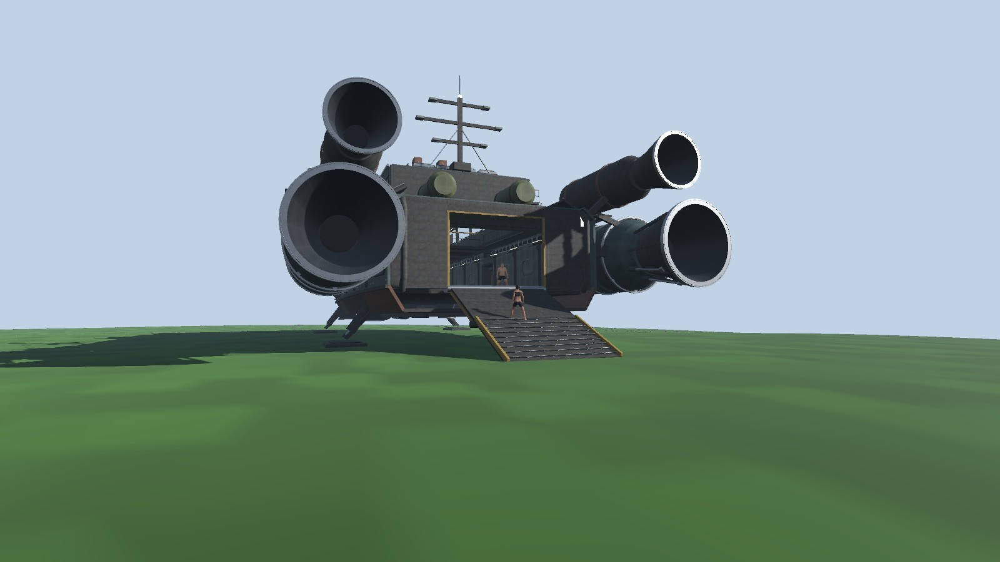
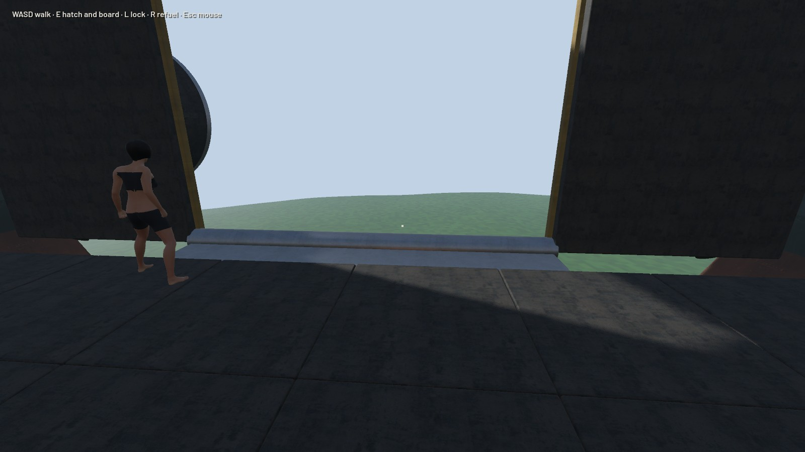
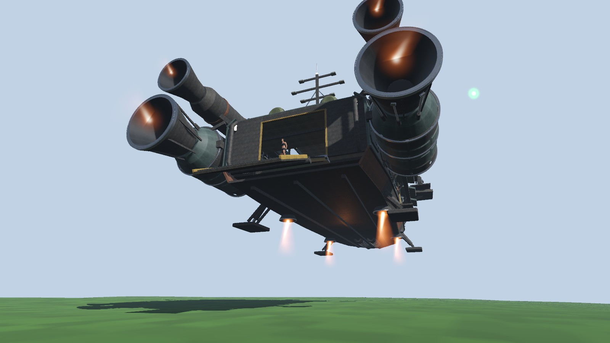
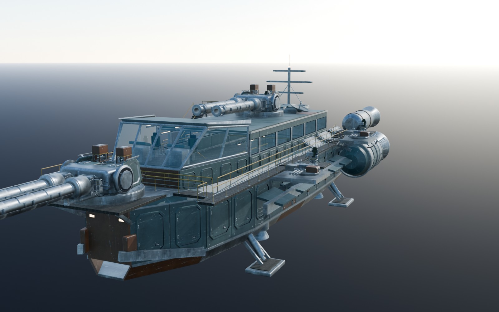
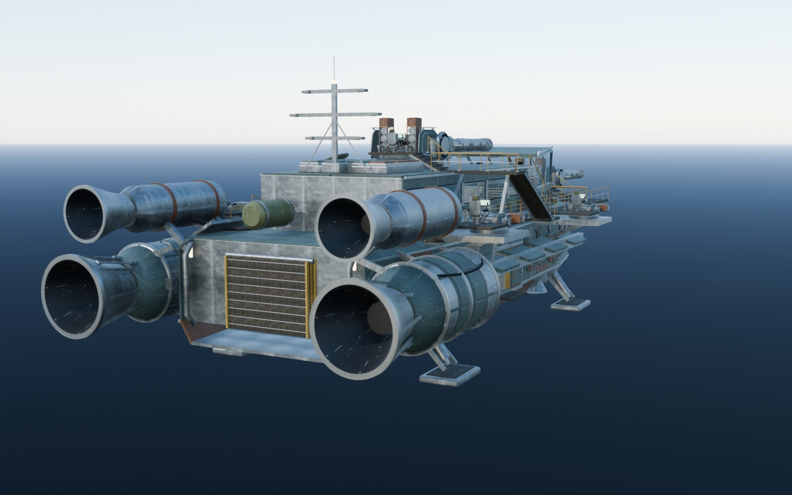
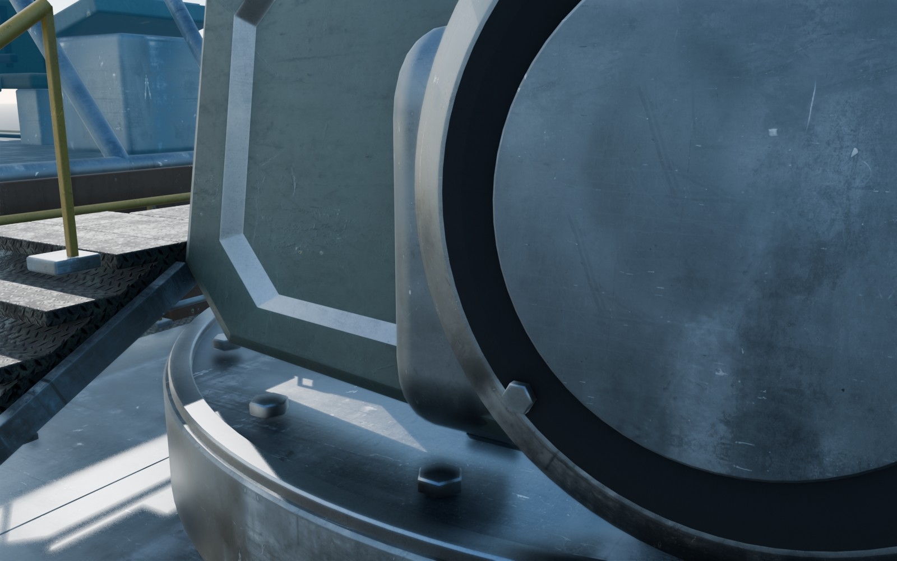
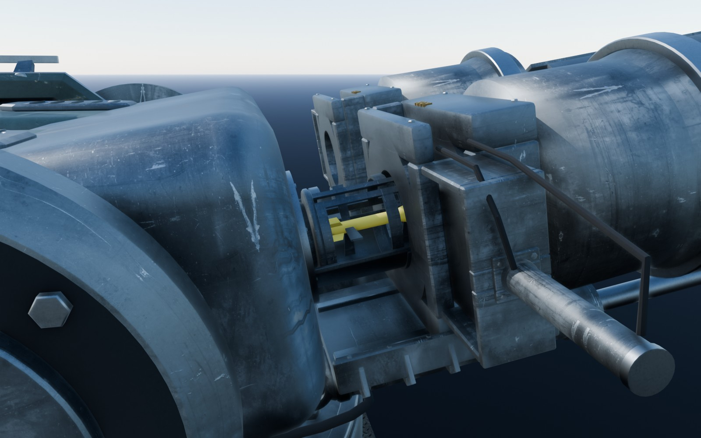
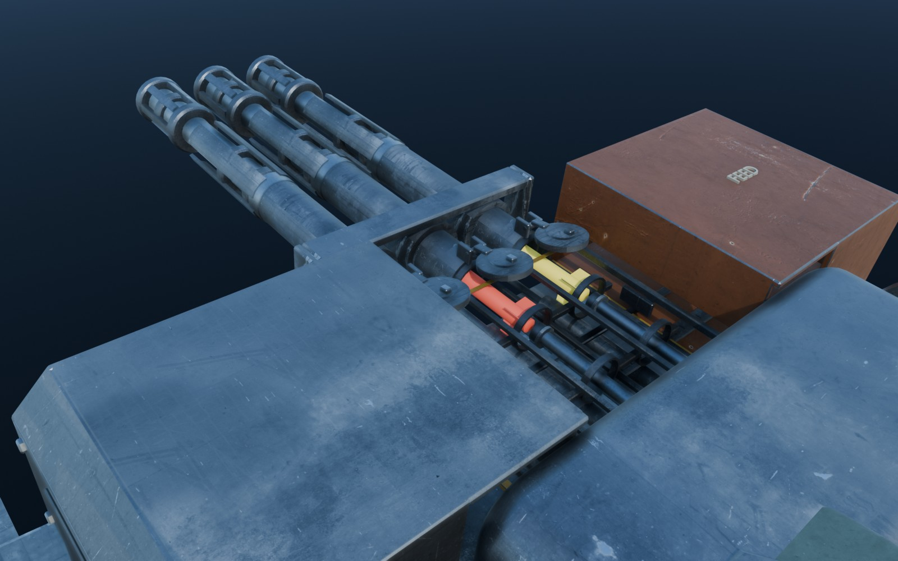

# The Iron Wake: a crewed carrier

Status: **approved by the owner on 15 October 2026, with all fourteen defaults of §2.** The art, sound and effects
(§13: IW-A, IW-S, IW-F) are on `main`. The rules follow on top of S3a (WHOLE_WORLD.md): IW1 (ship spaces) was built on
`whole-world`, which was merged into `main` on 15 October 2026 at the owner's word; IW2–IW6 follow on `main`. IW4 (the
incendiary rocket and fire, §7 "As built") was built on the branch `iw4`. In a hosted game the host gets an Iron Wake with
`ship iron-wake` (F1).

---

## 1. What the owner asked for

On 14 October 2026 the owner gave the Iron Wake asset (`D:\GameDev\Assets\IronWake_Buildable_R01`) to the game:

> Add this as described to our game. This ship really is going to be the benchmark right now. Make the cannons fire
> rocket, HV rocket and incendiary rocket for now. Loading should be done visually, animated, fully realistic. I want
> this ship and every mechanic and gameplay element about it done at the highest quality possible, at AAA studio
> level: no shortcuts, nothing low quality.

"As described" means the asset's `README.md` and `Documentation/SHIP_FEEL.md`, written with the owner while the asset
was made:
- **The decks:** an unfurnished 58 m carrier whose decks players furnish with crafted boxes, furnaces and
  workbenches, as on Rust's tugboats and player-built boats.
- **The cannons:** crewed by hand. A player walks to a station, sits, aims with the mouse and fires.
- **The feel:** a working vessel's weight: its engines spool, its hull strains, its guns kick and settle.

The owner's rule of 13 October applies in full: one shared system per concern, behaviour from capabilities declared in
data, no chains of special cases (GROUND_SYSTEMS.md §1). The Iron Wake therefore adds no ship-specific code path. It
is the first ship to need things the Tin Finch never did:
- a deck to walk on while it flies;
- more than one seat;
- doors;
- guns;
- things built aboard.

Each of these becomes a shared system the next ship reuses.

## 2. Decisions (defaults the owner may change)

| # | Question | Default | The other way |
|---|---|---|---|
| IW1 | Where do people aboard live? | In the ship's own frame, inside the zone (§4). Outside and inside see, hear and shoot each other through the open ramp. | A separate "interior" zone (ARCHITECTURE.md §10.1). That needs transfers, which the owner deferred, and it would cut the inside off from the world. |
| IW2 | Which way is down aboard? | The deck's down, with the ground's gravity. The ship's turns and braking never push people about (deck gravity). | The planet's real down. People would slide whenever the ship tilts. |
| IW3 | How does the Iron Wake fly? | Heavy and stately (§5.4). Flight assist holds it level, within 20° of pitch and 12° of roll. With assist off it may tumble. | Free six-axis flight like the Tin Finch's. |
| IW4 | Can a seated crew member be shot? | Gunners sit in open stations and can be shot; pilots on the glazed bridge are sheltered like the Tin Finch's pilot. | Everyone seated is sheltered, as today. |
| IW5 | The gunner's controls | E sits. Mouse aims, held in the world as the ship turns. Left mouse fires; right mouse zooms. R tapped reloads with the chosen rocket; R held picks the rocket. Tab opens the magazine. The seat is left with whatever key wave 1's seats package settles (Space proposed). | — |
| IW6 | Loading | Automatic, from the station's magazine, shown as the full mechanism (§6.6). The breech opens and the ready rack indexes. A tray swings the rocket to the breech, a rammer drives it home, and the breech closes. One timing table in the data drives both the rules and the animation. There is no loading minigame (SHIP_FEEL.md). | A second crew member loads by hand. |
| IW7 | Ammunition | The same `rocket`, `rocket-hv` and new `rocket-incendiary` items the shoulder launcher fires. The batteries launch them faster and further (§6.4); the blast is each item's own. | Separate ship ammunition. |
| IW8 | The two kinds of gun | The siege batteries (twin, bow and dorsal) alternate barrels: a heavy shot about every 2.3 s, long range. The defense mounts (triple, four on the sides) ripple three rockets, then swap a cassette: about every 3 s, short range, fast traverse. | — |
| IW9 | Incendiary rocket and fire | Rust's recipe. A small blast and a 3.5 m fire that burns 18 s. It burns people, animals, wooden deployables and twig or wood building pieces; stone and better don't burn. Fire doesn't spread. | Spreading fire (later, if wanted). |
| IW10 | Building aboard | Deployables only, inside the asset's build zones, with entrances, stairs and routes to the stations kept clear. The owner authorises builders at the helm; the ship is its own tool cupboard. Up to 80 deployables. A bed aboard is a spawn point. Everything aboard breaks with the ship. | — |
| IW11 | Durability and raiding | Hull 18,000. Each battery 1,500: disabled at 0, repaired with the hammer. The ramp and airlock lock against strangers and break open like armoured doors (1,000 each). A wreck leaves loot. | — |
| IW12 | How a player gets one | Open (§15.1). Until decided: admin `ship <name> iron-wake` and the F1 panel's spawn. | — |
| IW13 | Sound | Built from the CC0 libraries already on this PC and from synthesis (§10). No voice lines yet. | Add the Sonniss GDC bundles (royalty-free for games) for a richer mix; downloading them needs the owner's word. |
| IW14 | Order of work | The art, sound and effects start now on `main`. The rules (§4–§8) are built on top of S3a once it is green, because both rewrite characters, ships, the network and saves. | Build the rules on `main` now and merge them into `whole-world` by hand. |

## 3. The asset

**As delivered on 14 October 2026** (`IronWake_Buildable_R01`, made with ChatGPT from the owner's Iron Wake; original
geometry and textures, Poly Haven CC0 materials; no other game's files):

| | |
|---|---|
| Size | 58.1 × 21.0 × 17.6 m (native +X forward, +Z up, metres) |
| Detail | 622,060 triangles in 327 draw calls at LOD0; 331,740 / 63,360 / 51,736 at LOD1–3, still 291–321 draw calls each |
| Spaces | Deck A, the open construction deck: 30 × 10.8 m, 3.8 m headroom. A 7 × 8.2 m fabrication bay inside it, 7.5 m tall. The upper mezzanine: 14 × 8.9 m. The bridge with two flight seats. Weather decks and walkways to the stations |
| Moving parts | The cargo ramp (two leaves, `CargoRamp_Open`/`Close`), the side airlock door, 6 turrets (yaw and pitch nodes), 16 barrels each with its own recoil node and `*_Fire_*` clip (the curves in `weapon_motion.json`) |
| Stations | 6 gunner stations: seat, eye, hand-grip, entry, exit and interaction sockets; occupied volumes and access routes in `gunner_station_layout.json`, validated at the parked yaw |
| Sockets | 91, now with orientation: exhausts, lift nozzles, pilot and copilot seats and eyes, ramp hinge, boarding exit, cargo entry, a third-person camera, the centre-of-mass hint |
| Collision | 358 convex pieces (`03_CONVEX_COLLISION`; the manifest lists 475 colliders), grouped by part so the ramp's, the door's and each turret's move with them |
| Layout data | `asset_manifest.json`: rooms, 4 build zones with their exclusions, the ramp's hinges and angles, the stations, the routes |

**Gaps in the asset:**
- **Materials.** The README says the 4K Poly Haven materials are active, but the exported GLB and glTF files (21:11–21:15)
  and the `.blend` (21:20) are older than them (21:48–21:56) and still use the earlier 1,254 px generated textures.
  The import (§9.1) binds the new derivatives itself. A re-export by the asset's author would make the asset's own
  files agree.
- **Uncrewed weapons.** The 12-cell launch bank on the roof and the keel lance under the bow have no stations. They stay
  fittings (§15.4).
- **Port and starboard** are mirrored in the asset's names (found by IW-A, §9.1 "As built"). The names stay; the data
  file records the true sides.
- **The gunners' displays.** In the `.blend`, the six gunners' sight displays show the pilot's navigation screen (atlas
  tile 3). The asset's own source (`Source/make_ironwake.py`) and `display_artwork.json` give the defense gunners tile 5
  and the siege gunners tile 6, so the import moves those faces' UVs (§9.2 "As built").

**Made here, because the asset has none of it:**
- the loading mechanisms (breeches, loader arms and trays, rammers, ready racks and the defense mounts' cassettes;
  §9.5);
- the incendiary rocket's model;
- seated poses for pilots and gunners (§9.6);
- the interior's lights and reflection probes (§9.4);
- every sound (§10);
- the effects (§11).

## 4. Walking aboard: ship spaces

### 4.1 What exists

From the surveys of 14 October 2026:
- **Characters.** They move with Jolt's `CharacterVirtual` (`CharacterBody`, `CharacterMotor.Step`) in the zone's
  frame. Every physics body is static and the world is never stepped. Nothing reads a ground velocity: standing on
  something that moves is not supported.
- **The one seat.** A ship carries exactly one seated pilot by setting the character's position to the seat each tick
  (`ShipSystem.CarryPilot`, `Predictor.Seat`).
- **Parked hulls.** A parked hull is a static body. It is removed the moment the ship wakes (a hatch, a refuel, a hit),
  so people standing on it lose it.
- **Deployables** can be supported only by building pieces.
- **What already works.** Support links follow moving supports: arrows stuck in a hull already ride it.

### 4.2 The rule

**A character is either in the zone's frame or aboard a ship, in the ship's frame.** Aboard, its position, velocity
and view are relative to the ship. It moves by the same `CharacterMotor.Step` against the ship's own collision, its
*space*, with the ship's up as up. The ship's flight never moves an aboard character relative to its deck. So:
- nobody jitters on a turning deck;
- a passenger's prediction stays exact while someone else flies;
- precision stays fine, because positions are within 60 m of the ship's origin.

The same holds for anything else that moves aboard (§4.10). Seats are places in a ship's frame (§5.2), so the Tin
Finch's pilot becomes an aboard character at seat 0, and `CarryPilot` goes.

### 4.3 A ship's space

A ship whose `ships.json` entry has an `interior` block gets a space when it is made: a small Jolt physics system of its
own, separate from the zone's, with its collision in the ship's frame.
- **The hull.** The hull's static pieces form one compound body, built once per kind and shared.
- **Moving parts.** The ramp's leaves, the airlock door and each turret's platform are one body each, re-posed when they
  move, as doors are (`BuildingPhysics.Move`).
- **Deployables aboard.** Each is a box, as solid deployables are in the client's prediction world.
- **Characters** are not in it; they pass through each other as everywhere (GROUND.md §11 7).

The collision comes from the import (§9.1), not from Godot: `game/data/ground/ships/iron-wake.json` holds the convex
pieces by part, the rooms, the boarding volume, the build zones and exclusions, and the sockets. It is hashed with the
rest of the content, so server and client agree. A space has a few hundred bodies: tens of kilobytes, made in a
millisecond from the cached shapes. The server keeps one per ship with an interior. A client keeps one for each such
ship within 300 m, for its prediction and its aim.

`PhysicsWorld` stays the zone's. Its surface, frame and 148,544-body table don't fit a ship. `ShipSpace` is the small
class beside it. Its queries (`CastRay`, `CastShape`, `CollideShape`) are what `CharacterBody`, the aim and the shots
already ask of the zone. `CharacterBody` takes the space it is bound to, and each space has its own body for the
characters stepping in it. `MoveContext` gets its up, gravity and water from a frame object (`IMoveFrame`) instead of
`ZoneFrame`:
- **the zone's frame:** up from the planet, sea from the surface;
- **a ship's frame:** +Y up, the zone's character gravity, no sea.

### 4.4 Deck gravity (IW2)

Aboard, "down" is the ship's −Y, with the strength characters have on the ground (the planet's gravity × 1.8, as
`CharacterMotor` uses). The ship's acceleration and turning are not felt; the decks have their own gravity. People walk,
jump and fall aboard exactly as on the ground, at whatever attitude the ship holds. What the crew feels of the ship's
motion is cosmetic (§9.7): a little camera sway when it banks hard or stops short, which the reduced-motion option
turns off, and the hull's sound. Flight assist keeps the Iron Wake within 20° of level (IW3).

### 4.5 Boarding and leaving on foot

Transfers happen at the end of a character's step and keep its pose and velocity in the world exactly. Its velocity
gains or loses the ship's velocity at that point (centre-of-mass velocity + ω × r).
- **On.** A character in the zone's frame moves aboard when the body under its feet is the ship's (its parked body,
  §4.6), or when its feet are inside the ship's *boarding volume*: the rooms, the ramp and the weather decks, from the
  ship's data.
- **Off.** An aboard character returns to the zone's frame when nothing of the ship is under its feet and its feet are
  more than 0.3 m outside the boarding volume. The margin keeps someone on the ramp's edge from flickering between
  frames.
- **In flight.** Stepping off the open ramp of a hovering ship is a fall from that height, with the ship's velocity.
  Jumping onto a flying ship's deck is not possible, because a flying ship has no body in the zone (§4.6).

### 4.6 Parked and flying

While the Iron Wake is parked (asleep, nobody at the helm), its whole collision is a static body in the zone's physics,
as the Tin Finch's hull is today. People outside walk round its legs and up its ramp, and both frames agree, so the
hand-over on the ramp is seamless. When it wakes, the zone's body goes and the space carries everyone aboard. A
waking cause such as a refuel or a hit no longer costs anyone their footing, because people aboard never stood on the
zone's body.

### 4.7 Moving parts with people on them

- **The ramp and doors** refuse to move into a character, as building doors do. "RAMP BLOCKED" is the answer to whoever
  worked them.
- **A turret's platform** may turn into someone standing next to it; the character is pushed out on its next step. The
  seated gunner turns with it.

### 4.8 Prediction and drawing

- **Prediction.** The local player predicts its character in its frame. Aboard, the ship's motion doesn't enter the
  prediction at all. The camera is the ship as drawn × the character's predicted eye.
- **The pilot** predicts the ship too, as today.
- **Everyone else aboard** draws the ship interpolated 100 ms behind, like any remote ship, and places their own
  predicted character on it. They see themselves steady on the deck, and the deck moves under the sky.
- **Others aboard** are interpolated in the ship's frame and placed on the ship as drawn. A lerp in the zone's frame
  would cut the corner of a turning ship's arc (survey: `RemoteEntity` and `RemoteShip` interpolate separately).

### 4.9 Through the frame: aim, reach, shots and blasts

Every query in the zone's frame also enters each ship space its segment or sphere crosses (bounding sphere first). The
ray is turned into the ship's frame and tested against the space, the characters aboard and the things aboard. This
covers four queries:
- the aim (`Targeting.Aim`, its backdrops);
- reach and sight (`Zone.Reach`);
- the bullets' and arrows' traces (`DamageSystem.Trace`);
- a blast's line of sight (`BlastSystem`).

So:
- A shot from outside meets the hull's outside. Through the open ramp it meets whoever stands inside.
- A rocket that bursts on the deck hurts what is on the deck and in its sight there.
- One that bursts against the hull's outside hurts nobody inside.
- Someone aboard aims at a box on the deck, a gunner's station or a player on the shore with the same query.

The ship receiver stops treating the hull as six boxes. A shot meets the space's actual pieces, and the ship's own
shots ignore its own hull (a ship can hit itself today).

The pose history (`HistorySystem`) records aboard characters in their ship's frame and every ship's pose for the last
second. A late shot is then judged where the shooter saw both the ship and the people on it: someone aboard shooting
out, someone outside shooting in, or two people on the same deck. Projectiles keep flying in the zone's frame, with the
shooter's ship velocity added at launch (today nothing adds the shooter's velocity).

### 4.10 Other things aboard

- **Charges** stuck to the ship's surfaces already ride it: their support link names the ship.
- **Thrown grenades and charges** thrown aboard fly and bounce in the ship's frame, under deck gravity, until they leave
  the boarding volume.
- **Bags, bodies and dropped items** that come to rest aboard are linked to the ship and ride it.
- **Spent arrows** stick to the ship's parts by the same link, as they do today.
- **Fires** (§7) on a deck are linked to it.
- **Bullets, arrows and rockets in flight** stay in the zone's frame. They are fast, and leave the ship within a few
  ticks.

### 4.11 Network and saves

- **Input.** `InputCommand` carries the view in the frame the client believed its character was in, with that frame's
  number. On a transfer the server turns a view given in the other frame through the ship's pose.
- **Character state.** `CharacterNetState` carries the frame (none, or the ship's net number) and, aboard, the
  position and velocity in the ship's frame on the 1/256 m grid.
- **Relevance.** Aboard characters are relevant when their ship is.
- **Saves.** A character logged off aboard sleeps aboard, in the ship's frame, and comes back with the ship. Things
  linked to a ship are saved with their pose in its frame (`WorldCodec` keeps only piece supports today).

### 4.12 What this changes in the code

| Where | Change |
|---|---|
| `Hollow.Simulation/Physics` | `ShipSpace` (the small system, its queries and its bodies); `CharacterBody` bound to a space |
| `Movement/` | `IMoveFrame` (zone or ship: up, gravity, water, space); `CharacterState.Frame`; the transfer step |
| `Systems/ShipSystem` | Spaces made and dropped with ships; parked bodies of the whole collision; moving parts re-posed |
| `Systems/HistorySystem` | Ship poses; aboard characters in their frame; rewinds through both |
| `Systems/DamageSystem`, `BlastSystem`, `TargetSystem`, `Targeting` | Queries enter crossed ship spaces |
| `Hollow.Client` | Ship spaces near the player; the predictor in its frame; aboard characters interpolated in the ship's frame |
| `Hollow.Net` | The frame in the input and in `CharacterNetState` |
| `Hollow.Persistence` | Sleepers and things aboard in the ship's frame |

### 4.13 As built (IW1, 15 October 2026)

Built on the branch `iw-spaces` (from `whole-world`). Everything of §4.1–§4.12 but §4.10 (things aboard, IW5).

**The space** (`Physics/ShipSpace.cs`). The Iron Wake's data file gives 358 convex pieces on 88 parts, 120 boarding boxes
and its sockets (`Content/Readers/ShipInteriorReader.cs` into `Ships/ShipInterior.cs`); Jolt refuses none. Body 0 is the
hull's compound (every static piece), body *n* part *n*'s pieces, posed by `ShipInterior.PartPose` (a part's motion from
rest, its carriers' included, with deterministic sines). Shapes are made once per kind; a space is a `PhysicsSystem` of
89 bodies. The server keeps one per ship with an interior (`Ship.Space`); a client one per such ship within 300 m of the
player (kept to 350 m) and the one it is aboard (`ClientShipFrame`).

**Frames** (`Movement/MoveFrames.cs`). `CharacterState.Frame` and `MoveInput.Frame` name the frame: 0 the zone's, else a
ship's key (its entity ID on the server, its net ID on a client and on the wire). `IMoveFrame` gives up, gravity, water,
noclip's radius and the frame's one `CharacterBody`; `ZoneMoveFrame` and `IShipFrame` (`ShipFrame` on the server,
`ClientShipFrame` on a client) are the two kinds. `MoveFrames.Step` is the one step both the zone and the prediction run:
the view turned into the character's frame when the input gave it in another, `CharacterMotor.Step` unchanged, then the
hand-over. `ShipPose` turns points, directions and velocities between a ship's frame and the zone's; its spin includes the
ground's turn under a moving ship (r × v / r²).

**The hand-over** (§4.5), at the end of the step, the pose and velocity kept in the world exactly:
- *on*: the ground body is the ship's parked body; or the feet stand on nothing inside its boarding volume with its deck
  at most 3 m below them;
- *off*: nothing of the ship under the feet and the feet more than 0.3 m outside the boarding volume; or the feet more
  than 2 cm under the world's ground. The second rule was found by the tests: the Iron Wake's ramp foot sinks 0.2 m into
  the ground under a parked ship, and the space has no ground, so walking down it took people underground and the zone
  popped them up 0.28 m. Now the ground takes them where it rises over the ramp.

**Parked** (§4.6). A parked ship's pose rests on the wire's grid (`ShipMotor.RestOnGrid`: the 1/256 m grid and the
smallest-three turn, settled until encoding changes nothing), and its body is a compound of every piece at the parts'
states (`ShipSpace.ParkedShape`, cached per kind and states). The server's body ID goes to clients
(`ShipNetState.Body`): Jolt's character orders its contacts by body ID, so a client's copy under another ID gave the
same position but a velocity 3 × 10⁻⁷ m/s off after the hand-over. A ship with its engines off that moves less than 1 mm
and 0.0003 rad in a tick is held where it stands and sleeps: on uneven ground the Iron Wake rested on a hull box beside
two pads with a velocity the contacts never let it move by, and never parked.

**Moving parts** (§4.7). `ShipSystem.MovePart(ship, part, state)` is the one entry point: a door (a hinge or a slide)
refuses with RAMP BLOCKED (`OutcomeCode` 109) when its pieces would pass through anyone aboard or ashore within reach,
tried every 0.02 rad or 5 cm of the way; a turret turns anyway and the character's next steps push them out (two ticks
in the test). The space and a parked body follow, and `ShipPartStates` (message 121) tells the clients that know the
ship its parts away from rest. Nothing calls it in play yet: the doors' rules are IW2's.

**Queries** (§4.9, `Ships/ShipQueries.cs`): a ray of the zone's frame enters every ship space its bounding sphere meets.
The aim's backdrop (the server's and, through the ships as drawn, the client's), reach and sight (`TargetSystem.InSight`),
blasts' line of sight (`BlastSystem.Visible`), and bullets and arrows (`ShipReceiver.Raycast`, at the pose the history kept
for a late shot) all ask it. A swing, an arrow, a throw or a shot from a deck leaves where the shooter saw the ship
(`CharacterWorld.AttackLine`, `Zone.SeenPose`) with the ship's velocity at the eye added.

**History.** `HistorySystem` records every ship's pose and aboard characters in their ship's frame; a sample composes them.

**Network** (protocol 22): the frame in `InputCommand`, `OwnState`, `CharacterNetState` (a full character state grows 8
bits, from 191 to 199), `FireIntent` and `ThrowIntent`; `ShipNetState.Body`; `ShipPartStates`. Characters aboard are
relevant wherever they stand while their ship is within 2,000 m (`RelevanceGrid`'s far anchor). `CharacterNetState` has no
velocity, aboard or not: positions aboard are the ship frame's, on the 1/256 m grid.

**Saves** (schema 8): `characters.frame`; a sleeper aboard is stored in its ship's frame, comes back aboard at start
(ships load after sleepers, so a sleeper is restored pending and put ashore at the landing site if its ship didn't come
back), and wakes aboard. `ShipCodec` is unchanged: the parts' states are not saved (IW2's doors).

**Drawing.** `RemoteEntity` interpolates aboard characters in their ship's frame (across a hand-over, the nearer state)
and `ShipModule.Sample` places them on the ship as drawn; `GameClient.RenderPosition` is the local feet placed on the
frame as drawn; the camera's heading and pitch are read in its frame and turned when the player boards or leaves
(`GroundView.FollowFrame`). `ShipView` draws any kind from its catalogue model (ships.json's `model`), poses its parts'
nodes from their states, keeps its `-convcolonly` hulls under their parts on the feet's layer (`ModelUse.Parts`), and sizes
plumes, lights and the chase camera to the ship. People are drawn facing where they look in the character view's own
convention (`CharacterFrame.YawToward`): its north was the flat world's −Z, 60° off the movement code's at the landing site.

**The helm** stays the Tin Finch's: the `hatch`/`board` verbs at the Iron Wake's `hatch` socket on the bridge, its one
seat at `PilotSeat`, stepping out only when the ship is still (to an exit tested in the space). IW2 brings seats.

**Getting one** (§5.6): `ship [player] [kind]` and the F1 panel's spawn make the kind asked for, its way in (the lowest
boarding box: the ramp) toward the player; with no room in a wood, the trees and rocks where nothing else stands go.

**Measured** (engine-free, this PC): one Iron Wake flying with twelve walking aboard adds 0.19 ms to the server's tick
(budget 1 ms); a prediction step aboard costs 3–4 µs. Over the loopback a passenger walking up and down Deck A for 30 s
while another flies was reconciled 600 times: 0 corrections, 0 ticks replayed; walking up the parked ramp, the same.

The pictures are `--view ship --ship iron-wake --scene ramp|deck|outside`, on the stand-in world's ground as the ground
game draws it until S3c draws the world.

## 5. Ships with many seats, parts and doors

### 5.1 `ships.json` grows

Today one ship kind with one seat and four fixed parts is wired through every layer (survey: `ShipParts`, `Ship.Pilot`,
`ShipSeat`, `OwnShipState`, `ShipIntent`, `ShipCodec`, `Predictor.Seat`, `ShipView`). Spawning always makes
`Ships[0]`, so `spawn <ship>` names one kind and makes another. The Iron Wake's entry adds these blocks, each read by
`ShipsReader` with its check and each handled by one system. The Tin Finch keeps its current numbers, expressed in the
same blocks.

| Block | What | Used by |
|---|---|---|
| `model` | The catalogue key and the generated data file (§9.1) | The views; the space |
| `seats` | Seat id, role (`helm`, `passenger`, `station:<id>`), the socket it sits at (a turret's seat rides the turret), eye, exits, `exposed` (IW4), who may sit (`authorised`) | §5.2 |
| `parts` | Named targets with their aim shapes and capabilities, replacing the fixed hull, hatch, fuel cap and cargo; their order is their wire number (a byte) | Interaction, damage |
| `doors` | The ramp and the airlock: part, motion (the clip, or hinge and angles), seconds, when they may move, health | §5.3 |
| `interior` | The space's data file, the boarding volume, deck gravity | §4 |
| `stations` | The batteries (§6) | §6 |
| `build` | Zones, exclusions, the deployable limit | §8 |
| `assist` | `level`: the most pitch and roll flight assist allows (IW3) | `ShipMotor` |
| `nozzles` | Sockets by name and plume sizes (today the sizes are fixed per drive in `ShipView`) | The view |
| `lights` | Interior and exterior lamps by socket, with the power state they need | The view |

The sockets come from the generated file, not hand-copied numbers. The Tin Finch's seat, hatch and exits were copied
by hand into `ships.json`.

### 5.2 Seats

`Ship.Pilot` becomes one occupant per seat. `ShipSeat` gets the seat's index.
- **Sitting** is an interaction verb, `sit`, on the seat's part. Its gates: free, within reach, authorised for helm and
  station seats, the ship not locked against the sitter. The old `board` verb is `sit` on the Tin Finch's seat.
- **The seated character is aboard at its seat.** Its frame is the ship; its pose is the seat socket through whatever
  carries it: a turret's yaw for a gunner.
- **What a seat lets its occupant do** comes from its role:
  - `helm`: the flight controls (the pilot);
  - `passenger`: nothing;
  - `station:<id>`: that station's controls.

  The copilot's seat is a passenger seat that also works the doors and the lights.
- **Exposure.** An `exposed` seat keeps its occupant in the hit history at the seat's pose and in blasts' reach.
  Gunners can be shot (IW4); pilots on the bridge cannot, as today.
- **Leaving** puts the character at the first clear exit in the ship's frame, tested in the ship's space (a clear
  capsule on a floor). A gunner stands up onto the walkway beside the station, in flight too. A ship without an
  interior (the Tin Finch) keeps its exits on the ground and its rule that it must be still.
- **When nothing is clear**, the occupant stays seated and is told "EXIT BLOCKED".
- **Death and disconnect** free the seat. A dead gunner's body slumps from the seat onto the deck, linked to the ship.
- **Logging off** keeps the seat: the character sleeps in it.
- **Today's exemptions.** Seated characters are exempt from the hit history, blasts, wounding, interactions and guns.
  These become the seat role's rules: a gunner may use the station's verbs and its gun, and anyone seated may use the
  verbs marked `seated` in `interactions.json`.

### 5.3 Doors: the ramp and the airlock

A ship's door is a part with a progress (0 shut, 1 open), driven by the ship's rules and drawn by sampling the model's
clip at that progress, as the Tin Finch's hatch is today.

| | Time | When it may move | Who | Health |
|---|---|---|---|---|
| Cargo ramp | 6.0 s | Ship still, or slower than 5 m/s within 30 m of the ground | Anyone, unless locked; from the helm or the copilot's seat; from a switch at the ramp's top | 1,000 (armoured) |
| Airlock door | 1.5 s | Any time | As the ramp | 1,000 |

- A moving door refuses to move into a character (§4.7).
- **Locked doors** stay shut to anyone the owner hasn't authorised.
- **Broken doors** (a raid) jam open until repaired with the hammer (IW11).
- **The ramp's motion has phases** with their own sounds: release, actuator travel, contact and lock (§10).
- The ramp leaf is its own part, moving with the main leaf's hinge from the manifest.

### 5.4 The Iron Wake's numbers (proposals, tuned in play)

| | |
|---|---|
| Mass | 420 t. Centre of mass at the asset's hint, 1 m aft of the origin and 5.5 m up |
| Thrust | Main 2.1 MN (two main drives and two auxiliaries), retro 1.3 MN, lateral 0.85 MN. Lift 7.6 MN on the four lift engines (2.0 × its weight at 9.0 m/s², as the Tin Finch). Down 0.8 MN |
| Flight assist's speeds | Forward 110 m/s, reverse 25, lateral 18, up 15, down 12. Boost ×1.5 thrust to 150 m/s for 6 s, then 12 s to recharge |
| Turn rates, acceleration | Pitch 9°/s and 6°/s². Yaw 8°/s and 5°/s². Roll 7°/s and 5°/s². Flight assist holds pitch within 20° and roll within 12° of level (IW3) |
| Drag areas | Forward 190 m², side 950, top 1,150 |
| Landing legs | Four pads at the gear's feet. 6.3 MN/m, 1.1 MN·s/m, 0.35 m of travel, friction 0.6. Lands on up to 12° |
| Crash | Above 3 m/s, (speed − 3)² × 60 of the hull: 10 m/s costs 2,940 |
| Hull, fuel | 18,000 (IW11); 6,000 lamp oil, burning 0.5 a second idling and up to 5 at full thrust |
| Ceiling | The world's leaving height (WHOLE_WORLD.md §6.5). In orbit the crew stays aboard and may walk about; the ship waits at its orbit marker |

Five motor limits break at this size and become data or are fixed:
- the water band (±1.2 m round the centre of mass);
- buoyancy from the hull boxes' volume, which would float a ship whose hull is solid boxes;
- at most 8 skid loads and 4 overlap contacts;
- the reader's caps;
- the hull for the world's sweeps.

For the sweeps, ten boxes fitted to the model at import (body, bow, superstructure, bridge, two drive pods, two
outriggers, two batteries) sweep the world as the Tin Finch's six do, with the legs' four pads as skids.

**As built (IW1, 15 October 2026).** The entry has every number of the table: mass 420 t, inertia 103/107/21 × 10⁶
kg·m², the centre of mass at (0, 5.5, −1) (checked to be the data file's), the thrusts, speeds, boost, rates, drag areas,
landing legs (6.3 MN/m, 1.1 MN·s/m, 0.35 m, friction 0.6, 12°), crash, hull 18,000 and fuel. The limits:
- `water`: 4.1 m below and 2.3 m above the centre of mass, 1,680 m³ (a ship's own; the Tin Finch keeps 1.2 m each way and
  its boxes' volume);
- as many skid loads as pads, and as many overlap contacts as hull boxes (at least four);
- the reader's caps widened to a carrier's numbers;
- `"hull": "data"`: the data file's ten boxes, and its four pads as skids, each with a thin box a leg's travel (0.35 m)
  above its foot, as the Tin Finch's skid boxes sit over theirs;
- flight assist holds pitch within 20° and roll within 12° of level (`assist.level`), easing back at 0.6 of the rate.

In the takeoff test it climbed 106 m in 13 s, reached 38 m/s, turned 40° and stopped again in 15 s under flight assist.

### 5.5 Damage, the wreck and raiding a ship

- **The hull.** Hits on the hull go to the ship receiver as today, with the shares by delivery (explosives 1).
- **Batteries.** A hit on a battery's parts damages the battery. At 0 it is disabled: it can't fire or turn, it smokes,
  and its gunner is put out. The hammer repairs it at the cost of its metal.
- **Doors** take damage as armoured doors do.
- **A wrecked ship:**
  - everyone aboard takes its explosion by distance and is put into the zone's frame with the ship's velocity;
  - everything built aboard breaks and spills;
  - the wreck holds the stations' magazines, half the fuel and its salvage.

  Gibs come later, with their art.

### 5.6 Getting one

Open (§15.1). Until the owner decides, an admin spawns it (`ship <name> iron-wake`, the F1 panel's spawn). This also
fixes the spawn that always made `Ships[0]`.

### 5.7 As built (IW2, 15 October 2026)

**The data.** `ships.json` has the blocks `seats`, `doors`, `parts`, `nozzles` and `lights` for both ships, read by
`ShipLayoutReader` (`Content/Readers`) after the interior, and checked there:
- exactly one helm; at most 31 seats, 16 doors, 255 parts; unique keys;
- part 0 is the hull, with no shape or capability of its own;
- a door's pieces belong to one part; a part with the `seat` capability names a seat, and one with `ship-door` a door;
- a door's own part has no health of its own (its door's);
- every seat has a part, and its socket, eye and exits lie inside the boarding volume.

A point is three numbers or a socket's name in the generated data file. The Tin Finch's numbers are unchanged:
- its seat at (0, 0.992, −0.08), its eye, its four exits on the ground;
- its hatch, a door of 1 s that opens at rest;
- its parts: the hull, the hatch (the seat, the door and the list), the fuel cap and the cargo behind the hatch.

`ShipParts` keeps only `Hull = 0`; every other part is the data's, its index its wire number. The Iron Wake's parts:

| Part | What it is | Capabilities |
|---|---|---|
| helm, copilot | the bridge's two seats, by their sockets | `seat`; the helm also `cupboard` |
| ramp | the ramp's two leaves | `ship-door` |
| ramp-switch | a switch at the ramp's top, inside | `ship-door` |
| airlock | its door | `ship-door` |
| six stations | each battery's turret pieces and its gunner's ball | `seat`, health 1,500 |
| fuel | the filler on the starboard side | `fuel` |

`nozzles` and their plume sizes are data now (the view's fixed sizes are gone). `lights` are read and checked but stay
data until IW6 draws them (`LightPower`: the ship's power or the emergency lamps).

**Seats** (§5.2). `Ship.Occupants` holds one occupant a seat, and `ShipSeat` has the seat's index.
- **One seat rule**, `ShipSeats.Pose`. The server carries every occupant with it each tick, and a client's prediction
  carries its player with it (`Predictor.Seat`, the seat from `OwnState.Seat`). Aboard a ship people walk in, the seat's
  socket is in the ship's frame at its parts' states (a gunner turns with the turret). In one they only sit in, the seat
  is carried in the zone's frame.
- **Sitting** is the seat's own verb (`verb` in its data):
  - `board` the Tin Finch;
  - `take-helm`;
  - `man` a battery;
  - `sit` in the copilot's seat.

  The prompt says the seat's name: MAN FORWARD STARBOARD MOUNT, never BOARD IRON WAKE. `ShipSystem.MaySit` and the seat
  capability's offer refuse with the same reasons:
  - taken;
  - not on the list (a crew seat);
  - locked (an "unlocked" seat);
  - disabled;
  - through its door, the door shut or the ship not at rest.
- **Standing up** is Space in any seat (`ShipAction.Leave`):
  - to the first exit whose capsule is clear on a floor of the ship's space, in flight too (a gunner onto the walkway);
  - a ship without an interior keeps its ground exits and the rule that it be at rest;
  - none clear: EXIT BLOCKED (111), and the occupant stays.
- **Every way out is `ShipSystem.Release`:**
  - a death (the `Died` event, at once: the F1 console's `kill`, a wound, a fall);
  - an admin's teleport or noclip (`Zone.Teleport`);
  - a lost connection (not a goodbye: `PlayerSession.LoggedOff`, `ShipModule.Left`): the sleeper stands at the first
    clear exit, or sleeps in the seat when none is clear;
  - a disabled station (its gunner put out);
  - a wreck, which kills whoever sits in it.

  Logging off (LiteNetLib's goodbye) keeps the seat: they sleep in it, and the server seats them again after a restart.
- **Exposed seats** (the batteries) keep their occupant in the hit history and in blasts' reach, with seated hit shapes
  (`Pose.Seated`). The bridge's seats stay sheltered.

**The helm's list.** The ship is its own tool cupboard: the helm part has the `cupboard` capability.
- The ship keeps a list (`Ship.Crew`, `IAuthorisations`, 64 at most). Its owner is on it from the start.
- The cupboard's verbs at the helm (authorise, deauthorise, authorise team, clear list) go through `IAuthoriseFamily`,
  the family's own list: a claim device's, a ship's.
- As at Rust's cupboard, whoever reaches the helm authorises themselves. The ship's locked doors keep strangers from
  it.
- The list governs:
  - the crew's seats (the helm and the batteries): a ship whose list is empty waits for someone to authorise;
  - the lock and the locked doors;
  - mending its parts (anyone may mend a ship whose list is empty).

**Doors** (§5.3, `ShipSystem.Doors.cs`). A door is a motion record, `ShipDoorState`:
- what it holds: its progress at a tick, the way it moves (+1, −1, 0), the way it waits to go while someone is in its
  way, and its health;
- its progress at any tick is `clamp(From + Moving × (tick − Since) × rate)`;
- its parts follow by its ease (`InOut`: smoothstep) through `ShipSystem.DoorParts`, on the server and every client
  alike;
- the record goes to clients once a change (`ShipDetails`), never every tick.

Its rules:
- `ShipDoorDef.Rule`: the ramp moves at rest, or below 5 m/s within 30 m of the ground (`ShipSystem.ShipSlow`, sent as
  `ShipNetFlags.Slow`); the airlock moves any time.
- A move whose whole way would meet someone is refused (RAMP BLOCKED). Someone stepping in its way mid-motion stops it,
  and it goes on once they are clear.
- The parked body is kept while a door moves and made again when it stops.
- Locked, a door is shut to anyone not on the list.
- **Broken** (health 0; armoured, 1,000, the explosives' door table) a door falls open at once and stays jammed (JAMMED
  OPEN) until the hammer mends it.

`MovePart` refuses a door's parts (its door moves them). The Iron Wake's ramp and airlock are drawn from their parts'
states, exactly where their collision is, rather than by sampling the `CargoRamp_Open` and `Airlock_Open` clips. The Tin
Finch's hatch still samples `Hatch_Open` by its progress.

**Health** (§5.5). The hull keeps its 18,000.
- Each part with health takes blows through the damage pipeline's ship receiver:
  - a ray's hit in the space names its part (`ShipDef.PartOfPieces`);
  - a blast reaches each part by its own pieces' nearest point, the part it is stuck to whole;
  - its protection resolves it as a building's would: armoured for the doors, metal for the batteries.
- A battery at 0 is disabled (DISABLED, 113) and its gunner is put out.
- **Mending.** The hammer's attack mends what the interact aim names (`IRepairFamily`; `HammerIntent` carries the
  family and part):
  - building.json's numbers: 100 a hit, not within 30 s of damage;
  - each hit costs max(1, ⌈full cost × restored ÷ most⌉) of the part's material: refined metal 10 for a door, metal
    fragments 300 for a battery.

**Keys** (KNOWN_PROBLEMS.md finding 28). The key context is in one place (`SeatKeys.Context`): on foot, or seated as
helm, passenger or station.
- **Every seat:** Space leaves it.
- **A seat that works doors:** 1–9 work its ship's doors (1 the hatch or the ramp, 2 the airlock), and L the lock.
- **The helm:** J descends from orbit, V switches the camera. Its flight keys are W S the lever, A D slide, **Shift and
  Ctrl up and down**, Q E roll, **B boost**, Z flight assist, X the lever to zero. Space and C no longer move the ship,
  F no longer leaves it, and H no longer works the hatch.
- **Seated, Q, E and 1–6 do nothing of their own:** no crafting, no hold-E radial, no belt. Tab, G, Enter, Esc, F1 and
  F2 work everywhere.
- **The keys on screen:** the flight HUD shows the helm's in its corner (and its seat's line at rest); another seat
  shows its line above the belt.
- **A station's seat** looks from its camera socket (`GameClient.SeatEye`).

**The F1-kill finding** (KNOWN_PROBLEMS.md, commit 9da9bdd). Nothing of the seat was stale. The Iron Wake beside the
respawn never slept:
- on uneven ground its hull jittered a few millimetres a tick;
- afloat or on its side it never rested;
- a client judged a ship at rest only by its landing or its sleep.

Every verb at it said the pilot's "land first". Now:
- the motor rests any ship that touches something and barely moves;
- the server's word on a ship at rest goes to clients (`ShipNetFlags.Still`);
- on foot a ship in motion says NOT WHILE IT MOVES.

**Saves.** `ShipCodec` version 2 keeps:
- who sits in each seat;
- each door's progress, way and health;
- the parts' states and health;
- the list.

Version 1 (a pilot and a hatch) reads as the helm's occupant and the first door, its owner its list. A door's motion is
counted from the tick the ship is added (a half-shut ramp goes on shutting). `ship <name> [kind]` sets the ship down
with its first door open.

**Checks** (engine-free):
- `SeatTests`: every ship left alone parks; killed in flight and respawned;
- `ShipPartsTests`:
  - every way out frees the seat;
  - each part offers its own verbs;
  - the ramp opens, shuts, breaks under two timed charges and is mended;
  - the helm's list governs the helm and the doors;
  - two seated in a flying ship over the network (no correction; the gunner stands up onto the walkway);
  - `ShipCodec` 2 and 1.

## 6. Crewed batteries

### 6.1 A station

A station is a seat, a mount, a battery and a magazine, named in the ship's `stations` block:
- **the seat**, with role `station:<id>`, on the turret's yaw;
- **the mount:** the yaw and pitch nodes, with their limits and motors;
- **the battery:** the barrels with their muzzles and recoil nodes, the firing order, the loader;
- **the magazine:** a container that takes only the battery's ammunition.

Two kinds of battery are defined in data, `siege` and `defense`. Each station names one; nothing tests which. A
station has health (§5.5).

### 6.2 The mount: aim held in the world

- **What the gunner asks for** is a direction in the world: the input's view, which S3 makes a direction vector. Each
  tick the server turns it into the mount's yaw and pitch through the ship's pose, clamps them to the mount's arcs, and
  slews towards them at the motor's rates. It accelerates and brakes so it neither overshoots nor creeps.
- **Stabilisation.** A turning ship doesn't drag the aim away, within the motor's rates (SHIP_FEEL.md). It is not
  target tracking: the gunner still leads a moving target by hand.
- **Saturation.** When the ship turns faster than the motor can follow, or the aim is beyond the arcs, the actual barrel
  direction lags or stops. The sight shows both: where the gunner points and where the barrels are (§6.8).
- **Alignment.** A barrel may fire when it points within the battery's tolerance of the asked direction.

### 6.3 Barrels and shots

- **Firing order.**
  - The siege battery fires one barrel per press, the next loaded one in turn.
  - The defense mount ripples while the trigger is held: its three barrels a quarter second apart, each as soon as it is
    loaded.
  - A release, a loss of focus, leaving the seat or losing the seat stops the fire at once. No refused press is kept to
    fire later.
- **The shot.** It leaves from the barrel's muzzle: the ship's pose at the shot's tick × mount × yaw × pitch × barrel ×
  muzzle socket. It carries the barrel's direction × the launch speed (§6.4) plus the ship's velocity at the muzzle.
  It is the projectile system's own rocket, so blasts, raid hits, alerts and replication are what they are for the
  shoulder launcher. It also names its station and barrel, so the shooter is the gunner.
- **Recoil.** The asset's curves (`weapon_motion.json`: siege 0.48 m over 0.9 s, defense 0.19 m over 0.32 s) are copied
  into the battery's data and drive the barrel's recoil node. They are presentation. The rules know only that a barrel
  is *recovering* for that long, and the loader waits for it.

### 6.4 Ammunition and launch profiles (IW7)

A battery accepts the rocket items listed in its data. For each it has a launch profile:
- the speed the gun gives it at the muzzle;
- the motor that lights a few metres out, with its acceleration and burn time;
- gravity during and after the burn;
- drag;
- lifetime.

The shoulder launcher's numbers (18 and 40 m/s) don't change. The projectile reader's 5 s lifetime cap and the client's
8 s cut-off rise to 15 s.

| Proposal | Muzzle | Motor | Top speed | Lifetime | Reach on the flat (approx.) |
|---|---|---|---|---|---|
| Siege: rocket, incendiary | 70 m/s | +60 m/s² for 1.2 s | 142 m/s | 12 s | 900 m |
| Siege: HV rocket | 120 m/s | +100 m/s² for 1.4 s | 260 m/s | 12 s | 1,350 m |
| Defense: rocket, incendiary | 35 m/s | +40 m/s² for 1.0 s | 75 m/s | 7 s | 400 m |
| Defense: HV rocket | 60 m/s | +60 m/s² for 1.2 s | 132 m/s | 7 s | 650 m |

During the burn gravity is 0.15 × the planet's (the launcher's rule); after it, the whole of it. Drag is 0.0015 a metre.
On S3's 2.4 km worlds the horizon is 380 m away from 30 m up and 690 m from 100 m, so the siege battery's reach matters
from height. HV still flies flatter and faster, as the owner's playtest direction asks; its bear-killing damage and each
round's own gravity came with IW4 (KNOWN_PROBLEMS.md, finding 26; §7 "As built").

### 6.5 The magazine and the ready racks

- **The magazine** is a container at the station: 12 slots for a siege battery (36 rockets), 6 for a defense mount
  (18).
- **Filling it.** It is opened on foot at the station's interaction point (E, "OPEN MAGAZINE") or from the seat (Tab),
  by the ship's authorised players and the gunner. Rockets are put in as into a box.
- **The ready racks** are the magazine made visible. Each siege barrel's rack shows the next three rockets of the chosen
  kind; a defense mount shows its next clip of three, coming out of the feed hood (as built, §9.5).
- **The chosen kind** is the station's, picked by holding R (the ammo radial, P3's, with the kinds the magazine holds
  and how many). Loads take it. A tap of R cycles: rounds of another kind already chambered are drawn back into the
  magazine, by the same mechanism in reverse, and the chosen kind is loaded.

### 6.6 Loading, step by step (IW6)

Each battery kind has a loader: an ordered list of phases with durations. The rules step through them per barrel
(siege) or per mount (defense). A barrel counts as loaded at the end of its last phase. The view samples each phase's
progress to pose the mechanism's parts (§9.5), so what is seen is what the rules are doing. The mechanism's nodes and
their motions (which node, which axis, how far, with what easing) are named in the same table, so the art and the
rules can't drift apart.

**As built (15 October 2026, IW-A part 2; rebuilt the same day after the owner's review).** The table is
`game/data/ground/batteries.json`, the one timing definition for the rules (IW3), the view (IW6), the import's review
clips and the mechanism's clearance check; its format is in §9.5. Its phases are cut to the mechanism as built (§9.5),
which feeds through the trunnion rather than swinging an arm outside the receiver (the plan's). The totals are the
plan's: 4.6 s a siege barrel, 2.52 s a defense clip.

The owner's review of the first build (15 October 2026): "Barrels have a hollow space behind them as if the bullet is
going to teleport. The barrel should be whole." On the siege battery a round crossed an open gap from a port in the
receiver's face into the breech; on the defense mount the tubes ended at a breech face with an open bay behind them
and a cassette in mid-air. Rebuilt so that every barrel is whole and runs into a closed breech that is part of the gun,
a breech is shut whenever nothing is going into it, a port is gated whenever nothing passes it, and a round is always
carried (by its rack, a tray, a clip or the chamber) and seen to go into the barrel's own chamber.

**Siege battery, per barrel** (each barrel has its own loader; the battery alternates). A naval gun's way: the breech
ring with its sliding wedge rides on the barrel over a cradle trough; between the receiver's face and the ring is the
recoil space, and a spanning tray (the turret's part for exactly this gap) runs out across it so the rammer drives the
round along the tray into the chamber.

| Phase | s | What is seen and heard |
|---|---|---|
| recover | 0.90 | The barrel recoils 0.48 m and runs back to battery (the asset's curve), its breech ring over the cradle trough; the latch is heard at the end |
| breechOpen | 0.40 | The sliding wedge block runs 0.58 m outboard on its guide, pulled by its hydraulic cylinder; the ram port's armoured gate slides 0.64 m inboard into the receiver (in the last three quarters); a puff of smoke from the chamber, wisps until the ram |
| fetch | 0.80 | The feed port's gate slides open (the first 0.24 s); the feed rammer's two stages drive the ready rack's lowest round 1.22 m forward through it into the gun house, to the trunnion transfer |
| transfer | 0.40 | Inside, the transfer cradle on the trunnion axis takes the round; the feed rammer withdraws and the feed gate shuts behind it; the spanning tray runs 0.56 m out of the ram port and lands its lip on the breech ring's rear face |
| present | 0.75 | The cradle turns the round to the barrel's line at the current elevation (about the trunnion axis, so any elevation works); the rack indexes: its rounds step down one place (0.5 m) and the round waiting in the hood comes down into view |
| ram | 0.55 | The chain rammer drives the round, in its launch carrier, 2.05 m out of the ram port, along the tray and into the chamber: carried all the way, seen to go in |
| retract | 0.40 | The rammer withdraws into the receiver and the tray after it; the round stays seated |
| breechClose | 0.40 | The block runs back across the chamber and locks; the ram port's gate shuts |

That is 4.6 s from shot to loaded, per barrel; alternating, the battery fires about every 2.3 s sustained. With an
empty rack the loader waits before "fetch": the breech and the ram port stay open and the sight says EMPTY.

**Defense mount, per mount** (a clip of three). A multi-tube launcher's way, loaded from behind: each tube begins with a
chamber section under a breech collar with a hinged cap; a clip of three docks flush against the collars and three
ram rods push the rockets straight out of it into the chambers.

| Phase | s | What is seen and heard |
|---|---|---|
| recover | 0.32 | The third tube's recoil (each tube recoils 0.19 m at its own shot of the ripple, its chamber section, collar and cap with it) |
| open | 0.30 | The three breech caps swing up and back 100° on their hinges; in the feed hood, a closed box on the mount's outboard flank, the hoist lowers the next clip (brought up from the mount's base through the trunnion) 0.195 m to the slot |
| deliver | 0.45 | The conveyor carries the clip 0.885 m out through the hood's slot into the loading well behind the open chambers |
| dock | 0.15 | The clip closes up 15 mm against the collars: its rings line up with the chambers |
| ram | 0.50 | Three ram rods run 0.82 m out of glands in the receiver's face, through the clip, and push the rockets, each on its expelling charge, 0.77 m out of the clip into the chambers (they meet the charges 5 cm out and run at one speed) |
| withdraw | 0.30 | The rods withdraw; the empty clip backs off the collars; the rockets stay in their chambers |
| clear | 0.50 | The conveyor carries the empty clip on through the spent bin's slot (the first 0.3 s) and the bin's lift stows it 0.195 m up; the caps swing down and lock (the last 0.225 s) |

That is 2.52 s after the third shot. With the ripple, a defense mount fires three rockets about every 3 s. A clip holds
what the magazine has of the chosen kind, up to three. With an empty magazine the loader waits before "open": the caps
stay shut.

### 6.7 Why a shot is refused

The sight says why, in this order, and the press does nothing:

| Line | When |
|---|---|
| DISABLED | The station's health is 0 |
| EMPTY | No barrel is loaded and the magazine has none of the chosen kind |
| LOADING | No barrel is loaded yet; the loader is working (its progress shows) |
| LIMIT | The asked direction is beyond the mount's arcs |
| TRAVERSING | No loaded barrel is within the alignment tolerance yet |
| HULL BLOCKED | The barrel's line, from the breech to 6 m past the muzzle, meets the ship's own space |

### 6.8 Controls, camera and the sight (IW5)

- **Sitting.** E at the station's interaction point sits. The prompt reads "E  MAN FORWARD BATTERY", or why not:
  occupied, not authorised, disabled. Hold E for the radial: sit, open magazine.
- **Seated:**
  - the mouse aims;
  - left mouse fires;
  - right mouse zooms (×3 siege, ×2 defense, with its own sensitivity);
  - R reloads or opens the ammo radial;
  - Tab opens the magazine;
  - the seat is left with wave 1's key.

  Keys are rebindable. Free look (Alt) turns the head without moving the aim.
- **The camera** is at the station's camera socket. It turns with the yaw and pitches with the view; the gunner's own
  hands rest on the grips (§9.6). Recoil and the ship's motion shake the camera a little (a cosmetic layer, off with
  reduced motion). It never moves the aim and never drifts the cursor.
- **The sight** is in the ground interface's style:
  - the cross where the gunner points;
  - a ring where the barrels point (the two separate while the mount slews or is at a limit);
  - range marks for the chosen rocket, from its launch profile, in 100 m steps;
  - each barrel's state: loaded (the rocket's icon), loading (its progress) or empty;
  - the chosen kind and how many the magazine holds of each;
  - the refusal line (§6.7);
  - the arcs as a small dial when the aim is near or past them.

  The ship's heading and speed are small at the side.

### 6.9 Prediction without doubled shots

- **The aim.** The gunner's client predicts its mount from its own input and the ship as it draws it, and reconciles
  with the server's yaw and pitch. Corrections are smoothed, never snapped, because the cross is the input's and never
  moves.
- **A predicted shot.** A press the client believes can fire plays at once: the recoil, the flash, the sound and a
  predicted rocket, tagged with a shot number.
- **Confirmation.** The server's shot (ship, station, barrel, number, tick, kind) replaces the predicted rocket with the
  real one and plays nothing again.
- **A refused shot** stops the predicted rocket and shows the reason. Mispredictions are rare, because the client runs
  the same rules on the same loader timeline.
- **Others** see the shot from the server's event and the rocket from the projectile messages, deduplicated by the
  station, barrel and number (the asset's contract).

### 6.10 The numbers (proposals)

| | Siege battery (2) | Defense mount (4) |
|---|---|---|
| Barrels | 2, alternating, a press each | 3, rippled while held, 0.25 s apart |
| Yaw | arcs from the hull's clearance at import; 24°/s, 40°/s² | ±100° outboard; 80°/s, 240°/s² |
| Pitch | −8° to +40°; 16°/s, 30°/s² | −15° to +65°; 60°/s, 180°/s² |
| Alignment tolerance | 0.5° | 1.5° |
| Loader | 4.6 s a barrel | 2.52 s a clip of three |
| Magazine | 12 slots (36) | 6 slots (18) |
| Health | 1,500 | 1,500 |
| Zoom | ×3 | ×2 |

### 6.11 As built (IW3, 15 October 2026)

Built on the branch `iw3` from `main` (5357624, with IW1, IW2 and IW4), main's art fixes (iw-art2, 1dfebdf) merged in
before the view was wired. Everything of §6.1–§6.9 with the fourteen defaults.

**The data.** `batteries.json` is read by `BatteriesReader` (`Content/Batteries.cs`: `BatteryDef`, its `LaunchProfile`s,
`BatteryMount`, `BatteryLoader` with its `LoaderPhase`s, `LoaderMotion`s and `LoaderHolder`s, the `RecoilCurve`), checked:
a profile for every rocket (lifetime at most 15 s), every rocket a round with a blast, the phases' total the mount's
`loaderSeconds`, the `waitsBefore`, loop and holder phases named. A load's rounds are a clip's (or a cassette's) on a mount,
one a barrel. The data file's `stations` are read with the interior (`StationGeometry`: yaw and pitch parts, barrels with
their recoil parts, muzzle sockets, breeches and sides, the camera, the level arcs); `ShipsReader` makes a `ShipStationDef`
for each station a seat works, with the battery its `kind` names, the target part whose seat it is (its health, its
magazine) and the yaw's limits: the span of its level arcs (an arc whose end is below its start runs through the stern),
and on a battery with `yaw.outboard` that much each way from its side's beam within them. Forward siege −98° … 130°, dorsal
−95° … 152°, the mounts 100° each way from their beams within their arcs. Nothing tests a station's or battery's name.

**The mount** (`StationRules.Slew`, `Ships/ShipStations.cs`, the server's and the gunner's client's). The asked direction is
the input's view in the zone's frame (a gunner's client holds its view in the world: `GroundView.FollowFrame`), turned
through the ship's turn into a yaw and a pitch by the parts' own axes, clamped to the limits (LIMIT when it had to be). Each
axis slews toward its target at the motor's rate: the target's own motion fed forward (the ship turning under it), plus
what closes the gap no faster than the axis can brake in the distance left, the speed changing by at most the acceleration
a tick, landing on the target when it reaches it. Measured in `BatteryTests`: while the pilot yaws the flying ship the
barrels stay within the alignment (0.5°) of the asked direction. The yaw and pitch are the ship's parts, moved with
`ShipSystem.MoveParts` (several parts at once, the space posed once); a parked ship's body keeps every mount at rest
(`ShipInterior.IsMount`, `ShipSpace.ParkedShape`), so a gunner's aim never makes it again, on the server or a client.
A disabled station's mount doesn't turn.

**The loaders** (`ShipSystem.Stations.cs`), one a barrel or one a mount, as the table's `per` says. A `LoaderState` is a
record like a door's: at work, waiting or in reverse, seconds into the cycle at a tick, the round(s) it carries; its time at
any tick follows from it, and it goes to clients when it changes. Each tick:
- an idle loader whose barrels are all empty starts at the end of its first phase (nothing to recover from: a new ship, a
  restored one, after rounds were drawn back);
- a shot starts its barrel's loader from 0 (a mount's once its last barrel is empty);
- at the start of the `waitsBefore` phase it takes a load of the chosen kind from the magazine (a round; a clip of up to
  the table's three), or waits there, its breech open, until the magazine has one;
- at the last phase's end its barrels are loaded with what it carries.

A tap of R (the input's cycle counter) or the radial's choice sets the chosen kind; the tap also draws back chambered rounds
of another kind: an idle loaded barrel's loader runs from the end back to where rounds are taken, gives them back to the
magazine (what doesn't fit falls in a bag), then loads the chosen kind forward from there; a loader carrying another kind
reverses from where it is.

**Shots** (§6.3). The siege battery fires the next loaded barrel in turn at each press; the defense mount ripples while
the trigger is held, in the table's order, the interval apart (8 ticks). A press is refused, said (`StationState.Refused`,
sent with the records) and forgotten, in §6.7's order: DISABLED (113), EMPTY (`OutcomeCode.Empty`, 102: no barrel loaded,
nothing carried, none in the magazine), LOADING (116, with the busiest loader's progress), LIMIT (117), TRAVERSING (118:
the barrels more than the alignment off the asked direction), HULL BLOCKED (119: the barrel's line, breech to 6 m past the
muzzle, meets the ship's space, the station's own parts passed through: `ShipSpace.RayPast`). A shot is
`GunSystem.LaunchBattery`: a `Bullet` with a `RocketMotor` from the barrel's muzzle (the ship's pose × the mount × the
barrel), along the barrel at the profile's muzzle speed plus the ship's velocity there; its shooter is the gunner, its
number (`Seq`) the station's count. It flies by `RocketFlight.Step` (two steps a tick): the motor lights `ignite` metres out
and pushes `accel` along the flight for `burn` seconds; gravity is `gravityBurning` of the planet's while it burns and
`gravity` after (the profile's rule replaces the round's own launcher gravity); drag takes `drag` of the speed a metre; at
the profile's lifetime it goes off where it is. For its first second it passes through its own ship's space (it leaves
from inside the barrel). Its blast, raid hits, alerts and an incendiary's fire are the launcher's (`ExplosiveSystem`,
`FireSystem`), unchanged. The weapons reader's lifetime cap and the client's cut-off are 15 s.

**The magazine** (§6.5) is a container of its own kind (`ContainerKind.Magazine`: only the battery's rockets), looted as a
box. It opens at the station's part with the `magazine` capability's `open-magazine` (held E on foot; appended to
`capabilities.json` and `interactions.json`) and from the seat with Tab (`ShipAction.Magazine`), for the crew and the
gunner (`Player.LootPart` names the part; `ShipSystem.LootContainer`). A wreck holds the magazines' rockets.

**The network** (protocol 26). The gunner's controls ride beside the view (`InputCommand.Station`: fire, zoom, the kind asked
for, the cycle counter); the server turns the view into the world and gives them to the station. `ShipStations` (122,
reliable, when a station's record or its magazine changes): each station's chosen kind, shots, LIMIT, each barrel's round
and last shot's tick, each loader's record, the magazine's count of each kind, the last refusal. `TurretShot` (123,
reliable, to everyone the ship is relevant to): ship, station, barrel, number, tick, round, gunner. A rocket's
`ProjectileLaunch` names its battery, so every client flies it under its motor (`ClientProjectile`: the server's steps made
once and sampled). The yaw and pitch reach clients as the ship's parts (`ShipDetails`); a client ignores a mount's turn
when deciding to make a parked body again.

**Prediction** (§6.9, `StationModule`). The gunner's client predicts its mount from its own input with `StationRules.Slew`
against the ship as it extrapolates it, easing toward the server's only when they are more than 5° apart (the cross is
the input's; the seat and the camera turn with the prediction). A press its copy of the rules allows (the records'
chambers, loaders finishing by the tick on the same timeline, the predicted mount, the hull's line through its own copy
of the space) plays at once: the recoil, the flash, the report and a rocket tagged with the next number. The server's
`TurretShot` of that number confirms it and plays nothing; one not confirmed 15 ticks after the server has had its input
is taken back with its rocket, and the server's reason shows. Others play shots from `TurretShot` and draw the rockets from
the projectile messages (deduplicated by battery and number).

**Saves.** `ShipCodec` 3 adds each station: the chosen kind, the aim, the shots, each chamber, each loader (at work,
waiting, reversed, seconds into its cycle then, what it carries) and the magazine; a loader's cycle goes on from the tick
the ship is added (as a door's). Versions 1 and 2 read as before, their stations empty.

**The view** (`StationsView`, through `ShipsView`, and `ShipView.ShowParts` with each loader piece's own motion). Every
frame, from the records (the gunner's own as predicted, at the predicted tick; others' 100 ms behind):
- the mount's yaw and pitch, each barrel's recoil node by the battery's curve from its last shot;
- each loader piece by `LoaderPoses.Pose`: for every phase begun, each motion's value (its ease over its span; the last per
  node and axis), summed per node in its own axes on top of rest; `outboard` and `mirror` by the loader's side; the recoil
  curve's motions are left to the barrels' shots;
- each holder shown or hidden and each slot's rocket by `LoaderPoses.Holders`: loads counted from the cycle's own (what it
  carries once taken, else the magazine's), the magazine's rounds of the chosen kind dealt in turn between the loaders that
  share it; a clip's rounds numbered across the holders that show it in the same window; the rocket the item's catalogue
  model at its `socket_<slot>`;
- each phase's sound and effects as it begins, at the first piece it moves, its end sound, the loop effect (the breech's
  wisps) until the phase the table names; the phases heard again when drawn back;
- the traverse's whine while a mount turns (fast past half its rate) and the limit's clunk;
- each shot: `muzzle.<battery>` (and `muzzle.<battery>.dust` where fx.json has it) along the barrel,
  `<battery>.fire.report` and `.fire.mechanism` (the gunner hears `.fire.interior` too), `ignite.rocket` where the motor
  lights; the rocket's flight and roar are RaidView's, as for the launcher.

**The sight** (`StationSight`, the ground interface's style, every length through `Ui.Px`): the cross in the view's middle,
a ring where the barrels point (green; amber while refused), the chosen rocket's path marked every 100 m (`RocketFlight`
from the muzzle), each barrel loaded (the round's icon), loading (its progress) or empty, the battery's kinds with the
magazine's counts and the chosen one marked, the refusal's line for two seconds, a dial of the arcs within 15° of a limit or
past it, the ship's heading and speed at the side. The camera is the station's camera socket with the view's direction;
the right mouse zooms by the battery's `zoom` with the mouse turned down by as much.

**Keys** (`SeatKeys`: the station's role): the mouse aims, left fires, right zooms, R tapped cycles and held opens the ammo
radial (`StationAmmoRadial`: the kinds with their counts; held radials work at a station, `KeyContexts.Radials`), Tab the
magazine, Space leaves.

**Not verified in play** (the owner's playtest): how the mechanisms read at speed in the game, the sounds' and effects'
places and levels, the sight's layout at every scale, the radial's tap telling (it tells a tap from a choice by how often
the radial was read), the ripple and the alternation by hand, a gunner's prediction under loss.

**Checks** (engine-free and over the loopback, `BatteryTests`): the aim held while the ship yaws; alternation and the loader
against the table; EMPTY and DISABLED; LOADING, LIMIT, TRAVERSING and HULL BLOCKED (the dorsal battery laid forward and
down across the bridge); a rocket striking a hut 75 m ahead with its burst, a rocket drawn back and an incendiary loaded
and leaving a fire; a defense mount rippling three and changing its clip in the table's time; six predicted shots over
120 ms each matched by number; a stored ship's magazine, loaded barrel and mid-cycle loader.

## 7. The incendiary rocket and fire

**The item.**
- `rocket-incendiary`, "incendiary rocket", stack 3.
- Recipe (Rust's): workbench 2, 2 metal pipes, 150 gunpowder and 75 lamp oil (our low-grade fuel). Researchable like the
  rocket.
- It fires from the launcher (calibre `rocket`) and from both batteries.
- Its model: the rocket's body with a red band and a blunt, frangible nose cap. As built (IW-A part 2,
  `art/models/raid.py`, GROUND.md §9.1): the rocket's motor and fins, a grey steel canister with a filler plug, a pale
  pressed cap scored in four with a crush disc on its nose; `rocket-incendiary` in the model catalogue with its icons.
  The item and its recipe came with IW4 (below), before the batteries.

**Its burst** (`explosives.json` blast `rocket-incendiary`, proposals) is a small blast:
- radius 2.5 m;
- 60 to flesh at the centre, 60 to deployables;
- building pieces: twig 500, wood 20, stone 5, metal 2, armoured 1;
- doors: wooden 30, sheet metal 5, armoured 2.

The fire then does the work.

**The fire** (a new `FireSystem`, IW9):

| | Proposal |
|---|---|
| Size and time | A patch of 3.5 m radius on what the rocket hit, burning 18 s |
| People | 8 a second at the centre, nothing at the edge, less their clothing's protection, plus 6 of `Burning` a second while in it (the existing vital: 2 a second until it runs out or they swim) |
| Animals | 8 a second at the centre |
| Deployables | 5 a second to those whose data says they burn: wooden boxes, doors and benches. Metal ones don't |
| Building | 6 a second through the building rules' heat channel, which `building.json` already sets to 1 for twig and wood and 0 for stone and up. A wooden wall (200) under one fire loses 108; two fires break it |
| Water | A fire on water or in the sea goes out at once |
| Count | At most 64 fires in a zone; the oldest goes first |

- A fire is a world thing with a support link to what it burns on, so a fire on the Iron Wake's deck rides with it.
- It damages through the damage pipeline: a new delivery, `heat`, on the existing `Heat` channel, which nothing
  delivers today.
- Every half second it hurts what is within its radius and in its sight, by distance. It doesn't spread.
- **The network:** `FireStarted` and `FireEnded` reliably to everyone within 300 m. Fires aren't saved (the longest
  lasts 18 s).
- **Drawn as** `fire.patch` (§11), scaled to the radius, with a flickering light, crackle and roar by size, smoke, and
  `fire.patch.out`'s scorch where it burned.

### As built (IW4, 15 October 2026)

Built on the branch `iw4` from `main` (24df42c). The owner, on 15 October: the incendiary rocket is a standard launcher round
"just like the high velocity rocket", and the ship will fire the same items later; real ship munitions come later. So it is
the launcher's round first, and the batteries of IW3 need nothing more of it.

**The item.** `rocket-incendiary` (item 128), "Incendiary rocket", stack 3; the launcher's round (calibre `rocket`,
`weapons.json`), flying and dropping as the rocket does (18 m/s, 0.3 of the planet's gravity: below). Rust's recipe at
workbench 2: 2 metal pipes, 150 gunpowder, 75 lamp oil, 10 s; in the second tech tree after the launcher (125 salvage), so
researchable and found on blueprints of level 2; two in the raid bots' kit (rockets appear in no world loot table). Its model
and icons are IW-A's. Its item rows show its blast and its fire ("Blast 2.5 m, 60 damage", "Fire 3.5 m for 18 s", "Burns 8 a
second, and sets people alight", "Burns down wooden things, twig and wood").

**Its burst** is `explosives.json`'s blast `rocket-incendiary`, with the proposals above (2.5 m; 60 to flesh and to
deployables; twig 500, wood 20, stone 5, metal 2, armoured 1; doors 30, 5, 2), and it names the fire it leaves (`"fire":
"incendiary"`). Alone it breaks a wood wall in 10 and stone in 100 (GROUND.md §6.6's table, checked by `RaidTests`).

**The fire** is `FireSystem` (a `ZoneSystem`, after `ExplosiveSystem`) and `Raid/Fire.cs`, its kinds and rules in
`explosives.json` `fires` (GROUND.md §6.6 "Fire" has every rule):
- it is lit from the `Detonated` event, which now carries the blast: any blast whose data names a fire leaves one, whatever
  delivered it (the launcher; IW3's batteries through the same projectile system);
- the fuel rests on the surface the burst met when that faces up within 50°, else runs and falls straight down to the first
  that does within 12 m (a wall's foot, the floor under a box, the deck under a hull's side);
- it is a world thing, the twelfth target family (`TargetFamily.Fire`) with the `fire` capability, held by a support link
  to what it burns on: on a flying Iron Wake's deck it rides the ship (`FireTests`: within 0.2 mm of its place while the ship
  climbed 63 m); when what holds it goes it falls and burns on, the time it had left going on;
- every half second it hurts what is within 3.5 m and in its sight (the one reach and sight rule, through ships' spaces) by
  distance from its middle, through the damage pipeline's new `heat` delivery on the `Heat` channel: people 8 a second less
  what they wear on the body, 6 of `Burning` a second while in it, killed outright as burning kills; animals 8; deployables
  whose data `burns` 5; the building 6 through its heat channel, its fractions of a point carried to the next hit; its owner
  is blamed (kills, raid hits by the rule for blows; a thing burnt down breaks with the new cause `Fire`);
- water or the sea puts it out at once; at most 64 burn, the oldest going first; it doesn't spread and isn't saved.

**The network** (protocol 23): `FireStarted` (118) and `FireEnded` (119), reliably to everyone within 300 m (each player is
told of the fires in range as they light or come into range, and again when one falls), with its holder and its place there
so a client draws it on a ship's deck as drawn; the server's `FireModule`, the client's `FireModule` (`client.Fires()`),
the client's view of the fire family. `ThingDestroyed`'s cause grew to 4 bits.

**Drawn and heard** (`FiresView`): `fire.patch` on a node placed every frame where the fire burns, `Scale` its radius over
3.5 m, `Duration` the time it has left, with its flickering light; `fire.ignite` when it is lit and `fire.patch.large` looping
on it; `fire.patch.out` when it goes out. The burst is `explosion.incendiary` and `rocket.incendiary.burst`. Every rocket now
roars on its way: `rocket.ignite` where it leaves and `rocket.flight` looping on it until it stops (§10.1). The views take
every item's effects from fx.json's new `items` (GROUND.md §9.3): `RaidView`'s calibre test, its burst switch by item name and
`FxDirector.MuzzleKey`'s launcher case are gone, so a new round or explosive is data.

**Finding 26** (KNOWN_PROBLEMS.md), the same data: each round's own gravity (the rocket 0.3, the HV rocket 0.1 of the planet's;
10.6 and 0.7 m over 50 m, measured), and the HV rocket's 600 to whoever it strikes (a bear and a player in the best armour
die; `FireTests`). Rust's raid counts are unchanged.

**Measured** (engine-free, `FireTests`; the raid load test, GROUND.md §5.5): a small box struck burns down as its fire dies
(60 + 90 of 150); a wood wall loses 20 and 108, and a second rocket's fire breaks it 9 s in; stone loses nothing; a bare player
3 s in a fire loses 30 and is set burning 12, which burns on until the sea puts it out. In the raid load test with 100 bots (the
bots now fire every rocket they carry in turn) 40 fires were lit in the measured minute, up to 20 burning at once: 0.032 ms a
tick, against explosives and blasts' 0.078 ms (the PC busy with other work: ticks 10.6 ms on average against 10.4 without
fires).

**What IW3 needs to know.** A battery fires the same items through the projectile system (§6.3), so its rocket bursts with the
item's own blast and its fire lights from the `Detonated` event with no further code. A round's `gravity` (weapons.json) is the
shoulder launcher's drop; a battery's launch profile (§6.4) sets its own gravity, motor and drag per round, and should multiply
in or replace the round's by its own rule. A fire can be lit by hand with `FireSystem.Ignite(kind, at, facing, item, owner,
name)`, put out with `PutOut`; fires on a ship ride it and fall when it is wrecked.

## 8. Building aboard (IW10)

- **What may stand aboard:** every floor-standing deployable whose placement rule allows the `ship` surface. That is
  the default for deployables; `aboard: false` turns it off for some:
  - the tool cupboard, since the ship is its own;
  - the vehicle workbench;
  - anything whose rule says so.

  Placement already has a `Ship` surface that nothing maps.
- **Where:**
  - inside the asset's build zones: the fabrication bay, the lower forward and aft decks, the mezzanine;
  - with every corner on a deck within 15 cm;
  - with the footprint clear of the space's pieces, doors and other things aboard;
  - outside the exclusions: the ramp's top and its swing, the airlock's approach, stair footprints with 1 m landings,
    the stair void, the bridge, 1.2 m lanes along the asset's routes to the stations, the stations' access and exit
    volumes.
- **Tall things** (the large furnace and anything taller than 3.6 m) only in the 7.5 m bay.
- **How:** the one placement pipeline (GROUND_SYSTEMS.md §6):
  - the `free` solver runs in the ship's frame (its down);
  - the support is the ship's deck part;
  - the placed deployable keeps a support link to the ship with its pose in the ship's frame;
  - it goes into the ship's space as a box.
- **Who:** the ship's authorised players.
  - The owner authorises at the helm with the cupboard's verbs: authorise, deauthorise, clear. The ship carries the
    `cupboard` capability.
  - No upkeep or decay aboard.
  - 80 deployables per ship.
  - A bed or sleeping bag aboard is a spawn point aboard.
- **What happens to it:**
  - Things aboard open, burn and work as anywhere: a furnace smelts in flight.
  - They are saved with the ship.
  - When the ship is wrecked they break and spill (Rust).
  - Vibration is sound and a little cosmetic sway of loose parts, never their pose (SHIP_FEEL.md).

## 9. How it looks

### 9.1 The import

`art/import/iron_wake.py` reads the asset's `.blend`, as `tin_finch.py` reads the Tin Finch's:
- the collections `01_GAME_LOD0`, `04_GAME_LOD1_2_3`, `03_CONVEX_COLLISION` and `05_ATTACHMENT_POINTS`;
- the axes turned so the nose faces Godot +Z.

It writes `game/assets/ships/iron-wake.glb` and the data file the simulation reads.

**The model's structure** follows the house conventions (`art/hollow/__init__.py`):
- the static hull as `Body_lod0..4`;
- every moving part under an empty at its pivot: ramp main and leaf, the airlock door, six yaw and six pitch nodes,
  sixteen recoil nodes, and the loader's parts (§9.5);
- `socket_*` empties with their orientation (the asset's now carry it);
- the collision as `-convcolonly` hulls by part, for the views' own use (feet, decals; §9.8).

**The data file** `game/data/ground/ships/iron-wake.json` holds, in the ship's frame:
- the convex pieces by part;
- the rooms, the boarding volume, the build zones and exclusions, the routes;
- the sockets;
- the ten hull boxes fitted for the world's sweeps (§5.4).

`ShipsReader` checks it: every station's sockets, parts and nodes named, every seat's exits inside the space.

The model catalogue entry, `iron-wake` (`kind` world, `class` vehicle), carries the LOD distances (§9.3) and later its
`gibs`.

#### As built (15 October 2026, IW-A part 1)

`art/import/iron_wake.py`, run by `blender -b --factory-startup --python art/build.py -- iron_wake` (about five
minutes; `art/import/iron_wake.py -- data` writes the data file alone in 15 s). It never writes into the asset.

**Port and starboard are mirrored in the asset.** Blender's frame is right-handed: with +X forward and +Z up, +Y is
the ship's left. The asset puts what it calls Port at native −Y, the ship's right: Engine_Port, Outrigger_Port, the
`Defense_*_P` mounts (y −9), the airlock and BoardingExit (y −7.35) and the pilot's seat (y −1.75, the copilot at
+1.75). Its `HandGrip_L` sockets sit at each gunner's right hand. Its own exterior preview agrees: the bow points
right and the side in view, with the airlock, is the ship's right. The import keeps every asset name unchanged on
the nodes and in the data file, so they can be traced back. It records the true side, measured in game axes
(+X the left), wherever a side is recorded:
- `side` on the data file's parts, stations and lights, the ship's side at the parked pose (`Defense_F_P` is
  `starboard`), and `mountSide` on each station's barrels, its side of the mount as the gunner sees it;
- the hull's boxes (`drive-starboard` comes from Engine_Port);
- each station's `grips` (`left` names `…_HandGrip_R`);
- `assetSides`, which maps the asset's labels to the truth.

Later packages show players port and starboard from these, never from the asset's labels.

**The model**, `game/assets/ships/iron-wake.glb` (56 MB, 649 nodes), from the asset's origin on the ground plane,
+Z the nose:
- `Body_lod0..4`: the 52 static groups outside the hold, merged by material at each level (16 surfaces at LOD0–3,
  one at LOD4).
- `Hold_lod0..3`: Deck A's floor, linings, bulkheads, overhead and the stair (8 surfaces, 7 from LOD2). It is a part
  of its own so that occlusion culling can drop it from outside. `Hold_lod4` is an empty node: nothing of the hold
  shows beyond 1.2 km, and the node keeps every part's five levels named.
- 31 moving parts, each an empty at its pivot without a rotation of its own, so its motion is about or along the
  model's axes:
  - `Ramp_Main` (the hinge, about +X; −114° opens it) holds `Ramp_Leaf` (+180°);
  - `Airlock_Door` slides 2.5 m along +Z;
  - each station's `<Station>_Yaw` (about +Y; positive turns the guns to port) holds `<Station>_Pitch` (about −X;
    positive raises them), which holds its `<Station>_Recoil_0n` (recoil along −Z).

  Each has `<Part>_lod0..4`. The asset's turrets have no other moving nodes: the KeelLance and the launch bank stay
  fittings (§3).
- 358 hulls `<Part>_hull<i>-convcolonly`: the asset's convex pieces, 271 static ones as `Body_hull<i>`, 14 under each
  turret's yaw, one under each leaf of the ramp and one under the airlock door. The pitch and recoil nodes have none,
  as in the asset.
- 91 `socket_<Name>` with the asset's names and orientation (+X the documented direction, +Y up), each under the part
  that carries it.
- Occluders for Godot's occlusion culling (`-occonly`, imported as `OccluderInstance3D`): `Body_occluder` (1,736
  triangles of the body's and the hold's LOD3 faces of 1 m² and more, none touching a pane of glass) and one each
  under the ramp's leaves and the airlock door (76, 36 and 12 triangles), so they move with them. The project has
  occlusion culling off (`rendering/occlusion_culling/use_occlusion_culling`); IW6 turns it on.
- 20 clips from the asset's documented motion (`Source/weapon_motion.py`, `weapon_motion.json`): `CargoRamp_Open` and
  `_Close` (3 s, both leaves), `Airlock_Open` and `_Close` (1.4 s), and the sixteen `<Station>_Fire_0n` (0.9 s siege,
  0.32 s defense). A moved part keeps its rest in `delta_location`, so the clips' channels never overwrite the rest
  pose. Godot resamples clips at 30 frames a second, so the fire clips are previews; the batteries' recoil is driven
  from data (§6.3).
- Godot imports it without vertex compression (`meshes/force_disable_compression`). The metric UVs run to ±80, and
  16-bit UVs would move the textures by up to five texels.

**The data file**, `game/data/ground/ships/iron-wake.json` (223 kB, written deterministically: the same asset gives
the same bytes), in game axes from the model's origin at the parked pose:
- `source`: the `.blend`'s and the manifest's SHA-256.
- `parts`: the body and the 31 moving parts with pivot, parent, axis, motion (hinge angles from the manifest, the
  door's 2.5 m slide, the recoil's travel and seconds) and true side. Each yaw has `levelArcs`, measured at import:
  where its guns clear the ship firing level.
- `pieces`: the 358 convex pieces as points (deduplicated, to 1 mm) with their part and the asset's collider name.
  Glass is flagged.
- `sockets`: 91, each with position, forward, up and the part that carries it.
- `stations`, six. Each has its kind, true side, yaw, pitch, mount and access nodes and its barrels (recoil node,
  muzzle socket, breech, side of the mount). It names the seat, eye, camera, left and right grips, entry, exit and
  interaction sockets, its route and access points, and its occupied volumes. Two blocks were measured at import:
  - `receiver`: the pitch housing's box and each barrel's rear end, length and radius, in the pitch frame;
  - `clearance`: per degree of yaw, the lowest elevation from −20° to 70° from which the barrels clear the ship, from
    the breech to 6 m past the muzzle.
- `rooms` (4), `boarding` (120 boxes: the rooms, every walkable top with 2.2 m over it, and the open ramp),
  `buildZones` (4), `exclusions` (93) and `routes` (6). The exclusions are §8's: the ramp's top and swing, the
  airlock's approach, the stair with its landings, the stairwell, the bridge, 1.2 m lanes along every route, and
  each station's access and exit. The import adds lanes from the ramp and from the airlock to the stair's foot,
  because the asset's routes start on the upper deck.
- `hull`: the ten sweep boxes (body, bow, superstructure, bridge, two drive pods, two outriggers with the defense
  mounts' turning circles, and the two siege batteries in their yaw's frame) and the four landing pads' feet.
- `lights`: the 38 fixtures of the lamp material, each with position, size, direction and room, `omni` or `spot`
  by which of its faces are open to the room. The four drive glows are marked `exhaust`.
- `materials`: the lamps', displays', glass's, drive glows' and LOD4's materials by name and path, for the views to
  find and drive, never by a name in code.
- `centreOfMass` (the asset's hint) and `bounds`.

**The loading mechanisms' hook** (§9.5): right after the asset is loaded, the import calls `build(ctx)` from
`art/ships/iron_wake_loaders.py` when it exists; the contract is in §9.5.

#### As built: the holes (15 October 2026, after the owner's review)

The owner, from outside in the game: "Mesh is literally open from the front and the back, there are just gaps
everywhere." Godot draws a material's front faces only, and a glTF's front faces are Blender's own winding, so a face
seen from behind is not drawn at all. Blender's renders draw both sides, which is why every review picture looked
whole. The import now renders the question instead (`backfaces_seen` in `art/hollow/large.py`): parallel rays from
64 directions all round the ship on a 0.2 m grid, and rays all round from 18 points in each room, each noting whether
the first face it meets is a back face (a hole: Godot shows what lies behind it, or the sky).

Measured on the GLB as it was:

| Level | Rays meeting the ship from outside | First hit a back face | Through to the sky | From inside the rooms |
|---|---|---|---|---|
| LOD0 | 1,374,418 | 6,619 (0.48 %) | 115 | 3,941 of 102,838 |
| LOD1 | 1,374,709 | 6,622 | 116 | 3,935 |
| LOD2, LOD3 | 342,163, 340,638 | 1,636, 1,655 | 33, 49 | about 4,000 |
| LOD4 | 331,248 | 7,151 (2.2 %) | 4,321 | — |

What they were, by cause (the brief's four suspects checked one by one):
- **Not mirrored scale.** No object of the asset has a negative scale, and Blender's transform apply reverses the
  faces of one that has. The asset's meshes were already closed, apart from the open pieces below.
- **The bridge's port window crossed itself.** The asset made it by mirroring the starboard one. It is a thin slab
  of four triangles whose twisted outer quad is split along its inner diagonal, while the inner quad is split along
  the other. The two sides crossed by a few centimetres, each showing its back through the other: the pane vanished
  from outside and from inside (1,440 and 444 of the rays above).
- **The drives' jacket sectors were single skins.** 32 a drive, "double-skin sectors" in the asset's source with only
  their outer skin made, and their end faces wound against it. Through the seams between them one saw their backs
  and, past them, the sky. These are the see-through gaps at the stern.
- **The gunners' and pilots' screens** were single quads, harmless where a housing stands behind them.
- **LOD4's shell was opened, then decimated.** The import deleted the faces it thought hidden (24 directions, against
  every part at the parked pose, so a turret hid the deck under it), then decimated the open shell, which pulled the
  open edges about.
- **Not merging or the mechanisms' cuts.** Nothing lost a face in the merge (`validate` removed none); the cuts are
  closed by the repair like everything else.

**The repair**, for every mesh the import merges, the asset's and the mechanisms' alike (`repair` in the import;
`fix_folds`, `split_twisted` and `repair_shells` in `large.py`):
- a quad split along its inner diagonal (two triangles that share their longest edge, within 30° of each other, the
  far corner of one above the other) is split along the other, so the two sides of a thin plate move apart;
- a face that is not flat is split into triangles that bulge along its normal;
- a closed piece is turned outside in when rays get out from the backs of its faces rather than from their fronts
  (alone, a closed solid lets nothing out from inside, which also holds for pieces that cross themselves, where the
  sign of the volume does not);
- an open piece is wound so its front faces the side rays get out to, and is given a back skin 8 mm behind it, joined
  to it round its open edges, which makes the jacket sectors the double skins they were meant to be.

Each repair keeps the faces' custom normals, turned to the front where a face was reversed. LOD4 is now decimated while
it is closed. Afterwards only the faces a part's own shell hides are taken away (64 directions, from each face's centre
and half-way to its corners), and never decimated after.

**The check**: `check_holes` fails the import when a hole comes back. Every piece of LOD0–3 must be closed and facing
out (`shell_report`). At every level, at most 0.002 % of the rays from outside and 0.01 % from the rooms may meet a back
face first, and none may reach the sky.

After the repair:

| Level | From outside: back face first (of the rays) | Through to the sky | From inside |
|---|---|---|---|
| LOD0 | 6 of 916,377 (0.0007 %) | 5 | 0 of 73,983 |
| LOD1 | 6 of 916,603 | 5 | 0 of 74,001 |
| LOD2 | 70 of 912,612 (0.008 %) | 0 | 0 of 73,980 |
| LOD3 | 69 of 909,009 | 0 | 0 of 73,978 |
| LOD4 | 549 of 891,090 (0.06 %) | 81 | (no rooms) |

What is left: at LOD0 and LOD1 five rays graze the end of a yellow handrail at the bow; at LOD2 and LOD3 a patch of
about 20 cm at the stern in the asset's own decimation; at LOD4 folds the decimation leaves in the closed shells,
under a pixel from 1.2 km, where that level begins. The repair over all levels: 21,305 quads' diagonals turned, 656
faces split, 64 pieces turned outside in and 660 wound again, 620 single skins given their back (34,208 faces, mostly
the drives' jackets and LOD4's shells). The pictures, rendered from the exported GLB as Godot draws it (back faces
culled, `art/import/iron_wake_review.py`): `fix-hull-bow.jpg`, `fix-hull-stern.jpg`.

### 9.2 Materials and textures

- **The sixteen finishes.** The asset's sixteen surface definitions (`material_revision.json`) become shared Godot
  materials (`ORMMaterial3D`, `.tres` under `game/assets/materials`): paints, dark and brushed steel, gunmetal, machined
  parts, deck tread, grates, louvres, rubber, seat fabric, warning yellow. Their textures are the asset's 4K Poly Haven
  derivatives, filtered to 2K by the house tool (`art/hollow/textures.py`; the 2K rule, GROUND.md §9). The UVs carry
  the metric repeats (paint every 2.5 m, steel every 2 m), so 2K gives about 800 px a metre on the paint.
- **Ambient occlusion.** Every material turns its ambient occlusion on. No `.tres` does today, so the ORM's occlusion is
  read nowhere.
- **Special materials:**
  - the markings atlas;
  - the instrument display atlas (emissive, lit only when the ship has power);
  - the glass: transparent, low roughness, the interior seen through it;
  - the lamps (emissive, scaled by exposure as the Tin Finch's).
- **Contact darkening** is baked into the vertex colour at import (Blender, 40 rays, as our own models have it), mixed
  as the kits' are. Joints, deck edges and the undersides of fittings then read solid without a texture bake.
- **Texture memory:** about 150 MB at 2K with mipmaps (block compressed), against about 850 MB the 4K maps would hold
  for the whole game.

#### As built (15 October 2026, IW-A part 1)

**The finishes.** All sixteen of `material_revision.json` are written as `iron_wake_<finish>.tres` (`ORMMaterial3D`);
the model uses thirteen of them (no face of the asset is IvoryPaint, BrownPaint or GrateSteel). Each finish takes:
- the revision's textures: its 4K Poly Haven derivatives filtered to 2K once, 16 files `T_IW_PBR_*_2K.png` in
  `game/assets/textures/iron_wake`;
- its tint as the albedo colour, and its normal strength as `normal_scale`;
- the ORM's occlusion at the strength the asset's own materials read it (0.65), baked into the 2K red channel;
- `ao_enabled`. A throwaway test in Godot, under ambient light alone, showed the material darkening with the ORM's
  red channel, so the occlusion is read.

**Vertex colour is linear.** Godot 4.7.2 keeps a GLB's vertex colours as the file has them, linear: the mean of
`Body_lod4`'s colours read back in Godot equals the file's. The house's materials set `vertex_color_is_srgb`, which
would decode them once more and darken them. The Iron Wake's materials leave it off (`write_material`'s
`vertex_colour_srgb`). The older models keep the flag they were tuned with; it darkens their contact darkening a
little, a question for whoever next tunes them.

**Special materials:**
- **Displays** (`iron_wake_displays.tres`): the asset's markings atlas, which now holds only screens (navigation,
  propulsion, defense battery, siege battery). The emissive art is multiplied by the asset's emissive factor
  (0.45, 1, 0.6), at energy 1, which the views drive with the ship's power through the data file's `materials`. Its ORM
  stays; its normal map is flat, so it is dropped (5.6 MB). The gunners' displays are moved onto their batteries'
  screens (§3): the import shifts the UVs of those faces at every level (`sight_tiles`, `retile`).
- **Glass** (`iron_wake_glass.tres`): transparent, alpha 0.22, roughness 0.065, a dark blue-green; no vertex colour.
  Every pane shares it, so panes seen through panes blend the same in any order. It does not write depth.
- **Lamps** (`iron_wake_lamps.tres`): warm white, emission (1, 0.66, 0.32) at energy 3. The light itself comes from the
  data file's `lights` (§9.4).
- **Drive glow** (`iron_wake_engine_glow.tres`, departure): the asset gave the plates inside the four drive nozzles the
  lamps' material, which read as white discs on a ship at rest. They are sooty steel now, with an emission the views
  raise with thrust (energy 0 at rest; `materials.exhaust` in the data file).
- **Distant** (`iron_wake_distant.tres`): LOD4's single material; vertex colour, roughness 0.65 (the finishes'
  average, weighted by area), not metallic.

**Contact darkening** as designed: 40 rays per vertex to 1.2 m, with the monument kit's walk-through of buried
vertices (319,500 vertices at LOD0 in about 105 s), carried to LOD1–3 by the nearest point and mixed as
lerp(1, AO, 0.42).

**Texture memory:** 19 textures at 2K, **66.7 MiB** with mipmaps (BC1 for the colour and ORM maps, BC5 for the six
normal maps), against the 150 MB budget; 73 MB of PNG on disk.

**What reads as the asset made it:** the revision's DarkSteel and Gunmetal carry an oxidation mask that reads as heavy
rust mottling up close (`docs/images/iron-wake/turret.jpg`), and the hull's paint is the revision's dark teal
(`exterior.jpg`). Replaced after the owner's review, below.

#### As built (15 October 2026, after the owner's review)

The owner, close up: the dark steel and gunmetal read as blotchy, square-patched rust. Every steel finish of the
asset's revision derives from Poly Haven's Rusty Metal Sheet with an oxidation mask, so the guns, receivers and
housings were rust all over, in square patches that repeated every metre. Rebuilt (`art/import/iron_wake_surfaces.py`):

**One shader for the sixteen finishes**, `game/shaders/iron_wake_surface.gdshader`: Godot's own PBR lighting (no light
function), each finish a `ShaderMaterial` (`iron_wake_<finish>.tres`, the same files and names as before) with its
maps, the asset's tint and normal strength, and its wear:
- **Paint chips** to bare steel at edges, steel **wears bright and smooth** there.
- **Dirt and rust** gather in cavities and the contact shadow, and rust spots a few chips.
- **Contact darkening** stays as designed: lerp(1, occlusion, 0.42).

**The surfaces:**
- **Gunmetal and dark steel**, and the louvres and grates: a clean, scratched worn base re-derived from the asset's
  Blue Metal Plate. Its plate seams are painted out (mirrored neighbours cross-faded over the 4K columns and rows they
  run along), its large blotches flattened (divided by a wide blur, three quarters), greyed, darkened to a 0.24 albedo (roughness 0.38 to 0.62)
  and made a metal (0.88, its light flecks 1.0 and smoother: bright scratches). A 2 m repeat.
- **Every paint**: Poly Haven's Green Metal Rust, painted ship steel, approved by the owner on 15 October 2026. Its
  green paint becomes a neutral layer (the albedo's alpha) that each finish's tint colours; its chips, scratches and
  rust keep their own colour. The layer's mean is the old paint's (sRGB 0.5), so each finish keeps its brightness.
  A 2 m repeat.
- **The deck tread**: Poly Haven's Metal Plate, diamond plate, its colour half greyed, at a real plate's pitch: its
  about 26 diamonds across a repeat of 0.8 m, about 3 cm each.
- **Machined steel, rubber and the seat fabric**: the asset's derivatives as before, through the same shader with
  little or no wear.
- **Rust** is Rusty Metal Sheet's colour at 1K, only where the masks put it; a 512 px noise of our own breaks the
  masks up.

The asset's UV0 is in plain metres for every finish (measured by the import: 0.97 to 1.02 m a unit; the revision's
"repeats" were never baked in, so the old maps repeated every metre). The import measures it each run and sets each
material's `uv_scale` to its surface's physical repeat. The loading mechanisms' meshes get the same metres per unit.

**The vertex colour** now carries three masks, all linear:
- **R, the contact occlusion**: 40 rays per vertex to 1.2 m at LOD0, as before.
- **G and B, how convex and how concave** the surface is round each vertex: where its neighbours lie against its
  normal, smoothed twice over the edges.
- All three are carried to LOD1–3 by the nearest point of LOD0.

A vertex's value spreads over its faces, so G alone would wear a big flat panel between convex corners all over. The
shader therefore finds edges where the interpolated normal turns fast per metre of surface (from the screen-space
derivatives of the normal and the position): a bevel tighter than about 1.7 cm counts fully as an edge, anything
rounder than 6.7 cm (a pipe, a drum) not at all. It gates that by G, so only convex turns wear, and wears an edge in
patches (two noises), never along all of it. G turned out high on most vertices (the import's log: 86 %). The
asset's parts are separate solids, so where they meet reads convex and hardly anything concave. So cavities and
junctions take their dirt and rust from the occlusion (R), which the rays measure across separate parts.

The displays, glass, lamps and drive glow stay standard materials the views drive (`materials` in the data file); they
no longer read the vertex colour.

**Texture memory:** 23 maps with the displays', 70.7 MiB with mipmaps by the import's count (BC1 colour and ORM, BC3
for the paint's colour with its layer, BC5 normals; the rust at 1K and the noise at 512 px); seven of the asset's
derivatives are no longer used and are gone from the repository.

**The sources.** On 15 October 2026 the asset's folder (`IronWake_Buildable_R01`) was restored to an earlier snapshot
by a separate benchmark workflow. Its `.blend`, manifest, motion and layout files are unchanged (their hashes are
the data file's). Its 4K derivatives, its Poly Haven originals, `display_artwork.json` and the current
`material_revision.json` are gone from it. So the import keeps the sixteen finishes and the display tiles in
`art/import/iron_wake_finishes.json`, copied from byte-identical files (SHA-256 as the restore's receipt records them).
It reads the Poly Haven originals from any copy whose hash matches (the benchmark's), and only to make a map that is
missing. Every map it uses is committed.

The picture: `fix-steel-paint.jpg` (the forward siege battery's side and the stair beside it; Eevee from the
materials' own maps and parameters, so without the shader's wear, dirt and rust, which are Godot's).

### 9.3 Detail levels and draw calls

The asset's LODs keep their triangles but not their draw calls: 291 at LOD3. The import merges the static hull's
meshes by material at each level; moving parts stay their own.

| Level | Shown | Triangles | Draw calls (static + moving) |
|---|---|---|---|
| LOD0 | to 70 m | 622k | about 20 + 45 |
| LOD1 | to 180 m | 332k | about 20 + 45 |
| LOD2 | to 450 m | 63k | about 16 + 22 |
| LOD3 | to 1,200 m | 52k | about 12 + 10 |
| LOD4 (made by the import: decimated, one material, no interior) | to 4 km | about 8k | 2 |

Shadows draw the same meshes again from the sun, so the hull's LODs also bound its shadow cost. The interior's
fittings, from the outside, are hidden by occluders made from the hull's own boxes (Godot's occlusion culling), and the
outside is hidden from the inside the same way, except through the open ramp and the glass.

#### As built (15 October 2026, IW-A part 1)

Measured by the import (its log's last lines), at the designed distances, which the catalogue's `lodDistances` keep:

| Level | Shown | Triangles (static + moving) | Draw calls (static + moving) |
|---|---|---|---|
| LOD0 | to 70 m | 622,060 (403,612 + 218,448) | 161 (24 + 137) |
| LOD1 | to 180 m | 331,740 (212,460 + 119,280) | 155 (24 + 131) |
| LOD2 | to 450 m | 63,360 (37,024 + 26,336) | 138 (23 + 115) |
| LOD3 | to 1,200 m | 51,736 (31,984 + 19,752) | 138 (23 + 115) |
| LOD4 | to 4 km | 9,131 (5,666 + 3,465) | 32 (1 + 31) |

- **Static:** `Body` and `Hold`, merged by material: 24 draw calls against about 20 planned. The hold is apart so that
  occlusion culling can drop it (§9.1).
- **Moving (departure):** 137 draw calls at LOD0 against about 45 planned. Each of the 31 moving parts stays a mesh
  of its own so that it can move, and draws once per material: a siege turret's yaw alone has nine. Fewer would take
  rigid skinning: all moving parts in one skinned mesh per material, a bone at each pivot, and the views posing bones
  instead of nodes. That changes §9.1's structure, so it is left for the owner, once IW6 has measured the real cost.
- **LOD4**, made by the import:
  - The faces of each part that can be seen from outside (48 directions, glass counting as in the way), as a voxel
    shell of 2.5 to 15 cm, decimated to 5,500 triangles for the body and 2,600 for the moving parts together, shared
    out by area.
  - Each face takes its finish's average colour times the contact darkening, all in the one distant material.
  - Times 0.72, so that it renders as bright as LOD3 does at 1 km (`lod3-at-1km.jpg` and `lod4-at-1km.jpg`, both
    through a narrow lens).
  - Departure: every moving part keeps a LOD4 of its own, so the batteries keep their aim and the ramp its pose at
    range: 32 draw calls, not 2.
  - `Hold_lod4` is an empty node.
- **Occluders and culling:** as §9.1 lists. Occlusion culling stays off in the project until IW6 turns it on.
- **Since the rebuild (15 October 2026)**, with the mechanisms rebuilt, the repair's back skins and LOD4's closed shells:
  triangles 792,404 at LOD0, 411,852 at LOD1, 101,792 at LOD2, 63,160 at LOD3 and 15,687 at LOD4; draw calls 357, 345,
  328, 164 and 32 (§9.5 "Numbers").
- **Pictures** (`docs/images/iron-wake/`, the model viewer): `exterior.jpg`, `turret.jpg` (the forward siege battery),
  `gunner.jpg` (the forward port defense station, `Defense_F_S`: seat, grip, and the display on its battery's screen),
  `hull-surface.jpg` (the hull's side, close), `open-deck.jpg` (Deck A up the open ramp), `hold.jpg` (Deck A
  inside), `lod0.jpg` to `lod4.jpg` (each level from the same place), and the two at 1 km.

### 9.4 Light inside the ship

The game's renderer has no global illumination, reflection probes, screen-space reflections or fog (survey). For a hull
interior that matters twice:
- the inside would be lit only by the sky through the openings;
- its metal would reflect the open sky.

The Iron Wake therefore brings its own:
- **Lamps.** A light at each of the asset's light fixtures (omni or spot by shape). Four on Deck A and the bridge's
  two cast shadows; the rest don't. They are powered with the engines or by the helm's light switch; dim red
  emergency lamps light the deck without power.
- **Reflection probes.** Six reflection probes in the box shapes of the rooms (Deck A, the bay, the mezzanine, the
  bridge, the two weather decks), in interior mode with their own dark ambient. They are captured once at the start,
  with the ship's own lamps on, and move with the ship. Metal inside reflects the inside.
- **Exposure.** The sky's metering keeps working: inside, the eye opens up as it does in a shaded spot, and the glare
  through the open ramp reads as daylight.

A lighting test in this setup is also the engine question's test (memory: the visual fidelity bar): scanned materials,
bevels, standard PBR and real lamps, judged on the owner's screen.

### 9.5 The loading mechanisms (new art)

Made in Blender by our own script, `art/ships/iron_wake_loaders.py`:
- in the asset's materials and manufacturing language: welded steel plate, hydraulic cylinders, chain, bolts, cable
  looms, stencils;
- attached under the asset's turret nodes;
- every moving piece under an empty at its pivot.

| Battery | Parts |
|---|---|
| Siege (×2, per barrel ×2) | The **sliding breech block** at the barrel's rear, under the recoil node so it recoils with the barrel. The **loader arm** with its **tray**, pivoting on the trunnion axis beside the barrel. The **chain rammer** (telescoping links with a head) on the tray. The **ready rack**: a drum with three rocket cradles and a pusher, on the yaw platform beside the gunner's seat, so the gunner sees both loaders work at either side. A **hydraulic damper** and cable runs |
| Defense (×4) | The **breech face** behind the three tubes. The **cassette**: a steel frame holding three rockets, with latches. The **hoist** rising from the mount's base. The **chute** the spent cassette drops into |

- **The rockets in the racks and cassettes** are the items' catalogue models, three kinds told apart by their bands
  (yellow, blue, red) and noses, so a glance at a rack says what it holds.
- **The parts' clearance** is checked in Blender against the asset's housings and the seated gunner's volumes. The arm's
  swing must not cross the seat's occupied volume or the barrel's recoil path at any elevation.
- **Review renders.** A contact sheet of the phases and a short render of a whole cycle (`docs/images/iron-wake/`) come
  before the mechanism is wired to the rules.
- **The motion lives in the loader table**, not in clips: the phases name a node, an axis, a travel and an easing, and
  the view poses them. If clips are wanted for the model viewer, the script bakes them from the same table.

**The import's hook** (built by IW-A part 1, `art/import/iron_wake.py`). Right after the asset's `.blend` is loaded,
and before any conversion, LOD, occlusion bake or export, the import calls `build(ctx)` from
`art/ships/iron_wake_loaders.py` when that file exists.

What `ctx` holds:
- `ctx.objects`: {group: the asset's LOD0 object}, e.g. `ctx.objects["Siege_Forward_Pitch"]`
  (`SM_IW_Siege_Forward_Pitch`). Everything is in the asset's native frame (+X forward, +Z up, metres) at the parked
  pose: yaw 0, pitch 0, barrels run out.
- `ctx.lods`: {group: [LOD0, LOD1, LOD2, LOD3 objects]}.
- `ctx.manifest`, `ctx.layout`, `ctx.motion`, `ctx.revision`: the asset's `asset_manifest.json`,
  `gunner_station_layout.json`, `weapon_motion.json` and `material_revision.json`.
- `ctx.stations`: {station id: its manifest entry merged with its articulated turret (yaw, pitch, recoil nodes,
  weapon class)}.
- `ctx.materials`: {finish: Blender material}, the sixteen finishes and `Markings`, `Glass` and `Lamps`.
- `ctx.collection`: the collection new objects go in. Only objects in it are picked up.
- `ctx.source` (the asset's folder) and `ctx.log(...)`.

What it may add:
- **A moving piece** is an empty in `ctx.collection` at its pivot. Its local axes are its motion's. It is named
  `<Station>_<Piece>[_nn]` (e.g. `Siege_Forward_LoaderArm_00`) and parented, keeping its transform, to the asset object
  it rides on (`SM_IW_<Station>_Yaw`, `_Pitch` or `_Recoil_0n`) or to another such empty. It becomes a part of that
  name in the model and in the data file's `parts` (`kind` `loader`, with its pivot and local axes in game axes).
- **Its meshes** are parented to it and named `<Empty>_LOD0` to `_LOD3`. LOD1 to LOD3 are optional: a missing level is
  decimated from the one above. LOD4 is made by the import. (As built, IW-A part 2: a moving piece's LOD3 and LOD4 are
  empty nodes, see the As built below.)
- **A static addition** is a mesh parented straight to an asset object and named `<anything>_LOD<n>`. It joins that
  part's LOD n mesh.
- **Materials:** faces use `ctx.materials` only, so every surface maps to a shared Godot material.
- **Optional extras:** `UCX_<anything>` meshes parented to an empty become its collision hulls, and `SOCKET_<Name>`
  empties under it become `socket_<Name>`.
- **A return value:** `build()` may return a dict, written under `loaders` in the data file.

Everything added goes through the same pipeline as the asset's parts: the turn into game axes, the contact darkening,
LOD4, the export and the data file.

**Where the mechanisms go** (measured by the import and in `stations[].receiver`, in each pitch node's frame at rest,
game axes, metres from the trunnion):
- **Siege battery.** The barrels' rear ends sit on their axes at (±0.9975, 0, +0.945), inside the receiver: the pitch
  part, from z −0.725 to +3.517.
  - Up to z +0.4 the receiver is a trunnion block across the full width (x ±2.15, y ±0.72).
  - From z +0.9 it becomes two sleeves (x ±1.28 to ±1.35), the barrels in them.
  - The yaw's gun house covers the receiver up to z +0.719. Its inner faces are at x ±1.87 to ±2.14 and its top at
    y +0.48 to +0.80.
  - So the barrels' breech ends lie 0.23 m in front of the gun house, under the receiver's open top (y +0.745), with
    open space outboard of each sleeve from z +0.72 forward.
  - Behind the gun house, the gunner's seat is at (0, +0.09, −2.49).
- **Defense mount.** The three tubes' rear ends are at (−0.275, 0, +0.387), (0, 0, +0.387) and (+0.275, 0, +0.387),
  inside the pitch housing: z −0.297 to +1.441, x ±0.88 at the trunnion, the tube cluster ±0.38 from z +0.6.
  - The gun house's front face is at z +0.295 (+0.163 above y +0.25). Its inner faces are at x ±0.80.
  - The housing's top is at y +0.305.
  - The seat is at (0, +0.447, −1.994).

#### As built (15 October 2026, IW-A part 2; rebuilt the same day after the owner's review)

`art/ships/iron_wake_loaders.py` builds the mechanisms through the hook above, in the asset's finishes; every moving
piece is an empty at its pivot whose exported node carries no rotation, so its axes are the model's game axes, the
axes the motions are written in. It also checks the clearances and bakes the review clips, all from
`game/data/ground/batteries.json`. The plan's arm swinging outside the receiver would cross the gun house's walls
(x ±1.87 to ±2.14 up to z +0.72) and the racks at most elevations, and nothing of a breech showed: the asset's barrels
end inside closed receivers. So the round travels inside the housings, as naval turrets feed their guns, and the
breech is brought out where it can be seen.

The first build (IW-A part 2) left the breech open behind the barrel: the siege round crossed an open gap from the
receiver's port to the chamber, and the defense tubes ended at a breech face with a cassette in mid-air behind them
("as if the bullet is going to teleport", the owner). The rebuild keeps four rules, each checked by the clearance check
below or by the holders' windows:
- **Every barrel is whole**, from a closed breech that is part of the gun to its muzzle.
- **A breech is shut whenever nothing is going into it.**
- **A port is gated whenever nothing passes it.**
- **A round is always carried** (by its rack, a tray, a clip or the chamber) and is seen to go into the barrel's own
  chamber.

**Siege battery, per barrel** (a naval gun's breech, cradle, spanning tray and chain rammer):
- **The ready rack** stands on the gun house (yaw) in the open cockpit beside the gunner, in place of the asset's two
  side magazines: an outboard plate against the cheek, an open frame of posts and rails on the gunner's side so the
  rounds and their bands show, guide strips, escapement pawls and an index cylinder, and above the third round an
  armoured hood (stencilled READY and PORT or STBD) that holds a fourth. Each round sits in its launch carrier.
- **The feed rammer**, a two-stage hydraulic cylinder behind the rack, drives the lowest round 1.22 m forward through a
  port in the gun house's rear face. Just behind the face, **the feed gate** (with a hazard band on its leading edge)
  shuts the port; it slides 0.64 m inboard into the wall to let the round through, and shuts behind the rammer.
- **Inside**, a transfer cradle on the trunnion axis takes the round and turns it to the barrel's line. It turns about
  the axis the barrel elevates about, so it receives the round level whatever the elevation and presents it in line at
  any elevation from −8° to +40°: everything before it rides on the gun house, everything after it on the receiver and
  the barrel. It is not modelled; the rules time it.
- **The chain rammer** (a head with its face plate, nine rigid links) lies in the receiver and drives the round 2.05 m
  out of the ram port in the receiver's face and into the chamber.
- **The ram port** (29 cm, its collar set into the receiver's face) is shut by **the ram gate**, hazard-striped, just
  behind the collar; it slides 0.64 m inboard into the receiver when the breech opens and shuts when it closes. Behind
  the gate the port is 0.64 m deep, room for the tray.
- **The breech**: the asset's sleeves are cut back to z +2.37 and the barrel's hidden rear end is moved up to the
  chamber mouth at z +2.05, so the barrel is whole from the breech ring forward. The breech ring sits on the barrel
  (under its recoil node, so it recoils with it), with a machined liner at the chamber mouth and a sliding wedge block,
  0.58 m outboard on its guide when open, pulled by a hydraulic cylinder outboard of the guide whose chromed rod is part
  of the block; a socket at the chamber mouth for the breech's smoke. Shut, the ring's rear face shows the block.
- **The recoil space** between the receiver's face (z +1.27) and the ring's rear face (z +1.78; +1.30 at full recoil)
  lies over **the cradle trough**: a steel trough with walls, gussets and the slide rails the ring rides on.
- **The spanning tray** (a half-pipe trough 0.52 m long, its rails, keel and the lip at its front) is stowed in the
  ram port behind the gate. Once the breech and the gate are open it runs 0.56 m out across the recoil space and lands
  its lip on the ring's rear face, so the rammer drives the round along it into the chamber: it never crosses open
  air. It withdraws behind the rammer before the gate and the breech shut.
- **The bore** (option a): each round rides in a discarding sabot, three steel petals with bands and a scoop on a
  pusher base with a driving band, 0.78 m long and 0.485 m across, sized to the 48 cm bore the asset's muzzles show (its
  hollow muzzle collars stay as they are). The rocket lies in two saddles inside it. A liner (b) would put a 9 cm barrel
  in the 48 cm one and the muzzle would have to show it; firing from outside the barrel (c) would make the barrels
  decoration. The carriers are mechanism parts, one per rack slot and one in the rammer; the effects package sheds the
  petals at the muzzle (§11).

**Defense mount, per mount** (a multi-tube launcher loaded from behind):
- **The rockets' fins** stand 7 cm from their axis (`art/models/raid.py`), wider than the tubes' 10.3 cm bore. So each
  tube begins with **a chamber section** 15 cm across, its fins' room (they fold as the rocket leaves it at the shot),
  coning down to the bore at its front, under **a breech collar** at its rear (z +1.307). The asset's tubes are trimmed
  to begin at the chamber's front (z +2.08): their hidden rear and the heat shield and support behind it are cut away,
  the cut closed with its face, and a coupling joins the tube to its chamber. Each tube is whole from its collar to its
  muzzle and recoils 0.19 m with its chamber, collar and cap.
- **A breech cap** on each collar, hinged on a pin above it, swings up and back 100° to open the chamber and shuts on
  it again.
- **The clip** (0.80 × 0.17 × 0.78 m): a welded frame with a rear plate pierced for the ram rods, three rings along its
  length the rockets lie in (their fins clear), rails top and bottom, lifting lugs and a yellow band near its front. It
  waits in **the feed hood**, a closed box on the mount's outboard flank (stencilled FEED, the hoist's motor case
  outside), above the hood's slot; it comes down to the slot, rides **the conveyor** (two rails and the chain's channel
  across the loading well) into the well behind the open caps, and closes up 15 mm against the collars, its rings in
  line with the chambers.
- **The loading well** is the space between the receiver's face (z +0.507), the hood and the bin either side and the
  collars in front, floored by two plates either side of the middle recoil cylinder.
- **The ram**: three chromed rods out of glands in the receiver's face, with cups on their ends, push the rockets, each
  on its expelling charge (the cartridge its nozzle sits in, what gives it the gun's muzzle speed), out of the clip
  straight into the chambers, an HV rocket's tail 2 cm inside the collar.
- **The spent bin**, the hood's twin on the inboard flank (SPENT, an unloading hatch), takes the empty clip through its
  slot and its lift stows it. The boxes' outboard top edges are chamfered so they stay out of the gunner's view. Every
  clip appears, waits and disappears inside a box, so nothing pops in view.
- **The guide yoke** round the three chamber sections (collars open below for the recoil pistons' lugs) replaces the
  sleeves, which give way to the well.
- The hoist works at any elevation from −15° to +65°: it rides with the receiver, and the clip comes up from the
  mount's base through the trunnion (not modelled).

**Nodes, slots and the data file.** Pattern names, `{station}` and `{barrel}` (two digits):
- Siege: `{station}_Carrier_{barrel}_00` to `_03` (rack slots 00 at the bottom to 03 in the hood),
  `{station}_Feed_{barrel}_A`, `_B`, `{station}_FeedGate_{barrel}` (on the gun house), `{station}_Rammer_{barrel}`,
  `{station}_RamCarrier_{barrel}`, `{station}_Gate_{barrel}`, `{station}_Tray_{barrel}` (on the receiver),
  `{station}_BreechRing_{barrel}`, `{station}_Breech_{barrel}`, and the asset's `{station}_Recoil_{barrel}`. Static
  additions join the gun house (`ReadyRack`) and the receiver (`RamPortCollar`, `Cradle`).
- Defense: `{station}_Clip`, `{station}_Round_00` to `_02` (on the receiver: they ride in with the clip and stay in the
  chambers when it leaves), `{station}_Ram`, `{station}_Cap_00` to `_02` (each on its tube's recoil node), and the
  asset's `{station}_Recoil_00` to `_02`. Static additions: `{station}_Well` (the hood, the bin, the well's floor, the
  conveyor, the glands and the yoke) joins the receiver; `{station}_Chamber_00` to `_02` join their tubes.
- Slot sockets, where the rocket item's model goes as a child with no offset (nose along −Z, up +Y, its origin on the
  ground under it): `socket_{station}_Rack_{barrel}_Slot_00` to `_03`, `socket_{station}_Ram_{barrel}_Slot_00`,
  `socket_{station}_Round_00` to `_02`; and `socket_{station}_Breech_{barrel}` at a siege chamber's mouth.
- The data file's `parts` list every node (`kind` `loader`, pivot and axes); its `loaders` block lists per station each
  loader's side, nodes, holders with their slots and review clip, the bore, the triangles and the clearance report.
- Review clips for the model viewer: `{station}_Load_{barrel}` (a siege barrel's cycle with its recoil, 4.6 s) and
  `{station}_Load` (the ripple's three shots, then the clip delivered and rammed, 3.02 s). The runtime poses from the
  table.

**The table** (`batteries.json`, format 1). Per kind (`siege`, `defense`): `ammo` (`rocket`, `rocket-hv`,
`rocket-incendiary`), `carrier`, `fire`, `recoil` (the asset's curve: travel, axis, seconds, times and fractions),
`slots`, `launch` (§6.4's profiles), `mount` (§6.10's rates and limits) and `loader`: `per` (barrel or mount),
`waitsBefore` (the phase an empty magazine holds the loader before), `phases` (`name`, `seconds`, `sound`, `endSound`,
`effects`, `loop`, `note`, `motions`) and `holders`. A motion is `node` (a pattern), `kind` (`translate` or
`rotate`), `axis` (in the node's own axes, which are the model's at rest, or `outboard`), `from`, `to` (metres or
degrees), `ease` (`linear`, `in`, `out`, `inOut`) and an optional `span` (the part of the phase it takes), or `curve:
recoil`; `mirror` flips it for a starboard loader. A node holds a motion's `to` until another motion of it on the same
axis starts; its pose is the sum of its motions on top of its rest; at a cycle's end every node is back at rest. A
holder (`node`, `slots`, `what`, `from`, `until`) says which load its slots show and when: `what` counts loads of the
chosen kind from the one this cycle loads (0); a holder holding nothing is hidden with its slots. The file's
`conventions` say all of this in full.

**How the view poses it.** For a loader at cycle time t: for every phase that has started, each motion's value (its
ease over its span, or the recoil curve), the last one per node and axis; each node's local transform is its rest
translated by the sum of its translations along its own axes and turned by its rotations; `outboard` and `mirror` by
the loader's side (`mountSide` of the barrel, or the station's side). Holders show or hide by `from`, `until` and what
the magazine holds. `iron_wake_loaders.evaluate()` is the reference, and the clips are baked from it.

**Clearance, checked by the hook at every import** (`loaders.clearance` in the data file). Every station at 5° steps
across its elevations, at each phase's start and four steps through it and at the recoil's furthest point, both siege
loaders at once and all three defense tubes recoiling together. Each pair of meshes is tested for crossing faces
(Blender's BVH overlap, with the mechanism's surfaces pulled 2 mm in so parts that only touch don't count). A crossing
is out of sight when rays in fourteen directions from it all meet housing within 4 m; a mesh passing a port's black
back wall is how a round disappears.
- **Siege battery** (each of two): 374 poses, 4,659 and 8,031 pair tests. Nothing crosses the asset's housings, cheeks
  or receivers, the gunner's volumes, the barrels' recoil path or the other barrel's mechanism. Out of sight inside
  the gun house and the receiver (14 pairs): the fed round meeting the stowed rammer and the receiver's inner parts,
  the rammer and the rammed round passing the gun house's front face within the receiver, the stowed tray in the gun
  house's shadow. Into the dark ports: the round and the feed head (4). Joined by design (8): the breech ring on the
  barrel, the ram port's collar in the receiver's face, the cradle trough on the receiver, the two gates in their slots,
  the tray in its port. The round grazed the chamber mouth's liner in the first try; the liner is straight now.
- **Defense mount** (each of four): 510 poses, 2,708 to 4,901 pair tests: nothing crosses anything. Joined by design
  (8): each chamber section on its tube, each cap on its hinge pin, the ram's rods in their glands, the well's boxes
  on the receiver. Found and fixed on the way: the clip's front against the boxes' front walls, the conveyor's front
  rail under the caps and collars as the tubes recoil (the rails now lie behind the recoil), the ram's cups meeting
  the rockets' charges 1.4 cm early, and the well's floor touching the mount at full depression (the floor is two
  plates either side of the middle recoil cylinder, the cylinders resting on them).
- **The gunner's sightline**: rays from each gunner's eye through the view ahead (40° wide, from 10° below the aim to
  30° above), at every other elevation and through the cycle. The siege mechanism closes none of the view the ship
  leaves open (8,712 rays). On a defense mount, at −15° only, rays at the view's edge (20° aside) meet the hood's or
  the bin's roof, the boxes beside the well (10 of 10,890 rays); the line over the receiver is clear.
- **The racks from the seat** (rays from the eye to nine points on each round's upper side, at rest): the third round
  8 of 9 points, the second 5, the lowest 1 to 2 over the asset's grip consoles; the hood's round is shut in until it
  comes down. The delivery line was raised 6 cm to bring the lowest round over the consoles.

**Numbers.** Triangles made by the script for the six stations: LOD0 139,360 (part 2's first build 105,280), LOD1
87,104, LOD2 38,080. The moving pieces stop at LOD2 (450 m): their LOD3 and LOD4 are empty nodes, since beyond that a
carrier or a clip is a few pixels and each would still cost a draw call per finish. What stands still (the racks, the
hoods and bins, the cradles, the wells, the collars, the chamber sections) is merged into the gun house's, the
receiver's and the tubes' own meshes at every level, LOD4's shells included. The whole model by the import's report:
triangles 792,404 at LOD0, 411,852 at LOD1, 101,792 at LOD2, 63,160 at LOD3 and 15,687 at LOD4; draw calls 357, 345,
328, 164 and 32 (the first build's 285, 273, 244, 152 and 32: the gates, trays, caps, clips and rods are moving pieces
of their own, each drawing once per finish). Merging them would take the rigid skinning §9.3 leaves to the owner once
IW6 has measured the cost. The GLB is 78.8 MB, 1,189 nodes.

**Review** (`docs/images/iron-wake/`), rendered from the exported GLB as Godot draws it, back faces culled
(`blender -b --factory-startup --python art/import/iron_wake_review.py [-- <folder>] [names]`), the mechanism posed from
the table, the rockets on their slots (their colours by kind):
- `fix-siege-breech.jpg`: the forward battery at 10°, 60 % into "ram": the breech open, the wedge out on its guide, the
  spanning tray across the recoil space from the ram port to the ring, the round on it going into the chamber, the
  cradle trough under it.
- `fix-defense-breech.jpg`: a defense mount at 8°, half-way through "ram": the caps swung up, the clip against the
  collars, the rods pushing the rockets out of it into the chambers, the feed hood beside.

The first build's review sheets and cycles (`loader-*-sheet.jpg`, `loader-*-cycle.mp4` and `.gif`, `loader-siege.jpg`,
`loader-defense.jpg`) showed the breech it replaced and are gone; `art/ships/review_loaders.py` makes sheets and cycles
again from the table. `loader-siege-rack.jpg` and `loader-gunner.jpg` (the rack and the gunner's view of it, unchanged)
stay.

### 9.6 People in seats

- **The clips.** The character contract has no sitting stance; a retargeted `sit_idle` clip (Quaternius UAL1, CC0) is
  built but unused. A `Seated` stance is added to the animation graph with three poses:
  - **pilot:** hands on the helm's controls;
  - **gunner:** hands on the station's two grips, feet on the footrests;
  - **passenger:** `sit_idle`.

  The pilot's and gunner's poses are authored from `sit_idle` by the character scripts (`authored_clips.py`). The two
  hands reach their grip sockets by the existing two-bone IK, and the head and spine follow the view.
- **Who is drawn.** Seated characters are drawn instead of hidden: everyone at their seat in the ship's frame. That
  closes GROUND.md §11 87 for every ship, the Tin Finch's pilot included.
- **The gunner's own view.** In first person the gunner sees the station, its display and their own hands on the
  grips: the first-person arms with their hands on the grips' sockets.

### 9.7 Cameras

| Who | Camera |
|---|---|
| Pilot | At the pilot's eye socket, the cockpit view; or the chase camera, behind and above by the ship's size (the asset's third-person socket: 41 m back, 19 m up), following the heading as `ShipCamera` does |
| Gunner | At the station's camera socket (§6.8) |
| Anyone aboard | The usual first-person camera in the ship's frame. When the ship banks or brakes hard, a little sway and lag from the ship's acceleration (cosmetic, capped, off with reduced motion) |

### 9.8 Feet, decals and gibs

- **Feet.** Today the feet's IK rays meet only terrain (Godot physics layer 1). The view keeps the ship's collision
  hulls as Godot bodies on layer 1, under the ship's node, so feet stand on decks, stairs and the ramp.
- **Decals.** Bullet holes and scorch marks land on the hull and move with it.
- **Gibs.** A wreck's pieces follow when the model gets its `gibs` entry. The fracture script handles parts by
  material, and the Iron Wake's materials join its table.

## 10. How it sounds

The sound follows SHIP_FEEL.md: the simulation's events, not ship speed, drive the layers. Today's director has pooled
voices, distance layers with the speed of sound's delay, occlusion and loops on moving nodes, but no runtime pitch. Its
room reverb (`AudioBuses.SetSpace`) is never called. The Iron Wake adds three things:
- **The listener's space.** Aboard, the deck's connected reverb is the Deck A, bay and mezzanine volume. The bridge is
  insulated and drier. Outside, open air.
- **Interior transmission.** A battery's shot is heard aboard as a muffled structural thump and rattle as well as
  through the air.
- **Load-driven loops.** The drives' gain and filter follow spool, thrust and load. With no runtime pitch, a slow and a
  fast loop are crossfaded.

| Events | What |
|---|---|
| Drives | Start: contactors, pumps, a 6 s spool. Idle. Load, by thrust. Release, when thrust falls. Shutdown. Lift engines by lift thrust. Manoeuvring puffs. The boost's strain layer and its release |
| Hull | Strain creaks on hard turns, braking and heavy hits, by the simulation's event. Touchdown on the legs. Ventilation and machinery beds inside, by room |
| Doors | The ramp's release, actuator travel loop, contact and lock. The airlock's slide and seal |
| Siege battery | Mechanism attack (near). The exterior report in near, middle and far layers, with the delay. Interior transmission. Recovery. The latch |
| Loader | Breech open and close, the arm's servo, the rack's index ratchet, the rammer's chain, the cassette's latch, eject and lift. Each timed to its phase |
| Defense mount | Its own sharper report and ripple, not a small copy of the siege gun's (SHIP_FEEL.md) |
| Turret | Traverse motor loops (slow and fast, crossfaded by slew rate), the stop at a limit |
| Rockets | Motor ignition, a proper flight loop (today `arrow.flight` stands in), the incendiary's burst, fire by size |
| Alarms | Hull critical, fire aboard. Sparse; no voice (IW13) |

- **Sources.** The CC0 packs already on this PC (`D:\GameDev\Assets\Downloads`: BigSoundBank's 251 recordings, Kenney's
  impact and sci-fi packs, the free firearm library and others), layered and processed by the recipe pipeline
  (`art/audio`). Synthesis (`synth.py`, and `machines.py` for the ship's machinery, §10.1) supplies impulse responses and
  motors.
- **Mixing.** Every event is measured (`levels.json`). The mix is judged in the playable check (§14) from the bridge,
  the empty deck and outside, with and without built equipment aboard.

### 10.1 As built (IW-S, 15 October 2026)

Built on the branch `iw-sound`: **56 events, 198 files** in `game/assets/audio/iron-wake/` (Ogg Vorbis at 48 kHz,
7.3 MB), measured in `levels.json` and listed in `sounds.json`. Nothing plays them yet: IW6 hooks them up by the notes
in the table. `--view sounds` auditions every one (groups Iron Wake, Batteries, Rockets and Fire); `--sound-check`
agrees with the pipeline on all of them.

**How they are made** (GROUND.md §9.2). No recording on this PC holds a ship's drive, a cannon, a klaxon or an alarm
bell, so the machinery is modelled in code (`art/audio/machines.py`) and layered with recordings of real mechanisms in
`events.py`'s `iron_wake()`:
- **The drive** is a turbine shaft (53 Hz at ground idle, 85 Hz at full thrust) whose running phase drives its orders:
  the shaft's hum and harmonics; a 23-blade stage's whine with the shaft's sidebands, singing louder while it spools up;
  a second stage; an accessory gearbox's mesh; fuel pumps (a motor, a gear pump, the strokes' chug); combustion as
  noise in four bands moved by turbulence, brighter and crackling under load, with a big gasoline fire's real roar
  slowed under it; the mains' hum while the contactors are in; the hull's low modes (36, 97 and 158 Hz) swelling as the
  shaft's orders pass them and ringing on (the settled hull resonance); loose fittings ticking, several objects each with
  its own ring.
- **Steel** is modal (a pulse strikes resonances with their own decays); **contactors** a coil's thump, an armature's
  clack, the contacts' arc and the coil's buzz; **gas** shaped noise; **servos, chains and ratchets** motors and modal
  clicks on eased speeds; the **klaxon** a motor-driven toothed wheel on a steel diaphragm through a horn, its pitch
  rising and falling with the motor; the **bell** a trembler's hammer on a gong whose modes are split pairs.
- **Recordings** (BigSoundBank unless named; all CC0 and already on this PC, nothing downloaded): barn-lock and door-lock
  bolts (1539, 1540, 0191) for latches and contactors; drawers on steel rails (0773, 0792) for breech blocks, trays and
  cassettes; a creaking steel door and a grinding gate, slowed two to four times (0616, 0683), for the hull; quenching
  steam (1694–1696) for hydraulics and vents; an anvil and steel bars (3590, 1771–1777) for rings and rattles; the free
  firearm library's 12-gauge shotguns at half speed (a cannon's body) and its rifles (the crack); explosions (1806–1808,
  1023); gasoline fires (1340–1344) and burning branches (0987–0989, 2857); a strong wind (0146) in the lift engines'
  downwash; a sliding gate's motor and rollers (0513) in the ramp's actuators; Kenney's impacts and latches; rubberduck's
  steel, springs and keys. Every recorded transient starts at its measured attack, so layers land together.
- **Loops** are periodic by construction and cut without a crossfade: no seam to hear (checked: one period on, every
  made source repeats to 3·10⁻⁸; the encoded joins are ordinary samples of their files).

| Events (variants) | What | Hookup (IW6) |
|---|---|---|
| `iw.drive.start` (3 × 7.6 s) | Main contactor, the pumps' contactor and their run-up, the igniter's sparks, light-off, the spool to ground idle (the whine rising, the hull shuddering through its mode), a bleed valve | At start; fade `iw.drive.idle.slow` in over its last 1.5 s (their levels meet within 1 dB) |
| `iw.drive.idle.slow`, `.fast` (16 s loops) | Ground idle (53 Hz shaft) and flight idle (58 Hz) | Crossfade by spool and airborne |
| `iw.drive.load.slow`, `.fast` (16 s loops) | The whole drive at part thrust (72 Hz) and full thrust (85 Hz): the roar, the crackle, the hull under load | Gain by thrust over idle; crossfade slow to fast by thrust (equal power) |
| `iw.drive.release` (4) | The load letting go, the blow-off vent, the whine falling back | When thrust falls quickly; the loops carry on under it |
| `iw.drive.shutdown` (3 × 8 s) | Fuel valve, the flame's last puff, the rundown through the hull's mode, the pumps' contactor and their stop, the main contactor, the metal ticking as it cools | At stop; fade the loops over its first 0.5 s (volume −3 dB matches its start to the idle loop) |
| `iw.lift.loop.slow`, `.fast` (16 s loops) | Four ducted fans beating against each other, the downwash with real gusts | Gain and crossfade by lift thrust |
| `iw.rcs.puff` (6) | A solenoid's snap, a hard burst of gas, its chuff and thump; taps and pushes | Each manoeuvring jet's firing |
| `iw.boost.strain.slow`, `.fast` (12 s loops) | The drive overdriven, a wavering groan, steel singing at 2.35 kHz | Over the load while boosting: slow as it begins, fast toward its sixth second |
| `iw.boost.release` (4) | The flame's exhale, the vent, the whine falling, the structure relaxing | When the boost ends |
| `iw.hull.strain.light`, `.medium`, `.heavy` (6, 6, 5) | Creaks; groans with a stick-slip tone and a panel popping through; deep groans with pops, a boom and rattles; all ringing in the hull | By the simulation's strain event's size; structure-borne, so `occlude` is off and `structureDb` applies |
| `iw.touchdown` (4) | The legs' oleo struts, 420 t landing, the gear's steel, a rebound, rattles, a settling creak | On touchdown, at the legs |
| `iw.interior.ventilation`, `iw.interior.machinery` (48 and 56 s stereo beds) | Two fans beating slowly through ducts; the mains' hum, a generator far off, a pump, the hull's rumble, now and then a knock or a relay | Ambience beds by room, faded by the listener's space |
| `iw.ramp.release`, `.actuator` (10 s loop), `.contact`, `.lock` (3, 1, 4, 3) | The hydraulics' valve and two locking pins drawn; the power pack's motor and pump, the oil's rush, the gate's rollers; the lip landing; pins driven home and pressure let go | The ramp's phases (§5.3), at its hinge |
| `iw.airlock.slide`, `.seal` (3, 3) | The door's motor running 1.4 s along its rail to the stop; the gasket, two dogs, the pressure equalising | Its 1.5 s motion; when it shuts |
| `iw.alarm.hull`, `iw.alarm.fire` (3, 3) | A klaxon's two or three rasping blasts; an electric bell ringing 2.2–2.6 s | Sparse: a phrase every 20–30 s while it holds; flat for the crew aboard |
| `siege.fire.mechanism` (5) | The sear, the barrel's 80 ms of recoil, the buffer's thud with the cradle ringing, the oil's hiss, a short rattle | At the breech with the shot |
| `siege.fire.report` (5 near, 4 mid, 3 far) | A shotgun at half speed for the body, a rifle's crack, an explosion's blast, a low push of air and the open air's rolling echo; mid and far as heard across the world | At the muzzle; layered by distance (120 and 800 m) and delayed |
| `siege.fire.interior` (4) | The shot through the structure: a muffled thump, the hull answering, rattles overhead and along the rails | For listeners aboard, by `structureDb` |
| `siege.recover`, `siege.latch` (4, 4) | The recuperator pushing back to battery over 0.9 s and its firm stop; the latch catching | The recover phase; the latch at its end |
| `loader.*` (3–4 each) | Breech open (0.45 s), arm swing (0.80 s and a 0.55 s short), rack index (a ratchet), transfer (0.40), ram (a chain rammer, ending as the rocket seats), retract (0.40), breech close (0.35); the cassette's release (0.30), eject (0.45: the drop into the chute), raise (0.70), seat (0.45), lock (0.30) | Each at its phase's start (§6.6); each fits its phase |
| `defense.fire.report` (6 near, 4 mid, 3 far), `.mechanism` (5) | Its own report: a rifle's hard crack, the tube's steel ring and the rocket's hiss tearing out ("tchang-fsss"), a small blast; per barrel, a solenoid's snap and a knock | Per barrel of the ripple, 0.25 s apart |
| `turret.traverse.slow`, `.fast` (8 s loops), `turret.limit` (4) | The traverse drive: motor, gear mesh, the slewing ring's rumble and ticks; the stop at a limit | Crossfade by slew rate; the stop when it reaches an arc's end |
| `rocket.ignite` (4), `rocket.flight` (2 × 6 s loops), `rocket.incendiary.burst` (4 near, 3 mid, 2 far) | The motor catching a few metres out; a rocket motor's roar and crackle with a gasoline fire's real turbulence; a small blast and the fuel's whoomp, splash and crackle | Ignition at the light-up point; the flight loop on the rocket's node (`Loop`, `Stop` on arrival); the burst at impact, delayed |
| `fire.ignite` (4), `fire.patch.small`, `.large` (20 and 24 s loops) | Fuel catching with a whoomp; crackle; a roar | The fire's start; its 18 s by size (§7) |

**Mapped since IW4.** Every rocket's `ignite` and `flight` roles are `rocket.ignite` (where it leaves) and `rocket.flight`,
which `RaidView` loops on the rocket and stops where it stops (it played `arrow.flight` once at the launch point before); the
incendiary rocket's `explode` is `rocket.incendiary.burst`, its fire's `fireStart` `fire.ignite` and its `fire`
`fire.patch.large` (a 3.5 m pool), in `events.py`'s items and `sounds.json`.

**The listener's spaces** (`sounds.json` → `spaces`, for `AudioBuses.SetSpace`; Godot's `AudioEffectReverb` terms):

| Space | Room size | Damping | Wet | Pre-delay | Feedback | Spread | High-pass | Structure-borne |
|---|---|---|---|---|---|---|---|---|
| `outside` | 0.20 | 0.70 | 0.02 | 12 ms | 0.20 | 0.8 | 0.15 | −80 dB (none) |
| `deck` (Deck A, the bay and the mezzanine, connected) | 0.78 | 0.28 | 0.34 (dry 0.92) | 22 ms | 0.32 | 1.0 | 0.08 | 0 dB |
| `bridge` (glazed, insulated, padded) | 0.22 | 0.85 | 0.07 | 3 ms | 0.05 | 0.5 | 0.30 | −6 dB |

**Loudness** (GROUND.md §4.9): four categories were added for these, as built: machine −21.5 … −20.9 LUFS (event),
mechanism −25.4 … −25.0, engine −25.3 … −25.0 (integrated), alarm −20.1 … −19.9; the siege report's near layer is an
explosion's (−14.9 … −13.9), the defense mount's a gunshot's (−22.4 … −21.8); every file peaks under −1.3 dBTP.

## 11. Effects

| Effect | What |
|---|---|
| `muzzle.siege` | A heavy flash, a shock ring, a smoke ring, lingering gun smoke, dust and debris kicked off the deck below the muzzle, a light. A cosmetic camera kick for the gunner and those near |
| `muzzle.defense` | A smaller, sharper flash and smoke, per barrel |
| `ignite.rocket` | The motor lighting a few metres out, then the existing `trail.rocket` |
| `breech.smoke` | A puff from the open breech after each shot |
| Plumes | The ship's nozzles from `ships.json`, sizes from data. Main, auxiliary and lift drives, each growing with its thrust |
| `wash.lift` | Dust and flattened vegetation on the ground under the lift engines within 25 m of it |
| `explosion.incendiary`, `fire.patch` | The burst and the burning patch (§7) |
| `impact.hull` | Sparks and a decal on the hull's metal |
| `smoke.damaged` | Smoke from a disabled battery or a hull below a quarter |

Everything goes through `FxDirector` and its budgets (1,500 particles a frame; the firefight test's +0.29 ms against 2
ms). The siege muzzle stays within one heavy effect's share.

**As built** (IW-F, 15 October 2026; GROUND.md §9.3 has each effect's make-up, the calls and the viewer):
- *The keys.* The table's effects are in `fx.json`, with three partners: `muzzle.siege.dust` (the deck or ground under
  the muzzle), `breech.smoke.wisps` (a loop trailing from the breech while it stays open) and `fire.patch.out` (the
  burnt patch a fire leaves). `trail.rocket` was reworked: it read as a string of puffs. The fire of §7 is drawn by
  `fire.patch`, made for a 3.5 m pool of burning fuel, rather than `fire.burning`. They are made from the existing
  particle batches and the C4 kit's flipbooks; two decals are our own (`decals/strike_hull_*`, `decals/scorch_fire`).
  Plumes stay the ship view's own (§5.1 `nozzles`), not the library's.
- *How the views play them* (IW3, IW4, IW6): the siege shot as `Muzzle` on the barrel's socket, with
  `muzzle.siege.dust` on the deck or ground under it (`Direction` the barrel's along it, `Tint` the ground's dust,
  `Scale` 1 for a muzzle up to 4 m over it, 0.4 at 15 m, none higher); `ignite.rocket` on the rocket's tail where its
  motor lights and `trail.rocket` on it until the motor burns out; `muzzle.defense` per barrel; `breech.smoke` at
  "breech open" and `breech.smoke.wisps` until "ram"; `wash.lift` on the ground under each lift nozzle within 25 m;
  `explosion.incendiary` at the burst, `fire.patch` on `FireStarted` (`Duration` 18, `Scale` radius ÷ 3.5) and
  `fire.patch.out` on `FireEnded`; `impact.hull` on a bullet's hit; `smoke.damaged` on a disabled battery's gun house
  or the hull's damage socket. None of the ship's one-shots has a delayed layer, so a moving ship never leaves one
  behind.
- *Cost* (`--stress battery`: both siege batteries and all four defense mounts firing at their full rates with every
  rocket's ignition and trail and every breech's smoke, an incendiary rocket every 3 s with six fires burning, a hull
  hit every tenth of a second, two hulks smoking and four lift engines' wash, all at once): +0.81 ms a frame on the
  owner's PC (GPU +0.81 ms, the library's CPU 0.09 ms), against the 2 ms allowed; the siege batteries' share +0.16 ms.
  A siege shot with its dust and ignition puts 216 particles into one frame, against the 1,500 budget.
- *Waiting for code* (GROUND.md §9.3): a loop's intensity (the wash's rate by thrust and nearness), trails laid along
  each frame's path (rockets at 140 to 260 m/s), loops scaled whole (fires of another radius), and the ship's velocity
  added to its shots' particles.
- *Pictures:* `docs/images/iron-wake/fx-*.jpg`.

## 12. Network, saves and budgets

- **Protocol** (after S3's 21):
  - the frame in the input and in characters' state (§4.11);
  - ship state by kind: doors' progress, flags, and each station's yaw, pitch, occupant, health and each barrel's
    chamber and loader phase with its progress, delta-coded and sent only when changed;
  - `TurretShot`;
  - `FireStarted` and `FireEnded`;
  - the station's input (fire, zoom, cycle) and intents (the chosen kind);
  - the seats' verbs through `InteractIntent`.
- **Saves:**
  - `ShipCodec` version 2: the seats' occupants, doors, stations (aim, health, chambers, magazines), the authorised
    list;
  - things and sleepers aboard in the ship's frame;
  - a schema step after S3's 7.
- **Budgets** (measured once each, principle 6):
  - **Server.** One Iron Wake with twelve aboard adds under 1 ms to the tick: its step, its space's character steps,
    six stations, the queries through its space.
  - **Client.** The ship near, inside or out, costs under 3 ms on the owner's PC at 1600 × 900, its shadows and lamps
    included.
  - **Network.** The ship and its stations cost under 2 kbit/s to a watcher when idle and under 8 kbit/s in a
    firefight.

**As built (IW4).** Protocol 23: `FireStarted` (118) and `FireEnded` (119), the Fire target family on the wire (4 bits, value
12), `ThingDestroyed`'s cause in 4 bits (`Fire`). Fires aren't saved.

**As built (IW1).** Protocol 22: the frame in the input, the own state, characters' states, `FireIntent` and `ThrowIntent`;
`ShipNetState.Body`; `ShipPartStates` (121). Schema 8: `characters.frame`. Measured: §4.13.

**As built (IW2).** Protocol 25 (after IW4's 23 and S4's 24):
- `ShipNetFlags.Still` (the server's word on a ship at rest) and `Slow` (its slow doors may move), the hatch's progress
  gone from `ShipNetState`;
- `OwnState.Seat`;
- `ShipIntent.Arg` with the actions `Door`, `Leave`, `Lock` and `Descend`;
- `ShipDetails` (121, in place of `ShipPartStates`), sent when a ship comes into range and whenever its details change:
  - the parts away from rest that no door drives;
  - each door's motion and health;
  - the seats taken;
  - the parts' health below their most;
- `HammerIntent.Family` and `Part`.

No schema step: the ship's record is a blob, `ShipCodec` version 2.

## 13. Order of work

S3 is being built on `whole-world` now (WHOLE_WORLD.md §14). Its first step, S3a, rewrites the code §4–§8 change:
- the character's state and motor, and the view;
- the physics world;
- the ship system;
- the history, the messages, the protocol and the saves.

About thirty of those files were already open there on 14 October. Building the rules on `main` meanwhile would mean
merging them into S3 by hand, line by line. So (IW14):

**Now, on `main`** (new files, nothing S3 touches):

| Package | What | Done when |
|---|---|---|
| IW-A, art | The import (§9.1), materials (§9.2), LODs and merging (§9.3), the loading mechanisms (§9.5), the incendiary rocket's model, the seated poses (§9.6), the catalogue entry | `--view models --model iron-wake` renders it; the loader's contact sheet and cycle render; the seated poses in `--view character` |
| IW-S, sound | The events of §10 built by the recipe pipeline | `--view sounds` plays each; `--sound-check` passes |
| IW-F, effects | The effects of §11 | `--view fx` shows each |

**After S3a is green**, on a branch from `whole-world`:

| Package | What | Needs |
|---|---|---|
| IW1 | Ship spaces: frames, transfers, deck gravity, prediction, queries through frames, history, network, saves (§4) | S3a |
| IW2 | Ship kinds, seats, parts and doors; the Iron Wake's flight; spawning by kind (§5). Together with wave 1's seats package, which also changes the seat keys | IW1 |
| IW3 | Crewed batteries (§6) | IW2 |
| IW4 | The incendiary rocket and fire (§7); built on `iw4` (§7 "As built") | S3a |
| IW5 | Building aboard (§8) | IW1 |
| IW6 | The playable slice: the ship sandbox scene, lights and probes, the sound and effects hooked up, the measurements, the pictures, the owner's playtest | All |

IW4 can run beside IW1. Each package lands with every old path moved and deleted, its tests green and one check of its
own, as the kernel's did.

## 14. Checks

**Engine-free tests** (`IronWakeTests`):
- Walk from the ground up the ramp. Take off. The character's place on the deck doesn't move while the ship climbs,
  turns and brakes.
- Jump on the deck. Step off the open ramp at 10 m and land hurt.
- A passenger predicted while another player flies: 0 corrections.
- A shot through the open ramp hits a player inside; with the ramp shut it meets the hull.
- A rocket bursting on the deck hurts those aboard in its sight.
- Stations:
  - sit;
  - the aim held while the ship yaws;
  - fire, and the loader's timeline phase by phase;
  - every refusal of §6.7;
  - HULL BLOCKED across the bridge;
  - no doubled shot over a lagged loopback.
- An incendiary fire burns a wooden box, a wood wall and a player, and spares a stone wall.
- A box placed on the deck rides the ship; one placed in the stair's exclusion is refused.
- A restart with the crew asleep aboard, boxes and a furnace on the deck, magazines half full and a barrel loaded.

**As built (IW1):** `IronWakeTests` has the space, walking up the parked ramp and down again, taking off with someone on
the deck (their place moves 0.000 mm while the ship climbs, turns and brakes), jumps on a flying deck, stepping off the
ramp at 10 m (landing at 18 m/s, 19 damage), moving parts (RAMP BLOCKED, a turret pushing someone out), shots through the
open and the shut ramp, a lag-compensated shot from a deck sliding at 4.7 m/s, rockets on the deck and against the hull,
and the costs; `IronWakeNetTests` the passenger predicted while another flies and the sleeper aboard across a restart.
`--view ship --ship iron-wake --tour` walks up the ramp, has a pilot lift off, climb 118 m, turn 44° and brake while you
stand on Deck A looking out (your place moves 0.000 mm), fly back over the clearing and land, and walks you down the ramp
onto the ground: it prints this and quits with 0.

**In the game**, once (memory: minimal testing):
- `--view ship --ship iron-wake --tour`:
  - board up the ramp and walk to the forward battery;
  - sit and fire at a test hut while the ship turns, with another player at the helm;
  - leave the seat, walk to the bridge, land, step down the ramp.
- The pictures from it: `docs/images/iron-wake/`.
- Then the owner plays it (the milestone's playtest), from the bridge, the empty deck and outside, then with things
  built aboard. The acceptance list is SHIP_FEEL.md's.

## 15. Open questions

1. **How players get an Iron Wake** (IW12). Possibilities:
   - built at a shipyard monument from a great deal of salvage and refined metal;
   - a derelict found at a monument and repaired;
   - a new "large vehicle bay" deployable.

   It is the most valuable thing in the game, so its cost sets its place in the economy.
2. **Voice alerts.** None now. A local, original voice is possible later with the open text-to-speech model on this PC
   (`D:\GameDev\Tools\kokoro`): "Forward battery ready", "Hull integrity critical". Sparse, subtitled, with its own
   volume (SHIP_FEEL.md).
3. **Richer sound sources.** The Sonniss GDC bundles (royalty-free for games), if the owner wants them downloaded.
4. **The uncrewed weapons.** The roof's 12-cell launch bank and the keel lance: later, fired from the helm or the
   copilot's seat?
5. **Ships and decay.** Do ships and what is built aboard need upkeep, as bases do? (Default: no.)
6. **Walking inside other ships.** The ship spaces work for any ship with an `interior` block. Should the Tin Finch get
   a walkable cabin, or new ships be designed for it?
