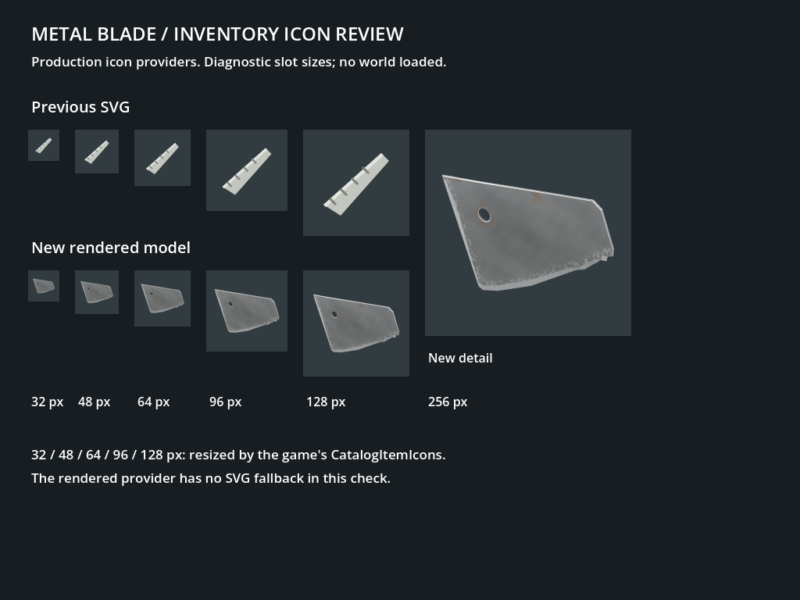

# Metal Blade asset

Revision R01, 18 October 2026. This replaces the refined-metal ingot stand-in and
SVG fallback with a dedicated original model and icons. Item key `metal-blade`,
ID 158, stack size, description, recipes and resource presentation are unchanged.
Artistic acceptance remains with the owner.

## Reference and design

The official [Rust Metal Blade](https://wiki.facepunch.com/rust/item/metalblade)
[item image](https://files.facepunch.com/rust/item/metalblade_512.png) was opened and
visually inspected before modelling. It shows a broad tapered grey steel plate,
one mounting hole near the broad end, a bright ground cutting edge, surface
scratches and small chips near the narrow end. These observed features guide this
asset, following the owner's request to stay closer to the reference.

Our mesh has its own outline, hole position, bevel profile, chips and wear pattern.
Both sides are modelled; the hole is open geometry at every LOD. Scratches and sparse
brown oxidation are generated from a fixed seed on neutral grey steel. No Rust
image, mesh or other game file is downloaded or included in the repository.

## Asset specification

- Approximately 32 x 23 cm, with 5.2 mm maximum thickness and a 22 x 26 mm mounting hole.
  Bottom-centre pivot shared by all three LODs.
- 1,568 / 992 / 672 triangles; one 37-triangle convex collision hull. The hull
  intentionally fills the hole; the rendered model retains it.
- One material, one original 1024px albedo/ORM/normal atlas. The broad faces and
  grinding bevels occupy separate atlas regions with padding.
- Transparent 128px and 256px PNGs rendered from the model by the production
  Godot IconRenderer, using per-item view [38, 28, -15].

[Repeatable Blender source](../art/models/metal_blade.py) writes only blade assets.
Run it directly or select `metal_blade` through `art/build.py`. The editable blend,
isolated preview harness and job logs are local under `.artifacts/metal-blade-r01/`.
[Provenance](../game/assets/items/metal-blade.provenance.json) records installed hashes.

## Validation

The focused test project and isolated Godot review project built with zero warnings
or errors. All **7/7 catalogue and content tests passed**. They cover the new blade
identity regression, 163 model entries, 171 model/stage files and 256 icons, plus
content references and reader registration.

Godot imported the mesh and external material maps. The production ModelViewer
captured all three LODs and the reverse side. IconRenderer wrote both PNG sizes;
CatalogItemIcons loaded 32, 48, 64, 96, 128 and 256px with SVG fallback disabled.
The blade silhouette survives 32px; the hole is clearer from 48px. Larger-size
review caught regular grind striping, replaced with less pronounced irregular
abrasions before the final renders. Mesh attributes and normals were checked for
finite values and unit length; PNGs have RGBA transparency and unclipped bounds.

- [LOD0](images/item-art-metal-blade-20261018/metal-blade-lod0.png),
  [LOD1](images/item-art-metal-blade-20261018/metal-blade-lod1.png),
  [LOD2](images/item-art-metal-blade-20261018/metal-blade-lod2.png),
  [reverse side](images/item-art-metal-blade-20261018/metal-blade-back.png).
- [Validation, hashes and job receipts](images/item-art-metal-blade-20261018/validation.json).

These are native Godot captures in a blade-only project referencing the existing
compiled game presentation code. The slots are a diagnostic using the actual icon
providers, not a live gameplay inventory screenshot. No world or server was loaded.
The full solution and gameplay test suite were deferred to keep load low while
other sessions work. Artistic acceptance remains with the owner.

Asset jobs ran one at a time, below normal priority on two CPU cores, waiting when
available memory fell below the launch threshold. All owned children exited, and
the temporary reference browser tab was closed. Other sessions were left alone.
