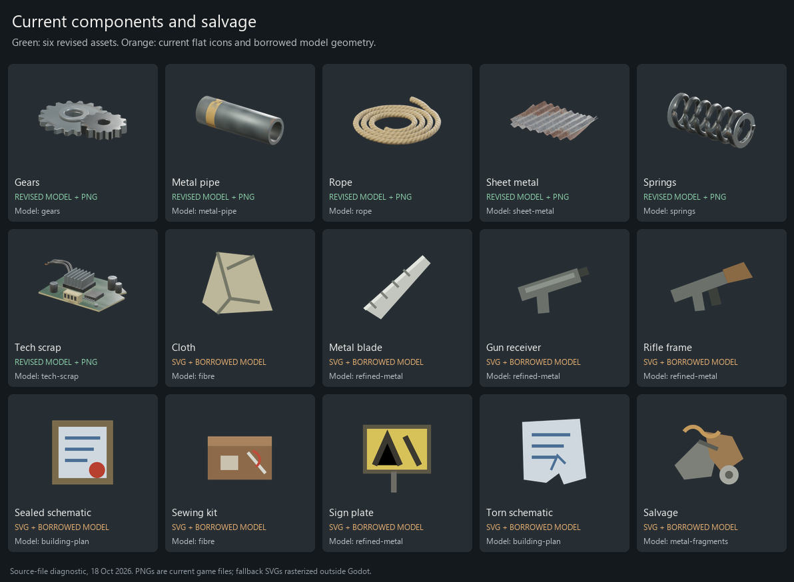

# Item Art Replacement Plan

Replace the remaining flat placeholder icons and borrowed item models with distinct,
recognizable assets. Each finished model supplies its own inventory icon so that the
two share the same shape, materials and construction.

**Status, 18 October 2026:** the catalogue audit is complete and the replacement work
is planned. The owner requested this plan and its audit evidence be saved and committed.
Cloth now has its own original model and rendered PNGs; see
[its specification, evidence and validation limits](ITEM_ART_CLOTH.md). Its live
inventory check and owner visual acceptance remain pending. Sewing Kit now has its
own spool-and-needle model and rendered icons; see [its asset record](ITEM_ART_SEWING_KIT.md).
Other replacements remain planned. Artistic acceptance remains with the owner.
[DESIGN.md](DESIGN.md), especially ART-01 and the ground UI requirement, remains authoritative.

## Current assets

The audited working tree contains 137 items: 14 components, 17 resources and 106 items
in other categories. All item keys have model mappings. Six components already use the
revised `Hollow_Salvage_R01` textured scenes and their supplied 128/256 px icons:
**gears, springs, metal pipe, rope, tech scrap and sheet metal**.

Eight components still use flat SVG drawings in the inventory and unrelated models.
The SVGs scale cleanly; their simple artwork is the problem. Increasing icon resolution
alone would preserve the same appearance.



The initial audit found 123 item entries with dedicated PNGs, two PNG aliases and twelve
fallbacks. Eleven entries lack icon metadata; Wire Tool referenced a missing PNG and
has no dedicated fallback drawing. These counts describe the working tree at the audit,
including concurrent uncommitted features, rather than a release inventory.

During document preparation, concurrent work supplied both Wire Tool PNG sizes. A fresh
diagnostic run now finds 124 dedicated PNG entries, two aliases and eleven fallbacks.
The images preserve the initial audit baseline. Wire Tool's remaining task is to review
its current art and confirm the model/icon match, rather than generate missing files.

## Replacement scope

Thirteen item entries need work. The appearance descriptions below are proposed art
directions grounded in the current item descriptions; detailed geometry and materials
remain subject to visual review.

| Batch | Item key | Current model or icon gap | Proposed appearance |
|---|---|---|---|
| 1 | `cloth` | Fibre model and SVG icon | A roll or folded bolt of rough woven cloth, with visible thickness, folds and restrained fraying. |
| 1 | `sewing-kit` | Replaced: original model and rendered PNGs | Wooden mending spool, sage thread and steel needle; revised from the tin proposal after inspecting the Rust reference. |
| 1 | `metal-blade` | Refined-metal ingots and SVG icon | A distinct spring-steel machine or saw blade, with a readable cutting edge and mounting features. |
| 1 | `sign-plate` | Refined-metal ingots and SVG icon | A bent road-sign panel with original markings, mounting holes and localized wear. |
| 1 | `receiver` | Refined-metal ingots and SVG icon | A semi-automatic gun frame, with recognizable slide and barrel interfaces. |
| 1 | `rifle-frame` | Refined-metal ingots and SVG icon | A rifle receiver and stock assembly without its barrel and springs; distinct from the gun receiver. |
| 1 | `torn-schematic` | Building-plan model and SVG icon | A torn engineering drawing with a strong irregular outline and original diagrams. |
| 1 | `sealed-schematic` | Building-plan model and SVG icon | A complete engineering drawing in a protective sealed sleeve. |
| 1 | `salvage` | Metal-fragments model and SVG icon | A compact assortment of wire, brackets and broken machine parts, distinguishable from metal fragments. |
| 2 | `explosives` | Sulphur model and sulphur PNG alias | A clearly packaged fictional industrial explosive material, distinct from sulphur and gunpowder. |
| 2 | `blueprint` | Building-plan model and SVG icon | A distinct blueprint document for generic views; preserve the learned-item presentation described below. |
| 2 | `research-table` | Engineering-workbench model and SVG icon | A dedicated dismantling and research bench with inspection tools, a work surface and sample storage. |
| 3 | `wire-tool` | Own simple model; PNGs supplied during document preparation | Review the probe's silhouette, construction and new icons; improve and re-render only where needed. |

Batch 1 is nine assets: the eight unfinished components plus salvage. Batch 2 covers
three further borrowed identities. Wire Tool needs a model/icon review, rather than
an assumed replacement of its existing model. Door-key icon reuse is outside this
scope. Clothing and door stand-in annotations need separate contextual review and do
not establish that their current gameplay geometry is still a placeholder.

## Visual standard

Follow the game's advanced technology with visible handmade construction. Materials
may be clean, maintained or worn as appropriate; rust is not a universal requirement.
The six revised components provide a starting point for consistency, not a ceiling on
quality or evidence of final owner acceptance.

**Owner direction, 18 October 2026:** Rust is the main visual inspiration. Before
authoring each replacement, look up and inspect the actual corresponding Rust item
image on the web, preferably on Facepunch's wiki. Record the reference URL and the
observed construction, silhouette, material and small-slot readability. Use those
observations to author our own asset. Keep reference game images and models out of
the repository; retain links and notes. Work on one item at a time, wait for machine
resources, and close only processes and browser tabs created by this work.

Start with **cloth, gun receiver and salvage** to establish fabric, machined metal and
mixed-material examples. Review their silhouettes, material response and inventory
readability before applying the approach to the rest of the batch. Avoid adding detail
that only appears in an enlarged studio render.

Use deliberate silhouettes, sensible thickness, bevels, smooth shading where appropriate
and convincing material variation. More polygons alone do not correct weak forms or
shading. The existing revised pickups use roughly 1,500–4,400 triangles at their closest
level of detail, three detail levels and shared 2K texture sets. These are references
for small items, not fixed budgets for paper, fabric or the larger Research Bench.
Set each asset's dimensions, geometry budget and texture allocation before production.

## Production and integration

1. **Prepare the asset specification.** Confirm the item identity, dimensions, intended
   views, construction, material treatment and detail budget. Keep the existing item key.
2. **Author in Blender.** Reuse the original owner-controlled source and shared material
   conventions where useful. Save editable sources and repeatable exports in a new
   asset workspace. Preserve the existing revised package. Other games supply no files.
3. **Prepare game assets.** Supply the appropriate detail levels, UVs, material maps and
   resource paths. Keep metre scale, orientation and pivots consistent with the current
   importer. Add collision or held-item sockets where the catalogue and runtime require
   them. Use textured Godot scenes when the plain GLB does not retain material bindings.
4. **Render matching icons.** Use the existing Godot `IconRenderer` on the exact model
   selected by the catalogue. Render transparent 128 and 256 px PNGs through the existing
   supersampled workflow. Adjust per-item framing and angle for a readable silhouette.
5. **Integrate narrowly.** Update each item's model path and icon entry in
   `game/data/ground/models.json`; remove its stand-in annotation only after replacement.
   Keep IDs, keys, recipes, quantities and inventory behavior intact. Record asset source,
   provenance and installed hashes without overwriting earlier integration receipts.
6. **Review in the game.** Compare the model viewer, inventory grid and item details.
   Check representative UI scales and actual small slot sizes, not only 256 px images.
   Correct geometry, materials or framing where those views disagree.

The current local pipeline already supplies Blender authoring helpers, a catalogue,
model viewer and icon renderer. The original revised component sources are under
`D:/GameDev/Assets/Hollow_Salvage_R01/Source`. Their availability does not mean the
missing twelve item identities have already been authored. The optional `game-dev`
CLI was unavailable during the audit; the existing project tools support the proposed
local production route.

## Gameplay details to preserve

**Blueprints:** inventory stacks with `Teaches` show the taught item's icon on a blue
background in `GroundUi.Paint.cs`. Keep that behavior. A new generic blueprint asset
serves generic catalogue and detail views; it must not replace every taught-item icon
with the same paper picture.

**Dropped items:** inventory drops form lootbags. Replacing component art does not
introduce individually scattered physical component drops. Validate actual presentation
paths that use the models and retain the shared bag behavior.

**Research Bench:** its visual footprint, authoritative placement bounds and collision
must agree. Check placement on foundations, interaction reach, pickup, storage and
destruction. If the geometry changes, update the shared bounds and matching destruction
assets deliberately; the engineering-workbench debris must not silently remain the
claimed finished replacement.

**Wire Tool:** preserve its existing held presentation and grip requirements if its
model changes. Render only after the selected model is ready, so the icon does not
immediately become stale.

## Acceptance checks

Every replacement needs a recognizably distinct model and a matching rendered icon.
The intended rendered path must not silently fall back to the SVG. Check both icon
sizes, transparency, resource references, material bindings, detail levels, pivots
and required collision or sockets.

Run the existing catalogue/content checks and extend targeted coverage for these
identities where needed: dedicated model and icon mappings, no remaining stand-in
annotation, and no accidental reference to the previously borrowed asset. A file's
existence cannot establish visual quality; retain before/after model and inventory
screenshots for that review.

For implementation handover, run `dotnet build HollowUniverse.sln` and
`dotnet run --project tests/Hollow.Tests`, along with targeted catalogue checks and
Godot import/runtime inspection. Coordinate builds and Godot sessions with the root
agent. Record actual results and any remaining failures in `DEVELOPMENT.md`.

Completion means all thirteen scoped entries meet their applicable checks, icons are
readable at gameplay size, and the Research Bench and Wire Tool retain correct behavior.
Structural checks and successful imports do not substitute for artistic acceptance.

## Audit evidence

- [Component and salvage comparison](images/item-art-audit-20261018/components-current.png)
- [Resource icons](images/item-art-audit-20261018/resources-current.png)
- [All item icons page 1](images/item-art-audit-20261018/all-items-1.png) and
  [page 2](images/item-art-audit-20261018/all-items-2.png)
- [Catalogue snapshot](images/item-art-audit-20261018/inventory.json)
- [Revised model captures](images/abtest-b/repairs/assets/models-r01-contact-sheet.png)
- [Existing revised-asset integration record](REPAIR_ASSETS.md)
- [Audit sheet generator](../tools/audit_item_art.py)

The four icon sheets compose actual selected PNGs and source SVG drawings rasterized
outside Godot. They are diagnostic sheets, not new gameplay captures. The model images
are the existing Godot captures. The audit checked all 171 catalogue model/stage paths
and matched all 34 salvage-package and 15 container-package files against their installed
hash receipts. No replacement asset, runtime build or new gameplay validation is claimed.

To regenerate diagnostic sheets, use Python with Pillow and Node.js with Sharp:

```text
python tools/audit_item_art.py --output .artifacts/item-art-review --node <node-executable> --sharp <sharp-module-path> --font <ttf-path> --date YYYY-MM-DD
```

Generate into a fresh diagnostic directory. Treat the committed images and inventory
as the dated baseline; later catalogue changes can legitimately produce different output.
