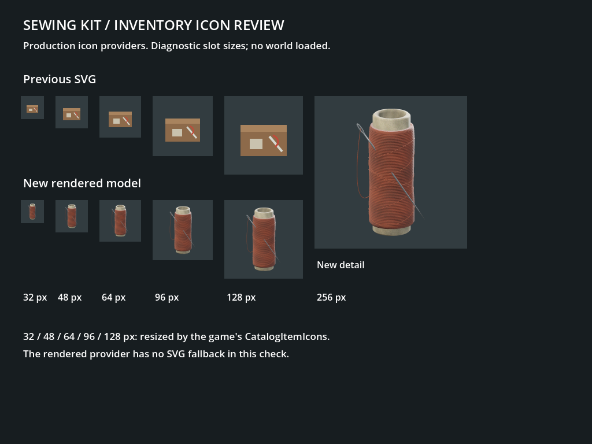

# Sewing Kit asset

Revision R02, 18 October 2026. The owner rejected R01's green palette and appearance.
This revision replaces its decorative wooden caps and smooth, corrugated winding.
Artistic acceptance of R02 is pending. The item key, ID 156, stack size,
recipes and resource presentation remain unchanged. Its description now says
"A spool of tough thread and a steel mending needle." to match its appearance.

## Reference and design

Before authoring, the actual [Rust Sewing Kit](https://wiki.facepunch.com/rust/item/sewingkit)
[item image](https://files.facepunch.com/rust/item/sewingkit_512.png) was opened and visually
inspected on Facepunch's site. It shows a tall tubular spool, brown wound thread, a
large diagonal needle and a hanging loop. The broad spool silhouette and exposed
needle make the function legible in a small inventory icon.

R02 uses a narrow, hollow compressed-fibre core, reddish-brown thread with fine,
irregular winding, and a smaller flattened steel needle partly tucked under the
thread. The loose loop is thin and uses the same brown fibre as the winding.
The geometry, texture patterns, palette and proportions are authored for Hollow
Universe. The earlier tin proposal in the replacement plan was revised after this
reference study. No Rust pixels, meshes or other game files are included.

## Asset specification

- Size: approximately 9.7 x 6.1 x 16.1 cm including the needle; bottom-centre origin
  shared by all LODs. The thread body is about 6 cm wide.
- One material and one original 1024px albedo/ORM/normal atlas. Separate padded bands
  distinguish thread, compressed fibre, steel and the loose thread. The larger atlas
  resolves fine fibres instead of adding repeated bumps to the mesh silhouette.
- Three deliberately constructed LODs: 7,200 / 2,748 / 1,060 triangles. Initial maximum
  budgets remain 10,000 / 5,500 / 2,200. One 56-triangle convex collision hull.
- Hollow bobbin, needle eye, bevels and trailing loop survive all detail levels.
  No cloth simulation, texture baking or transparent geometry is needed.
- Transparent 128px and 256px icons use the production Godot IconRenderer, with
  per-item view [20, 18, 0]. The existing UI chooses and scales these PNGs.

[Repeatable Blender source](../art/models/sewing_kit.py) writes only sewing-kit files.
Run it directly, or select `sewing_kit` through `art/build.py`. The editable blend and
job logs are local under `.artifacts/sewing-kit-r02/`; the source script is committed.
[Provenance](../game/assets/items/sewing-kit.provenance.json) records installed hashes.

## Validation

The existing isolated review harness was reused; the current catalogue/content test
sources built with zero warnings or errors. All **6/6 focused tests passed**, including the sewing-kit
identity regression, all catalogue resource paths and the content reader checks.
The full catalogue check covered 163 models, 171 model/stage files and 254 icons.

Godot imported the external material maps and model successfully. All three LODs
were captured through the production ModelViewer. The production IconRenderer wrote
both PNG sizes, and CatalogItemIcons loaded them at 32, 48, 64, 96, 128 and 256px
with its SVG fallback disabled. PNG checks confirmed RGBA transparency and unclipped
edges. Core UVs use physical height, removing the stretched vertical grain seen in
the first R02 candidate. Normals/UVs are finite; exported normals have unit length.

- [LOD0](images/item-art-sewing-kit-r02-20261018/sewing-kit-lod0.png),
  [LOD1](images/item-art-sewing-kit-r02-20261018/sewing-kit-lod1.png),
  [LOD2](images/item-art-sewing-kit-r02-20261018/sewing-kit-lod2.png).
- [Measured validation and job receipts](images/item-art-sewing-kit-r02-20261018/validation.json).
- [Rejected R01 evidence](images/item-art-sewing-kit-20261018/icon-slots.png) is retained
  as history, not as an accepted art direction.

These are native Godot captures in a sewing-kit-only project referencing the existing
compiled game presentation code. The comparison is a diagnostic slot control using
the actual icon providers, not a live gameplay inventory screenshot. No world or
server was launched. A full solution rebuild and full gameplay suite were deferred
to keep load low while other sessions work. Artistic acceptance remains with the owner.

Jobs ran serially at below-normal priority on two CPU cores, waited for memory/CPU
capacity and exited after each capture. No browser or interactive Blender was opened
for R02. It reused the isolated cache retained after R01's cleanup was blocked by
automatic approval review. That rejected cleanup operation was not retried.
The asset uses the existing resource-class model and icon systems. Inventory drops
still form lootbags; this artwork does not introduce scattered physical components.
