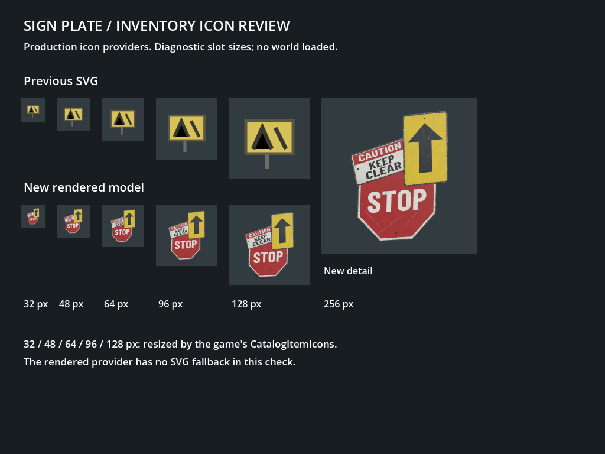

# Sign Plate asset

Revision R01, 18 October 2026. A dedicated original model and rendered icons replace
the refined-metal ingot stand-in and SVG fallback. Key `sign-plate`, ID 160, stack
size 20 and recipes remain unchanged. Its description now reads "A bundle of dented
steel signs from roads long gone." to match the reference-inspired group of plates.
Artistic acceptance remains with the owner.

## Reference and design

The official [Rust Road Signs](https://wiki.facepunch.com/rust/item/roadsigns)
[item image](https://files.facepunch.com/rust/item/roadsigns_512.png) was opened and
visually inspected before authoring. It shows overlapping road signs: a red stop
octagon below, a red-and-white warning panel at upper left and a tall yellow panel
with a black upward arrow at upper right. Painted faces, exposed thin edges and
scuffs establish the salvage appearance. The owner requested a close reference.

Our three plates retain that arrangement and palette, with original dimensions,
shallow bends, mounting holes and wear patterns. The warning says "CAUTION / KEEP
CLEAR." The common STOP marking and arrow are authored from scratch; no reference
pixels, graffiti or meshes are copied. Lettering uses the repository's Barlow
Condensed Bold font under its existing SIL Open Font License. No foreign game
files are downloaded or included.

## Asset specification

- The bundle measures about 53 x 64 cm, with 5.4 cm overall depth including bends.
  Three thin steel plates each have an open 9 mm mounting hole. The base steel is
  2.4 mm thick, with shallow bends and separate depth positions to keep overlap clear.
  All LODs share the same bottom-centre origin.
- 4,032 / 1,824 / 936 triangles, one 52-triangle convex hull and one material. Panel silhouettes,
  bends and mounting holes survive all LODs. Hull points enclose the bundle; it
  intentionally fills holes and the spaces between plates.
- One original 1024px albedo/ORM/normal atlas: three painted faces, unpainted backs
  and narrow edges use separate padded regions. Paint and exposed steel have
  different roughness and metallic values. Wear is generated from fixed seeds.
- Transparent 128px and 256px PNGs come from the production Godot IconRenderer,
  using per-item view [-22, 14, -5]. Existing inventory UI scales these PNGs.

[Repeatable Blender source](../art/models/sign_plate.py) writes only sign-plate
assets. Run it directly or select `sign_plate` through `art/build.py`. The editable
blend, isolated review project and job logs are under `.artifacts/sign-plate-r01/`.
[Provenance](../game/assets/items/sign-plate.provenance.json) records installed hashes,
source and font attribution.

## Validation

The isolated review and focused test projects built with zero warnings/errors.
All **8/8 catalogue/content tests passed**, including a regression that requires
the dedicated sign model and its own icons. The catalogue check covered 163 models,
171 model/stage files and 258 icons. The description edit does not alter gameplay
quantities or crafting requirements.

Godot imported the mesh and external material maps. Native ModelViewer captures
cover LOD0/1/2 and the reverse side. IconRenderer produced both PNG sizes;
CatalogItemIcons loaded 32, 48, 64, 96, 128 and 256px with SVG fallback disabled.
The coloured silhouettes remain the main recognition cue in small slots; fine
warning text is intended for larger sizes. Preview review corrected the warning
panel's overlap, widened the arrow panel and exposed more of the STOP lettering.
Mesh attributes/normals and PNG transparency/unclipped bounds were checked.

- [LOD0](images/item-art-sign-plate-20261018/sign-plate-lod0.png),
  [LOD1](images/item-art-sign-plate-20261018/sign-plate-lod1.png),
  [LOD2](images/item-art-sign-plate-20261018/sign-plate-lod2.png),
  [reverse side](images/item-art-sign-plate-20261018/sign-plate-back.png).
- [Validation, hashes and job receipts](images/item-art-sign-plate-20261018/validation.json).

These are native Godot captures in an isolated project using existing compiled
game presentation code. The slot comparison uses the actual icon providers; it is
not a live gameplay inventory screenshot. No world or server was loaded. The full
solution and gameplay suite were deferred to keep load low during concurrent work.
Asset jobs ran serially below normal priority on two CPU cores, with CPU/memory
gating. All owned jobs exited and the temporary reference tab was closed. Other
sessions' work was preserved. Artistic acceptance remains with the owner.
