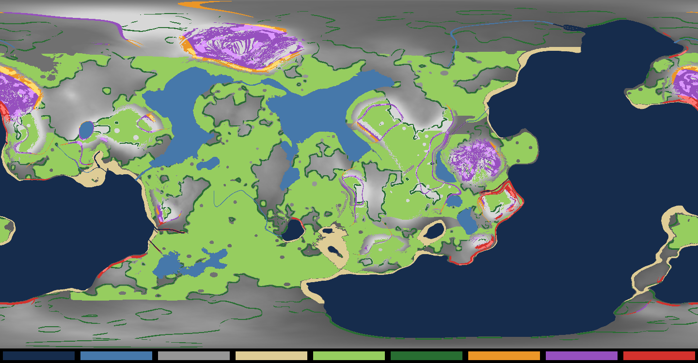
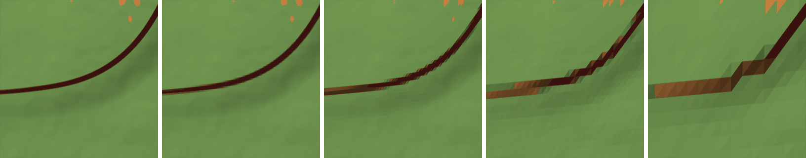

# Earth landform survey and visual targets (T1)

19 October 2026. T1 of [TERRAIN_SCENERY_PLAN.md](TERRAIN_SCENERY_PLAN.md): the whole current Earth surveyed,
its sites named, the scalloped soil wall diagnosed, before-images taken in normal play, and the targets and
the first three formation recipes recorded. Nothing here changes generation, saves or rendering. The survey
reads the same `WalkingWorld` the server builds (layout 5, save revision 5, radius 1,200 m).

## Tools

```bash
dotnet run -c Release --project tools/Hollow.GeneratorReport -- earth survey [folder] [width]
dotnet run -c Release --project tools/Hollow.GeneratorReport -- earth transect <lat> <lon> <bearing> [length] [step]
dotnet run -c Release --project tools/Hollow.GeneratorReport -- earth wall <lat> <lon> [size] [folder]
dotnet run -c Release --project tools/Hollow.GeneratorReport -- earth formations <lat> <lon> [size] [folder]
```

- `survey` rasterises the globe (1,440 × 720 by default, 5.24 m a pixel at the equator) and writes
  `docs/images/t1-survey/earth-landforms.png` and `.json`. Two runs give identical files. It takes 5 s.
- `transect` prints the ground along a bearing: height, the relief before carving, water, rise per metre, the
  four relief weights and the scans whose box holds the point.
- `wall` draws the ground round a point from above as the generator makes it and as the terrain's render grid
  draws it at tile levels 6, 5, 4 and 3 (32 cells a tile: 0.92, 1.84, 3.68 and 7.36 m cells on Earth).
- `formations` (T2) draws the cliff formations round a point from above: each scan's footprint by family and
  every face sample of the generator's survey, green covered, magenta meant for rock but bare, white soil.

## Classification

Land is classified by grade (the route planner's central differences, two metres either side):

| Class | Rule |
| --- | --- |
| Coastal scarp | grade ≥ 0.62 (the cliff generator's own candidate rule) within 80 m of the sea |
| Plateau / mountain face | grade ≥ 0.62 inland, tableland or mountain relief dominant |
| Inland outcrop | grade ≥ 0.62 inland, plains or hills relief dominant (kettle rims, valley sides) |
| Shore | the beach biome |
| Wooded edge | grade < 0.35, woodland ≥ 0.45 within three pixels of woodland ≤ 0.15 |
| Meadow | grade < 0.35, grass cover ≥ 0.6, woodland < 0.2 |

A **wall** is ground steeper than 2 (63°). **Covered** means the ground point lies inside a placed scan's
bounding box, with a metre's margin: rock is drawn there. An earlier draft counted any scan within 48 m (the
cliff query's reach includes its 40 m maximum extent) and reported 65.5%; that overstated coverage threefold.

## Results



Legend, left to right: sea, lake, other land (grey by height), shore, meadow, wooded edge, inland outcrop,
plateau or mountain face, coastal scarp. Pixels covered by a scan are lightened.

| Class | Area | Covered by scans | Walls (≥ 2) | Walls covered |
| --- | ---: | ---: | ---: | ---: |
| Meadow | 4.564 km² | – | – | – |
| Wooded edge | 0.539 km² | – | – | – |
| Shore | 0.396 km² | – | – | – |
| Plateau / mountain face | 0.494 km² | 19.3% | 17.1% of it | 13.2% |
| Coastal scarp | 0.117 km² | 26.2% | 13.2% | 21.7% |
| Inland outcrop | 0.100 km² | 34.5% | 2.6% | 14.8% |

Land is 10.668 km². Steep ground is 0.711 km² (6.7% of the land), of which 22.5% has scan rock on it. Walls
total 0.103 km², 14.5% covered. The generator places 909 scan parts on the whole world.

The steepest faces belong to tablelands: their regions reach grade 16.7 (86°), against 7.4 on mountains.
Tableland regions are the least covered (10 to 16%). Mountain massifs hold most of the face area.

## Sites

Site identities are coordinates on Earth layout 5, save revision 5; the viewpoint is where a player stands.
Faces' anchors are their region's steepest sample; a viewpoint walks 30 to 150 m downhill (uphill on a sea
cliff whose foot is under water) to gentle dry ground and looks back. Every capture is a hosted game at High,
1600 × 900, solar hour 14, from a fresh scratch save; arguments and outcomes are in
`images/t1-survey/captures.json`. Unedited frames, converted to JPEG.

| Site | Viewpoint (lat, lon, yaw, pitch) | What it is | Before-image |
| --- | --- | --- | --- |
| Tableland escarpment | 18.179194, 51.421326, 283.3°, 15° | 31,310 m² region, 105 m relief, grade 16.2, 9.9% covered | [image](images/t1-survey/before-tableland-face.jpg) |
| Mountain face | 18.121935, −168.553855, 123.5°, 15° | the largest face region, 0.142 km², grade 7.4, 21% covered | [image](images/t1-survey/before-mountain-face.jpg), [foot](images/t1-survey/before-mountain-face-foot.jpg) |
| Coastal scarp | −8.949035, 74.252048, 175.2°, 15° | tableland coast, grade 16.7, 16% covered | [image](images/t1-survey/before-coastal-scarp.jpg) |
| Inland outcrop | −13.309826, 65.950764, 92.9°, 15° | hills, grade 2.6, 43 m relief, no scan | [image](images/t1-survey/before-inland-outcrop.jpg) |
| Meadow | −19.375, −63.875, 316.6°, 0° | the largest meadow, 1.684 km² | [image](images/t1-survey/before-meadow.jpg) |
| Wooded edge | 8.875, −13.875, 113.3°, 0° | the largest wooded edge region | [image](images/t1-survey/before-wooded-edge.jpg) |
| Shore | 1.125, −128.375, 17°, 0° | the largest shore, 93,854 m² | [image](images/t1-survey/before-shore.jpg) |
| Lake bank | 44.3873, −13.730981, 180°, −5° | the largest lake, 0.499 km², level 14.36 m | [image](images/t1-survey/before-lake-bank.jpg) |
| Scalloped wall | −46.883901, 6.496583, 10°, −12°, lifted 40 m | a tableland edge 120 m away (see below) | [image](images/t1-survey/before-wall-120m-above.jpg), [detail](images/t1-survey/before-wall-120m-detail.jpg) |

### The benchmark route

The continuous normal-play benchmark is the hosted route (`--environment-route`, planned by
`EarthEnvironmentRoute.Find`): from a beach through woodland, a clearing, the water's edge, a scanned cliff and
the weather station. The 868 m route below was the one measured for the T0 baseline; three of its four walks
stopped at a boulder inside a waypoint, so the planner now keeps clear of solid natural objects and of every
scan piece's box. The route depends on where the cliff groups stand, so it moves while T2 iterates: after T2's
second iteration it is 573 m (beach −40.206890, −104.689056; woodland −43.333428, −108.184458; clearing
−44.166008, −109.608904; water −41.128248, −105.388214; cliff −37.448934, −99.091943, a `nordic_broad` group;
weather station −37.902748, −97.273959), and a hosted High walk completed it. The route test prints the current
one.

| Stop | Coordinates | Covers |
| --- | --- | --- |
| beach | −22.950096, −101.979924 | coast |
| woodland | −17.775937, −96.344951 | forest edge (tropical forest, eight trees within 18 m) |
| clearing | −18.708761, −95.332092 | meadow (savanna, grass 0.82) |
| water | −23.902197, −102.011057 | the sea's edge (a beach) |
| cliff | −21.570481, −98.864210 | inland rock: a `nordic_forest_ledge` group, grade 0.60 |
| monument | −25.852710, −95.717831 | the weather station's surroundings |

It covers all five landforms the plan names, but two only at their easiest: its water is the sea, and its
cliff is chosen in front of a scan group, where coverage is best. The lake bank and the four face sites above
are the extra sites the plan allows "where one route cannot cover all landforms". Open construction ground,
approaches, resources and monument access are kept by the route itself (its corridor rules) and are checked
again at each site after a change.

## The scalloped soil wall

The playtest's screenshot 5 (16 October) shows a long reddish wall with regular vertical scallops whose tops
are dark. A static review on 16 October ([Earth-terrain-recovery.md](repair-results/Earth-terrain-recovery.md))
named the same suspects and asked for a reproduced site; this is that reproduction. It is reproduced at the tableland edge north of −42.7987, 7.689 (Codex's capture site of 18 October)
and, in normal play, at the mountain and coastal sites above.

**Cause: relief shape.** `WalkingWorld.Tableland` builds each plateau and mesa edge as an escarpment whose
cliff part (`CliffShare`, 75% of the rise) spans only ±0.3 of a narrow band of a noise field. Along bearing 10°
from the capture site the ground rises 8.7 m in 3 m (31.5 to 34.5 m out; rise up to 3.9 per metre, 75°), with
a flat top beyond and a 0.25 talus below. The relief before the drainage carves and monument pads are graded
(`WalkingWorld.Parts`) is identical to the final ground across the whole step, so the wall is the tableland's
own shape, not a canyon. Mountain flanks reach grade 7 and the tableland coast 16.7. The heightfield is asked
to stand vertical.

**Why it scallops.** Three things turn that step into a regular pattern:

1. The render grid is coarser than the step beyond the finest level. At High, level 6 (0.92 m cells, within
   about 94 m) follows the generator's curve; levels 5 and 4 (to about 377 m) redraw it as stair-steps one
   cell wide; level 3 as blocks. Low's terrain detail (0.75) brings each level 25% closer. 
2. The shader chooses rock by the interpolated vertex normal (`slope + (macro3.r − 0.5) · 0.12` through
   0.30–0.48, `surface_ground_look.gdshaderinc`), and vertex material weights are blended across each cell. A
   cell spanning the step gets grass or forest floor from its top or bottom vertices part-way up the face.
3. Those non-rock layers are drawn with top-down UVs, so they streak vertically, and the macro noise that
   moves the rock threshold is sampled top-down (`wp / 37`): constant down the wall, varying only along it.
   Tongues of streaked grass hang from the lip or rise from the foot at a quasi-regular spacing, slanting
   with the lattice's triangle diagonal. Only rock and sandstone use triplanar projection.

**Ruled out.** Not a lake rim: the ground is dry for the whole profile and no lake is near. Not LOD skirts:
skirts hang below tile edges 29 to 118 m apart, while the pattern repeats every few metres and follows the
step's curve. Not cliff placement: scans are absent, not wrong. One small group stands at the foot of a wall
more than 100 m long; scans could hide the face, but none of them makes it.

**Consequence.** Covering the faces (T2) is necessary but not sufficient: anything the heightfield still shows
beyond about 94 m scallops. Two remedies, for T2 to compare; neither is applied:

- Keep the shape and give formations far proxies that hide the face at levels 5 and below (the plan asks for
  far geometry beyond the scans' 340 m range; these walls need it from about 94 m).
- A deliberate, versioned shape change: widen the escarpment's cliff band so the heightfield face stays below
  about grade 2 and every level draws it smoothly, with the scans standing proud as the vertical rock. It
  changes heights, so it needs a save revision and the owner's approval.

## Problems seen, and the targets that address them

Inspect large silhouettes first, vegetation masses second, ground detail third. Targets are properties a
before/after comparison at the same site, sun and settings can check. The atmosphere reference is Subsistence
(DESIGN.md ART-02, whose particular qualities are still to be identified with the owner); the composition
notes come from REFERENCE_STUDY_TOOLS_WORLD.md and the plan's production lessons.

| Site | Problems in the before-image | Target |
| --- | --- | --- |
| Faces (all) | Bare heightfield faces tens of metres high and up to 150 m long, flat orange or red-brown, no strata, ledges or overhangs; smooth blobby silhouettes; scallops at the foot and lip; a hard horizontal line where grass meets rock; one scan group per long wall | The exposed-rock share each recipe sets is drawn as rock: no heightfield wall steeper than 2 visible at the near level; crown, face and toe read as one formation; no scallops at any level; the silhouette survives at distance |
| Inland outcrop | Procedural grass blades growing out of a near-vertical face | Plants only where something supports them (T3): ledges, soil pockets, the toe |
| Meadow | Dark clumps over wide bare brown soil; backlit blades almost black; flat soil texture; no flowers, stones or litter between | One coverage policy (T4) with deliberate patches rather than compounded thinning; lit blades keep colour against the sun; the three scales of ground (relief, masses, small detail) |
| Wooded edge | Evenly spaced trunks of one size and lean; bare brown floor with sparse tufts; a hard line between wood and meadow | Groups and gaps, varied trunks and crowns, ferns, deadwood and stones on the floor, a transition band at the edge |
| Shore | A wide, empty sand plain; a faint repeating pattern in the sand | Wet and dry bands, pebbles and wrack, varied sand, the sea in view from the beach |
| Lake bank | Grass and bare soil run straight to a thin foam line; no wet band, reeds or stones; flat, still water | Banks that read as banks: a wet band, reeds, stones; water with movement and highlights |

## Initial formation recipes

Three recipes for T2, from the survey's measurements and the five scans in `src/Hollow.Surface/Data/cliffs.json`
(coastal 22 × 2.7 m, sandstone 18 × 6.4 m, nordic broad 24 × 12.9 m, nordic tall 22 × 12.1 m, forest ledge
20 × 5.8 m; widths × heights). Before T2 the generator placed at most three columns by three tiers in a 48 m
cell, one material family a group. The numbers below are starting values, not tuned results. They are built
in `src/Hollow.Surface/Data/cliff-recipes.json`, the plateau/mountain recipe as a tableland and a mountain
entry that differ in their scans' families.

| | Coastal scarp | Inland outcrop | Plateau / mountain face |
| --- | --- | --- | --- |
| Where | steep within 80 m of the sea | steep inland on plains or hills | steep inland on tablelands or mountains |
| Measured | 0.117 km²; relief to 178 m in a region; walls 13% of it | 0.100 km²; 22 to 88 m relief in its largest regions; walls 3% | 0.494 km²; to 243 m relief; walls 17%; grade to 16 on tablelands |
| Rock target | the whole face above the splash zone; a wave-cut toe | the outcrop's core; soil may keep its gentler flanks | every wall; talus below stays soil and scree |
| Mass | coastal and sandstone scans in long low runs, stacked on taller faces | one or two broad scans, sandstone or forest ledge, set into the slope | nordic tall and broad stacked to the face's height (up to about 40 m), sandstone on tablelands |
| Breaks | ledges and gullies every few runs; boulders at the toe in the surf line | a cap stone, scattered blocks on the downhill side | ledges that carry soil and plants, scree fans at gullies |
| Access | a way down to a beach where one exists | walk-around on every side | a ramp or break at least every 150 m of escarpment |
| Far | the cliff line's silhouette from the sea | none needed beyond the near range | proxies from about 94 m where the face is a wall |

## Macro layout

Macro layout stays frozen for the art comparison: no generation change was made. The survey shows a need for
one deliberate change, the escarpment band above, and it is proposed rather than applied.

## Gate

Reference targets, before-images, site identities and the problems each target addresses are recorded above.
The before-images are normal-play frames at fixed sites; the benchmark itself is the connected route. The
route's own frames are taken with the measured baseline (T0 item 4).
