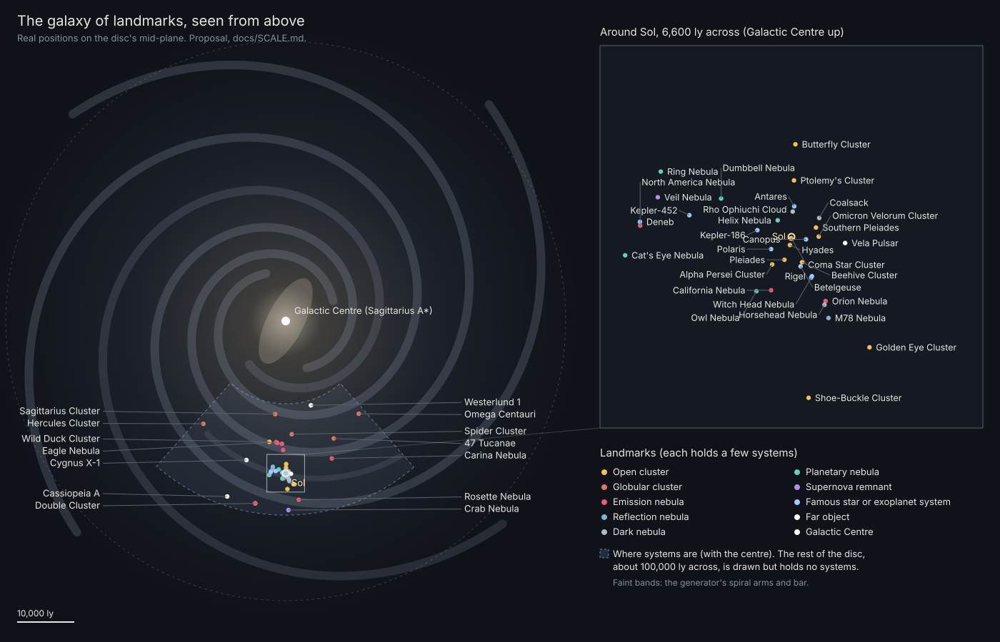

# Scale: small worlds in a galaxy of landmarks

Status: **proposal of 14 October 2026, for the owner's review.** Nothing in it is built except S3's first step: the owner
approved S3, the zone as a whole ball, on 14 October 2026, and S3a is built on the branch `whole-world` (§5.1, §6). Rows
marked **Decided** are the owner's answers of 14 October 2026 (the questions are in [SCALE_DECISIONS.md](SCALE_DECISIONS.md)).
Everything else is a **Proposal**, listed with its default in §8 so it can be changed in one line, or **Open**. It replaces
the 1:1 galaxy of [GAME_DESIGN.md](GAME_DESIGN.md) pillar 1, which the owner reversed, and the real-size planets of
[GROUND.md](GROUND.md) §3.

---

## 1. Decisions (owner, 14 October 2026)

| Topic | Rule | Status |
|---|---|---|
| Worlds | Far smaller than real planets. An Earth-like world is about 2.4 km in radius: 73 km², about four 4.2 km Rust maps. | Decided |
| Other bodies | Scaled from their real size: about 1 km for small moons, about 3.5 km for super-Earths. | Decided; the rule is a Proposal (§3.1) |
| A world's numbers | Gravity, air, temperature and day length stay the generator's real values and drive play. Only extremes are clamped to a playable band. | Decided; the bands are a Proposal (§3.5) |
| Inside a system | Planets keep their real orbits, crossed in supercruise. Only the worlds shrink; moons move in so they look as big in the sky as generated. | Decided; the moon rule is a Proposal (§3.6) |
| The galaxy | Not 1:1 any more. The real Milky Way's shape stays; its systems are a few at each landmark. | Decided |
| Landmarks | Real clusters and nebulae; famous real stars and exoplanet systems; the Galactic Centre and a few famous far objects. No generated landmarks. | Decided; the list is a Proposal (§4.2) |
| How many | A few systems per landmark, about 200 to 300 in all. | Decided; the counts are a Proposal (§4.5) |
| Height | Every system on the galaxy's mid-plane: the map is a flat board, and the camera still tilts freely. | Decided |
| Travel between landmarks | A gameplay question, to decide with the space gameplay ([SPACE_CONCEPT.md](SPACE_CONCEPT.md)). | Open (§7) |

---

## 2. One rule: real values, game lengths

The generator stays the truth about the universe. Every star, planet and moon keeps its real radius, mass, orbit, air,
climate and light, and their golden values don't move. The game reads three kinds of things from it in three ways:

| Kind | Rule | Examples |
|---|---|---|
| What you feel | The real value, clamped only at the extremes (§3.5) | Gravity; the air and whether you can breathe it; temperature; light; the length of the day (with the ×24 compression of GROUND.md §1) |
| What you see | The real angle | Where suns, moons, planets and the galaxy's band stand in the sky; how big a sun or a moon looks |
| What you cross | A game length | A world's radius; the height of its air, clouds and mountains; its moons' distances; the galaxy's thickness (none, §4.4); the number of systems |

**One place converts** (Proposal): `GameScale` in `Hollow.Galaxy`, engine-free and deterministic (`DMath`). From a body's
real values it gives the game's: radius, gravity, the distance factor of its moons, the heights of its air and clouds, the
day. Its bands and constants are one table of data. Nothing else converts: the surface, the zone, the server, the sky, the
maps and the body cards all ask `GameScale`. `Body.Radius` stays the real radius, because the generator derives gravity
from it: shrinking it in place would multiply gravity by about seven million. A body card shows the real value as
information, and the game value where they differ.

---

## 3. Small worlds

### 3.1 Sizes

**Rule** (Proposal): a landable body's game radius is 2.4 km × (its real radius ÷ Earth's)^⅓, at least 1 km and at most
3.5 km. The cube root keeps every size in order while squeezing them together, and the floor and the cap keep every world
you can land on between 1 and 3.5 km. Gas giants follow the same rule without the cap (they are only flown past). Stars keep
their real size.

| Body | Real radius | Game radius | Surface | In 4.2 km Rust maps |
|---|---|---|---|---|
| A small moon (Ceres-sized or smaller) | under 470 km | 1.0 km (the floor) | 12.6 km² | 0.7 |
| A moon like ours | 1,737 km | 1.56 km | 30 km² | 1.7 |
| A Mars-like world | 3,390 km | 1.94 km | 47 km² | 2.7 |
| **The first world, B 3** | 6,435 km | **2.41 km** | 73 km² | 4.1 |
| A super-Earth, 1.5 × Earth | 9,560 km | 2.75 km | 95 km² | 5.4 |
| A super-Earth, 2 × Earth | 12,740 km | 3.02 km | 115 km² | 6.5 |
| A Jupiter-like giant (not landable) | 69,900 km | 5.3 km | | |

### 3.2 What a 2.4 km world is like

| | The first world at 2.41 km |
|---|---|
| Surface | 73 km². With its real 45% of sea, 40 km² of land: a little over two Rust maps |
| Round the equator | 15.1 km: 46 minutes at a sprint (5.5 m/s) |
| From the equator to a pole | 3.8 km: 11 minutes |
| Horizon | 90 m standing on flat ground; 380 m from a 30 m hill; 700 m from 100 m up; 2.4 km from 1 km up |
| Curvature | The ground turns 2.4° every 100 m. Across a 50 m base its edges sit 13 cm below its middle's level |
| From 5 km up | The whole world below you, a ball |

What it means for play:

- **Sight lines come from relief.** Flat ground hides a player at 90 m, so long shots need hills, ridges and towers, and open
  plains feel close. The ground (§3.3) is made for it: relief everywhere, with ridgelines and valleys that open views.
- **Night is a place.** The first world's day lasts 87 minutes, so the line between day and night crosses its equator at
  2.9 m/s, slower than a run. Half the world is always dark, and you can walk into the night or out of it. Rust's
  server-wide night becomes something you choose.
- **Bases fit.** A base keeps one frame, its first foundation's (GROUND.md §6.3). Across 50 m the ground falls 13 cm away
  from that frame, which the foundations' height range already takes; a 100 m base would need 52 cm.
- **Less to draw.** Beyond the horizon only peaks show. Today's far forests (impostors to 2.2 km) and 900 km far plane go.

### 3.3 The ground at walking scale

Today's surface generator is made for a world of 6,435 km. Its plates, continents, mountain belts and regional controls
work over 7 to 3,000 km, with heights from −5,400 to +4,600 m. On a 2.4 km world every layer above 10 km is nearly constant,
and the heights are larger than the world. The ground is redone for the walking scale (Proposal). It is the same job as the
district-scale features planned after the owner's second playtest (no valleys, rivers, lakes or cliffs). A whole world is
now the size of four Rust maps, so Rust's maps are the right reference for its features: a checklist only, never their data.

- **What stays:** the cube-sphere, the noise and its determinism, the calibration of sea and ice cover to the real values
  (they work on angles), the climate's latitude bands, the biome table, scatter densities per square metre.
- **What's new:** heights in Rust's range (hills of tens of metres, a few mountains of a few hundred), landmasses from the
  real sea cover, relief types across the world, rivers and lakes, cliffs dressed with the scanned rocks, coasts.
- **Climate at real-equivalent heights:** temperature falls with height as if a mountain were as tall as the real world's
  would be (game height × a factor), so the highest peaks carry snow where the real climate would. The real climate's 42 K
  from equator to pole now spans 3.8 km of walking.
- **Tile levels by size, not by number.** The cube-sphere levels that mean 154 m (scatter) and 39 m (collision) on today's
  world would mean 6 cm and 1.4 cm on a 2.4 km one. Each fixed level becomes "the level whose tiles are about N metres on
  this world". Since S3a, `TileKey.LevelFor(radius, metres)` gives that level: the zone's physics tiles, nav grids,
  animal spawn areas, loot cells and the stand-in's nature use it; the scatter waits for this ground.
- **First a design document with look-dev renders**, as the owner asked for any world work, then the generator.

### 3.4 Air, clouds and sky

- **The sky from the ground is the real air's.** It is drawn as on a real-size world: the scattering tables at real scale,
  and the observer's height read at real-equivalent scale. The sky's colour, the sunsets and the stars look as they do now,
  and the sky darkens to black as a ship climbs. This is "what you see" (§2).
- **The air seen from a ship or from space is game-sized.** Today the air's shell is 12 scale heights deep, about 105 km on
  the first world. On a 2.4 km world it is drawn as a thin shell above the peaks, denser so its colour from space stays the
  same. Haze on the land uses real-equivalent distances, so far hills still fade into blue (tuned in look-dev).
- **Clouds** form a layer at a game height above the peaks (today 1.6 to 2.9 km), their noise laid on the sphere instead of
  the flat render plane.
- **Suns, stars, planets and moons** stand at their real angles. The moon in the sky already comes from its real radius and
  distance, so it keeps its size and phases.

### 3.5 The bands (Proposal)

| Value | Today | In play | Beyond the band |
|---|---|---|---|
| Gravity | Real: 0.92 g on the first world | 0.5 to 1.5 g | Clamped; the body card shows the real value |
| The day | Real rotation ÷ 24 (GROUND.md §1): 87 minutes on the first world | 30 minutes to 4 hours | Clamped. A tidally locked world keeps its sun still: a day side and a night side |
| Temperature | Real, by place and hour (the vitals) | −90 to +90 °C | Clamped; what each gear tier withstands inside the band is gear design |
| Air pressure | Real, with its gases (breathable or not) | Up to 10 atm | Denser air counts as 10 atm (ship flight). Air you can't breathe needs a breather, as now |

### 3.6 Moons and orbits

Planets orbit their suns at their real distances and periods, as decided, and supercruise crosses them as before. Around
each world, its moons' distances (and its rings') are multiplied by one factor (Proposal):

- **around a world you can land on**, the scale of its largest moon (game radius ÷ real radius), so that moon looks as big
  from the world as generated;
- **around a world you can't land on** (a gas giant), the giant's own scale, so it looks as big as generated from all its
  moons.

One factor per parent keeps the moons' order and spacing. Periods stay real. The sky (§3.4) already draws every body at its
real angle; these distances matter where a ship flies.

| | Real | In the game |
|---|---|---|
| B 3 a, the first world's moon | 250 km radius, 32,036 km away | 1.0 km radius, 128 km away. It still looks 1.7 times as wide as our Moon from B 3 |
| B 3 seen from B 3 a | 23° wide | 2.2° wide |
| Our Moon around Earth (Sol) | 1,737 km, 384,400 km away | 1.56 km, 344 km away |
| Io around Jupiter | 1,822 km, 421,700 km away | 1.58 km, 32 km away. Jupiter fills 19° of its sky, as real |

### 3.7 Flying and leaving a world

- **Gravity points to the world's centre for everything** (decided for S3: WHOLE_WORLD.md decision 3). Characters, bullets,
  arrows, thrown charges and ships already fall toward the centre, with the world's constant gravity. Ragdolls, gibs and the
  client's cosmetic arcs keep the "down" of where they started, and before S3a animals walked on heights measured along the
  landing site's up. That is wrong on a 2.4 km world (an arc 50 m long ends 1.2° off), so they move to the same radial rule: the
  animals did in S3a, the rest follow in S3c.
- **No real orbits near a world.** At this size and 0.92 g a real orbit would take 150 m/s. Ships keep their flight model
  with flight assist, and the air thins with game height. Since S3a the ground turns under a ship as it goes, so it flies
  over the ball as it did over flat ground, and the first world's air is scaled so that the climb to the leaving height
  thins it as the climb to 15 km did.
- **Leaving:** before S3 a ship reached orbit 15 km above the mean radius. Since S3a it does so 2 world radii above the
  ground (4.8 km on the first world; `ships.json`'s ceiling, in world radii), where the world below is a ball about 38°
  wide. Above it the ship is in space (M5).
- **From space**, a 2.4 km world is a 1° disc from 275 km away. Markers show bodies from further, as in supercruise.

---

## 4. A galaxy of landmarks

### 4.1 What stays, what goes

- **Stays:** the galaxy's shape (the density model, which draws the map's glow and the band in every sky); the HYG
  catalogue, where real stars come from; the authored layer (real exoplanet systems and regions, GALAXY.md §15); the system
  generator, which still makes every system's bodies and physics; the syllable names.
- **Leaves the game:** the 1:1 population. Sectors, octree cells and the catalogue merge (about 1.2 × 10¹¹ systems made on
  demand) stop feeding the map, search and travel. The galaxy map draws a fixed list instead of streaming up to 100,000
  stars per level. The cell generator stays as a library while a kept system needs it (§4.8).

### 4.2 Landmarks (Proposal)

| Kind | Landmarks |
|---|---|
| Sol and its neighbours | Sol, with the real systems within about 26 ly: Alpha Centauri (with Proxima), Barnard's Star, Wolf 359, Sirius, Epsilon Eridani, Tau Ceti, Procyon, 61 Cygni, Epsilon Indi, Gliese 229, Teegarden's Star, Altair, Vega and Fomalhaut |
| Famous stars | Arcturus, Pollux, Capella, Aldebaran, Regulus, Spica, Canopus, Polaris, Betelgeuse and Deneb, one system each. Rigel joins the Witch Head Nebula it lights, Antares the Rho Ophiuchi Cloud |
| Exoplanet systems | TRAPPIST-1, 51 Pegasi and Kepler-186 (authored today), plus 55 Cancri, Kepler-16 (two suns), HR 8799 (four giants seen directly), Beta Pictoris and Kepler-452 |
| Clusters and nebulae | The 39 regions of GALAXY.md §15.2, the Coalsack among them, plus the **Witch Head Nebula** (IC 2118, about 900 ly away, lit by Rigel), which the owner asked about |
| The Galactic Centre | Sagittarius A*, the central black hole, with the Arches and Quintuplet clusters around it |
| Far objects | Cygnus X-1 (a black hole with a blue supergiant), Cassiopeia A (a young supernova remnant), Westerlund 1 (the most massive young cluster known in the galaxy) and the Vela Pulsar. Eta Carinae joins the Carina Nebula, the Crab Pulsar the Crab Nebula |

More real nebulae the owner may add, a landmark of 2 to 5 systems each: the Flame, Cone (with the Christmas Tree Cluster),
Bubble, Crescent, Thor's Helmet, Soul, Pelican, Jellyfish and Elephant's Trunk nebulae. Every position comes from public
astronomy, never from another game's data.

### 4.3 The systems at a landmark

- A landmark is a record in the authored layer: name, designation, kind, real centre and radius, how many systems, and its
  members.
- **Real members come first:** catalogue stars by their HYG ID (the Pleiades' Alcyone, Atlas, Electra, Maia, Merope,
  Taygeta and Pleione are in the catalogue), and hand entries for real objects it lacks. Eta Carinae, for one, lies beyond
  the catalogue's import limit; so do the Galactic Centre's stars, Cygnus X-1's supergiant and the pulsars. They are entered
  like the supplement's brown dwarfs (GALAXY.md §8.4).
- **Generated members** fill the count. Their primary star suits the landmark's kind, from one table of data: young hot
  stars in emission nebulae and young clusters, old red giants and dwarfs in globular clusters, the white dwarf at a
  planetary nebula's heart, a neutron star in a supernova remnant. The system generator does the rest, as for any system.
- **Two positions** (Proposal). Every system keeps its real position, which generation reads: a catalogue star's companions
  are placed from its distance (GALAXY.md §10.2). It also gets a game position on the plane (§4.4), which the map, travel
  and every distance shown use. So no real system changes when it moves onto the plane, and their golden values stay.
- Generated members get a real position inside the landmark's real sphere and are spread on the plane at least a few
  light-years apart, deterministically from the landmark's key.

### 4.4 One plane

Every system's game position is its real one dropped onto the disc's mid-plane (height 0 in the model frame of GALAXY.md
§2); its place along the disc is kept. Most landmarks barely move: apart from the globular clusters they lie a median
180 ly off the mid-plane (Sol 68 ly). A few high ones drop further: the Owl and Cat's Eye nebulae and the Golden Eye Cluster
about 1,500 to 1,800 ly. The globular clusters drop most, the Hercules Cluster from 14,600 ly above the disc. Members that
land on top of each other are pushed apart to the minimum spacing. The glow behind keeps its real thickness, and the camera
still tilts freely.

### 4.5 How many (Proposal)

| | Landmarks | Systems |
|---|---|---|
| Sol and its neighbours | 1 | 15 |
| Famous stars on their own | 10 | 10 |
| Exoplanet systems beyond the neighbourhood | 8 | 8 |
| Open clusters | 13 | 50: 3 to 7 each (the Pleiades 7) |
| Globular clusters | 5 | 37: 5 to 10 each |
| Emission nebulae | 10 | 54: 3 to 15 each (the Carina Nebula 15) |
| Reflection and dark nebulae, with the Witch Head | 5 | 13 |
| Planetary nebulae | 5 | 5: the central star |
| Supernova remnants | 2 | 5 |
| The Galactic Centre | 1 | 8 |
| Far objects | 4 | 10 |
| **All** | **64** | **about 215**, each with its own planets and moons |

### 4.6 Where they are

- **Our side of the galaxy.** Every landmark but the centre lies 15,400 to 33,100 ly from the centre, within 39° either
  side of the Sun's direction: about 7% of the disc (the dashed wedge in the picture). The rest of the disc is drawn but
  holds no systems, since the owner chose no generated landmarks.
- **Gaps.** Within 3,000 ly of Sol a landmark's nearest neighbour is 30 to 1,400 ly away, most under 600. Further out it is
  25 to 6,100 ly. The Hercules Cluster's is 9,800 ly away, the Galactic Centre's 15,400 ly.
- **For the travel design** (Open, §7): with jumps only between the landmarks of the picture, from Sol,

| Jump range | Landmarks reachable from Sol |
|---|---|
| 500 ly | about half |
| 1,000 ly | about 60% |
| 3,000 ly | about 80% |
| 7,000 ly | all but five: the Hercules Cluster, Omega Centauri, 47 Tucanae, the Carina Nebula and the centre |
| 10,000 ly | all but the centre |
| 15,400 ly | all |

### 4.7 Addresses, names and search

- **Addresses.** A system keeps a 64-bit address that never changes. Real stars keep their catalogue addresses, as today.
  Generated members get a catalogue number of their own: the address's top bit set and catalogue 2 (0 is HYG, 1 is kept for
  AT-HYG), with ID = landmark × 256 + member. An address that isn't on the list finds nothing (untrusted, ARCHITECTURE.md
  §8).
- **Names** (Proposal). Real systems keep their real names. Sector names and cell codes ("CQ-SLY 7-0") only meant something
  in the 1:1 grid, and they go. Generated members get a name from Hollow's syllable tables, like the first world's "Nolcas
  Peris", shown with their landmark ("..., in the Carina Nebula"). Numbered names ("Carina 7") are the alternative.
- **Search** finds systems by name, and landmarks by name or designation ("M45", "IC 2118").

### 4.8 The first world

Nolcas Peris CQ-SLY 7-0 is a generated system 331.5 ly from Sol and about 280 ly above the mid-plane, at no landmark.

- **Proposal:** keep it, renamed Nolcas Peris (today its sector's name, now its own), as a member of Sol and its neighbours.
- It keeps its address, so its stars and planets stay exactly as generated (a generated system's contents don't depend on
  its position), and its saves' keys stay.
- B 3 becomes a 2.41 km world with the same air, climate, life and moon. Its ground is generated again at the new scale
  (§3.3), so the landing site is chosen again.
- Players still start around Sol (GAME_DESIGN.md §4, Proposal). The alternative is the landmark nearest its real position.

### 4.9 The sky from a world

The night sky's star field is drawn by its shader from hashed layers, not from the catalogue, and its band points at the
Galactic Centre from the system's position. Both keep working with the game position, so the sky keeps thousands of stars
while about 215 can be visited (Proposal). Known and visited systems could be marked in the sky later, with the knowledge
map of SPACE_CONCEPT.md.

---

## 5. What it changes in the code

Two read-only surveys of the code (14 October 2026) listed every place that assumes a large planet or the 1:1 galaxy. The
first change is the largest.

### 5.1 The zone becomes a whole ball

Before S3 a zone was laid out on a tangent plane at the landing site. "Up" was radial at every point, but much was measured
on the plane:

- the ground under (x, z) was found through the plane (`GroundProbe.At`);
- physics tiles were 64 m squares of the plane, out to ±8.2 km;
- relevance measured X/Z distance, and nav grids read slope from the frame's Y;
- the map was an X/Z square, a character's yaw turned about the landing site's up, and the grass and wind lay along it.

That worked for a 16 km patch of a 6,435 km world. On a 2.4 km world the plane reaches only the near half, and 90° from the
landing site it breaks: the near and far halves even share tile keys. S3, approved by the owner on 14 October 2026: the
zone's frame is the world's own frame, origin at the centre, and everything spatial is native to the sphere. One zone holds
the whole world, so a world has no zone borders, and the deferred zone host (several zones in one server) becomes several
worlds in one server.

| Before S3 | With S3 | Built |
|---|---|---|
| The ground under (x, z) of the plane | The ground under a direction from the centre (the radial probe `HeightAbove` already uses) | S3a |
| Physics tiles: 64 m squares of the plane | The surface's own cube-sphere tiles, at the level of about 64 m on this world | S3a: level 6, 59 m |
| Relevance by X/Z distance | By straight-line distance between positions, in a 3D grid | S3a |
| Nav grids: 2 m cells of the plane, slope from the frame's Y | One per cube-sphere tile, each in its own local frame | S3a |
| A character's yaw about the landing site's up | Its facing as a direction along the ground, carried as it moves: no pole and no seam | S3a (the game's camera: S3c) |
| The map: a 3.9 km square | The whole world: a globe that becomes a flat chart as you zoom in (decided: WHOLE_WORLD.md decision 5) | S3d |
| Arrival beaches, loot spots and recyclers found near the landing site | Found on the whole world | S3a |
| Ships kept within ±7.8 km of the plane | Bounded only by the leaving height (§3.7) | S3a |
| The time of day at the landing site | At each player's position | S3a |

Positions stay within a few kilometres of the centre, so Jolt's single precision still keeps a quarter of a millimetre.
The detailed design, from four surveys of the code, is [WHOLE_WORLD.md](WHOLE_WORLD.md).

**Where it stands** (14 October 2026). S3 is being built on the branch `whole-world`, and S3a is built there:

- the zone's frame is the world's own, centred on a ball of 2.41 km (`ZoneFrame.World`; the radius is a constant,
  `ZoneSpec.FirstWorldRadius`, until S1);
- every zone stands on the stand-in world until S4 (`StandInWorld`: continents, a sea over 45% of it, climate bands);
- tiles are chosen by size (`TileKey.LevelFor`, §3.3);
- a character's input carries a view direction, and headings are measured from local north (`Facing`);
- protocol 21 carries the views, ships' rotations and 3D points;
- players arrive on beaches anywhere, loot lies over the whole world, and each face of the world's cube has a recycler;
- ships reach orbit 2 world radii above the ground, and the ground turns under them as they go (§3.7);
- the console's `teleport` and `whereami` use latitude and longitude, or metres along the ground from the landing site,
  and `time` sets the hour where the admin stands;
- the climate's day follows the hour where each player stands;
- schema 7 wipes the world's rows once, and characters start a new life (§5.4).

In the tests a character and a Tin Finch go straight ahead round the world, over both poles, and come back within a
metre. S3b (the load test with 100 bots on the ball), S3c (the Godot client draws the ball; playing on the ball waits for
it) and S3d (the map) remain. WHOLE_WORLD.md §14 says where the build differs from the design.

### 5.2 Every length from `GameScale`

- `ZoneSpec` and the `Welcome` message take the world's radius, gravity and air from `GameScale`; the real surface
  (`PlanetSurface`) is built at the game radius. Until then S3a uses 2.41 km as a constant (`ZoneSpec.FirstWorldRadius`),
  and every zone stands on the stand-in world until S4 (§5.1).
- The atmosphere model reads `GameScale` for the drawn shell and the real values for the sky (§3.4). The aerial-perspective
  table (400 km today) shrinks to the world.
- The clouds' heights and noise, the sea's ripples and the grass's frame move onto the sphere.
- The leaving height (before S3, 15 km in `ships.json`, checked between 1 and 19 km) and the noclip limit (±20 km) become
  multiples of the world's radius. Done in S3a: `ships.json`'s ceiling is 2 world radii (checked between 1 and 3), and
  noclip stays between 500 m under the mean radius and 3 radii from the centre.
- The camera's far plane (900 km) and the far forests follow the horizon.
- Readouts like "radius 2 km" show metres.

### 5.3 The galaxy and its map

- A landmark layer in `Hollow.Galaxy.Authored` (the list, its members, the kind table, the plane and the spacing), and a
  `Galaxy` that serves the fixed list: `GetSystem`, search and names.
- The Godot galaxy map draws the list, about 215 points with their landmarks, over the same glow. `StarStreamer`, the sector
  labels and the per-level budgets go. The map's design still waits for the space gameplay, as agreed; the first version
  shows the list in today's frame. The lead the owner liked, "every star gets a shape", becomes simple: about 215 cells on
  one plane.
- The generator report and the map export (for `prototypes/map-ux`) read the list.

### 5.4 Saves and golden values

- **Saves:** positions are stored in metres from the world's centre, and natural objects' changes by scatter tile. The
  development world's saves are wiped once (done in S3a: schema 7 deletes the world's rows and gives characters a new
  life; accounts and teams stay). The map's picture cache gets the radius and the generator version in its key
  (today it would show the old picture).
- **Golden values that change on purpose:** the surface (new ground), the first world's name, the names of generated
  members, the movement check's stand-in (a 2.4 km sphere; changed in S3a).
- **Golden values that stay:** every real system and the first world's system (bodies, orbits, physical state), because
  generation keeps reading real values and real positions.
- **New checks:**
  - the landmark list: counts, unique names and addresses, the same every run, untrusted addresses finding nothing, every
    system on the plane and spaced;
  - `GameScale`: the size rule, the bands, the moon factor on B 3 a and on Io;
  - the zone on a ball: a walk all the way round the world, through points 90° and 180° from the start and over a pole
    (built in S3a: `MovementTests.WalkRoundTheWorld`, and the same flown, `ShipTests.FlyRoundTheWorld`).

---

## 6. Order of work (after approval)

Each package ends green with one check, on its own branch, as usual.

| # | Package | Needs | Check |
|---|---|---|---|
| S1 | `GameScale` and the landmark layer, engine-free, with GALAXY.md and GAME_DESIGN.md | Approval | A generator report listing every landmark and system |
| S2 | The galaxy map on the list (Godot) | S1 | One screenshot |
| S3 | The zone as a whole ball (§5.1), on a 2.4 km stand-in sphere: movement, building, guns, raiding, ships, animals, saves. Designed in [WHOLE_WORLD.md](WHOLE_WORLD.md) (approved by the owner on 14 October 2026; being built on the branch `whole-world`: S3a is built, S3b to S3d remain, §5.1) | Approval | The bots' load test on the ball, and a walk round it |
| S4 | The ground at walking scale (§3.3): its design document with look-dev renders first, then the generator | S3 | The look-dev views, judged by the owner |
| S5 | Air, clouds, sky and moons at the new scale (§3.4, §3.6) | S4 | The look-dev views at morning, golden hour, night and from 2 km up |
| S6 | Clean-up: the 1:1 path out of the game, the docs, the golden values | S2, S5 | Build and tests |

S1 and S3 can run at the same time. S3 is the largest. The owner's playtest comes after S5, a major milestone. The second
playtest's wave plan stays as it is, with one change: its world design (wave 2) becomes S4. Wave 1's fixes don't depend on
the scale and can go first or alongside.

---

## 7. Open questions

1. **Travel between landmarks** (gameplay, with SPACE_CONCEPT.md): jump range and how a drive grows, whether there are
   routes or gates, how the autopilot takes a 15,000 ly trip. §4.6 has the distances.
2. **Real systems with nothing to land on.** GALAXY.md §15.1 invents nothing around a real system's known planets. So
   51 Pegasi (one hot Jupiter), HR 8799 and Beta Pictoris (giants) have no world to land on. With so few systems, should
   real systems also get the small planets and moons that today's telescopes can't see?
3. **The empty disc.** Without generated landmarks, 93% of the disc has no systems. Keep it so, or come back to it later?
4. **More nebulae:** which of the extra real nebulae of §4.2 go in.

---

## 8. Defaults the owner may change

| # | Default | Where |
|---|---|---|
| 1 | The size rule: 2.4 km × the cube root of the real size, from 1 to 3.5 km | §3.1 |
| 2 | The bands: gravity 0.5 to 1.5 g, the day 30 minutes to 4 hours, temperature −90 to +90 °C, air up to 10 atm | §3.5 |
| 3 | The moon factor: a world's largest moon looks as generated from it; a giant looks as generated from its moons | §3.6 |
| 4 | The leaving height: 2 world radii above the ground (decided for S3, WHOLE_WORLD.md decision 4; built in S3a) | §3.7 |
| 5 | Climate at real-equivalent heights, so the highest peaks carry snow | §3.3 |
| 6 | The landmark list, with the Witch Head Nebula | §4.2 |
| 7 | The counts per landmark, about 215 systems | §4.5 |
| 8 | Generated members named from Hollow's syllables, shown with their landmark | §4.7 |
| 9 | The first world kept, renamed Nolcas Peris, among Sol's neighbours | §4.8 |
| 10 | The night sky keeps its drawn star field | §4.9 |
| 11 | The world map as a globe and a flat projection (for S3 the owner chose one map, a globe that becomes a flat chart as you zoom in: WHOLE_WORLD.md decision 5) | §5.1 |

---

## 9. Changes made with this proposal

- [GAME_DESIGN.md](GAME_DESIGN.md): §1, pillar 1, §4 (the galaxy, planets, travel) and §11 take the owner's decisions of
  14 October 2026.
- [SCALE_DECISIONS.md](SCALE_DECISIONS.md) §2 records the answers.
- [SPACE_CONCEPT.md](SPACE_CONCEPT.md): a note on the scale at the top, and question 6 (travel between landmarks).
- [GALAXY.md](GALAXY.md) §12: the line saying the system map's linear scale can be switched on is corrected; the switch was
  removed on 14 October 2026.

GALAXY.md and GROUND.md otherwise describe what is built, so each package updates them in its own commit (docs first).
