# The ground at walking scale (S4)

Status: **design with look-dev renders and a working generator, for the owner's review (15 October 2026).** This is
package S4 of [SCALE.md](SCALE.md) §6. The owner asked for it on 15 October 2026 ("finish S3c, S3d and S4 right now").
By the owner's rule for world work, the design and its pictures come first, then the generator. Here both exist: the
generator (`WalkingWorld` in `Hollow.Surface`) made every picture below, and the game can stand on it behind a switch
that is off by default (`--ground walking`, §12). Everything marked **Default** is listed in §2 so it can be changed in
one line. Built on the branch `s4`.

---

## 1. What S4 does

The first world is 2.41 km in radius: 73 km², about four 4.2 km Rust maps (SCALE.md §3.2). Today every zone stands on
the stand-in of S3 (WHOLE_WORLD.md §4): continents 20 m high, plain hills, biomes in latitude stripes. The owner's second
playtest (finding 3 of [KNOWN_PROBLEMS.md](KNOWN_PROBLEMS.md)) found a forest everywhere, a tree every metre, and no
biomes, valleys, rivers, lakes, cliffs or difference between flat and mountainous land. S4 makes the ground for a world
of this size:

- **landmasses** from the real sea cover (45 % on the first world), with sandy and rocky coasts and sea cliffs (§3);
- **relief provinces**: plains, hills, tablelands with escarpments, mountains with ridges (§4);
- **water**: streams and rivers from their sources to the sea or a lake, lakes in hollows, valleys, canyons and gorges
  cut by water (§5);
- **climate** at real-equivalent heights, so the highest peaks carry snow, and biomes in patches (§6);
- **woods** in stands, clearings and open plains, about half as dense as today's forest at most (§7);
- **the scatter** at the level by size (WHOLE_WORLD.md §3.2 left this for S4) (§7);
- **a plan for the scans** the owner owns (§8).

What S4 does not do:

| Not in S4 | Where |
|---|---|
| Drawing the ball, its terrain, water and plants in the client | S3c, being built; S4c adds the new ground's materials and water to it (§13) |
| The globe map | S3d, being built; it draws any `ISurface` |
| Air, clouds and sky at the new scale | S5 |
| Monuments in the world | M3, after S4 (WHOLE_WORLD.md decision 12) |

---

## 2. Decisions for the owner

Each row is a **Default** that the generator uses today. The pictures show the defaults.

| # | Question | Default | Alternative |
|---|---|---|---|
| 1 | One generator for small worlds | `WalkingWorld`, a new generator built for a few kilometres; `PlanetSurface` stays for the real-size look-dev views and tools | Retune `PlanetSurface`. Its plates, belts and climate work over 7 to 3,000 km and would all go |
| 2 | Landmasses | A few continents and many islands: the first octave 2.6 km long (§3) | One large continent; or an archipelago of islands a kilometre or two across |
| 3 | The relief mix | Shares of plains 0.30, hills 0.34, tablelands 0.16, mountains 0.20, grouped into ranges by an uplift field: on the first world 29 / 31 / 14 / 25 % of dry land (§4) | Fewer mountains (Rust's maps are mostly hills and plains); or more tablelands |
| 4 | Heights | Hills about 40 m; plateaus 52 m with mesas 30 m on them; mountains up to 400 m (the first world's highest peak is about 330 m); half the land under 21 m | Higher mountains (500 m); lower everything |
| 5 | Coasts | Sandy or rocky by a field about a kilometre across; a rocky coast rises in a sea cliff of at most 26 m (§3) | Higher sea cliffs; all coasts sandy |
| 6 | Streams | Water runs once its catchment reaches 0.26 km²: 34 streams, 12.7 km of them on the first world, 6 to 32 m wide (§5) | More and wider rivers, like Rust's 20 to 50 m: a catchment of 0.15 km² and wider channels |
| 7 | Lakes | Every hollow at least 2.5 m deep and 1.5 ha large holds a lake: 40 lakes, 2.2 km², 5.6 % of the land (§5) | Fewer lakes (most hollows filled into flat meadows); or more |
| 8 | Canyons and gorges | Water cuts canyons into tablelands (up to 28 m deep, walls of 70°) and gorges into mountains (8 m, 48°) (§5) | Smooth valleys everywhere |
| 9 | Climate | Real-equivalent heights × 12 (SCALE.md default 5): snow on the highest peaks, ice caps beyond about 67°; the real climate, warm at the equator (18 °C mean) | Lean the first world's climate toward a temperate Rust-like world |
| 10 | Woods | Closed stands at 45 % of the biome table's density (135 trees a hectare in temperate forest, 300 today); woods cover 18 % of plains, 55 % of hills, 30 % of tablelands, 60 % of mountains: 41 % of dry land, 29 trees a hectare on average (§7) | Denser (60 %); sparser |
| 11 | Scatter | Tiles at the level nearest 120 m (level 5, 118 m on the first world), candidates spaced in metres as on the planet (§7) | — |
| 12 | Water in the rules | `ISurface.WaterLevelAt` (§9): lakes and streams are water for swimming, as the sea is; built behind the switch | Only the sea is water until S4c |
| 13 | The landing site | The generator picks it: a meadow 5 to 25 m above the sea at a forest's edge, near the coast and a stream, in the temperate belt; on the first world 53.13° S, 17.94° E (§11) | Choose one by hand from the maps |
| 14 | Scans | The plan of §8, each Fab listing's licence checked before anything ships | Fewer sets |
| 15 | Speed | Make the height cheaper before it goes live: a target of 1 µs a height and 5 ms a physics tile (§10) | Go live at today's 1.8 µs and 11 ms if S3b's load tests still hold |
| 16 | Going live | Off by default (`--ground walking`) until the owner says go; then the default, and the stand-in stays for tests (§12, §13) | — |

---

## 3. Landmasses and coasts

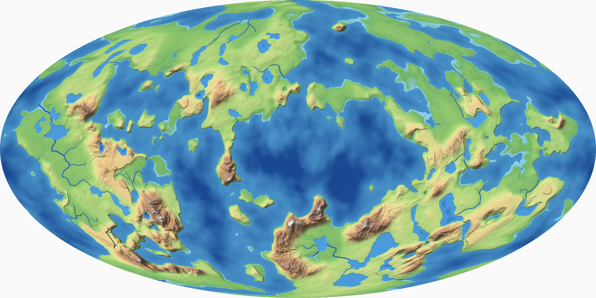

*The whole first world on an equal-area map (Mollweide): heights from the deep sea (dark blue) to 330 m (white), lit from
the north-west. 2,048 pixels for 15.1 km round the equator: 7.4 m a pixel.*

- **Landmass field:** two warped noise fields on the sphere, about 2.6 km and 720 m long, and a small third (210 m) that
  breaks the coast into coves, points and skerries. A warp of about 220 m bends coasts and every border below.
- **Sea cover:** the field's level below which 45 % of 8,192 evenly spread directions lie is the coast, so the sea
  covers the real share (45.3 % measured). The sea lies at height 0, so `SeaRadius` is the radius.
- **Sea floor:** a curve from the coast down: 2 m at 15 m out, 9 m at about 60 m, 28 m at 150 m, 160 m in the deepest
  basins. Swimmers find shallows along most shores.
- **Coast kind:** a field about a kilometre across makes each stretch sandy or rocky. On a sandy coast the land's relief
  rises over about 70 m behind a low shore, and the shore within about 2 m of the sea is beach. On a rocky coast the
  relief rises in a sea cliff of at most 26 m within a few metres, and the rest of it further inland.

## 4. Relief provinces

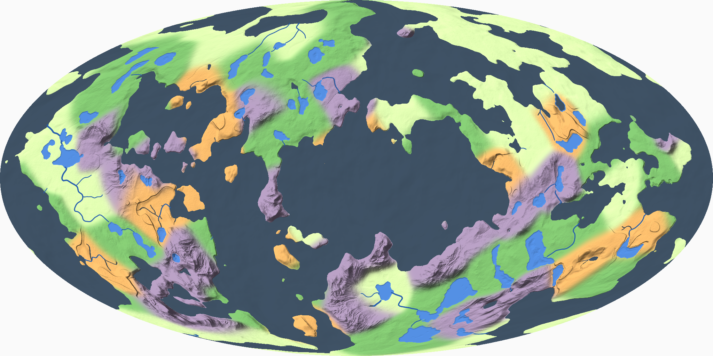

*Relief provinces: plains (pale green), hills (green), tablelands (ochre), mountains (violet); lakes and streams in blue.*

- **Provinces:** 96 points spread evenly over the sphere (about 0.8 km² each; half of them lie under the sea), each of one
  relief type. An uplift field about 3 km long weighs the choice, so mountains and tablelands gather into ranges and
  plains into lowlands.
- **Blending:** every province near a point weighs in by a Gaussian of its distance, normalised, so heights are smooth
  everywhere and a border is about 300 m wide. A nearest-province rule would leave a crease along every border.
- **Plains:** 4 to 9 m above the shore, gentle swells, and kettle hollows up to 4.5 m deep, which hold small lakes.
- **Hills:** eroded noise about 460 m long and 40 m high: smooth slopes, detail on crests and flats.
- **Tablelands:** a plateau 52 m high whose edge is an escarpment, three quarters cliff over a talus slope, with spurs
  and bays; mesas and buttes 30 m high standing on it. Water cuts their canyons (§5).
- **Mountains:** eroded ridged noise about 1.25 km long, up to 400 m, rising toward the massif's middle, with eroded
  detail on the flanks and gullies cut by the drainage.
- **Metre-scale ground:** 0.3 to 1.5 m of noise about 22 m long, rougher on stony and mountain ground.

On the first world: half the land lies under 21 m, 90 % under 78 m, and the highest peak stands about 330 m.

| Measured on the first world | Plains | Hills | Tablelands | Mountains |
|---|---|---|---|---|
| Share of dry land | 29 % | 31 % | 14 % | 25 % |

## 5. Water: streams, lakes, valleys

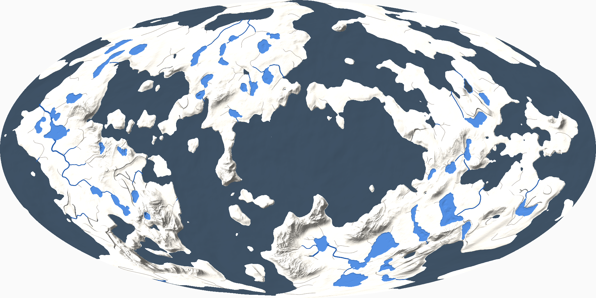

*Streams and rivers (blue, wider as they gather water), lakes, and dry valleys (faint grey).*

Water is worked out once when the world is made, on a drainage grid of the cube sphere (level 7 on the first world:
98,304 cells of about 30 m):

1. **The ground's height** at every cell, without the metre-scale detail.
2. **A priority flood** from every cell under the sea, lowest first. Each cell reached takes the level it was reached at
   (its own height, or the hollow's spill level if that is higher) and drains to the cell it came from. So every cell
   has a way down to the sea, through hollows at their spill level. The heap is ordered by (level, cell), so the result
   is the same on every machine.
3. **Catchments:** the ground each cell drains, summed down the ways in the flood's reverse order.
4. **Lakes:** cells the flood filled above their own height, joined with neighbours filled to the same level. A hollow at
   least 2.5 m deep and 1.5 ha large holds a lake at its spill level. Each lake's shore is a smooth field over its cells
   (a bowl below the water inside, a low lip outside, high ground sloping down to it), so water meets the ground at its
   edge and nothing lower than the lake lies beside it.
5. **The network:** a cell with a catchment of 4 ha or more starts a dry valley; from 0.26 km² water runs in it. Each
   piece goes from a cell to the cell it drains to. Two passes of smoothing and a wander across the way it runs turn the
   grid's eight directions into curves.
6. **Levels, downstream first:** a stream's water lies 0.5 to 2.5 m below its banks, never below the water it runs into,
   so it meets the sea at sea level and a lake at the lake's. A stream leaving a lake starts at the lake's level.
7. **Carving:** the ground near a piece is the lowest of its profiles: a channel (a parabola from the bed to the banks,
   6 to 32 m wide), and a valley that eases from the banks to the ground, up to 150 m from a large river. On tablelands
   the valley's sides are canyon walls (rise 2.6 over 1), on mountains gorge walls (1.1), and the water cuts deeper as
   its catchment grows (up to 28 m and 8 m). Outside every channel, ground lower than a stream's banks beside it is
   raised to them, so its water stays in its channel.

The pieces are found by tile (level 5, 118 m) when a height is asked for. Every way down ends in the sea or a lake by
construction; a test walks every stream from its source to check it, and that its water lies in its channel.

On the first world: 34 streams start (23 run to the sea, 11 into lakes), 12.7 km of streams and rivers, 37 km of dry
valleys, 40 lakes covering 2.2 km² (the largest 26.5 ha and 7.7 m deep). Lakes and streams cover 6.7 % of the land.

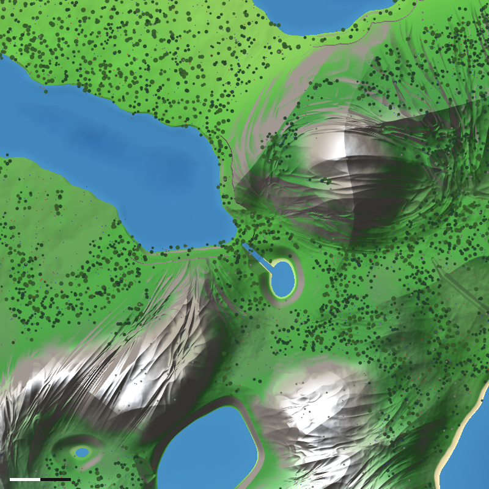

*A river valley, 800 m across: the river leaves a lake (left) between wooded slopes; snow on the mountains (bottom).
Trees are drawn where the scatter puts them. The scale bar is 100 m.*

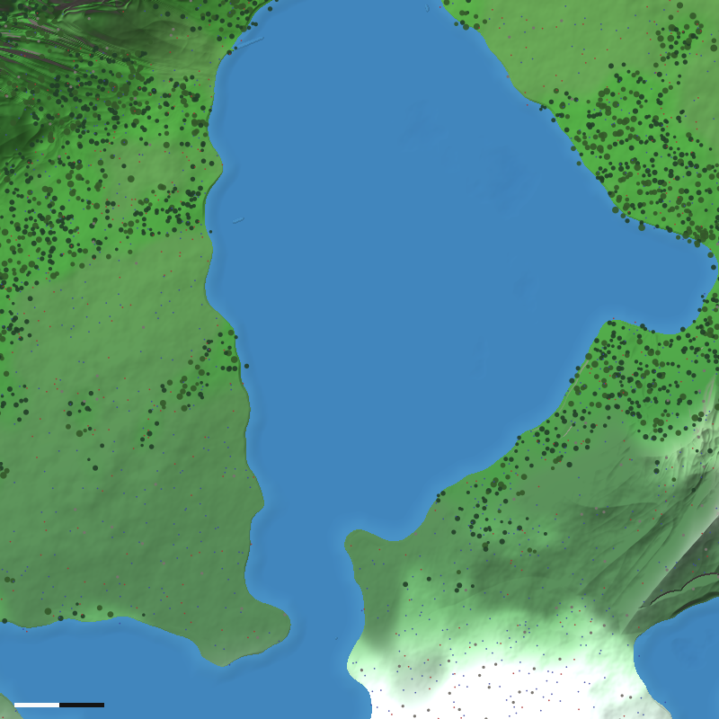

*The largest lake, 26.5 ha, in a basin of tablelands and hills.*

## 6. Climate and biomes

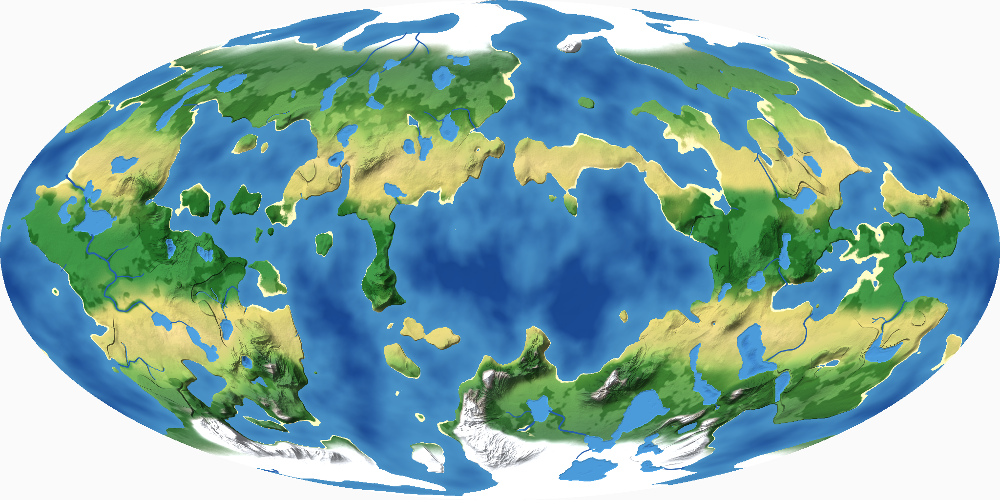

*Biomes, woods darker, snow where it lies.*

- **Temperature:** the planet's real mean (18 °C on the first world), 42 K between the equator and the poles, patches of
  ±3 K a kilometre or two across, and a fall of 6 K a kilometre at **real-equivalent heights**: a game height × 12, so a
  330 m peak is cold like a 4 km one (SCALE.md §3.3). The highest peaks carry snow; at the equator they are cold but bare.
- **Ice:** the temperature below which the real ice cover (8 %) lies, on 8,192 evenly spread directions: ice caps from
  about 67° and on high ground.
- **Moisture:** the real latitude bands (wet tropics, dry subtropics, wet mid-latitudes), patches ±0.3 down to a few
  hundred metres, drier deep inland, wetter in stream valleys and on mountains.
- **Biomes:** the biome table of GROUND.md §4.6, unchanged, read at real-equivalent heights (so alpine ground starts high
  on cold mountains), with beaches on sandy coasts within about 2 m of the sea.

On the first world's dry land: tropical forest 18 %, temperate forest 16 %, boreal forest 15 %, savanna 14 %, shrubland
11 %, ice 10 %, grassland 8 %, beach 4 %, tundra 2 %, alpine 1 %, desert 1 %.

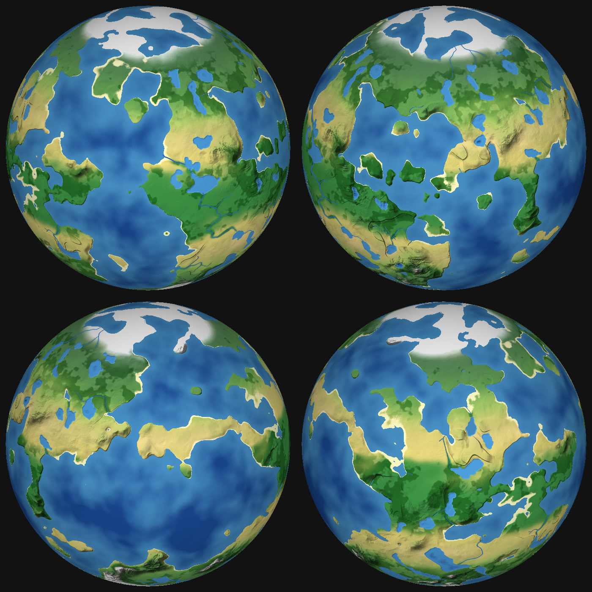

*The first world seen from four sides, 25° north.*

## 7. Woods and the scatter

- **Density:** the biome table's densities times 0.45 in closed stands: about 135 trees a hectare in temperate forest,
  where the playtest had 300 everywhere.
- **Where woods grow:** each relief type has a share of woods (plains 18 %, hills 55 %, tablelands 30 %, mountains 60 %),
  more along streams, in patches about 420 m long with smaller clearings in them, so there are closed stands, edges,
  clearings, meadows and open plains. On the first world 41 % of dry land is wooded, at 29 trees a hectare on average.
- **Open ground for sight lines:** plains are mostly open. The horizon is 90 m on flat ground, so the long views come from
  hills, plateau edges and ridges, which the relief has everywhere.
- **The scatter** is the planet's (`Scatter`), fed by the walking ground (`IScatterField`): tiles at the level nearest
  120 m (level 5, 118 m), candidates spaced in metres as on the planet (trees 3.5 m, bushes 2.4 m, ferns 1.6 m, rocks
  3.2 m, berries 6.4 m, outcrops 12.8 m), so densities per square metre are the planet's. Nothing grows in water. A
  wooded tile has about 800 objects and takes about 6 ms.

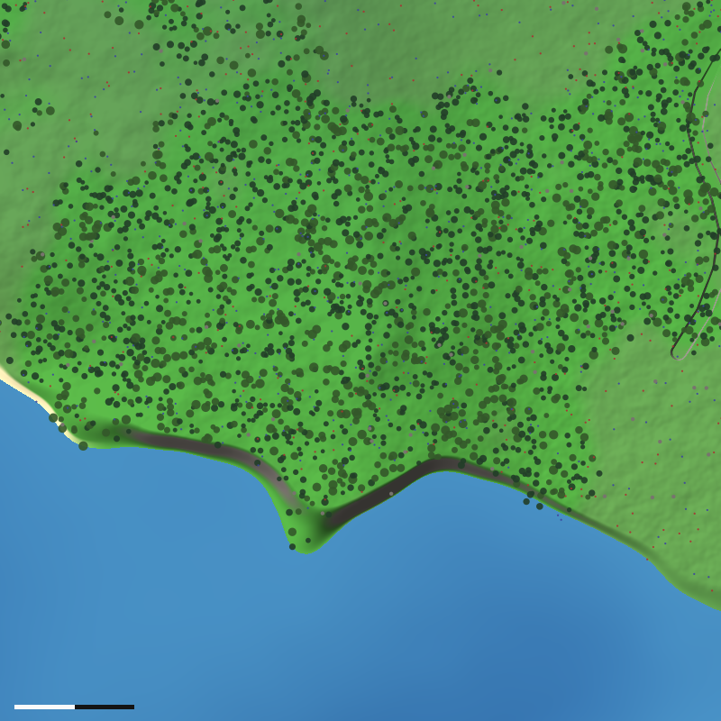

*Wooded hills, 600 m across: stands, edges and clearings; 63 trees a hectare over the square.*

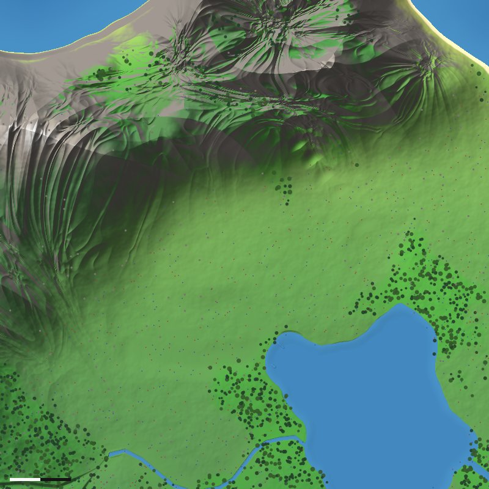

*Open plains under a mountain, a lake and a river, woods at the edges.*

## 8. The scans: a plan

Only 8 of the 34 owned ground sets reach the game today, and none of the 62 scanned cliffs and rocks
(`game/assets/THIRD_PARTY.md`). The walking ground gives each a place. **Before anything ships, each Fab listing's licence
is checked** (the 2 October batch is unchecked); the Poly Haven sets are CC0.

**Ground layers** (today 8 materials, `GroundMaterial`; Proposal: 16, appended, chosen per vertex by biome, slope and
wetness; the client's terrain array takes 16 layers):

| Where | Ground sets (`D:\GameDev\Assets`) |
|---|---|
| Sandy beaches; the swash | `beach_sand_uinladeo`, `beach_sand_with_pebbles_vl0fdilo`; `wet_plain_sand_rldas3p0` |
| Rocky coves and shingle | `beach_gravel_with_pebbles_tbvqegas`, `cracked_nordic_coastal_rock_ukohaj0mw` |
| Meadows, grassland | Dry Grassy Ground (in the game); `wet_grass_ground_sjzkdjba` in wet valleys and on river banks |
| Forest floor | Forest Floor (in the game), `forest_floor_wgyhdgy`; `mossy_ground_tj4ocdjr` in wet woods |
| Boreal forest and tundra | `tundra_mossy_ground_vjulbjjr`, `tundra_rocky_ground_vi2mahnmw`, `tundra_gravel_ground_vjepchymw`, `tundra_lichened_rock_vjbode1mw` |
| Tablelands and canyons, dry country | Canyon Sandstone Rock (Fab), `RedRock02_4K`, `desert_western_ground_dirt_coarse_07`, `desert_western_ground_gravel_coarse_02`, `desert_outback_ground_rocky_06` |
| Desert and savanna sand | `desert_sand_sfilxqh`, `desert_sand_sfiodwh`, `desert_sand_wkjgche`, `desert_western_ground_sand_fine_01` |
| Mountains, scree | Granite Rock and Gravel Ground (in the game) |
| Snow line and snow | Clean Snow (in the game), `icy_snow_on_dry_grass_sjziebea` (the snow line on grass), `melting_snow_uexjbdudy`, `fresh_windswept_snow_uehnaazn`, `sleet_covered_gravel_tb5oaf2s`, `windswept_snowy_stones_tdloaf1r`; `snow_cliff_uhqncfpdy`, `ice_wall_uebjabcr` on steep ice |
| Frozen lakes | `frozen_lake_tcbkdcfr` |

**Cliff and rock meshes** (Proposal: a dressing pass, S4d, places them along the generator's cliffs: the escarpments,
sea cliffs, canyon and gorge walls, where the slope passes 50°; new scatter kinds, appended; with collision):

| Where | Meshes |
|---|---|
| Rocky coasts and sea cliffs | `huge_nordic_coastal_cliff` (two), `massive_nordic_coastal_cliff`, Large Nordic Coastal Cliff (Fab), `coastal_cliff_04`, `coast_rocks_01/02`, `coast_line_01/02` (Poly Haven), `nordic_beach_boulder` |
| Tableland escarpments and canyons | `desert_western_cliff_layered_large_01`, `_xl_04` (also Fab), `_corner_xl_01`, `desert_western_ledge_rock_large_03`, `_medium_01`, `desert_western_rock_*` (six), `namaqualand_cliff_02` (Poly Haven) |
| Forest cliffs and boulders | `nordic_forest_cliff_large`, `nordic_forest_ledge_rock_large`, `nordic_forest_ledge_dirt_root_medium`, `nordic_forest_rock_large`, Forest Boulder (Fab), `rock_moss_set_02` (Poly Haven) |
| Mountains | `mountainside` (Poly Haven), `large_tundra_rock_formation`, `massive_tundra_rock_formation`, `tundra_rock_formation` |
| Tundra and snow | `tundra_*` boulders and stones (seven), `ice_cliff`, `large_ice_cliff`, `snowy_rocks_pile`, `rocky_snow_pile`, `snow_embankment` (two), `huge_snow_hill` |
| Scree at a cliff's foot | `small_stones_pack`, `rounded_cobble_pack`, `desert_western_pile_dirt_rock_small_01` |

The scanned plants (`*_ue_high`: bilberry, bracken, crowberry, dwarf birch and others) stay out: plants are made in code,
and grass is a shader system.

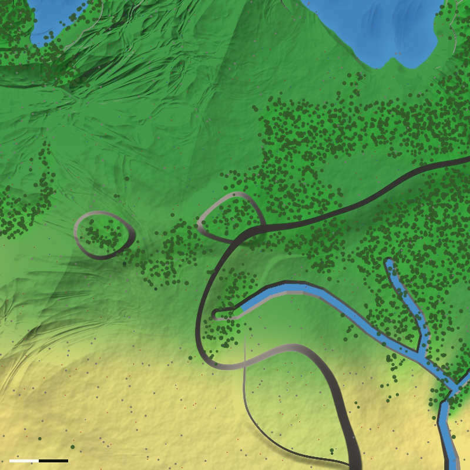

*A tableland, 800 m across: an escarpment, buttes, and a river in a canyon with steep walls.*

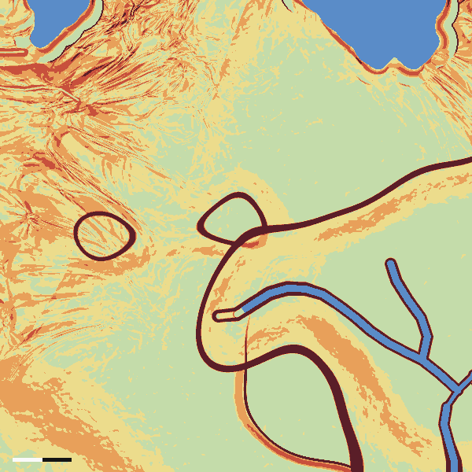

*The same ground by slope: under 8° (pale green), 8–20° (yellow), 20–35° (orange), 35–50° (red), cliffs over 50°
(dark red). Cliffs are where the meshes go.*

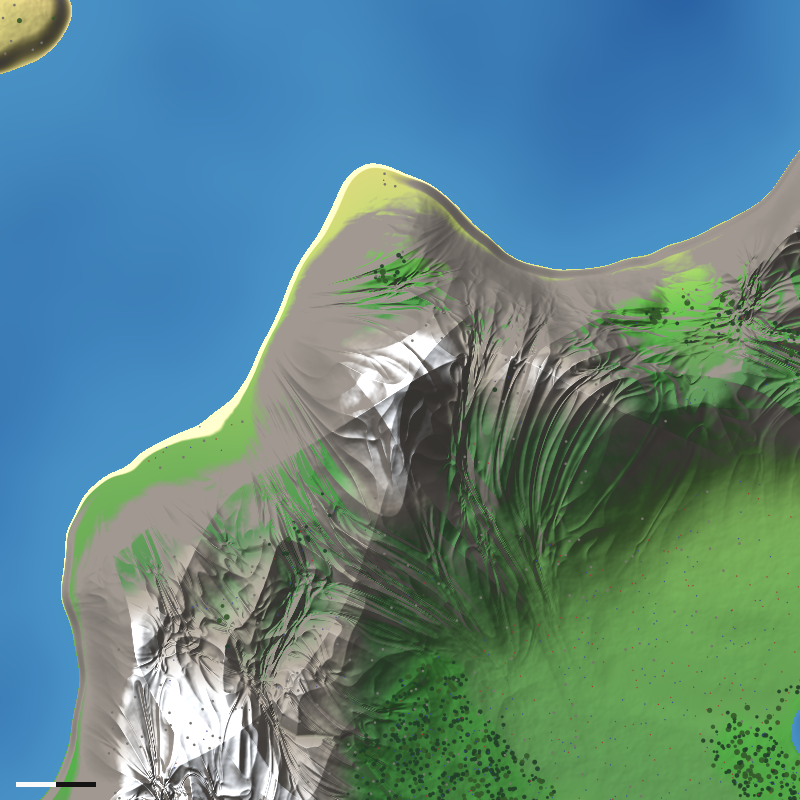

*The highest mountain, 1 km across: ridges and gullies, snow, a tarn, a sea cliff along the coast.*

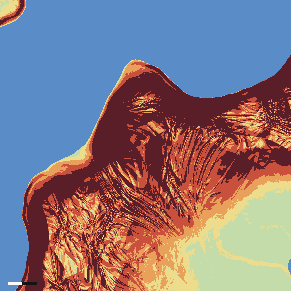

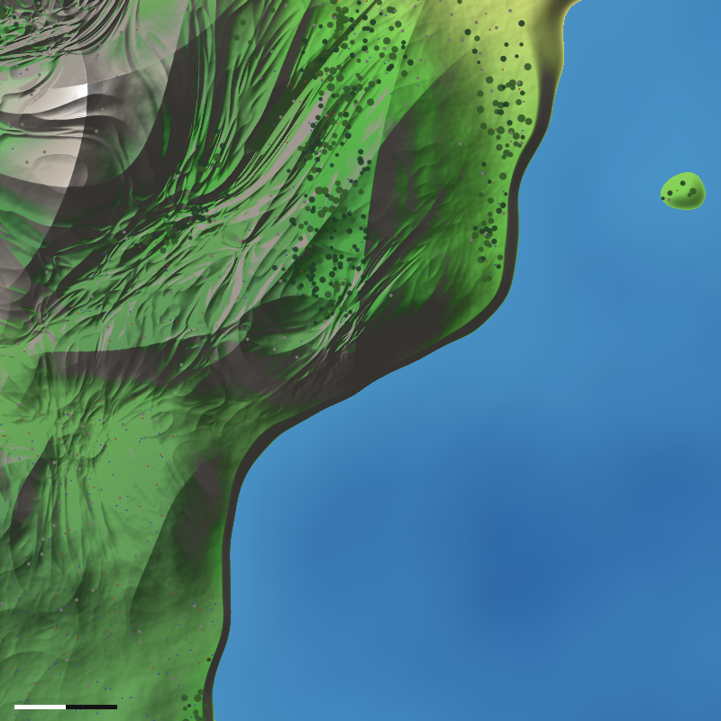

*A rocky coast under hills: the sea cliff is the dark band along the shore.*

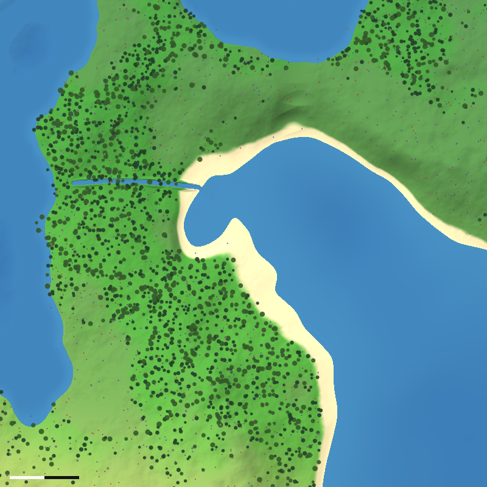

*A sandy bay with its beach; a stream crosses the isthmus.*

## 9. The interface

`WalkingWorld` is an `ISurface` and an `IScatterField`:

| | |
|---|---|
| `Radius`, `SeaRadius` | The game radius (2,410 m on the first world); the sea at height 0 |
| `HeightAt(direction)` | The ground, with channels, valleys, canyons and lakes' bowls cut in |
| `WaterLevelAt(direction)` | **New on `ISurface`** (default: the sea's level wherever there is a sea): the sea, a lake's level over its hollow, a stream's surface in its channel, or −∞. The water probe (`GroundProbe.InWater`) asks it, so lakes and streams are water for swimming and falling |
| `BiomeAt(direction)` | The biome table at real-equivalent heights, with beaches |
| `GroundCollision(frame, tile, margin)` | `ISurface`'s default grid of about a metre (`SurfaceGrid`) |
| `ScatterFor(tile)` | The scatter at its level by size (`ScatterPlan`) |
| `Fields(direction)` | Everything at a point (`WalkingSample`): height, water, landmass, the four relief weights, rocky coast, roughness, nearness to a stream |
| `Climate`, `BiomeWeights`, `Vegetation`, `ForestCover`, `MeanTemperature` | As on `PlanetSurface`, for the client's materials and the tools |
| `Lakes`, `Drainage` | The lakes and the network's pieces, for the map and the tools |
| `LandingSite` | Where players land (§11) |

- **Deterministic** (ARCHITECTURE.md §8): `DMath`, `Hash64`, `Rng` and the surface's gradient noise; `ArchitectureTests`
  scans the folder. The world is a pure function of the body's seed (`WalkingWorld.SeedFor(ZoneSpec.SurfaceSeed)`, with
  `WalkingWorld.Version` in it), its game radius and its real sea cover, ice cover and mean temperature. The drainage is
  worked out with a heap ordered by (level, cell) and sums in a fixed order; its heights are sampled on worker threads,
  each into its own slot.
- **The noise's basis:** Perlin's twelve edge gradients each have a zero component, so about one lattice edge in seven
  carries noise that is exactly zero along its whole length. Ridged noise, creases and thresholds near zero turn those
  into straight lines hundreds of metres long at walking scale (they were the first renders' worst fault). The walking
  ground uses the cube's eight corners as gradients instead (`NoiseBasis.Corners`). The planet keeps Perlin's, so its
  golden values are unchanged.
- **The numbers** are one table, `WalkingParameters`: every length, height, share and threshold of this document (§14).
- **Shared:** `WalkingWorlds` builds one world per body and radius in a process, as `PlanetSurfaces` does: a server, the
  host's client and a hundred bots draw from one.

## 10. Cost

Measured on the first world (one thread, warmed up, the best of three runs; the stand-in for comparison):

| | Walking ground | Stand-in |
|---|---|---|
| A height | 1.8 µs | 0.6 µs |
| A physics tile (level 6, 59 m, a metre grid, 2 m margin) | 11 ms | 3 ms |
| Building the world (both the server and every client) | 0.4–0.5 s | under 10 ms |
| Memory | about 11 MB (the drainage grid) | none |
| A scatter tile (level 5, a wooded one) | 6 ms, about 800 objects | — |

The real planet's surface costs 3.7 µs a height. The server builds collision tiles all the time on workers (S3b held
arrivals until their ground was built), so a tile at 11 ms instead of 3 ms is the one cost to watch. A first check ran
10 bots on beaches all round the walking ground for 15 s: the server's tick 0.73 ms on average, 2.1 ms at the 99th
percentile, nobody disconnected, prediction 0.016 mm off on average. It also showed the server's scatter cache (384
tiles, sized for the planet's level) making 4,209 scatter tiles in the run: it needs sizing for level 5.

**Plan (S4b, Default):** a target of 1 µs a height and 5 ms a tile, by
- sampling the slow fields (landmass, warp, provinces, plateaus, massifs: about half the cost) on a fixed lattice of the
  cube sphere, about 15 m, when the world is made, and interpolating them (the same lattice on every machine, so heights
  stay a pure function of the direction);
- keeping the heights of recent collision grids, shared by neighbouring tiles (as `PlanetSurface` does, GROUND.md §5.11);
- the scatter cache by size;

then S3b's load tests with 100 bots on the walking ground, which must hold their numbers (GROUND.md §5.12).

## 11. What changes when it goes live

- **Golden values:** a new one for the walking ground (`WalkingWorldTests`, 0x9992D00861B4D96D), moved on purpose with
  any change to the generator or its table. The planet's and the stand-in's stay. The movement check stays on the plain
  sphere.
- **Saves:** positions and bases saved on the stand-in mean nothing on the new ground. Going live wipes the world's rows
  once (a schema step, as schema 7 did; accounts and teams stay; characters start a new life).
- **The landing site:** chosen again (SCALE.md §4.8). The generator picks it (`LandingSite`): a meadow 5 to 25 m above
  the sea at a forest's edge, near the coast and a stream, in the temperate belt nearest 45°, off the mountains. On the
  first world it is 53.13° S, 17.94° E, between a lake and two streams, mountains to the south. `FirstWorld`'s landing
  latitude and longitude move there; until then a server on the walking ground at the default site uses it.
- **Arrivals:** beaches all round the world, as now (WHOLE_WORLD.md decision 8); sandy coasts give them (4 % of dry land is
  beach). Beaches lie only by the sea, but the search (`Beaches`) should also skip ground under `WaterLevelAt` (to do in
  S4e).
- **Nature IDs:** the scatter's (`ScatterNaturalObjects`: tag, face, tile X and Y at level 5, kind, candidate), not the
  stand-in's tag-0x5A IDs. Overrides saved under the old IDs go with the wipe.
- **Loot clusters and recyclers:** found as now (coast, forest edge, open), on the new ground; the six recyclers stand on
  each cube face's best coastal spot. They move with the ground.
- **Animals:** spawn areas read biomes and heights through `ISurface`, as now. The nav grid still reads only the sea
  (`NavGrid`: `SeaRadius`); it moves to `WaterLevelAt` in S4e so animals keep out of lakes and streams.
- **The map:** its picture's cache key names the ground and its version. S3d's globe draws `HeightAt`, `BiomeAt` and
  `WaterLevelAt`.
- **Monuments (M3):** placed on the new ground, on flat or tableland sites.
- **The client (S4c, needs S3c):** terrain materials from biome weights, slope and wetness (§8); water surfaces for lakes
  (flat, at their level) and streams (their surface along the channel), drawn on the terrain's tiles as the sea is.

## 12. The switch (built)

The game can stand on the walking ground today, off by default:

- **Server:** `dotnet run --project src/Hollow.Server -- --ground walking` (or `--ground stand-in`, the default).
- **The game:** `play-ground.cmd --ground walking` hosts a game on it (the option goes to the hosted server); joining
  players get the ground with the zone.
- **Bots:** `dotnet run -c Release --project tools/Hollow.Bots -- loadtest ... --ground walking`.
- **How:** `ZoneSpec.Ground` (`GroundKind`: the stand-in or the walking ground) is the one switch; `CreateSurface`
  picks the surface and `CreateNature` the scatter's natural objects by it. `ZoneInfo.Ground` carries it to clients
  (protocol 24). A server on the walking ground left at the default latitude and longitude lands players at its
  `LandingSite`.
- **Until S3c** the client still draws the ball as before, so a hosted game on the walking ground shows the new heights
  with today's terrain materials and no lake or stream water drawn. The ground-level look-dev shots in Godot (a valley
  with a river, a coast, a cliff, a mountain with snow, a forest edge and a plain) wait for S3c.

## 13. Order of work after approval

| Step | What | Check |
|---|---|---|
| S4a | Built: the generator, its test, the look-dev report and the switch | This document's pictures; `WalkingWorld` tests; 10 bots on the ground |
| S4b | Speed (§10): the slow fields on a lattice, shared collision heights, the scatter cache by size | S3b's load tests with 100 bots on the walking ground |
| S4c | The client draws it (after S3c): materials from biomes, slope and wetness with the scan sets of §8, lakes' and streams' water, the plants by the new scatter | The six Godot look-dev shots of §12 and the frame time |
| S4d | Cliffs and rocks: the scanned meshes along cliffs, sea cliffs, canyon and gorge walls, with collision | Shots of each; the load test |
| S4e | Live: the default ground, the landing site, the wipe, the golden values, the docs | The owner's playtest |

## 14. The table of numbers

`WalkingParameters` (`src/Hollow.Surface/Walking/WalkingParameters.cs`) holds every number above. The generator report can
change any of them for one run, to compare pictures: `HOLLOW_WALKING="StreamCatchment=150000;LakeMinArea=30000"`.

| Group | Numbers (defaults) |
|---|---|
| Landmasses | `ContinentWavelength` 2,600 m, `IslandWavelength` 720 m, `IslandShare` 0.32, `CoastDetail` 0.035 at 210 m, `WarpWavelength` 1,500 m, `WarpReach` 0.09 rad |
| Coasts | `CoastKindWavelength` 950 m, `SandyShoreRamp` 0.1, `RockyShoreRamp` 0.012, `SeaCliffHeight` 26 m |
| Provinces | `Provinces` 96, `ProvinceBlend` 300 m, `UpliftWavelength` 3,000 m, shares 0.30 / 0.34 / 0.16 / 0.20 |
| Relief | `PlainsHeight` 7 m, `KettleDepth` 4.5 m, `HillsHeight` 44 m at 460 m, `PlateauHeight` 52 m, `MesaHeight` 30 m, `CliffShare` 0.75, `MountainHeight` 400 m, `RidgeWavelength` 1,250 m, `RidgeWarp` 110 m, `MountainDetail` 0.12, `GroundDetail` 0.3 m, `StonyDetail` 1.2 m |
| Water | `DrainageCell` 30 m, `ValleyCatchment` 4 ha, `StreamCatchment` 0.26 km², `LakeMinDepth` 2.5 m, `LakeMinArea` 1.5 ha, stream half-width 3 m (+2.2 a size), drop 0.8 m, depth 0.9 m, valley 45 m (+22), dry valley 26 m, `Meander` 0.35 cells, `RuggedValleyFade` 0.3, `CanyonDepth` 28 m at 0.25 km², `CanyonWall` 2.6, `GorgeDepth` 8 m, `GorgeWall` 1.1 |
| Climate | `RealHeightFactor` 12, `LapseRate` 6 K/km, `EquatorToPole` 42 K, patches ±3 K and ±0.3 at 1,700 m |
| Plants | `TreeDensityScale` 0.45, woods 0.18 / 0.55 / 0.30 / 0.60, `WoodsWavelength` 420 m, `ScatterTile` 120 m |

## 15. Tools

`dotnet run -c Release --project tools/Hollow.GeneratorReport -- walking <command>`:

| Command | What |
|---|---|
| `stats` | Speed, sea cover, heights, relief and biome shares, woods, streams and lakes, a scatter tile |
| `relief`, `biomes`, `rivers`, `provinces` `[png] [width]` | A whole-world equal-area map |
| `globe [png] [size]` | Four views of the globe |
| `zoom lat lon metres [png] [size]` | A close-up at walking scale, with the scatter's trees, outcrops and berries drawn |
| `slopes lat lon metres [png] [size]` | A close-up by slope class |
| `spots` | Places for close-ups: the highest peak, a river valley, a rocky coast, a beach, a tableland, the largest lake, a plain, the landing site, wooded hills |
| `closeups [folder]` | Every spot's close-up |
| `compare [png]` | Today's stand-in above the walking ground |
| `all [folder]` | The whole set, by default into `docs/images/scale/s4` |
| `probe lat lon metres size x0 row x1` | The fields along a row of a close-up's pixels (a negative `x0` probes a column), for finding faults |

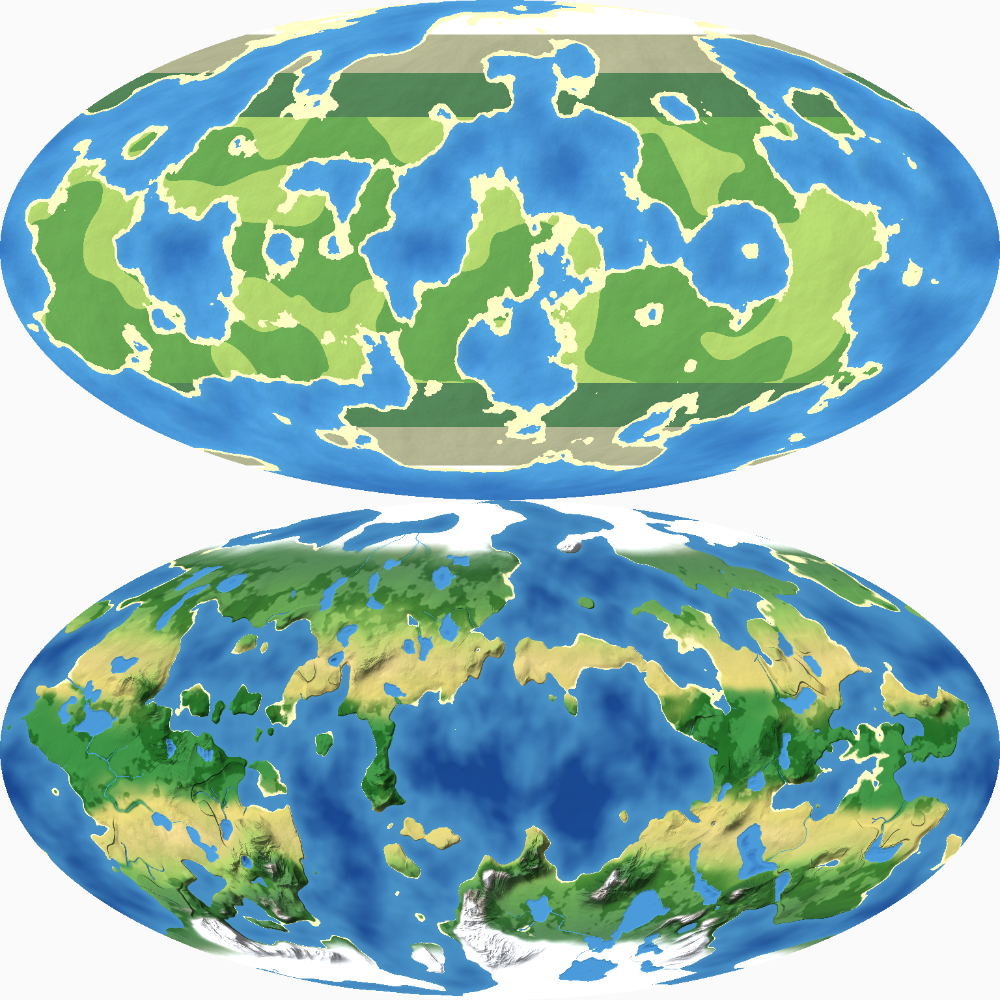

*Today's stand-in (top: continents, latitude stripes, no water inland) and the walking ground (bottom), the same
projection.*

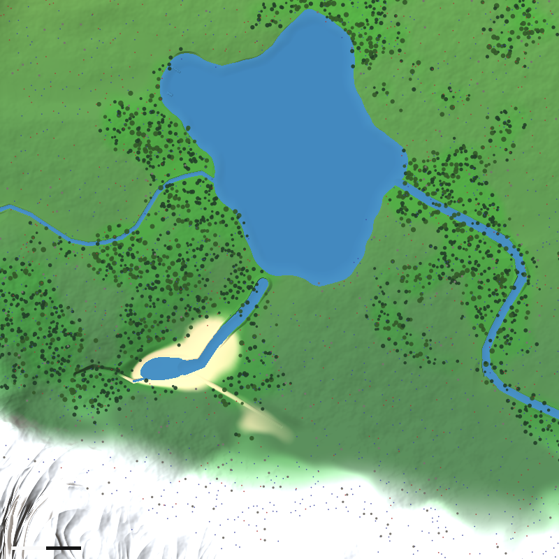

*The landing site the generator picks, 800 m across.*

## 16. Found while building

- **Straight lines from the noise.** Ridged noise on Perlin's gradients drew ruler-straight ridgelines along lattice
  edges where the noise is exactly zero (§9). Fixed by a second gradient basis for the walking ground.
- **Creases along province borders.** Weights from the nearest province (a minimum) kink along the borders, and the
  provinces' amplitudes then crease there. Fixed by normalised Gaussian weights.
- **A missed tile.** The drainage's pieces are found by tile; `TileKey.Around` samples a third of a tile apart, so a
  piece's reach could clip a tile no sample fell in, leaving a step. Fixed by one more step of reach; a test walks
  100,000 points 5 cm apart and finds no step over 0.4 m.
- **Perched water.** A lake's outlet valley cut its rim below the lake's level, and a stream crossing a hollow could stand
  above the ground beside its channel. Fixed by lakes' shapes with a lip, outlets at the lake's level, and banks.
